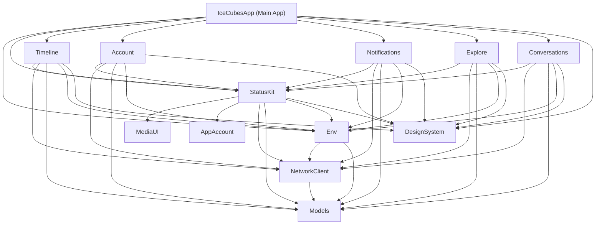

# IceCubesApp Architecture & Technical Stack Report

## Executive Summary

**IceCubesApp** (also known as *Ice Cubes for Mastodon*) is a premier, open-source, multiplatform client for the decentralized social network [Mastodon](https://joinmastodon.org/). Created by Thomas Ricouard and maintained by the open-source community under the **AGPL v3** license, the application is written **100% in Swift and SwiftUI**, targeting **iOS, iPadOS, macOS (Mac Catalyst & native Apple Silicon), and visionOS**.

IceCubesApp stands out as an exemplary real-world SwiftUI codebase. It showcases modern Apple framework patterns including modular Swift Package Manager (SPM) architecture, Swift Concurrency (`async/await`, `Task`, `Actor`), Apple's `@Observable` observation framework, push notifications via custom APNS proxy, and multi-account state handling.

---

## Technical Stack & Key Dependencies

### Core Languages & Apple Frameworks
* **Language**: Swift 5.10 / 6.0
* **UI Framework**: SwiftUI (100% declarative UI across iOS, iPadOS, macOS, visionOS)
* **Observation & State**: `@Observable` macro framework (replacing legacy `Combine`/`ObservableObject`)
* **Concurrency**: Swift Concurrency (`async/await`, structured concurrency, actors)
* **System Integration**:
  * `WidgetKit` — Timeline, Mentions, and Account widgets
  * `UserNotifications` & `Intents` (`INSendMessageIntent`) — Rich notifications with contact avatars
  * `AppIntents` — Siri Shortcuts & system integrations
  * `AVFoundation` — Audio/video playback and video media compression

### Local Data Storage & Caching
* **Bodega**: Lightweight SQLite-backed caching library used to persist the home timeline and post drafts locally.
* **KeychainSwift**: Secure encryption and storage of user OAuth tokens and account credentials.
* **UserDefaults / iCloud Key-Value Store**: Storage of user preferences, tag groups, remote timeline configurations, and reading position markers.

### External Open-Source Libraries (SPM)
* **Nuke / NukeUI**: High-performance image loading, caching, and downsampling pipeline (`LazyImage`, `LazyResizableImage`).
* **SFSafeSymbols**: Type-safe interface for Apple's SF Symbols.
* **SwiftUI-Introspect**: Introspects underlying `UIKit`/`AppKit` components when native SwiftUI customization APIs are unavailable.
* **LRUCache**: Thread-safe Least-Recently-Used in-memory cache for status embeds.
* **WrappingHStack**: Flow layout for tags, polls, and badges.
* **ButtonKit**: Primitive for async buttons with automatic loading & disabled state indicators.

### Integrations & Third-Party APIs
* **Mastodon REST & Streaming APIs**: Full implementation of Mastodon REST endpoints and WebSockets / Server-Sent Events (SSE) streaming for real-time timeline updates.
* **OpenAI API**: AI-assisted post editing, automated alt-text/image description generation, and hashtag recommendations.
* **DeepL API**: In-app translation of posts and profile bios.
* **RevenueCat (`purchases-ios-spm`)**: Management of in-app tipping and "Supporter" tier entitlements.
* **TelemetryDeck (`SwiftSDK`)**: Privacy-conscious, lightweight analytics tracking app launches and feature usage.
* **WishKit**: User feature request and feedback system.

---

## Codebase Architecture & Modular SPM Design

IceCubesApp is architected as a **modular multi-package workspace**. Core app features and layers are segregated into **13 internal Swift Packages** housed within the `/Packages/` directory.

```
IceCubesApp/
├── IceCubesApp.xcodeproj           # Main Xcode Project
├── IceCubesApp/                    # App Target & Entrypoint
│   ├── App/
│   │   ├── Main/                   # IceCubesApp.swift & AppView.swift
│   │   ├── Router/                 # Central RouterPath navigation system
│   │   └── Tabs/                   # Navigation Tab Definitions
├── Packages/                       # 13 Modular Swift Packages
│   ├── Account/                    # User profile views & account settings
│   ├── AppAccount/                 # Account selection & Keychain state
│   ├── Conversations/              # Direct Messages (DM) interface
│   ├── DesignSystem/               # Themes, typography, dynamic icons
│   ├── Env/                        # Global state & dependency injection
│   ├── Explore/                    # Discovery & trending feeds
│   ├── Lists/                      # Mastodon list management
│   ├── MediaUI/                    # Media viewer, zoom & video playback
│   ├── Models/                     # Data models & Codable Mastodon structs
│   ├── NetworkClient/              # Network layer, REST & Streaming APIs
│   ├── Notifications/              # In-app notifications & rich alerts
│   ├── StatusKit/                  # Post row UI, Editor & Composer
│   └── Timeline/                   # Home, Local, Federated & Remote feeds
└── App Extensions/
    ├── IceCubesAppWidgetsExtension/ # Home/Lock Screen Widgets
    ├── IceCubesNotifications/      # APNS Rich Notification Service Extension
    ├── IceCubesShareExtension/      # iOS System Share Sheet
    ├── IceCubesActionExtension/     # Quick Action Extension
    └── IceCubesAppIntents/          # Siri & App Intents
```

---

## Deep-Dive into Internal Swift Packages (`Packages/`)



### 1. `Models`
* **Purpose**: Houses pure data structs, enums, and `Codable` representations of Mastodon entities.
* **Key Entities**: `Status`, `Account`, `Notification`, `Tag`, `Poll`, `MediaAttachment`, `Filter`, `Instance`, `Card`, `Conversation`.

### 2. `NetworkClient`
* **Purpose**: Low-level HTTP client (`Client`), OAuth login handler, SSE/WebSocket streaming client (`StreamWatcher`), OpenAI client, and DeepL API integration.
* **Key Components**: `Client.swift`, `Endpoint.swift`, `StreamWatcher.swift`, `OpenAIClient.swift`.

### 3. `Env`
* **Purpose**: Core business logic, global environment dependencies, and shared state across packages.
* **Key State Services**:
  * `AppAccountsManager`: Manages active accounts, persistent account switching, and Keychain credentials.
  * `CurrentAccount`: Holds profile data, followings, blocks, and mutes for the logged-in user.
  * `CurrentInstance`: Stores instance configuration, custom emoji sets, and character limit rules.
  * `UserPreferences`: Global settings (font sizes, swipe actions, sound effects, layout choices).
  * `Theme`: Theme management (40+ app icons, custom accent colors, dark mode styles).
  * `RouterPath`: Programmatic navigation stack management for SwiftUI views.
  * `PushNotificationsService`: Handles APNS device token registration and push settings.

### 4. `DesignSystem`
* **Purpose**: Reusable visual components, design tokens, custom buttons, avatar views, badges, and color themes.
* **Key Features**: Multi-theme palette support, dynamic font scaling, custom loading spinners, and app icon switcher logic.

### 5. `StatusKit`
* **Purpose**: Everything related to displaying, composing, editing, and interacting with posts (*Statuses*).
* **Key Components**:
  * `StatusRowView`: The primary post rendering component (handles text formatting, mentions, media grids, polls, quote posts, and action buttons).
  * `StatusEditor`: Feature-rich composer supporting up to 5-post threads, 4 media uploads, AI text editing/alt-text generation, content warnings, custom emojis, and draft saving.

### 6. `Timeline`
* **Purpose**: Feeds and post streams (Home, Local, Federated, Trending, Remote, Hashtag, and User Lists).
* **Key Features**: Timeline caching via `Bodega` SQLite engine, reading position restoration using Mastodon Marker API, streaming updates, and unread post counters.

### 7. `Account`
* **Purpose**: User profile screens, follower/following lists, relationship management (follow, block, mute), profile bio translation, server-side note editing, and account settings.

### 8. `AppAccount`
* **Purpose**: Lightweight model representing stored account credentials (`oauthToken`, instance domain, profile metadata) for multi-account management.

### 9. `Notifications`
* **Purpose**: Displays user notification streams (mentions, boosts, favorites, reblogs, new followers) with inline grouping and account routing.

### 10. `Explore`
* **Purpose**: Discovery feed displaying trending tags, users, popular posts, links, and search interface with activity charts.

### 11. `Conversations`
* **Purpose**: Direct Messages (DM) interface with instant messaging layout and quick inline composer.

### 12. `Lists`
* **Purpose**: Interface to view, create, edit, and manage custom Mastodon user lists.

### 13. `MediaUI`
* **Purpose**: Fullscreen media viewer supporting multi-touch zoom, video controls, gallery navigation, and image sharing.

---

## Architectural Evolution & Design Patterns

### Modern SwiftUI Architecture (No ViewModels)
IceCubesApp has transitioned from legacy MVVM patterns towards modern **SwiftUI-native data flow**:
* **Direct State Binding**: Ephemeral UI state uses `@State` and `@Binding`.
* **Service Injection via `@Observable`**: Shared managers (`AppAccountsManager`, `Theme`, `CurrentAccount`) are annotated with `@Observable` and injected down the view hierarchy using SwiftUI's `.environment(...)`.
* **Async Lifecycle Tasks**: Native `.task` and `.refreshable` view modifiers trigger asynchronous data fetching.
* **No Unnecessary Abstractions**: Eliminates boilerplates by exposing clean async calls directly to SwiftUI views.

---

## Key App Extensions & Platform Adaptations

1. **`IceCubesAppWidgetsExtension`**: Native `WidgetKit` support providing Home Screen and Lock Screen widgets for home timeline feeds, mentions, and account quick access.
2. **`IceCubesNotifications` (`NotificationServiceSupport`)**: Device-side APNS notification payload decryption and rich notification formatting with `INSendMessageIntent` contact pictures.
3. **`IceCubesShareExtension`**: Enables users to share links, text, images, or videos directly into the IceCubes post editor from any iOS app.
4. **Platform Adaptations**:
   * **iOS / iPadOS**: Adaptive split-view navigation with customizable tab bar and sidebar options.
   * **macOS**: Native multi-column layout with sidebar navigation, macOS menu commands (`IceCubesApp+Menu.swift`), and keyboard shortcuts.
   * **visionOS**: Spatial computing layout with semi-transparent glassmorphism aesthetics.

---

## Developer Setup & Build Commands

### Configuration Setup
Before building, developers must copy `IceCubesApp.xcconfig.template` to `IceCubesApp.xcconfig` and configure code signing settings:
```bash
cp IceCubesApp.xcconfig.template IceCubesApp.xcconfig
```

### Build & Testing Commands
```bash
# Code Formatting (SwiftFormat)
swiftformat .

# Building for iOS Simulator via xcodebuild
xcodebuild -project IceCubesApp.xcodeproj -scheme IceCubesApp -destination 'platform=iOS Simulator,name=iPhone 16 Pro' build

# Running Package Unit Tests
xcodebuild -project IceCubesApp.xcodeproj -scheme AccountTests -destination 'platform=iOS Simulator,name=iPhone 16 Pro' test
xcodebuild -project IceCubesApp.xcodeproj -scheme TimelineTests -destination 'platform=iOS Simulator,name=iPhone 16 Pro' test
```

---

## Summary Matrix

| Metric / Dimension | Specification / Details |
| :--- | :--- |
| **Primary Platforms** | iOS 17+, iPadOS 17+, macOS 14+, visionOS 1.0+ |
| **UI Framework** | 100% SwiftUI |
| **State Paradigm** | `@Observable` + `@Environment` + `@State` |
| **Package Structure** | 13 Modular Swift Packages (`Packages/`) |
| **Database / Cache** | `Bodega` (SQLite) + `UserDefaults` |
| **Credential Security** | `KeychainSwift` |
| **Image Pipeline** | `Nuke` / `NukeUI` |
| **AI Integration** | OpenAI (GPT text polish, alt-text generation, tag discovery) |
| **Translation** | DeepL API & Mastodon Server Translation |
| **License** | AGPL v3 (Open Source) |
