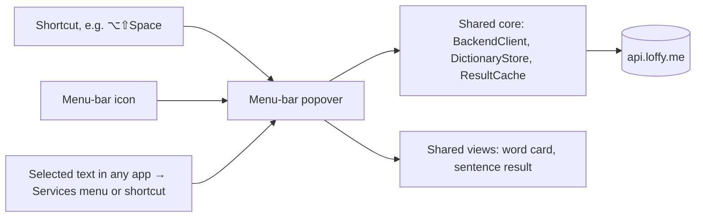
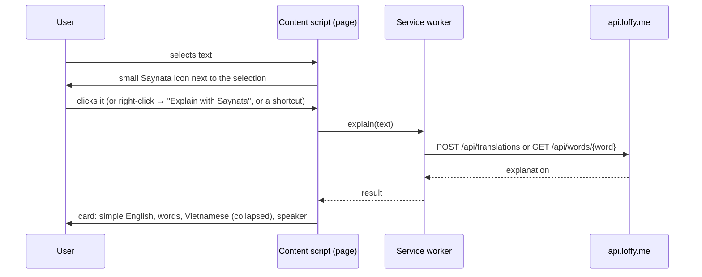

# Plan: Mac menu-bar app and browser extension

> Status: **plan, nothing built.** Written 2026-10-15 after the developer asked for (1) Saynata on macOS, opened with a shortcut and living in the menu bar, and (2) a browser extension to explain text on web pages. Decisions go to doc-7 when the developer picks.

Both keep the product rule (CLAUDE.md): the simple English explanation first, words next, the target language last and collapsed. Both call the same backend (`POST /api/translations`, `GET /api/words/{word}`), so no backend logic is new.

## Part 1. Mac app in the menu bar

### Options

| Option | What it is | Menu bar + global shortcut | Work |
|---|---|---|---|
| A. "Designed for iPad" | The iPhone app runs as-is on an Apple Silicon Mac | No | None |
| B. Mac Catalyst | The iOS target built for Mac with UIKit | Hard (AppKit bridge needed) | Medium |
| **C. Native macOS target (recommended)** | A new SwiftUI macOS target in the same project that shares the app's code | Yes: `MenuBarExtra` + a hotkey | Medium |

**Recommendation: C.** SwiftUI's `MenuBarExtra` (macOS 13+) gives a menu-bar icon that opens a small window. A global shortcut needs a tiny package. The app already has plain SwiftUI views and no UIKit in the core, so most code can be shared.

### How it works

### Steps

1. **Share the code.** Move the platform-free parts into a local Swift package (`SaynataCore`): models (`WordEntry`, `Explanation`), `BackendClient`, `DictionaryStore` and the bundled `dictionary.sqlite`, `ResultCache`, `MediaFileCache`, `SpeechPlayer` (`AVSpeechSynthesizer` works on macOS). Then the views that are pure SwiftUI (word card, sentence result, design system). The iOS app and both extensions import the package. Doing this first is safe on its own: no behaviour changes, and the iOS tests must still pass.
2. **macOS target** (macOS 15, so the Apple Translation framework is there for the target-language row): a `MenuBarExtra(.window)` with the input box on top and the result below, about 420×560 pt. No Dock icon (`LSUIElement`). Optional "Open window" for a bigger view.
3. **Global shortcut.** Use the [KeyboardShortcuts](https://github.com/sindresorhus/KeyboardShortcuts) package (MIT). The user sets the keys in Settings, default ⌥⇧Space. The shortcut opens the popover with the cursor in the box.
4. **Explain selected text.** Two ways:
   - A **Services menu** item "Explain with Saynata" (right-click → Services). It works in most apps and needs no permission. Do this first.
   - "Shortcut explains the selection" needs Accessibility permission to read the selected text. Later, and optional.
5. **Launch at login** with `SMAppService` (a toggle in Settings).
6. **Run it.** With a free Apple ID you can build and run it on your own Mac ("Sign to Run Locally"). Giving it to other people needs a paid account for notarization.

### Risks

- Code sharing touches many files. Do step 1 as its own PR before any Mac code.
- `MediaFileCache` and the App Group paths differ on macOS. The cache already falls back to its own folder.
- The Apple Translation download prompt looks different on macOS 15. Check it.

## Part 2. Browser extension

### Options

| Option | Browsers | Notes |
|---|---|---|
| **A. Chromium MV3 extension (recommended first)** | Brave (the developer's browser), Chrome, Edge, Arc | Load it unpacked for free. The Chrome Web Store is a one-time $5 fee |
| B. Safari Web Extension | Safari on Mac, iPhone and iPad | Must ship inside a Mac or iOS app. Apple can convert an MV3 extension (`xcrun safari-web-extension-converter`) |

**Recommendation:** build one Manifest V3 extension in TypeScript (a new `extension/` folder, Vite), test it in Brave, then convert it for Safari once the Mac app exists (Safari extensions ride inside an app).

### How it works

### Steps

1. **Skeleton:** `manifest.json` (MV3) with a content script, a service worker, a context-menu item, a keyboard command, and `host_permissions` for `https://api.loffy.me/*`. Fetching from the service worker with host permissions needs no CORS change on the backend.
2. **Card UI** inside a Shadow DOM, so page styles can't break it. It reuses Saynata's colours and the icon-only buttons (CLAUDE.md). One word goes to `/api/words`, more than one to `/api/translations`, the same split as the app.
3. **Speak** with the Web Speech API (`speechSynthesis`), no backend.
4. **Settings popup:** target language, and the "Show translation" mode (Collapsed / Always open / Remember), the same as the app.
5. **Build and test** with Vitest for the parts that aren't UI, and load it unpacked in Brave. CI job: build and test.
6. **Safari later**, through the converter, inside the Mac app from Part 1.

### Risks and backend work

- **Abuse:** an extension makes the public API easier to call in bulk, and each new sentence costs a Claude call. Add a per-IP rate limit on `/api/translations` (the admin login already has one) before sharing the extension.
- Personal text on web pages (emails, phone numbers) is already never cached (`PersonalTextDetector`), but it's still sent to Claude. Say so in the extension's description.
- Sites with strict CSP: the card lives in the content script's Shadow DOM, so page CSP doesn't block it.

## Suggested order

1. Faster sentences, streaming first (see the speed note below). It helps the app, Mac and extension at once.
2. Extension MVP in Brave. It's the smallest step to "translate in the browser".
3. Share the code (SaynataCore package).
4. Mac menu-bar app plus shortcut plus Services.
5. Safari extension inside the Mac app.

## Speed note (2026-10-15 measurements)

- Network to the VPS: about 30 ms. A cached sentence: about 50 ms on the server.
- A new sentence: 1.9–2.7 s, sometimes up to 9 s. **All of it is the Claude call** (Haiku 5.5 writes the meaning, the words and the translation in one answer). Nothing is shown until the full JSON arrives.
- Fixes, biggest first:
  1. **Stream the answer:** the backend streams Claude's output (SSE), and the app shows the meaning as soon as it's complete. The words and the translation fill in after. The total time stays the same, but the screen changes in under a second.
  2. **A shorter answer:** fewer words in the words list (only really hard ones, at most 5), shorter word meanings.
  3. **Show the app's own dictionary words at once** (TASK-56): they're local and appear before Claude answers.
  4. **Prompt caching** on the long system prompt, if it's over the minimum cacheable size for the model.
