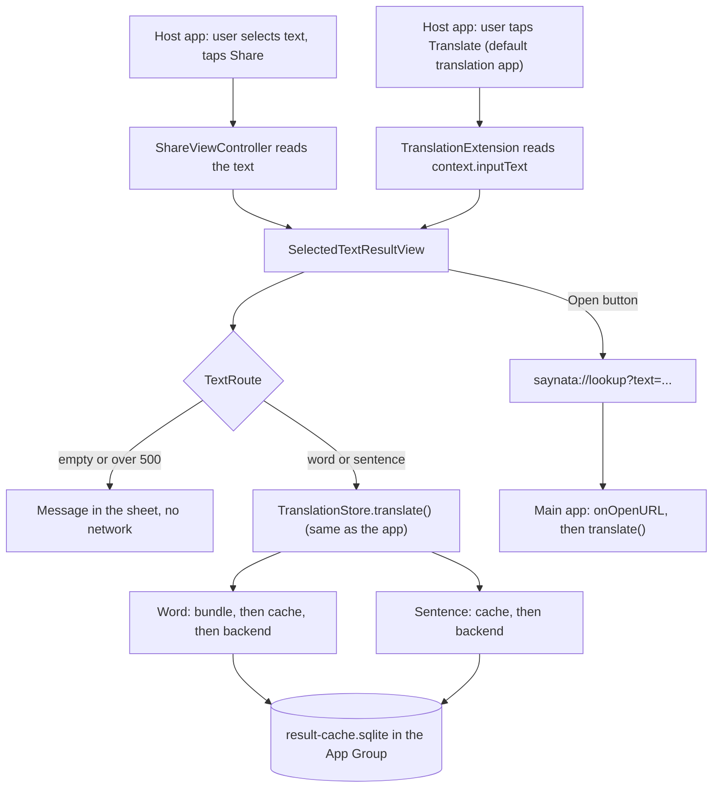
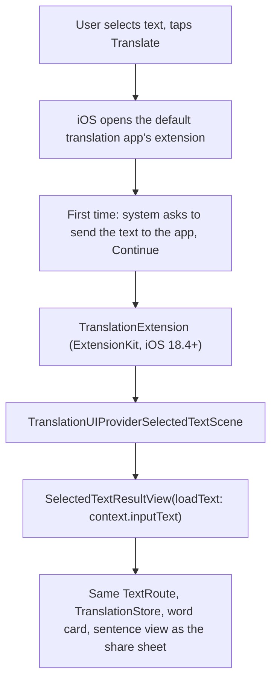

# Share extension and Translate button

> Status: **working** (TASK-30 share extension, TASK-42 Translate button). Listen reads aloud (F3, TASK-7). Last traced from code: 2026-10-15 (TASK-70: the extensions are guests).
> Spec: R1, R2 in [Vision and spec](../doc-1%20-%20Vision-and-spec.md). Builds on [Word lookup](doc-5%20-%20Word-lookup.md) and [Sentence translation](doc-4%20-%20Sentence-translation.md).

## What it does

In Safari, Messages or any app, the user selects text and taps Share, then Saynata. A sheet opens over that app (the main app does not open). One word shows the word card, more than one word shows the sentence explanation, and text over 500 characters shows a clear message. An icon button opens the main app on the same text; another closes the sheet.

Since iOS 18.4 the same sheet also opens from the system **Translate** item on selected text, when Saynata is the default translation app (see [Translate button](#translate-button-default-translation-app)).

## Big picture

## How the code is shared

The extension is a second target (`ShareExtension`; the Translate button adds a third, `TranslationExtension`, built the same way). It does **not** copy code and it is **not** a Swift package. Both targets use the same Xcode synchronized folder `EnglishTranslation/EnglishTranslation/`: the extension target has a "membership exceptions" list in `project.pbxproj` for the files it must not compile (the `@main` app file, `ContentView`, `Lessons/`, `TranslateView`, the input and options views, the design gallery). Everything else (Dictionary, Cache, Network, Models, Translation, Stores, DesignSystem, Views, the asset catalog with the theme colours, `dictionary.sqlite`) is compiled into both.

Why: no files moved and no new module; a change in `WordCardView` shows in both. Cost: **a new file in the app folder also joins the extension** unless it is added to the exception list (Xcode: select the file, File inspector, Target Membership, untick ShareExtension). `dictionary.sqlite` (5.6 MB) is copied into the extension bundle too.

## Step by step

| Step | File | What happens |
|---|---|---|
| Activation | [ShareExtension/Info.plist](../../../EnglishTranslation/ShareExtension/Info.plist) | `NSExtensionActivationSupportsText = true`: Saynata is offered when text is shared. Web pages without a selection are not offered (a page share is a URL, not text). Also holds `BackendBaseURL` and the local-network ATS exception. No API keys. |
| Read the text | [ShareViewController.swift:38-60](../../../EnglishTranslation/ShareExtension/ShareViewController.swift#L38-L60) | Loads the first `public.text` attachment (or `attributedContentText`). Empty string if none. |
| Host the sheet | [ShareViewController.swift:14-31](../../../EnglishTranslation/ShareExtension/ShareViewController.swift#L14-L31) | `UIHostingController` with `ShareSheetView`, pinned to the full view. |
| Route | [TextRoute.swift:23-36](../../../EnglishTranslation/EnglishTranslation/Translation/TextRoute.swift#L23-L36) | Trim, then: empty, over 500 UTF-16 units (the same count as Java's `@Size(max = 500)`), one token (`CacheKeys.isSingleToken`) or sentence. |
| Show / explain | [SelectedTextResultView.swift:44-86](../../../EnglishTranslation/EnglishTranslation/Views/SelectedText/SelectedTextResultView.swift#L44-L86), [142-149](../../../EnglishTranslation/EnglishTranslation/Views/SelectedText/SelectedTextResultView.swift#L142-L149). The view lives in the shared app folder, so both extensions compile it. | A problem message is shown as text. Otherwise `TranslationStore.translate()` runs. Header row: for a word, `WordHeaderView` (headword large, IPA or form pill under it); for a sentence, the quoted text in serif. On the right: Listen (reads the word as shown or the selected sentence; the sheet makes its own `SpeechPlayer` and puts it in the environment, because the extensions have no app around them and the word card's speakers need it), Open in Saynata (only when the host gives an `onOpenApp` closure: the share extension does, the translation extension does not), Close (only when the host gives an `onClose` closure: the share extension does, the translation extension does not), all icon-only with accessibility labels. Below the header the app's own views are reused unchanged: `WordCardView(showsHeader: false)` for a word, `TranslateResultView` for a sentence and for errors (with "Did you mean"). The sentence layout is not built here, so it follows the app when that view is restyled. |
| Open the app | [ShareViewController.swift:72-83](../../../EnglishTranslation/ShareExtension/ShareViewController.swift#L72-L83) | A share extension cannot call `UIApplication.shared`, and `extensionContext.open` does not work for share extensions. The code walks the responder chain to the host's `UIApplication` and calls `open(url)`, then closes the sheet. Checked on the iOS 18.5 simulator; it relies on the responder chain, so re-check it on each new iOS version. |
| Link | [DeepLink.swift](../../../EnglishTranslation/EnglishTranslation/Translation/DeepLink.swift) | `saynata://lookup?text=<encoded text>`. The scheme is in the app's Info.plist (`CFBundleURLTypes`). |
| App side | [EnglishTranslationApp.swift:16-21](../../../EnglishTranslation/EnglishTranslation/EnglishTranslationApp.swift#L16-L21) | `onOpenURL`: put the text in the input and call `translate()`. Other URLs are ignored. |

## Shared cache (App Group)

`group.com.luke.EnglishTranslation` is in all three `.entitlements` files (app, share extension, translation extension). [ResultCache.swift:15-44](../../../EnglishTranslation/EnglishTranslation/Cache/ResultCache.swift#L15-L44) puts `result-cache.sqlite` in the group folder (`containerURL(forSecurityApplicationGroupIdentifier:)`). If the group is not available it uses the process's own Application Support folder, so the code still runs (the app and the extension then have two separate caches). The old cache file in the app's Application Support folder is moved to the group folder once. [Line 57](../../../EnglishTranslation/EnglishTranslation/Cache/ResultCache.swift#L57) sets a 2 s SQLite busy timeout because two processes can open the file. The bundled dictionary is opened read-only, as in the app, and there are no other caches (extensions have a small memory limit).

## Errors

| Cause | What the user sees |
|---|---|
| No text in the share | "No text found. Select some words, then share them." |
| Over 500 characters | "This text has N characters. The limit is 500. Select a shorter part." No network call. |
| Not an English word, offline, backend error | Same message and "Did you mean" chips as the app (`TranslationStore`). |

## Tests

| Test file | What it covers |
|---|---|
| [TextRouteTests.swift](../../../EnglishTranslation/EnglishTranslationTests/TextRouteTests.swift) | Empty, word, sentence, exactly 500, over 500 with the message, `DeepLink` round trip and bad links. |

Run: `xcodebuild test -project EnglishTranslation/EnglishTranslation.xcodeproj -scheme EnglishTranslation -destination 'platform=iOS Simulator,name=iPhone 16 Pro,OS=18.5' -only-testing:EnglishTranslationTests -parallel-testing-enabled NO`. The sheet itself is checked by hand (PR "Test it" card).

## Change checklist

- Backend limit or prompt version changes: `TextRoute.maxLength` and `PromptVersions` ([CacheKeys.swift](../../../EnglishTranslation/EnglishTranslation/Cache/CacheKeys.swift)).
- New file in `EnglishTranslation/EnglishTranslation/` that uses `UIApplication.shared` or other app-only APIs: add it to the exception list of **both** extensions (`ShareExtension` and `TranslationExtension`; the lists are the same).
- New backend URL: change `BackendBaseURL` in **all three** Info.plist files (the app's, `ShareExtension/Info.plist`, `TranslationExtension/Info.plist`).
- New App Group id: change `ResultCache.appGroupID` and all three `.entitlements` files.

## Known gaps

- iOS does not let third-party apps add their own button to the text-selection menu of other apps. The two entry points are Share, then Saynata, and (iOS 18.4 and later) the system Translate item when Saynata is the default translation app.
- The share row shows the app's name and its placeholder icon: the extension has no icon of its own.
- On a real device, the App Group needs the capability in Xcode (see the PR). Until then the two caches are separate.
- The app itself does not apply the 500-character limit before calling the backend (the backend answers 400).
- **The extensions are guests (TASK-70).** The app keeps its sign-in tokens in its own Keychain. Sharing them needs a Keychain access group, and a free Apple ID cannot sign access groups or App Groups (`scripts/install-on-phone.sh`). So when the backend answers `sign_in_required`, the share sheet and the Translate sheet show "Sign in from the Saynata app to explain new text." and never open the sign-in sheet. The share sheet's "Open in Saynata" button opens the app with the same text, and the app asks for the sign-in itself. Bundled and cached words still work in the extensions. See [Accounts and limits](doc-17%20-%20Accounts-and-limits.md#ios-app-task-70).

## Translate button (default translation app)

Added in TASK-42. Since iOS 18.4 the user can pick a default translation app (Settings, Apps, Default Apps, Translation). Then the system **Translate** item on selected text in any app opens that app's extension instead of Apple's Translate sheet. Saynata uses it to show the same explain-first sheet.

| Piece | Where | Notes |
|---|---|---|
| Extension target | `TranslationExtension` in project.pbxproj: product type `com.apple.product-type.extensionkit-extension`, minimum iOS 18.4, embedded in the app's `Extensions/` folder by an "Embed ExtensionKit Extensions" phase | It is not a share-services extension. `EXAppExtensionAttributes` / `EXExtensionPointIdentifier` = `com.apple.public.translation-ui-provider` in [TranslationExtension/Info.plist](../../../EnglishTranslation/TranslationExtension/Info.plist). |
| Entry point | [TranslationExtension.swift:15-25](../../../EnglishTranslation/TranslationExtension/TranslationExtension.swift#L15-L25) | `@main` class conforming to `TranslationUIProviderExtension`; scene `TranslationUIProviderSelectedTextScene`. |
| Sheet | [TranslationExtension.swift:28-35](../../../EnglishTranslation/TranslationExtension/TranslationExtension.swift#L28-L35) | `context.inputText` is an `AttributedString`; it is turned into a `String` and given to `SelectedTextResultView`. No Close button of our own: the system draws its own X above the sheet. No Replace button (Saynata explains, it does not replace), so `allowsReplacement` is ignored. No Open in Saynata button: the context has no way to open the app. |
| Entitlement | [EnglishTranslation.entitlements](../../../EnglishTranslation/EnglishTranslation.entitlements): `com.apple.developer.translation-app` = true | On the **app** target, as in Apple's guide. Without it the app is not offered in Default Apps. |
| Network key | `com.apple.developer.translation-ui-provider.network-access` = true in the app's and the extension's Info.plist | Needed because the extension calls our backend. |
| Sharing code | Same synchronized folder and exception list as the share extension | `dictionary.sqlite` and the asset catalog are compiled into the extension too. |

Checked on the iPhone 16 Pro, iOS 18.5 simulator (2026-10-11): Settings, Apps, Default Apps, Translation lists Saynata (ticked, as it is the only provider); Safari, select a word, Translate: a consent sheet ("The selected content will be sent to ... to process the translation", Continue, "Change Default Translation App"), then the word card.

### Signing

The `com.apple.developer.translation-app` entitlement is a restricted capability. The simulator does not check it. On a real iPhone the provisioning profile must contain it. Steps are in the PR for TASK-42. If a free Personal Team cannot sign it, remove that one key from `EnglishTranslation.entitlements` to build for the device (the Translate button then does not list Saynata).

### Errors

Same as the share sheet: empty text, over 500 characters, offline, not an English word. The system draws its own X above the sheet, so the Translate sheet has no Close button of its own (one X only).

### Known gaps (Translate button)

- The consent sheet names the app by its `CFBundleName`, which is the Xcode product name `EnglishTranslation`, not "Saynata". Fixing it means renaming the app target's product name (not done: it touches the test host path).
- Listen works as in the share sheet.
- Some reports say the default translation app setting is limited by region; not checked.
