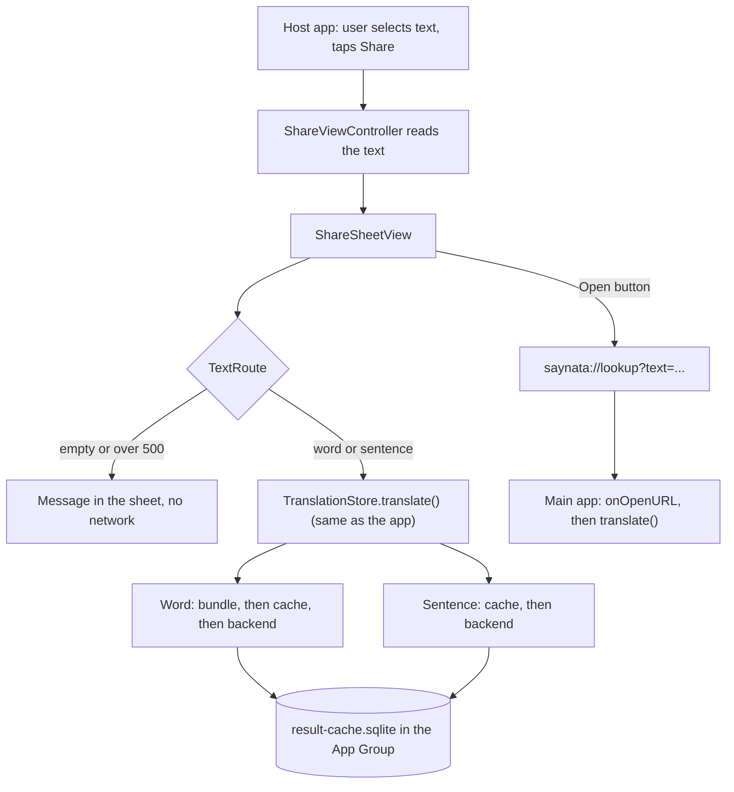

# Share extension

> Status: **working** (TASK-30), with the approved header design. Listen is a placeholder until F3. Last traced from code: 2026-10-11.
> Spec: R1, R2 in [Vision and spec](../doc-1%20-%20Vision-and-spec.md). Builds on [Word lookup](doc-5%20-%20Word-lookup.md) and [Sentence translation](doc-4%20-%20Sentence-translation.md).

## What it does

In Safari, Messages or any app, the user selects text and taps Share, then Saynata. A sheet opens over that app (the main app does not open). One word shows the word card, more than one word shows the sentence explanation, and text over 500 characters shows a clear message. An icon button opens the main app on the same text; another closes the sheet.

## Big picture

## How the code is shared

The extension is a second target (`ShareExtension`). It does **not** copy code and it is **not** a Swift package. Both targets use the same Xcode synchronized folder `EnglishTranslation/EnglishTranslation/`: the extension target has a "membership exceptions" list in `project.pbxproj` for the files it must not compile (the `@main` app file, `ContentView`, `Lessons/`, `TranslateView`, the input and options views, the design gallery). Everything else (Dictionary, Cache, Network, Models, Translation, Stores, DesignSystem, Views, the asset catalog with the theme colours, `dictionary.sqlite`) is compiled into both.

Why: no files moved and no new module; a change in `WordCardView` shows in both. Cost: **a new file in the app folder also joins the extension** unless it is added to the exception list (Xcode: select the file, File inspector, Target Membership, untick ShareExtension). `dictionary.sqlite` (5.6 MB) is copied into the extension bundle too.

## Step by step

| Step | File | What happens |
|---|---|---|
| Activation | [ShareExtension/Info.plist](../../../EnglishTranslation/ShareExtension/Info.plist) | `NSExtensionActivationSupportsText = true`: Saynata is offered when text is shared. Web pages without a selection are not offered (a page share is a URL, not text). Also holds `BackendBaseURL` and the local-network ATS exception. No API keys. |
| Read the text | [ShareViewController.swift:38-60](../../../EnglishTranslation/ShareExtension/ShareViewController.swift#L38-L60) | Loads the first `public.text` attachment (or `attributedContentText`). Empty string if none. |
| Host the sheet | [ShareViewController.swift:14-31](../../../EnglishTranslation/ShareExtension/ShareViewController.swift#L14-L31) | `UIHostingController` with `ShareSheetView`, pinned to the full view. |
| Route | [TextRoute.swift:23-36](../../../EnglishTranslation/EnglishTranslation/Translation/TextRoute.swift#L23-L36) | Trim, then: empty, over 500 UTF-16 units (the same count as Java's `@Size(max = 500)`), one token (`CacheKeys.isSingleToken`) or sentence. |
| Show / explain | [ShareSheetView.swift:38-80](../../../EnglishTranslation/ShareExtension/ShareSheetView.swift#L38-L80), [112-119](../../../EnglishTranslation/ShareExtension/ShareSheetView.swift#L112-L119) | A problem message is shown as text. Otherwise `TranslationStore.translate()` runs. Header row: for a word, `WordHeaderView` (headword large, IPA or form pill under it); for a sentence, the quoted text in serif. On the right: Listen (placeholder), Open in Saynata, Close, all icon-only with accessibility labels. Below the header the app's own views are reused unchanged: `WordCardView(showsHeader: false)` for a word, `TranslateResultView` for a sentence and for errors (with "Did you mean"). The sentence layout is not built here, so it follows the app when that view is restyled. |
| Open the app | [ShareViewController.swift:72-83](../../../EnglishTranslation/ShareExtension/ShareViewController.swift#L72-L83) | A share extension cannot call `UIApplication.shared`, and `extensionContext.open` does not work for share extensions. The code walks the responder chain to the host's `UIApplication` and calls `open(url)`, then closes the sheet. Checked on the iOS 18.5 simulator; it relies on the responder chain, so re-check it on each new iOS version. |
| Link | [DeepLink.swift](../../../EnglishTranslation/EnglishTranslation/Translation/DeepLink.swift) | `saynata://lookup?text=<encoded text>`. The scheme is in the app's Info.plist (`CFBundleURLTypes`). |
| App side | [EnglishTranslationApp.swift:16-21](../../../EnglishTranslation/EnglishTranslation/EnglishTranslationApp.swift#L16-L21) | `onOpenURL`: put the text in the input and call `translate()`. Other URLs are ignored. |

## Shared cache (App Group)

`group.com.luke.EnglishTranslation` is in both `.entitlements` files. [ResultCache.swift:15-44](../../../EnglishTranslation/EnglishTranslation/Cache/ResultCache.swift#L15-L44) puts `result-cache.sqlite` in the group folder (`containerURL(forSecurityApplicationGroupIdentifier:)`). If the group is not available it uses the process's own Application Support folder, so the code still runs (the app and the extension then have two separate caches). The old cache file in the app's Application Support folder is moved to the group folder once. [Line 57](../../../EnglishTranslation/EnglishTranslation/Cache/ResultCache.swift#L57) sets a 2 s SQLite busy timeout because two processes can open the file. The bundled dictionary is opened read-only, as in the app, and there are no other caches (extensions have a small memory limit).

## Errors

| Cause | What the user sees |
|---|---|
| No text in the share | "No text found. Select some words, then share them." |
| Over 500 characters | "This text has N characters. The limit is 500. Select a shorter part." No network call. |
| Not an English word, offline, backend error | Same message and "Did you mean" chips as the app (`TranslationStore`). |

## Tests

| Test file | What it covers |
|---|---|
| [TextRouteTests.swift](../../../EnglishTranslation/EnglishTranslationTests/TextRouteTests.swift) | Empty, word, sentence, exactly 500, over 500 with the message, `DeepLink` round trip and bad links. |

Run: `xcodebuild test -project EnglishTranslation/EnglishTranslation.xcodeproj -scheme EnglishTranslation -destination 'platform=iOS Simulator,name=iPhone 16 Pro,OS=18.5' -only-testing:EnglishTranslationTests -parallel-testing-enabled NO`. The sheet itself is checked by hand (PR "Test it" card).

## Change checklist

- Backend limit or prompt version changes: `TextRoute.maxLength` and `PromptVersions` ([CacheKeys.swift](../../../EnglishTranslation/EnglishTranslation/Cache/CacheKeys.swift)).
- New file in `EnglishTranslation/EnglishTranslation/` that uses `UIApplication.shared` or other app-only APIs: add it to the extension's exception list.
- New backend URL: change `BackendBaseURL` in **both** Info.plist files (the app's and `ShareExtension/Info.plist`).
- New App Group id: change `ResultCache.appGroupID` and both `.entitlements` files.

## Known gaps

- iOS does not let third-party apps add a button to the text-selection menu of other apps, so Share, then Saynata, is the only entry point.
- Listen does nothing yet (speech is F3, TASK-7).
- The share row shows the app's name and its placeholder icon: the extension has no icon of its own.
- On a real device, the App Group needs the capability in Xcode (see the PR). Until then the two caches are separate.
- The app itself does not apply the 500-character limit before calling the backend (the backend answers 400).
