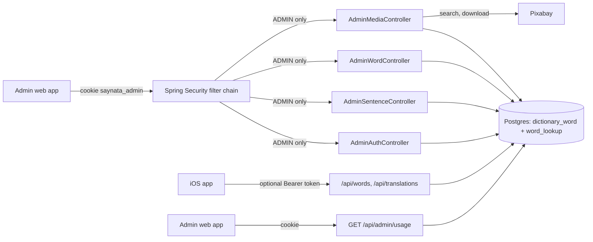
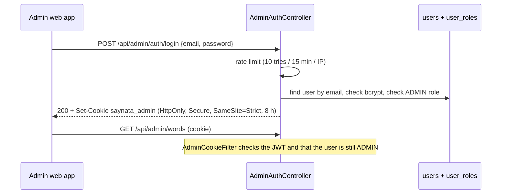
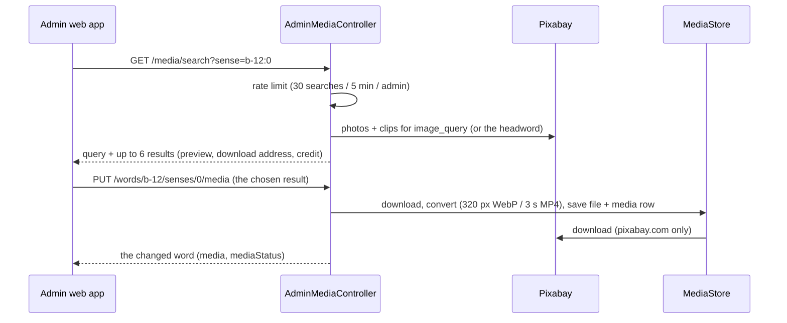

# Admin API

> Status: **backend built** (TASK-49.1 and TASK-49.3, part of F5 Admin CMS, TASK-49). The admin web app is TASK-49.2. Last traced from code: 2026-10-15 (app user accounts and `GET /api/admin/usage`: TASK-66 to 69, see doc-17; Pixabay 429 on a pick answers 503 "Pixabay is busy": TASK-63; media per sense: TASK-49.4; replace, remove or mark a sense picture: TASK-52; review reasons: TASK-55; the `media` list filter: TASK-60; the bundled entry wins over a backend entry: TASK-58).
> Why: Postgres on the server is the single source of truth for content (doc-7, 2026-10-14). A person needs a safe way to read, fix and regenerate words and sentences.

## What it does

`/api/admin/**` is a small REST API for the admin web app (admin.loffy.me). An admin logs in with email and password, gets a signed cookie, and can then list, search, read, edit, mark as reviewed and delete the words and sentences. Words come from two tables: the **bundled dictionary** (`dictionary_word`, the 2,750 words in the iOS app, source `bundled`) and the words Claude wrote on demand (`word_lookup`, source `backend`). Sentences are `sentence_translation`. Deleting a row is "regenerate": the next public lookup asks Claude again. The public API (`/api/translations`, `/api/translations/stream` (server-sent events: `meaning-delta`, `meaning`, `done`, `error`; TASK-65 and TASK-73, see doc-4), `/api/words/{word}`, `/actuator/health`) needs no admin login. App users have a separate login with an email code and a Bearer token ([Accounts and limits](doc-17%20-%20Accounts-and-limits.md)): a guest gets cached and bundled answers, a new Claude call needs a signed-in user. Streamed sentences are cached in the same `sentence_translation` table, so deleting a row here also "regenerates" them.

## Big picture

## Login

| Step | File:line | What happens |
|---|---|---|
| Accounts | [V5__create_users_and_roles.sql](../../../backend/src/main/resources/db/migration/V5__create_users_and_roles.sql) | Tables `users` (email unique, bcrypt hash) and `user_roles` (ADMIN here; USER for app users, see doc-17). Also `sentence_translation.needs_review`. [V10](../../../backend/src/main/resources/db/migration/V10__create_accounts.sql) lets `password_hash` be empty: an app user has no password, and the admin login treats such a user like an unknown email. |
| First admin | [AdminBootstrap.java:36](../../../backend/src/main/java/com/englishtranslation/backend/admin/AdminBootstrap.java#L36) | At start-up, only when no ADMIN exists: creates one from `ADMIN_EMAIL` + `ADMIN_INITIAL_PASSWORD` (12+ characters). Logs the email, never the password. |
| Rules | [SecurityConfig.java:43](../../../backend/src/main/java/com/englishtranslation/backend/admin/SecurityConfig.java#L43) | Stateless. `/api/admin/**` needs ADMIN (login and logout are open, OPTIONS is open for CORS), `/api/me` needs the USER role (doc-17). Everything else stays open. No login gives 401. The Bearer filter for app users never looks at `/api/admin`, and the admin cookie filter never looks at anything else, so the two logins cannot open each other's doors. |
| CORS | [SecurityConfig.java:71](../../../backend/src/main/java/com/englishtranslation/backend/admin/SecurityConfig.java#L71) | Only for `/api/admin/**`: `https://admin.loffy.me` and `http://localhost:5173`, with credentials, `X-Total-Count` exposed. |
| Login | [AdminAuthController.java:60](../../../backend/src/main/java/com/englishtranslation/backend/admin/AdminAuthController.java#L60) | Same 401 "Wrong email or password." for unknown email, wrong password, or a user without ADMIN. Too many tries: 429. |
| Rate limit | [LoginRateLimiter.java:24](../../../backend/src/main/java/com/englishtranslation/backend/admin/LoginRateLimiter.java#L24) | In memory, per IP (the real IP from `X-Forwarded-For`, trusted only from a private or loopback proxy such as Caddy). A restart clears it. |
| Token | [AdminTokenService.java:46](../../../backend/src/main/java/com/englishtranslation/backend/admin/AdminTokenService.java#L46) | JWT HS256 with `ADMIN_JWT_SECRET` (32+ characters, or start-up fails), 8 hours, holds only the user id. |
| Cookie filter | [AdminCookieFilter.java:39](../../../backend/src/main/java/com/englishtranslation/backend/admin/AdminCookieFilter.java#L39) | Reads the cookie, checks the token, loads the user from the database and checks the ADMIN role again (so removing an admin works at once). |
| CSRF | [JsonWritesOnlyFilter.java:19](../../../backend/src/main/java/com/englishtranslation/backend/admin/JsonWritesOnlyFilter.java#L19) | Spring CSRF is off. Instead the cookie is SameSite=Strict, and every POST/PUT/DELETE under `/api/admin` must send `Content-Type: application/json` (else 415). The admin site and the API must share the site `loffy.me` (for example admin.loffy.me and api.loffy.me). |
| Me, logout | [AdminAuthController.java:84](../../../backend/src/main/java/com/englishtranslation/backend/admin/AdminAuthController.java#L84), [:91](../../../backend/src/main/java/com/englishtranslation/backend/admin/AdminAuthController.java#L91) | `GET /api/admin/auth/me` gives id, email, display name and roles (for example `["ADMIN"]`). `POST /api/admin/auth/logout` clears the cookie. |

## Words and sentences (Refine simple-rest shape)

### Ids and the two sources

A word id is a **string with a letter**: `b-12` is `dictionary_word` 12 (bundled), `w-45` is `word_lookup` 45 (backend). The two tables count from 1 each, so the letter keeps the ids apart. The list returns these ids, and `GET`, `PUT`, `POST .../reviewed` and `DELETE` accept the same ids, so Refine simple-rest works without changes. A bare number or any other id is a 404 ([AdminWordId.parse:16](../../../backend/src/main/java/com/englishtranslation/backend/admin/AdminWordId.java#L16)). Sentences keep their numeric ids.

The list reads the database view `admin_word_list` ([V6](../../../backend/src/main/resources/db/migration/V6__create_dictionary_tables.sql)), which joins both tables, so filters, sorting and paging happen in SQL. The level (`cefr`) of a word is the level of its **first sense**; for a backend word it is saved in `word_lookup.cefr` when the entry is saved or edited, and [WordCefrBackfill](../../../backend/src/main/java/com/englishtranslation/backend/word/WordCefrBackfill.java) fills it at start-up for older rows.

A word is in only one list. `GET /api/words/{word}` answers a bundled word from `dictionary_word` and never makes a `word_lookup` row for it (doc-5, TASK-58), and Flyway [V9](../../../backend/src/main/resources/db/migration/V9__remove_backend_words_that_are_bundled.sql) deleted the old `word_lookup` rows (and their `word_lookup_media` links) whose word is a bundled lemma. The media rows and files of those words stay on disk (the same gap as below). The match is on the lemma only: a form such as "working" (a form of "work") is not a bundled lemma, so it stays a backend word.

### Requests

| Request | File:line | What happens |
|---|---|---|
| `GET /api/admin/words?_start&_end&_sort&_order&q&needs_review&source&cefr&media` | [AdminWordController.java:37](../../../backend/src/main/java/com/englishtranslation/backend/admin/AdminWordController.java#L37), [AdminWordService.list:103](../../../backend/src/main/java/com/englishtranslation/backend/admin/AdminWordService.java#L103) | JSON array and header `X-Total-Count`. `q` searches the word (case-insensitive, `%` and `_` match themselves). `source=bundled` or `backend`. `cefr` is a list: `cefr=A1,A2` (or repeated); each level is A1 to C2, else 400 ([checkLevels:168](../../../backend/src/main/java/com/englishtranslation/backend/admin/AdminWordService.java#L168)). `media=with` keeps the words where **any sense has a media file**, `media=without` the words where no sense has one; anything else is 400 (TASK-60). The check is SQL on the base tables, not in the view ([HAS_MEDIA:57](../../../backend/src/main/java/com/englishtranslation/backend/admin/AdminWordService.java#L57)): a bundled word counts when some `dictionary_sense.media_id` is set, a backend word when some `word_lookup_media.media_id` is set. A claim row without a file (Pixabay found nothing) is not media. All filters work together; the admin web app sends one for every chip (source, level, media, needs review) and the total in `X-Total-Count` is the filtered total. `_start` must be a multiple of the page size (Refine does this). Sort names: id, word, source, needsReview, model, promptVersion, createdAt ([orderBy:155](../../../backend/src/main/java/com/englishtranslation/backend/admin/AdminWordService.java#L155); `id` sorts by source, then by number; "bundled" comes before "backend" when descending). Page size at most 200. |
| `GET /api/admin/words/{id}` | [AdminWordController.java:56](../../../backend/src/main/java/com/englishtranslation/backend/admin/AdminWordController.java#L56) | `{id, word, entry, ipa, needsReview, source, model, promptVersion, createdAt, media}`. `entry` is the same `WordEntry` Claude writes (no image fields). `reviewReasons` is a list of strings (TASK-55): why the word needs review, from `SimpleWords.problems` on the entry **as it is now**, for example `"sense 1: the definition uses hard words [abstain]"`. It is computed on every read ([reviewReasons:355](../../../backend/src/main/java/com/englishtranslation/backend/admin/AdminWordService.java#L355)), not stored, so it works for words that were flagged before and is right after a `PUT`. It is empty when `needsReview` is false, when the entry cannot be read, or when the entry is simple enough now; in that last case `needsReview` stays true until `POST .../reviewed` (the developer decides). The list items have it too. `media` has one item per sense, in the same order as `entry.senses` (TASK-49.4): `{url, kind, photographer, pageUrl, licenseNote}` or `null` when the sense has no media. `mediaStatus` is the same length: `"needs_ai"` when the sense is marked for an AI image (TASK-52), else `null` ([statusPerSense:374](../../../backend/src/main/java/com/englishtranslation/backend/admin/AdminWordService.java#L374)). `url` is absolute (`MEDIA_BASE_URL` + file name), `kind` is `photo` or `clip`, `photographer` and `pageUrl` are the Pixabay credit. The list items have `media` too ([SenseMediaReader](../../../backend/src/main/java/com/englishtranslation/backend/media/SenseMediaReader.java), [mediaPerSense:363](../../../backend/src/main/java/com/englishtranslation/backend/admin/AdminWordService.java#L363)). Bundled words read it from `dictionary_sense.media_id`, backend words from `word_lookup_media`. `ipa` is set for bundled words (null for backend words). `model` and `promptVersion` can be null for bundled words. 404 when missing. |
| `PUT /api/admin/words/{id}` | [AdminWordController.java:62](../../../backend/src/main/java/com/englishtranslation/backend/admin/AdminWordController.java#L62), [AdminWordService.update:231](../../../backend/src/main/java/com/englishtranslation/backend/admin/AdminWordService.java#L231) | Body `{"entry": {...}}`; other fields are ignored. [EntryParser](../../../backend/src/main/java/com/englishtranslation/backend/admin/EntryParser.java#L31) must read it as a `WordEntry` (unknown fields, empty text, bad example level or usage kind are errors), else 400 with a ProblemDetail that names the field and nothing is saved. **Bundled word:** the `dictionary_sense` rows are updated ([applyEntry:290](../../../backend/src/main/java/com/englishtranslation/backend/admin/AdminWordService.java#L290)) and the next `pipeline export` has the change. Senses are matched by **position**: sense 1 stays sense 1 and keeps its `image_type`, `image_query` and media. A sense added at the end has no picture (`image_type` "none"); a sense left out at the end is removed. |
| `POST /api/admin/words/{id}/reviewed` | [AdminWordController.java:67](../../../backend/src/main/java/com/englishtranslation/backend/admin/AdminWordController.java#L67), [AdminWordService.markReviewed:248](../../../backend/src/main/java/com/englishtranslation/backend/admin/AdminWordService.java#L248) | `needsReview = false` (also for bundled words). For a backend word this sets `word_lookup.needs_review` to false and saves it; a test marks a flagged backend word reviewed and reads it back from the API, the list and the table (TASK-57). The answer has `reviewReasons: []`. |
| `DELETE /api/admin/words/{id}` | [AdminWordController.java:73](../../../backend/src/main/java/com/englishtranslation/backend/admin/AdminWordController.java#L73) | Backend word: deletes the row; the next `GET /api/words/{word}` calls Claude again. **Bundled word: 400** "A bundled word cannot be deleted here. Edit it instead." (it would disappear from the next `dictionary.sqlite`). |
| Same for `/api/admin/sentences` | [AdminSentenceController.java](../../../backend/src/main/java/com/englishtranslation/backend/admin/AdminSentenceController.java#L63) | Search `q` is on the source text. Item: `{id, sourceText, targetLang, explanation{meaning, words, translation}, model, promptVersion, needsReview, createdAt}`. `PUT` body `{"explanation": {...}}` (the same shape as the public response). |

## Pictures of a sense (TASK-52)

The admin can fix a bad picture. A sense is named by the word id and its position (0 = first sense), for example `b-12` and `0`. It works for **bundled words** (the link is `dictionary_sense.media_id`) and **backend words** (`word_lookup_media`; the row is made when it is missing, because the background job makes it only for the first 3 senses). All of these are under `/api/admin/**`, so only ADMIN can call them (no login: 401; a user without ADMIN: 401).

| Request | File:line | What happens |
|---|---|---|
| `GET /api/admin/media/search?sense=b-12:0&q=...` | [AdminMediaController.search:33](../../../backend/src/main/java/com/englishtranslation/backend/admin/AdminMediaController.java#L33), [AdminMediaService.search:77](../../../backend/src/main/java/com/englishtranslation/backend/admin/AdminMediaService.java#L77) | `{query, results[]}`. `query` is the search words that were used: `q`, or when `q` is empty the sense's `image_query` (bundled) or the headword. Each result: `{kind, pixabayId, previewUrl, downloadUrl, photographer, pageUrl}`. Up to 6, mostly photos plus at most 2 clips ([HttpPixabayClient.search:59](../../../backend/src/main/java/com/englishtranslation/backend/media/HttpPixabayClient.java#L59)). Rate limited: 30 searches per admin in 5 minutes, then 429 ([MediaSearchRateLimiter](../../../backend/src/main/java/com/englishtranslation/backend/admin/MediaSearchRateLimiter.java#L25)). |
| `PUT /api/admin/words/{id}/senses/{n}/media` | [AdminMediaController.replace:51](../../../backend/src/main/java/com/englishtranslation/backend/admin/AdminMediaController.java#L51), [AdminMediaService.replace:100](../../../backend/src/main/java/com/englishtranslation/backend/admin/AdminMediaService.java#L100) | Body: one result from the search (`kind`, `pixabayId`, `downloadUrl`, `photographer`, `pageUrl`). The body comes from the browser, so it is checked ([checked:260](../../../backend/src/main/java/com/englishtranslation/backend/admin/AdminMediaService.java#L260)): `kind` photo or clip, and `downloadUrl` and `pageUrl` must be https on pixabay.com, else 400. [MediaStore.save:44](../../../backend/src/main/java/com/englishtranslation/backend/media/MediaStore.java#L44) downloads, converts with the same rules as TASK-49.4, writes the file and the `media` row, and the sense is linked to it. The status mark is cleared. If the same file was used before, its `media` row is reused. A download or convert error: 502 and the old picture stays. **Pixabay answered 429 on every try** (see doc-15): 503 "Pixabay is busy right now. Try again in a minute." ([BUSY_MESSAGE:35](../../../backend/src/main/java/com/englishtranslation/backend/admin/AdminMediaService.java#L35), [replace:102](../../../backend/src/main/java/com/englishtranslation/backend/admin/AdminMediaService.java#L102)), and the old picture stays. Returns the changed word. |
| `DELETE /api/admin/words/{id}/senses/{n}/media` | [AdminMediaController.clear:57](../../../backend/src/main/java/com/englishtranslation/backend/admin/AdminMediaController.java#L57), [AdminMediaService.clear:123](../../../backend/src/main/java/com/englishtranslation/backend/admin/AdminMediaService.java#L123) | "No image": `media_id` becomes null. A bundled sense also gets `image_type = 'none'` (so the pipeline wants no image either); a later pick sets it back to `photo`. A backend word keeps its `word_lookup_media` row, so the background job does not fetch a picture again. |
| `POST /api/admin/words/{id}/senses/{n}/media/mark-for-ai` | [AdminMediaController.markForAi:62](../../../backend/src/main/java/com/englishtranslation/backend/admin/AdminMediaController.java#L62), [AdminMediaService.markForAi:136](../../../backend/src/main/java/com/englishtranslation/backend/admin/AdminMediaService.java#L136) | `media_status = 'needs_ai'` on that sense ([V8](../../../backend/src/main/resources/db/migration/V8__add_media_status.sql)). The current picture stays until an AI image replaces it (TASK-53). Picking another or "No image" clears the mark. |
| `GET /api/admin/media?status=needs_ai` | [AdminMediaController.list:44](../../../backend/src/main/java/com/englishtranslation/backend/admin/AdminMediaController.java#L44), [AdminMediaService.listByStatus:154](../../../backend/src/main/java/com/englishtranslation/backend/admin/AdminMediaService.java#L154) | The marked senses of both sources: `[{wordId, word, position, pos, simpleDefinition, media}]`, bundled first. Any other `status`: 400. Header `X-Total-Count`. |

Not found: an unknown word or a sense number past the last sense is 404. No `PIXABAY_API_KEY` on the server: 503 "Pixabay is not set up." Pixabay down or slow: 502 "Pixabay did not answer. Try again later."

## Claude usage per day (TASK-67)

`GET /api/admin/usage?days=7` (ADMIN, `days` 1 to 90, default 7) shows what Claude cost, newest day first (UTC days, empty days included):
`{dailyBudgetUsd, todayUsd, days: [{date, total: {calls, inputTokens, outputTokens, costUsd}, byFeature: {sentence, word, admin}}]}`.
Code: [AdminUsageController](../../../backend/src/main/java/com/englishtranslation/backend/admin/AdminUsageController.java), [ClaudeUsageService.report](../../../backend/src/main/java/com/englishtranslation/backend/claude/ClaudeUsageService.java#L110). There is no admin screen for it yet. How the cost and the daily cap work: [Accounts and limits](doc-17%20-%20Accounts-and-limits.md). Deleting a word or sentence here ("Regenerate") means the next public lookup asks Claude, so it is covered by the cap and by the sign-in rule like any new call.

## Errors

| Cause | HTTP | What the admin web app gets |
|---|---|---|
| No or bad cookie | 401 | Empty body |
| Wrong email or password | 401 | "Wrong email or password." |
| More than 10 logins in 15 minutes from one IP | 429 | "Too many login attempts. Try again in 15 minutes." |
| Write without `Content-Type: application/json` | 415 | "Send Content-Type: application/json." |
| Bad entry JSON or bad list parameters | 400 | ProblemDetail `detail`, for example "entry.senses[0].examples[0].level must be one of: easy, harder, medium." |
| Unknown id, or a word id without `b-` / `w-` | 404 | Standard problem body |
| Delete of a bundled word | 400 | "A bundled word cannot be deleted here. Edit it instead." |
| More than 30 media searches in 5 minutes | 429 | "Too many searches. Wait a few minutes." |
| Chosen picture not from Pixabay, or `status` other than `needs_ai` | 400 | The reason, for example "downloadUrl must be a Pixabay https address." |
| Pixabay search, download or convert fails | 502 | "Pixabay did not answer. Try again later." / "Could not download or convert that file. Try another one." |
| Pixabay says 429 (too many requests) on all 3 tries, in a search or a pick | 503 | "Pixabay is busy right now. Try again in a minute." (TASK-63) |
| `PIXABAY_API_KEY` empty | 503 | "Pixabay is not set up. Set PIXABAY_API_KEY on the server." |
| `source`, `cefr` or `media` with a wrong value | 400 | "source must be one of: backend, bundled." / "cefr must be a list of: A1, A2, B1, B2, C1, C2." / "media must be one of: with, without." |
| `GET /api/admin/usage` with a bad `days` | 200 | `days` is kept between 1 and 90 |
| `ADMIN_JWT_SECRET` missing (admin enabled) | start-up fails | Log: "Set ADMIN_JWT_SECRET to at least 32 characters". Set `ADMIN_ENABLED=false` to run without the admin API. |

## Tests

`AdminAuthTest` (login, cookie flags, 401, rate limit, CORS, public endpoints open), `AdminContentApiTest` (list/paging/search/filter, get, update, invalid JSON, reviewed, delete), `AdminBundledWordsTest` (both sources in one list, `source`, `cefr` and `media` filters (TASK-60: a clip on the second sense counts, a claim row without a file does not, both sources, combined with the other filters, bad value is 400), marking a backend word reviewed clears the flag and stays cleared when read back (TASK-57), ids, update of a bundled word keeps the picture fields, validation, reviewed, bundled delete is 400, `media` with the credit for both sources, `reviewReasons` for a flagged word and none for a clean one or after a fixing edit), `AdminMediaTest` (TASK-52: 401 without login and for a user without ADMIN, search with a fake Pixabay, rate limit, pick another for bundled and backend words, non-Pixabay address refused, download error keeps the old picture, Pixabay busy (429) gives 503 with the busy message and keeps the old picture, no image, mark for AI and the `needs_ai` list), `BundledWordWinsTest` (TASK-58, see doc-5), `WordCefrBackfillTest`, `AdminSetupTest` (first admin, secret check, token), `AdminDisabledTest`, `AdminUsageTest` (TASK-67: login needed, spend by feature, `days` default and cap).
Run: `cd backend && ./mvnw -B test`.

## Change checklist

- New env key: also `backend/.env.example`, `backend/docker-compose.prod.yml` (it lists env keys by hand), and doc-11.
- New field in `WordEntry` or `Explanation`: also the checks in `EntryParser`.
- New column on the word list: also the view `admin_word_list` (a new Flyway migration) and `AdminWordService`.
- New admin endpoint: it is covered by `/api/admin/**` automatically; add a 401 test.

## Known gaps

- The admin entry (`PUT /words/{id}`) has no picture fields: a bundled sense keeps its `image_type`, `image_query` and media. Pictures are changed with the media endpoints above.
- Replacing or removing a picture leaves the old `media` row and its file on the server (the same gap as deleting a word). Cleaning them up is a follow-up.
- `HttpPixabayClient.search` (two Pixabay calls per search) has no automated test: the tests use a fake `PixabayClient`. Try it once with a real key.
- Deleting a backend word ("Regenerate") also deletes its `word_lookup_media` rows, but the `media` rows and the files stay on the server (the next lookup fetches a new photo). Cleaning them up is a follow-up.
- Bundled word forms (`dictionary_form`) and the word's IPA cannot be edited through the API yet.
- The default sort is `id DESC`, which lists bundled words before backend words.
- The admin web app does not show the usage report yet (`GET /api/admin/usage` is ready).
- App users (role USER) sign in with an email code and use a Bearer token; they never get access to `/api/admin` (doc-17). An account that has both roles keeps the admin cookie login for the admin site.
- Ran on a real PostgreSQL 16 on 2026-10-14 (TASK-49.3): Flyway V1 to V6, the `admin_word_list` view, the filters and a PUT on a bundled word. The automated tests use H2.
