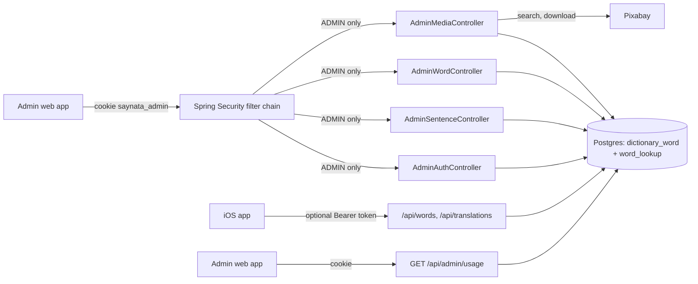
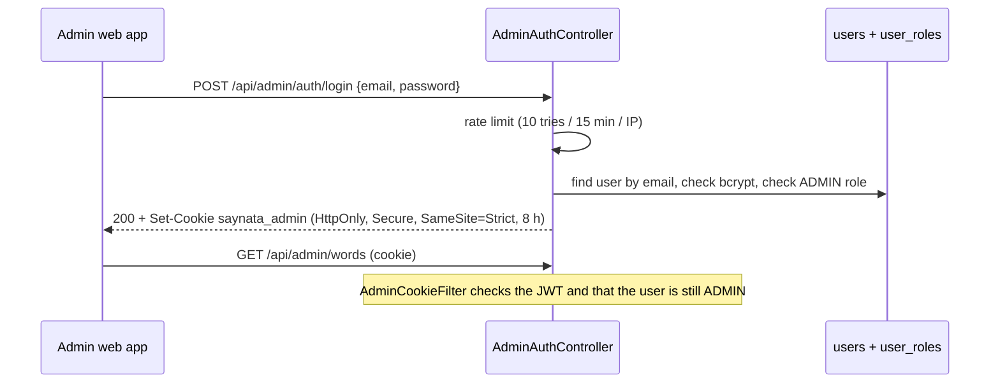
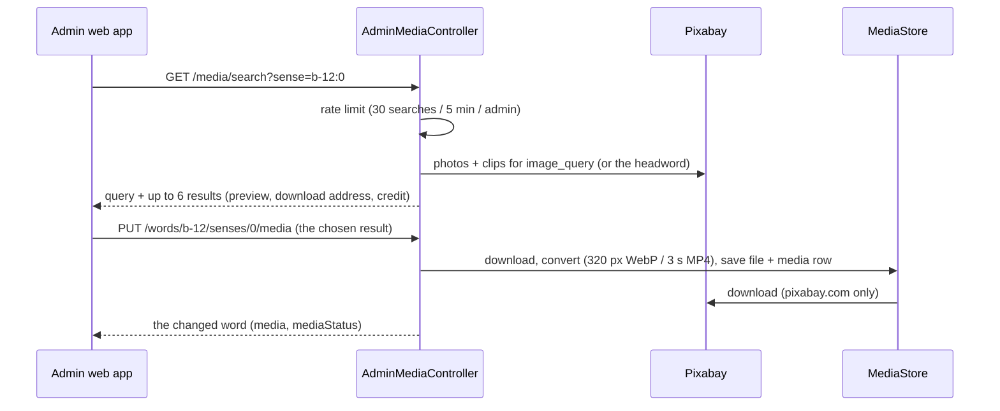

# Admin API

> Status: **backend built** (TASK-49.1 and TASK-49.3, part of F5 Admin CMS, TASK-49). The admin web app is TASK-49.2. Last traced from code: 2026-10-18 (the admin draws an AI picture for a sense with Codex on the server, the prompt endpoints and the wand: TASK-91); earlier: 2026-10-16 (picture review, the `media=wrong|to-review` filters and the approve endpoints: TASK-80; admin upload of a picture or clip: TASK-79); earlier: 2026-10-15 (media is really deleted when it is removed, and `DELETE /api/admin/words/{id}/media`: TASK-76; app user accounts and `GET /api/admin/usage`: TASK-66 to 69, see doc-17; Pixabay 429 on a pick answers 503 "Pixabay is busy": TASK-63; media per sense: TASK-49.4; replace, remove or mark a sense picture: TASK-52; review reasons: TASK-55; the `media` list filter: TASK-60; the bundled entry wins over a backend entry: TASK-58).
> Why: Postgres on the server is the single source of truth for content (doc-7, 2026-10-14). A person needs a safe way to read, fix and regenerate words and sentences.

## What it does

`/api/admin/**` is a small REST API for the admin web app (admin.saynata.com). An admin logs in with email and password, gets a signed cookie, and can then list, search, read, edit, mark as reviewed and delete the words and sentences. Words come from two tables: the **bundled dictionary** (`dictionary_word`, the 2,750 words in the iOS app, source `bundled`) and the words Claude wrote on demand (`word_lookup`, source `backend`). Sentences are `sentence_translation`. Deleting a row is "regenerate": the next public lookup asks Claude again. The public API (`/api/translations`, `/api/translations/stream` (server-sent events: `meaning-delta`, `meaning`, `done`, `error`; TASK-65 and TASK-73, see doc-4), `/api/words/{word}`, `/actuator/health`) needs no admin login. App users have a separate login with an email code and a Bearer token ([Accounts and limits](doc-17%20-%20Accounts-and-limits.md)): a guest gets cached and bundled answers, a new Claude call needs a signed-in user. Streamed sentences are cached in the same `sentence_translation` table, so deleting a row here also "regenerates" them.

## Big picture

## Login

| Step | File:line | What happens |
|---|---|---|
| Accounts | [V5__create_users_and_roles.sql](../../../backend/src/main/resources/db/migration/V5__create_users_and_roles.sql) | Tables `users` (email unique, bcrypt hash) and `user_roles` (ADMIN here; USER for app users, see doc-17). Also `sentence_translation.needs_review`. [V10](../../../backend/src/main/resources/db/migration/V10__create_accounts.sql) lets `password_hash` be empty: an app user has no password, and the admin login treats such a user like an unknown email. |
| First admin | [AdminBootstrap.java:36](../../../backend/src/main/java/com/englishtranslation/backend/admin/AdminBootstrap.java#L36) | At start-up, only when no ADMIN exists: creates one from `ADMIN_EMAIL` + `ADMIN_INITIAL_PASSWORD` (12+ characters). Logs the email, never the password. |
| Rules | [SecurityConfig.java:43](../../../backend/src/main/java/com/englishtranslation/backend/admin/SecurityConfig.java#L43) | Stateless. `/api/admin/**` needs ADMIN (login and logout are open, OPTIONS is open for CORS), `/api/me` needs the USER role (doc-17). Everything else stays open. No login gives 401. The Bearer filter for app users never looks at `/api/admin`, and the admin cookie filter never looks at anything else, so the two logins cannot open each other's doors. |
| CORS | [SecurityConfig.java:71](../../../backend/src/main/java/com/englishtranslation/backend/admin/SecurityConfig.java#L71) | Only for `/api/admin/**`: `https://admin.saynata.com` and `http://localhost:5173`, with credentials, `X-Total-Count` exposed. |
| Login | [AdminAuthController.java:60](../../../backend/src/main/java/com/englishtranslation/backend/admin/AdminAuthController.java#L60) | Same 401 "Wrong email or password." for unknown email, wrong password, or a user without ADMIN. Too many tries: 429. |
| Rate limit | [LoginRateLimiter.java:24](../../../backend/src/main/java/com/englishtranslation/backend/admin/LoginRateLimiter.java#L24) | In memory, per IP (the real IP from `X-Forwarded-For`, trusted only from a private or loopback proxy such as Caddy). A restart clears it. |
| Token | [AdminTokenService.java:46](../../../backend/src/main/java/com/englishtranslation/backend/admin/AdminTokenService.java#L46) | JWT HS256 with `ADMIN_JWT_SECRET` (32+ characters, or start-up fails), 8 hours, holds only the user id. |
| Cookie filter | [AdminCookieFilter.java:39](../../../backend/src/main/java/com/englishtranslation/backend/admin/AdminCookieFilter.java#L39) | Reads the cookie, checks the token, loads the user from the database and checks the ADMIN role again (so removing an admin works at once). |
| CSRF | [JsonWritesOnlyFilter.java:19](../../../backend/src/main/java/com/englishtranslation/backend/admin/JsonWritesOnlyFilter.java#L19) | Spring CSRF is off. Instead the cookie is SameSite=Strict, and every POST/PUT/DELETE under `/api/admin` must send `Content-Type: application/json` (else 415). The admin site and the API must share the site `saynata.com` (for example admin.saynata.com and api.saynata.com). |
| Me, logout | [AdminAuthController.java:84](../../../backend/src/main/java/com/englishtranslation/backend/admin/AdminAuthController.java#L84), [:91](../../../backend/src/main/java/com/englishtranslation/backend/admin/AdminAuthController.java#L91) | `GET /api/admin/auth/me` gives id, email, display name and roles (for example `["ADMIN"]`). `POST /api/admin/auth/logout` clears the cookie. |

## Words and sentences (Refine simple-rest shape)

### Ids and the two sources

A word id is a **string with a letter**: `b-12` is `dictionary_word` 12 (bundled), `w-45` is `word_lookup` 45 (backend). The two tables count from 1 each, so the letter keeps the ids apart. The list returns these ids, and `GET`, `PUT`, `POST .../reviewed` and `DELETE` accept the same ids, so Refine simple-rest works without changes. A bare number or any other id is a 404 ([AdminWordId.parse:16](../../../backend/src/main/java/com/englishtranslation/backend/admin/AdminWordId.java#L16)). Sentences keep their numeric ids.

The list reads the database view `admin_word_list` ([V6](../../../backend/src/main/resources/db/migration/V6__create_dictionary_tables.sql)), which joins both tables, so filters, sorting and paging happen in SQL. The level (`cefr`) of a word is the level of its **first sense**; for a backend word it is saved in `word_lookup.cefr` when the entry is saved or edited, and [WordCefrBackfill](../../../backend/src/main/java/com/englishtranslation/backend/word/WordCefrBackfill.java) fills it at start-up for older rows.

A word is in only one list. `GET /api/words/{word}` answers a bundled word from `dictionary_word` and never makes a `word_lookup` row for it (doc-5, TASK-58), and Flyway [V9](../../../backend/src/main/resources/db/migration/V9__remove_backend_words_that_are_bundled.sql) deleted the old `word_lookup` rows (and their `word_lookup_media` links) whose word is a bundled lemma. The media rows and files of those words stay on disk (the same gap as below). The match is on the lemma only: a form such as "working" (a form of "work") is not a bundled lemma, so it stays a backend word.

### Requests

| Request | File:line | What happens |
|---|---|---|
| `GET /api/admin/words?_start&_end&_sort&_order&q&needs_review&source&cefr&media` | [AdminWordController.java:37](../../../backend/src/main/java/com/englishtranslation/backend/admin/AdminWordController.java#L37), [AdminWordService.list:103](../../../backend/src/main/java/com/englishtranslation/backend/admin/AdminWordService.java#L103) | JSON array and header `X-Total-Count`. `q` searches the word (case-insensitive, `%` and `_` match themselves). `source=bundled` or `backend`. `cefr` is a list: `cefr=A1,A2` (or repeated); each level is A1 to C2, else 400 ([checkLevels:168](../../../backend/src/main/java/com/englishtranslation/backend/admin/AdminWordService.java#L168)). `media=with` keeps the words where **any sense has a media file**, `media=without` the words where no sense has one; `media=wrong` keeps the words where any sense is marked `needs_ai`, and `media=to-review` the words where any sense has a media file that nobody approved and that is not `needs_ai` (TASK-80, [WRONG_MEDIA:64](../../../backend/src/main/java/com/englishtranslation/backend/admin/AdminWordService.java#L64), [MEDIA_TO_REVIEW:73](../../../backend/src/main/java/com/englishtranslation/backend/admin/AdminWordService.java#L73)); anything else is 400 (TASK-60). The check is SQL on the base tables, not in the view ([HAS_MEDIA:57](../../../backend/src/main/java/com/englishtranslation/backend/admin/AdminWordService.java#L57)): a bundled word counts when some `dictionary_sense.media_id` is set, a backend word when some `word_lookup_media.media_id` is set. A claim row without a file (Pixabay found nothing) is not media. All filters work together; the admin web app sends one for every chip (source, level, media, needs review) and the total in `X-Total-Count` is the filtered total. `_start` must be a multiple of the page size (Refine does this). Sort names: id, word, source, needsReview, model, promptVersion, createdAt ([orderBy:155](../../../backend/src/main/java/com/englishtranslation/backend/admin/AdminWordService.java#L155); `id` sorts by source, then by number; "bundled" comes before "backend" when descending). Page size at most 200. |
| `GET /api/admin/words/{id}` | [AdminWordController.java:56](../../../backend/src/main/java/com/englishtranslation/backend/admin/AdminWordController.java#L56) | `{id, word, entry, ipa, needsReview, source, model, promptVersion, createdAt, media}`. `entry` is the same `WordEntry` Claude writes (no image fields). `reviewReasons` is a list of strings (TASK-55): why the word needs review, from `SimpleWords.problems` on the entry **as it is now**, for example `"sense 1: the definition uses hard words [abstain]"`. It is computed on every read ([reviewReasons:355](../../../backend/src/main/java/com/englishtranslation/backend/admin/AdminWordService.java#L355)), not stored, so it works for words that were flagged before and is right after a `PUT`. It is empty when `needsReview` is false, when the entry cannot be read, or when the entry is simple enough now; in that last case `needsReview` stays true until `POST .../reviewed` (the developer decides). The list items have it too. `media` has one item per sense, in the same order as `entry.senses` (TASK-49.4): `{url, kind, photographer, pageUrl, licenseNote}` or `null` when the sense has no media. `mediaStatus` is the same length: `"needs_ai"` when the sense is marked for an AI image (TASK-52), else `null` ([statusPerSense:374](../../../backend/src/main/java/com/englishtranslation/backend/admin/AdminWordService.java#L374)). `url` is absolute (`MEDIA_BASE_URL` + file name), `kind` is `photo` or `clip`, `photographer` and `pageUrl` are the Pixabay credit. The list items have `media` too ([SenseMediaReader](../../../backend/src/main/java/com/englishtranslation/backend/media/SenseMediaReader.java), [mediaPerSense:363](../../../backend/src/main/java/com/englishtranslation/backend/admin/AdminWordService.java#L363)). Bundled words read it from `dictionary_sense.media_id`, backend words from `word_lookup_media`. **Picture review (TASK-80)**, separate from `needsReview` (word text): `wrongMediaCount` (senses marked `needs_ai`), `mediaToReviewCount` (senses with a picture or clip that is not approved and not `needs_ai`) and `mediaReview`, one item per sense in the order of `entry.senses`: `{state, verdict, reason}`. `state` is `approved` (the sense's `media_reviewed_media_id` equals its current `media_id`), `to_review`, `wrong` (`media_status = needs_ai`, wins over the others) or `none` (no media) ([SenseReview.stateOf](../../../backend/src/main/java/com/englishtranslation/backend/media/SenseReview.java#L22)). `verdict` (`good`, `wrong`, `unsure`) and `reason` are the newest `media_check` row **for the media the sense has now** (a check of an older picture is ignored); null when it was never checked. Backend-word senses have no check (the pipeline checks bundled senses only). Read by [SenseMediaReader.reviewForBundledWords:54](../../../backend/src/main/java/com/englishtranslation/backend/media/SenseMediaReader.java#L54) and `reviewForBackendWords`, put together in [build:376](../../../backend/src/main/java/com/englishtranslation/backend/admin/AdminWordService.java#L376). `ipa` is set for bundled words (null for backend words). `model` and `promptVersion` can be null for bundled words. 404 when missing. |
| `PUT /api/admin/words/{id}` | [AdminWordController.java:62](../../../backend/src/main/java/com/englishtranslation/backend/admin/AdminWordController.java#L62), [AdminWordService.update:231](../../../backend/src/main/java/com/englishtranslation/backend/admin/AdminWordService.java#L231) | Body `{"entry": {...}}`; other fields are ignored. [EntryParser](../../../backend/src/main/java/com/englishtranslation/backend/admin/EntryParser.java#L31) must read it as a `WordEntry` (unknown fields, empty text, bad example level or usage kind are errors), else 400 with a ProblemDetail that names the field and nothing is saved. **Bundled word:** the `dictionary_sense` rows are updated ([applyEntry:290](../../../backend/src/main/java/com/englishtranslation/backend/admin/AdminWordService.java#L290)) and the next `pipeline export` has the change. Senses are matched by **position**: sense 1 stays sense 1 and keeps its `image_type`, `image_query` and media. A sense added at the end has no picture (`image_type` "none"); a sense left out at the end is removed. |
| `POST /api/admin/words/{id}/reviewed` | [AdminWordController.java:67](../../../backend/src/main/java/com/englishtranslation/backend/admin/AdminWordController.java#L67), [AdminWordService.markReviewed:248](../../../backend/src/main/java/com/englishtranslation/backend/admin/AdminWordService.java#L248) | `needsReview = false` (also for bundled words). For a backend word this sets `word_lookup.needs_review` to false and saves it; a test marks a flagged backend word reviewed and reads it back from the API, the list and the table (TASK-57). The answer has `reviewReasons: []`. |
| `DELETE /api/admin/words/{id}` | [AdminWordController.java:73](../../../backend/src/main/java/com/englishtranslation/backend/admin/AdminWordController.java#L73) | Backend word: deletes the row; the next `GET /api/words/{word}` calls Claude again. **Bundled word: 400** "A bundled word cannot be deleted here. Edit it instead." (it would disappear from the next `dictionary.sqlite`). |
| Same for `/api/admin/sentences` | [AdminSentenceController.java](../../../backend/src/main/java/com/englishtranslation/backend/admin/AdminSentenceController.java#L63) | Search `q` is on the source text. Item: `{id, sourceText, targetLang, explanation{meaning, words, translation}, model, promptVersion, needsReview, createdAt}`. `PUT` body `{"explanation": {...}}` (the same shape as the public response). |

## Pictures of a sense (TASK-52)

The admin can fix a bad picture. A sense is named by the word id and its position (0 = first sense), for example `b-12` and `0`. It works for **bundled words** (the link is `dictionary_sense.media_id`) and **backend words** (`word_lookup_media`; the row is made when it is missing, because the background job makes it only for the first 3 senses). All of these are under `/api/admin/**`, so only ADMIN can call them (no login: 401; a user without ADMIN: 401).

| Request | File:line | What happens |
|---|---|---|
| `GET /api/admin/media/search?sense=b-12:0&q=...` | [AdminMediaController.search:36](../../../backend/src/main/java/com/englishtranslation/backend/admin/AdminMediaController.java#L36), [AdminMediaService.search:104](../../../backend/src/main/java/com/englishtranslation/backend/admin/AdminMediaService.java#L104) | `{query, results[]}`. `query` is the search words that were used: `q`, or when `q` is empty the sense's `image_query` (bundled) or the headword. Each result: `{kind, pixabayId, previewUrl, downloadUrl, photographer, pageUrl}`. Up to 6, mostly photos plus at most 2 clips ([HttpPixabayClient.search:59](../../../backend/src/main/java/com/englishtranslation/backend/media/HttpPixabayClient.java#L59)). Rate limited: 30 searches per admin in 5 minutes, then 429 ([MediaSearchRateLimiter](../../../backend/src/main/java/com/englishtranslation/backend/admin/MediaSearchRateLimiter.java#L25)). |
| `PUT /api/admin/words/{id}/senses/{n}/media` | [AdminMediaController.replace:54](../../../backend/src/main/java/com/englishtranslation/backend/admin/AdminMediaController.java#L54), [AdminMediaService.replace:127](../../../backend/src/main/java/com/englishtranslation/backend/admin/AdminMediaService.java#L127) | Body: one result from the search (`kind`, `pixabayId`, `downloadUrl`, `photographer`, `pageUrl`). The body comes from the browser, so it is checked ([checked:130](../../../backend/src/main/java/com/englishtranslation/backend/admin/AdminMediaService.java#L130)): `kind` photo or clip, and `downloadUrl` and `pageUrl` must be https on pixabay.com, else 400. [MediaStore.save:48](../../../backend/src/main/java/com/englishtranslation/backend/media/MediaStore.java#L48) downloads, converts with the same rules as TASK-49.4, writes the file and the `media` row, and the sense is linked to it. The status mark is cleared. If the same file was used before, its `media` row is reused. A download or convert error: 502 and the old picture stays. **Pixabay answered 429 on every try** (see doc-15): 503 "Pixabay is busy right now. Try again in a minute." ([BUSY_MESSAGE:35](../../../backend/src/main/java/com/englishtranslation/backend/admin/AdminMediaService.java#L35), [replace:127](../../../backend/src/main/java/com/englishtranslation/backend/admin/AdminMediaService.java#L127)), and the old picture stays. Returns the changed word. |
| `DELETE /api/admin/words/{id}/senses/{n}/media` | [AdminMediaController.clear:60](../../../backend/src/main/java/com/englishtranslation/backend/admin/AdminMediaController.java#L60), [AdminMediaService.clear:208](../../../backend/src/main/java/com/englishtranslation/backend/admin/AdminMediaService.java#L208) | "No image": `media_id` becomes null. A bundled sense also gets `image_type = 'none'` (so the pipeline wants no image either); a later pick sets it back to `photo`. A backend word keeps its `word_lookup_media` row, so the background job does not fetch a picture again. **The old file is deleted too** (TASK-76): if no other sense uses that `media` row, the row and the file in `MEDIA_DIR` go (see below). |
| `DELETE /api/admin/words/{id}/media` | [AdminMediaController.removeAll:66](../../../backend/src/main/java/com/englishtranslation/backend/admin/AdminMediaController.java#L66), [AdminMediaService.removeAllMedia:228](../../../backend/src/main/java/com/englishtranslation/backend/admin/AdminMediaService.java#L228) | "Remove all media" of a word (TASK-76). No body. In **one transaction** every sense of the word loses its `media_id` and gets `media_status = 'removed'`: a bundled sense also gets `image_type = 'none'`; a backend word gets a `word_lookup_media` claim row for each sense that has none yet, so the background job never fills it. Then, after the commit, the files that no sense uses any more are deleted. Answers the changed word (`media` all null, `mediaStatus` all `removed`). Unknown word: 404. ADMIN only like all of `/api/admin`. |
| `POST /api/admin/words/{id}/senses/{n}/media/upload` | [AdminMediaController.upload:76](../../../backend/src/main/java/com/englishtranslation/backend/admin/AdminMediaController.java#L76), [AdminMediaService.upload:160](../../../backend/src/main/java/com/englishtranslation/backend/admin/AdminMediaService.java#L160) | TASK-79. The admin's own picture or clip. Body: `multipart/form-data` with one part `file`, and the header `X-Requested-With` (the only admin write that is not JSON; the CSRF filter allows it on this path only with that header). The type is read from the first bytes ([UploadedFileType](../../../backend/src/main/java/com/englishtranslation/backend/media/UploadedFileType.java#L22)): JPEG, PNG, WebP, GIF, HEIC become a 320 px WebP; MP4, MOV, WebM become a 3 s muted MP4 (the same rules as Pick another). The `media` row has `source = upload`, credit "Uploaded by the admin" and no Pixabay author or page. `media_status` is cleared, the old file is deleted through `MediaCleanup` when unused. Works for bundled and backend words and needs no Pixabay key. Max size `spring.servlet.multipart.max-file-size` (env `UPLOAD_MAX_FILE_SIZE`, default 25 MB). Errors: 400 `unsupported_media` (wrong type, empty, or a broken file), 413 `file_too_large`, 502 "Could not download or convert that file. Try another one." Returns the changed word, and its `media[]` items now have `source` (`pixabay` or `upload`). See doc-15. |
| `POST /api/admin/words/{id}/senses/{n}/media/mark-for-ai` | [AdminMediaController.markForAi:82](../../../backend/src/main/java/com/englishtranslation/backend/admin/AdminMediaController.java#L82), [AdminMediaService.markForAi:263](../../../backend/src/main/java/com/englishtranslation/backend/admin/AdminMediaService.java#L263) | `media_status = 'needs_ai'` on that sense ([V8](../../../backend/src/main/resources/db/migration/V8__add_media_status.sql)). The current picture stays until an AI image replaces it (TASK-53). Picking another or "No image" clears the mark. |
| `GET /api/admin/words/{id}/senses/{n}/media/ai-prompt` | [AiPictureController.prompt:35](../../../backend/src/main/java/com/englishtranslation/backend/aipicture/AiPictureController.java#L35), [AiPromptService.prompt:107](../../../backend/src/main/java/com/englishtranslation/backend/aipicture/AiPromptService.java#L107) | TASK-91. The prompt for the AI picture dialog: `{prompt, source, sceneVersion, usage}`. It is the **inner image prompt** (the server adds the Codex wrapper text later). `source` is `scene` (the newest `media_generation` row of the bundled sense with a `scene_json` and a method other than `none`, built like `codex_prompt` in the pipeline) or `template` (like `media_generate.build_prompt`, but ending with the media-ai style; also for backend words). `usage` is `{picturesToday, picturesPerDay, sceneUsdToday, sceneUsdPerDay}`. No Claude call, no cost. |
| `POST /api/admin/words/{id}/senses/{n}/media/ai-prompt/scene` | [AiPictureController.newScene:41](../../../backend/src/main/java/com/englishtranslation/backend/aipicture/AiPictureController.java#L41), [AiPromptService.newScene:125](../../../backend/src/main/java/com/englishtranslation/backend/aipicture/AiPromptService.java#L125) | TASK-91, the wand. No body. Claude Sonnet 5.5 writes a new scene (about $0.02, `ClaudeService.writePictureScene`, saved as usage `admin`). Same answer shape, `source: "claude"`. Before the call: `ClaudeGate.checkBudget()` (the users' daily budget) and the wand's own cap (`app.media.ai.scene-daily-usd`, default $1, today's `admin` spend). Method `none` is 422 `not_drawable`. |
| `POST /api/admin/words/{id}/senses/{n}/media/ai-picture` | [AiPictureController.draw:47](../../../backend/src/main/java/com/englishtranslation/backend/aipicture/AiPictureController.java#L47), [AiPictureService.start:95](../../../backend/src/main/java/com/englishtranslation/backend/aipicture/AiPictureService.java#L95) | TASK-91. Body `{"prompt": "...", "source": "scene|template|claude"}` (`source` is only for the record; anything else is saved as `edited`). Saves a job row (queued) and answers **202** with `{id, status, error, createdAt, finishedAt}`. A single worker thread runs Codex in the background (doc-15). |
| `GET /api/admin/words/{id}/senses/{n}/media/ai-picture` | [AiPictureController.latest:55](../../../backend/src/main/java/com/englishtranslation/backend/aipicture/AiPictureController.java#L55), [AiPictureService.latest:123](../../../backend/src/main/java/com/englishtranslation/backend/aipicture/AiPictureService.java#L123) | TASK-91. The newest job of the sense (status `queued`, `drawing`, `done` or `failed`, with `error` in plain words), or **204** when it never had one. The admin page asks every 3 seconds while a job runs. |
| `POST /api/admin/words/{id}/senses/{n}/media/approve` | [AdminMediaController.approve:87](../../../backend/src/main/java/com/englishtranslation/backend/admin/AdminMediaController.java#L87), [AdminMediaService.approve:282](../../../backend/src/main/java/com/englishtranslation/backend/admin/AdminMediaService.java#L282) | "Picture looks right" (TASK-80). Sets `media_reviewed_at = now` and `media_reviewed_media_id = media_id` ([V15](../../../backend/src/main/resources/db/migration/V15__add_media_review.sql)), so the approval belongs to **that media file**: a later new picture (Pick another, upload, AI) is `to_review` again with no reset. It also **clears `needs_ai`**: the admin is the final judge, so the AI job skips the sense. A sense with no media: 400. Unknown word or sense: 404. Returns the changed word. |
| `DELETE /api/admin/words/{id}/senses/{n}/media/approve` | [AdminMediaController.unapprove:93](../../../backend/src/main/java/com/englishtranslation/backend/admin/AdminMediaController.java#L93), [AdminMediaService.unapprove:295](../../../backend/src/main/java/com/englishtranslation/backend/admin/AdminMediaService.java#L295) | Undo: both review columns become null, so the sense is `to_review`. A cleared `needs_ai` is not put back. ADMIN only. Returns the changed word. |
| `GET /api/admin/media?status=needs_ai` | [AdminMediaController.list:47](../../../backend/src/main/java/com/englishtranslation/backend/admin/AdminMediaController.java#L47), [AdminMediaService.listByStatus:316](../../../backend/src/main/java/com/englishtranslation/backend/admin/AdminMediaService.java#L281) | The marked senses of both sources: `[{wordId, word, position, pos, simpleDefinition, media}]`, bundled first. Any other `status`: 400. Header `X-Total-Count`. |

**AI picture from the admin (TASK-91).** The Sparkles button opens a dialog (doc-14) that reads `ai-prompt`, lets the admin edit it (or press the wand), and sends `ai-picture`. The word answer shows the state in `mediaStatus[n]`: `ai_drawing` while a job is queued or drawing (worked out from `ai_picture_job` on every read, not saved in the sense, so a reloaded page keeps polling), `ai_generated` after the picture is linked, and `needs_ai` as before. A finished picture replaces the sense's picture like an upload and lands in "Media to review". A failed job keeps the old picture. Caps: `app.media.ai.pictures-per-day` (30), `app.media.ai.scene-daily-usd` ($1), one job per sense at a time, 4000 characters per prompt. `app.media.ai.enabled` (env `AI_PICTURES_ENABLED`, default false) turns the drawing on. The flow and the file:line table are in [Media and images](doc-15%20-%20Media-and-images.md), the server setup in the [VPS guide](../guides/doc-11%20-%20Deploy-to-a-VPS.md).

**Files are deleted for real (TASK-76).** [MediaCleanup.deleteIfUnused](../../../backend/src/main/java/com/englishtranslation/backend/media/MediaCleanup.java#L33) runs after No image, Pick another (for the picture that was replaced) and Remove all media, **after the database change has committed**. For each old media row, one SQL statement deletes the row only when no `dictionary_sense` and no `word_lookup_media` row points to it ([deleteOne:46](../../../backend/src/main/java/com/englishtranslation/backend/media/MediaCleanup.java#L46)); only then the file in `MEDIA_DIR` is deleted ([deleteFile:62](../../../backend/src/main/java/com/englishtranslation/backend/media/MediaCleanup.java#L62)). A shared file is kept. A file that is already gone is logged and ignored. A name that would leave the media folder is never deleted. The background job also stops: if an admin removed a sense while the job was downloading for it, the job does not link the new file and deletes it ([BackendWordMediaService:116](../../../backend/src/main/java/com/englishtranslation/backend/media/BackendWordMediaService.java#L116)). Caddy then answers 404 for the old address, and the app shows nothing for that sense. Phones that cached the picture: see doc-15.

Not found: an unknown word or a sense number past the last sense is 404. No `PIXABAY_API_KEY` on the server: 503 "Pixabay is not set up." Pixabay down or slow: 502 "Pixabay did not answer. Try again later."

## Claude usage per day (TASK-67)

`GET /api/admin/usage?days=7` (ADMIN, `days` 1 to 90, default 7) shows what Claude cost, newest day first (UTC days, empty days included):
`{dailyBudgetUsd, todayUsd, days: [{date, total: {calls, inputTokens, outputTokens, costUsd}, byFeature: {sentence, word, admin}}]}`.
Code: [AdminUsageController](../../../backend/src/main/java/com/englishtranslation/backend/admin/AdminUsageController.java), [ClaudeUsageService.report](../../../backend/src/main/java/com/englishtranslation/backend/claude/ClaudeUsageService.java#L113). There is no admin screen for it yet. How the cost and the daily cap work: [Accounts and limits](doc-17%20-%20Accounts-and-limits.md). Deleting a word or sentence here ("Regenerate") means the next public lookup asks Claude, so it is covered by the cap and by the sign-in rule like any new call.

## Users (TASK-105)

App accounts for the admin Users page. ADMIN only, same list shape as words.

| Call | What it does |
|---|---|
| `GET /api/admin/users?q=&blocked=&admin=&provider=&_start=&_end=&_sort=&_order=` | A page of accounts with `X-Total-Count`: `{id, email, displayName, createdAt, lastSeenAt, blocked, admin, providers, explanationsToday, explanationsTotal, costTotalUsd}`. `providers` lists `google` and `apple`; `provider=email` means no Google or Apple sign-in; another value is 400. `_sort`: `lastSeenAt` (default, newest first, never-seen last), `createdAt`, `email`, `explanationsTotal`. "Explanations" are `WORD` and `SENTENCE` rows of `claude_usage`; the cost is every row of that user |
| `GET /api/admin/users/summary` | `{accounts, activeToday, explanationsToday, costTodayUsd, usageSince}`: today = the UTC day, active = last seen today, `usageSince` = the first usage row with a user (older rows have none) |
| `GET /api/admin/users/{id}` | The drawer: `user` (the row above), `blockedReason`, `blockedAt`, usage `today`, `last7Days`, `total` (`{calls, costUsd}`), `wordsTotal`, `sentencesTotal`, `days` (the last 14 UTC days, oldest first, empty days included), `identities` (`{provider, email, since}`), `likedCount`, `devicesSignedIn` (refresh tokens not revoked and not expired). 404 for an unknown id |
| `POST /api/admin/users/{id}/block` `{reason}` | Sets `blocked_at` and the reason (optional, at most 300 characters, else 400). The account gets no new Claude call ([ClaudeGate:50](../../../backend/src/main/java/com/englishtranslation/backend/limits/ClaudeGate.java#L50), 403 `account_blocked`); cached and bundled answers still work. 400 for an admin account. Answers the drawer JSON |
| `POST /api/admin/users/{id}/unblock` | Clears both. Answers the drawer JSON |
| `DELETE /api/admin/users/{id}` | 204. The same as "Delete account" in the app (`AuthService.deleteAccount`): the account, its refresh tokens, email codes and links, its Google and Apple identities and its Liked items (cascade). Its `claude_usage` rows stay, with the old `user_id`, for the cost history. 400 for an admin account |

Code: [AdminUserController](../../../backend/src/main/java/com/englishtranslation/backend/admin/AdminUserController.java), [list:93](../../../backend/src/main/java/com/englishtranslation/backend/admin/AdminUserService.java#L93), [detail:139](../../../backend/src/main/java/com/englishtranslation/backend/admin/AdminUserService.java#L139), [block:182](../../../backend/src/main/java/com/englishtranslation/backend/admin/AdminUserService.java#L182), [delete:201](../../../backend/src/main/java/com/englishtranslation/backend/admin/AdminUserService.java#L201). Plain SQL with `NamedParameterJdbcTemplate`, so one query gives a page with its counts. Schema: [V27](../../../backend/src/main/resources/db/migration/V27__user_block_last_seen_and_usage_user.sql). How blocking and last seen work: [Accounts and limits](doc-17%20-%20Accounts-and-limits.md#admin-users-page-task-105).

## Prefill queue rows (TASK-100)

`GET /api/admin/prefill/items` (ADMIN) lists the rows of `prefill_item` in the same shape as the word list: `_start`, `_end`, `_sort` (`id`, `text`, `seenCount`, `priority`, `createdAt`), `_order`, `q` (part of the text), `kind` (`word` or `sentence`) and `status` (`pending`, `done`, `skipped`, `failed`), both optional; an unknown value is 400. The answer is an array of `{id, kind, text, targetLang, source, seenCount, priority, status, attempts, lastError, createdAt, updatedAt}` with `X-Total-Count`, newest first. `_end=1` gives just the count (the admin's Pending count). `DELETE /api/admin/prefill/items/{id}` takes a row out of the queue: it is **kept with status `skipped`** and `lastError` "Removed by the admin", so a learner meeting the same word later does not queue it again (`SentenceWordQueue` leaves `done` and `skipped` rows alone). 404 for an unknown id; like every admin write it needs a JSON `Content-Type`.
Code: [items:126](../../../backend/src/main/java/com/englishtranslation/backend/admin/AdminPrefillController.java#L126), [remove:152](../../../backend/src/main/java/com/englishtranslation/backend/admin/AdminPrefillController.java#L152), [PrefillItemRepository.search](../../../backend/src/main/java/com/englishtranslation/backend/prefill/PrefillItemRepository.java). The queue itself: [Prefill](doc-18%20-%20Prefill.md).

## Errors

| Cause | HTTP | What the admin web app gets |
|---|---|---|
| No or bad cookie | 401 | Empty body |
| Wrong email or password | 401 | "Wrong email or password." |
| More than 10 logins in 15 minutes from one IP | 429 | "Too many login attempts. Try again in 15 minutes." |
| Write without `Content-Type: application/json` | 415 | "Send Content-Type: application/json." |
| Bad entry JSON or bad list parameters | 400 | ProblemDetail `detail`, for example "entry.senses[0].examples[0].level must be one of: easy, harder, medium." |
| Unknown id, or a word id without `b-` / `w-` | 404 | Standard problem body |
| Delete of a bundled word | 400 | "A bundled word cannot be deleted here. Edit it instead." |
| More than 30 media searches in 5 minutes | 429 | "Too many searches. Wait a few minutes." |
| Chosen picture not from Pixabay, or `status` other than `needs_ai` | 400 | The reason, for example "downloadUrl must be a Pixabay https address." |
| Pixabay search, download or convert fails | 502 | "Pixabay did not answer. Try again later." / "Could not download or convert that file. Try another one." |
| Pixabay says 429 (too many requests) on all 3 tries, in a search or a pick | 503 | "Pixabay is busy right now. Try again in a minute." (TASK-63) |
| `PIXABAY_API_KEY` empty | 503 | "Pixabay is not set up. Set PIXABAY_API_KEY on the server." |
| `source`, `cefr` or `media` with a wrong value | 400 | "source must be one of: backend, bundled." / "cefr must be a list of: A1, A2, B1, B2, C1, C2." / "media must be one of: with, without." |
| Empty prompt, or more than 4000 characters (`ai-picture`) | 400 | "Write a prompt first." / "The prompt must be 4000 characters or fewer." |
| AI pictures are not set up (`AI_PICTURES_ENABLED` false) | 503 | code `ai_unavailable`: "AI pictures are not set up on this server..." |
| This sense has a queued or drawing AI job | 409 | code `ai_job_running` |
| Today's AI picture count reached (`AI_PICTURES_PER_DAY`) | 429 | code `ai_picture_limit` |
| The wand's own daily cap is used up (`AI_SCENE_DAILY_USD`) | 503 | code `ai_budget_reached`; the users' budget gives `daily_limit_reached` instead |
| Claude says the meaning cannot be drawn (method `none`) | 422 | code `not_drawable` |
| Claude's scene is not usable JSON | 502 | code `bad_scene` |
| `GET /api/admin/usage` with a bad `days` | 200 | `days` is kept between 1 and 90 |
| `ADMIN_JWT_SECRET` missing (admin enabled) | start-up fails | Log: "Set ADMIN_JWT_SECRET to at least 32 characters". Set `ADMIN_ENABLED=false` to run without the admin API. |

## Tests

`AdminAuthTest` (login, cookie flags, 401, rate limit, CORS, public endpoints open), `AdminContentApiTest` (list/paging/search/filter, get, update, invalid JSON, reviewed, delete), `AdminBundledWordsTest` (both sources in one list, `source`, `cefr` and `media` filters (TASK-60: a clip on the second sense counts, a claim row without a file does not, both sources, combined with the other filters, bad value is 400), marking a backend word reviewed clears the flag and stays cleared when read back (TASK-57), ids, update of a bundled word keeps the picture fields, validation, reviewed, bundled delete is 400, `media` with the credit for both sources, `reviewReasons` for a flagged word and none for a clean one or after a fixing edit), `AdminMediaUploadTest` and `AdminMediaUploadFfmpegTest` (TASK-79, see doc-15), `AdminMediaTest` (TASK-52: 401 without login and for a user without ADMIN, search with a fake Pixabay, rate limit, pick another for bundled and backend words, non-Pixabay address refused, download error keeps the old picture, Pixabay busy (429) gives 503 with the busy message and keeps the old picture, no image, mark for AI and the `needs_ai` list), `BundledWordWinsTest` (TASK-58, see doc-5), `WordCefrBackfillTest`, `AdminSetupTest` (first admin, secret check, token), `AdminDisabledTest`, `AdminUsageTest` (TASK-67: login needed, spend by feature, `days` default and cap), `AdminUserTest` (TASK-105: admin login needed, list with providers, usage and total, filters `q`, `blocked`, `admin`, `provider`, the drawer with usage by period and 14 days, summary, block stops a new word with 403 `account_blocked` and keeps the cached one, unblock, admin and a too long reason are 400, delete removes sign-ins, tokens and likes but keeps usage, usage saved with the caller, last seen at most once an hour), `AdminPrefillTest` (TASK-100 adds: the queue rows with `kind`, `status`, `q` and the total, bad `kind`/`status` 400, delete keeps the row as `skipped`, 404, login needed).
TASK-91: `AiPictureApiTest` (401 without login, the prompt from a saved scene or the template for a bundled and a backend word, the wand with a fake Claude: the caps, `not_drawable`, bad JSON; the job with a fake drawer: queued to done, the picture replaces the old one, review cleared, `ai_drawing` in the word answer, 409, 429, a failed draw keeps the old picture, restart marks jobs failed), `AiPictureDisabledTest` (503 `ai_unavailable`), `ClaudeServiceSceneTest`.
Run: `cd backend && ./mvnw -B test`.

## Change checklist

- New env key: also `backend/.env.example`, `backend/docker-compose.prod.yml` (it lists env keys by hand), and doc-11.
- New field in `WordEntry` or `Explanation`: also the checks in `EntryParser`.
- New column on the word list: also the view `admin_word_list` (a new Flyway migration) and `AdminWordService`.
- New admin endpoint: it is covered by `/api/admin/**` automatically; add a 401 test.

## Known gaps

- The admin entry (`PUT /words/{id}`) has no picture fields: a bundled sense keeps its `image_type`, `image_query` and media. Pictures are changed with the media endpoints above.
- Deleting a word does not clean up its `media` rows and files yet; replacing or removing a picture does (TASK-76).
- `HttpPixabayClient.search` (two Pixabay calls per search) has no automated test: the tests use a fake `PixabayClient`. Try it once with a real key.
- Deleting a backend word ("Regenerate") also deletes its `word_lookup_media` rows, but the `media` rows and the files stay on the server (the next lookup fetches a new photo). Cleaning them up is a follow-up.
- Bundled word forms (`dictionary_form`) and the word's IPA cannot be edited through the API yet.
- The default sort is `id DESC`, which lists bundled words before backend words.
- The admin web app does not show the usage report yet (`GET /api/admin/usage` is ready).
- App users (role USER) sign in with an email code and use a Bearer token; they never get access to `/api/admin` (doc-17). An account that has both roles keeps the admin cookie login for the admin site.
- Ran on a real PostgreSQL 16 on 2026-10-14 (TASK-49.3): Flyway V1 to V6, the `admin_word_list` view, the filters and a PUT on a bundled word. The automated tests use H2.
