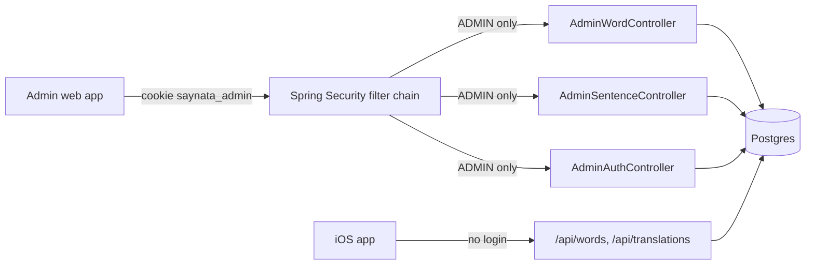
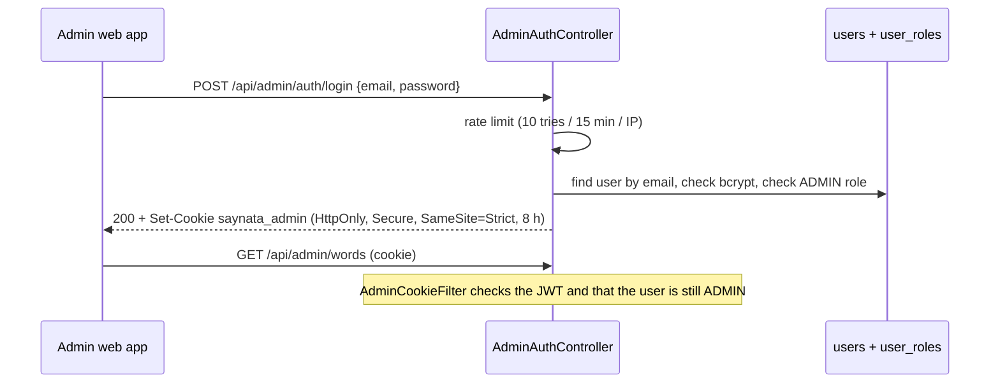

# Admin API

> Status: **backend built** (TASK-49.1, part of F5 Admin CMS, TASK-49). The admin web app is TASK-49.2. Last traced from code: 2026-10-14.
> Why: Postgres on the server is the single source of truth for content (doc-7, 2026-10-14). A person needs a safe way to read, fix and regenerate words and sentences.

## What it does

`/api/admin/**` is a small REST API for the admin web app (admin.loffy.me). An admin logs in with email and password, gets a signed cookie, and can then list, search, read, edit, mark as reviewed and delete the words (`word_lookup`) and sentences (`sentence_translation`) that Claude wrote. Deleting a row is "regenerate": the next public lookup asks Claude again. The public API (`/api/translations`, `/api/words/{word}`, `/actuator/health`) is unchanged and needs no login.

## Big picture

## Login

| Step | File:line | What happens |
|---|---|---|
| Accounts | [V5__create_users_and_roles.sql](../../../backend/src/main/resources/db/migration/V5__create_users_and_roles.sql) | Tables `users` (email unique, bcrypt hash) and `user_roles` (role ADMIN now, USER later). Also `sentence_translation.needs_review`. |
| First admin | [AdminBootstrap.java:36](../../../backend/src/main/java/com/englishtranslation/backend/admin/AdminBootstrap.java#L36) | At start-up, only when no ADMIN exists: creates one from `ADMIN_EMAIL` + `ADMIN_INITIAL_PASSWORD` (12+ characters). Logs the email, never the password. |
| Rules | [SecurityConfig.java:36](../../../backend/src/main/java/com/englishtranslation/backend/admin/SecurityConfig.java#L36) | Stateless. Only `/api/admin/**` needs ADMIN (login and logout are open, OPTIONS is open for CORS). Everything else stays open. No login gives 401. |
| CORS | [SecurityConfig.java:60](../../../backend/src/main/java/com/englishtranslation/backend/admin/SecurityConfig.java#L60) | Only for `/api/admin/**`: `https://admin.loffy.me` and `http://localhost:5173`, with credentials, `X-Total-Count` exposed. |
| Login | [AdminAuthController.java:54](../../../backend/src/main/java/com/englishtranslation/backend/admin/AdminAuthController.java#L54) | Same 401 "Wrong email or password." for unknown email, wrong password, or a user without ADMIN. Too many tries: 429. |
| Rate limit | [LoginRateLimiter.java:24](../../../backend/src/main/java/com/englishtranslation/backend/admin/LoginRateLimiter.java#L24) | In memory, per IP (the real IP from `X-Forwarded-For`, trusted only from a private or loopback proxy such as Caddy). A restart clears it. |
| Token | [AdminTokenService.java:46](../../../backend/src/main/java/com/englishtranslation/backend/admin/AdminTokenService.java#L46) | JWT HS256 with `ADMIN_JWT_SECRET` (32+ characters, or start-up fails), 8 hours, holds only the user id. |
| Cookie filter | [AdminCookieFilter.java:39](../../../backend/src/main/java/com/englishtranslation/backend/admin/AdminCookieFilter.java#L39) | Reads the cookie, checks the token, loads the user from the database and checks the ADMIN role again (so removing an admin works at once). |
| CSRF | [JsonWritesOnlyFilter.java:19](../../../backend/src/main/java/com/englishtranslation/backend/admin/JsonWritesOnlyFilter.java#L19) | Spring CSRF is off. Instead the cookie is SameSite=Strict, and every POST/PUT/DELETE under `/api/admin` must send `Content-Type: application/json` (else 415). The admin site and the API must share the site `loffy.me` (for example admin.loffy.me and api.loffy.me). |
| Me, logout | [AdminAuthController.java:77](../../../backend/src/main/java/com/englishtranslation/backend/admin/AdminAuthController.java#L77), [:84](../../../backend/src/main/java/com/englishtranslation/backend/admin/AdminAuthController.java#L84) | `GET /api/admin/auth/me` gives email and display name. `POST /api/admin/auth/logout` clears the cookie. |

## Words and sentences (Refine simple-rest shape)

| Request | File:line | What happens |
|---|---|---|
| `GET /api/admin/words?_start&_end&_sort&_order&q&needs_review` | [AdminWordController.java:62](../../../backend/src/main/java/com/englishtranslation/backend/admin/AdminWordController.java#L62) | JSON array and header `X-Total-Count`. `q` searches the word (case-insensitive, `%` and `_` match themselves). `_start` must be a multiple of the page size (Refine does this). Sort names: id, word, needsReview, model, promptVersion, createdAt. Page size at most 200. |
| `GET /api/admin/words/{id}` | [AdminWordController.java:81](../../../backend/src/main/java/com/englishtranslation/backend/admin/AdminWordController.java#L81) | `{id, word, entry, model, promptVersion, needsReview, createdAt}`. `entry` is the same `WordEntry` the public API returns. 404 when missing. |
| `PUT /api/admin/words/{id}` | [AdminWordController.java:87](../../../backend/src/main/java/com/englishtranslation/backend/admin/AdminWordController.java#L87) | Body `{"entry": {...}}`; other fields are ignored. [EntryParser](../../../backend/src/main/java/com/englishtranslation/backend/admin/EntryParser.java#L31) must read it as a `WordEntry` (unknown fields, empty text, bad example level or usage kind are errors), else 400 with a ProblemDetail that names the field. |
| `POST /api/admin/words/{id}/reviewed` | [AdminWordController.java:96](../../../backend/src/main/java/com/englishtranslation/backend/admin/AdminWordController.java#L96) | `needsReview = false`. |
| `DELETE /api/admin/words/{id}` | [AdminWordController.java:104](../../../backend/src/main/java/com/englishtranslation/backend/admin/AdminWordController.java#L104) | Deletes the row. The next `GET /api/words/{word}` calls Claude again. |
| Same for `/api/admin/sentences` | [AdminSentenceController.java](../../../backend/src/main/java/com/englishtranslation/backend/admin/AdminSentenceController.java#L63) | Search `q` is on the source text. Item: `{id, sourceText, targetLang, explanation{meaning, words, translation}, model, promptVersion, needsReview, createdAt}`. `PUT` body `{"explanation": {...}}` (the same shape as the public response). |

## Errors

| Cause | HTTP | What the admin web app gets |
|---|---|---|
| No or bad cookie | 401 | Empty body |
| Wrong email or password | 401 | "Wrong email or password." |
| More than 10 logins in 15 minutes from one IP | 429 | "Too many login attempts. Try again in 15 minutes." |
| Write without `Content-Type: application/json` | 415 | "Send Content-Type: application/json." |
| Bad entry JSON or bad list parameters | 400 | ProblemDetail `detail`, for example "entry.senses[0].examples[0].level must be one of: easy, harder, medium." |
| Unknown id | 404 | Standard problem body |
| `ADMIN_JWT_SECRET` missing (admin enabled) | start-up fails | Log: "Set ADMIN_JWT_SECRET to at least 32 characters". Set `ADMIN_ENABLED=false` to run without the admin API. |

## Tests

`AdminAuthTest` (login, cookie flags, 401, rate limit, CORS, public endpoints open), `AdminContentApiTest` (list/paging/search/filter, get, update, invalid JSON, reviewed, delete), `AdminSetupTest` (first admin, secret check, token), `AdminDisabledTest`.
Run: `cd backend && ./mvnw -B test`.

## Change checklist

- New env key: also `backend/.env.example`, `backend/docker-compose.prod.yml`, and doc-11.
- New field in `WordEntry` or `Explanation`: also the checks in `EntryParser`.
- New admin endpoint: it is covered by `/api/admin/**` automatically; add a 401 test.

## Known gaps

- Sense media and the bundled dictionary are not in Postgres yet (TASK-49.3).
- Only the ADMIN role is used. The USER role is ready in the tables for app users later.
- Not run against a real Postgres by the worker that built it (no Docker in that container). Flyway V5 and the `like ... escape` query ran on H2 in tests.
