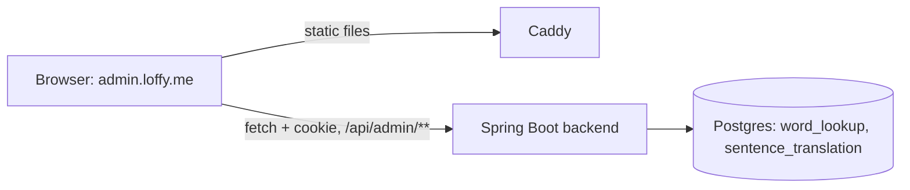
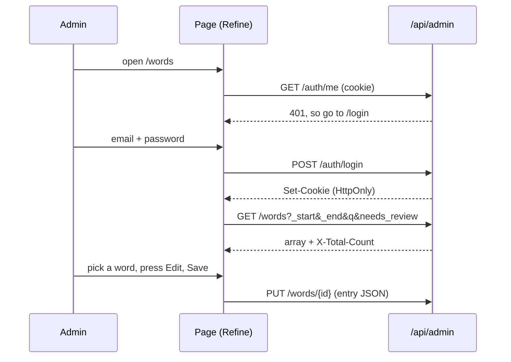

> Status: **built against the API contract of TASK-49.1** (the backend part is built in parallel; names may need small changes in `types.ts`). TASK-49.2. Last traced from code: 2026-10-14.
> Spec: F5 Admin CMS (TASK-49). Decisions: doc-7 rows 10-14 (Admin CMS, shadcn/ui + Refine, layout A, users with roles).

## What it does

A web page for the developer (and later other admins) to check what Claude wrote. After signing in, the left sidebar has Words, Sentences and Media.
Each page is a split view (layout A): a list with a search box and filter chips on the left, and the selected entry as a plain table of fields on the right.
Three icon-only buttons act on the entry: **Mark reviewed** (check), **Edit** (pencil, a form plus a JSON tab) and **Regenerate** (arrow, asks for confirmation in the page, then deletes the entry so Claude makes it again on the next request).
Media is a placeholder until TASK-49.3.

## Big picture



The admin app is only static files (`admin/dist`). The login cookie is HttpOnly, so the page never reads it; it only sends it back (`credentials: 'include'`, axios `withCredentials`).

## Step by step



| Step | File:line | What happens |
|---|---|---|
| Routes, login guard | [App.tsx:25](../../../admin/src/App.tsx#L25) | Pages inside `Authenticated`; without a login, go to `/login` |
| Login, check, logout | [authProvider.ts:21](../../../admin/src/providers/authProvider.ts#L21) | `fetch` to `/api/admin/auth/*`; signed in only if `/me` has the ADMIN role; a 401 anywhere logs out ([onError](../../../admin/src/providers/authProvider.ts#L53)) |
| Data provider | [dataProvider.ts:7](../../../admin/src/providers/dataProvider.ts#L7) | Refine simple-rest on `${VITE_API_URL}/api/admin`, axios with cookies |
| List, search, chips | [EntryBrowser.tsx:67](../../../admin/src/components/EntryBrowser.tsx#L67) | `q` and `needs_review` go to the backend; Bundled, From backend and A1-A2 / B1-B2 filter the loaded page |
| Mark reviewed, regenerate, save | [EntryBrowser.tsx:113](../../../admin/src/components/EntryBrowser.tsx#L113) | `POST /{id}/reviewed`, `DELETE /{id}`, `PUT /{id}`; then the list is fetched again |
| Regenerate confirm | [EntryActions.tsx:38](../../../admin/src/components/EntryActions.tsx#L38) | Inline panel; nothing is deleted until the check is pressed |
| Edit: Form and JSON tabs | [EntryEditor.tsx:32](../../../admin/src/components/EntryEditor.tsx#L32) | One draft; switching to Form parses the JSON and stops with a message if it is not valid |
| Word fields | [WordsPage.tsx:25](../../../admin/src/pages/WordsPage.tsx#L25) | Table: IPA, sources, each sense (type + CEFR, explanation, 3 examples, usage, Vietnamese last, media) |
| Sentence fields | [SentencesPage.tsx:13](../../../admin/src/pages/SentencesPage.tsx#L13) | Sentence, simple explanation, words, translation last |
| API types | [types.ts](../../../admin/src/api/types.ts) | All shapes in one file; change them here when the backend differs |

## Errors

| Cause | Where | What the admin sees |
|---|---|---|
| Wrong email or password (401) | login | "Wrong email or password." under the form |
| Too many tries (429) | login | "Too many tries. Wait a minute and try again." |
| Session ended (401 on any call) | `onError` | Back to the login page |
| Invalid JSON in the JSON tab | editor | Red message; the tab does not change |
| Backend rejects the entry (400) | save | The backend message under the editor |
| List cannot load | list | "Could not load the list." |

## Run it

```bash
cd admin
cp .env.example .env.local      # VITE_API_URL=http://localhost:8081
npm ci
npm run dev                     # http://localhost:5173
```

The backend must allow CORS with credentials for `http://localhost:5173` (TASK-49.1). Production build and Caddy: see [Deploy to a VPS](../guides/doc-11%20-%20Deploy-to-a-VPS.md).

## Tests

`cd admin && npm test` (Vitest + Testing Library, no network).

| Test file | What it covers |
|---|---|
| `src/test/dataProvider.test.ts` | List URL (`_start`, `_end`, `_sort`, `_order`, `q`, `needs_review`), `X-Total-Count`, PUT, DELETE, cookies on |
| `src/test/login.test.tsx` | Login request (method, body, `credentials: include`), 401 message, ADMIN check, login form |
| `src/test/wordsPage.test.tsx` | List and badges, Needs review chip sends `needs_review=true`, source chip, field table, icon buttons, regenerate confirm, edit form and JSON tab |

## Change checklist

- Backend field renamed: change `admin/src/api/types.ts`, then the pages and tests the compiler points at.
- New chip: add it to `chips` in `WordsPage.tsx` or `SentencesPage.tsx` (server chips need backend support).
- New admin section: route in `App.tsx`, link in `Layout.tsx`.

## Known gaps

- Bundled / From backend and CEFR chips filter only the loaded page (20 items) until the backend supports `source` and `cefr` filters.
- IPA is shown but not edited: the contract says PUT sends the entry only.
- Media page is a placeholder (TASK-49.3).
- No Sentences "bundled" or CEFR chips: sentences have neither.
- Screens were not checked in a real browser against the real backend yet; the tests use mocked data.
