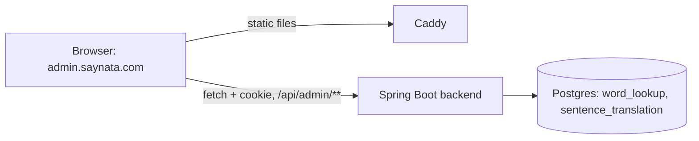
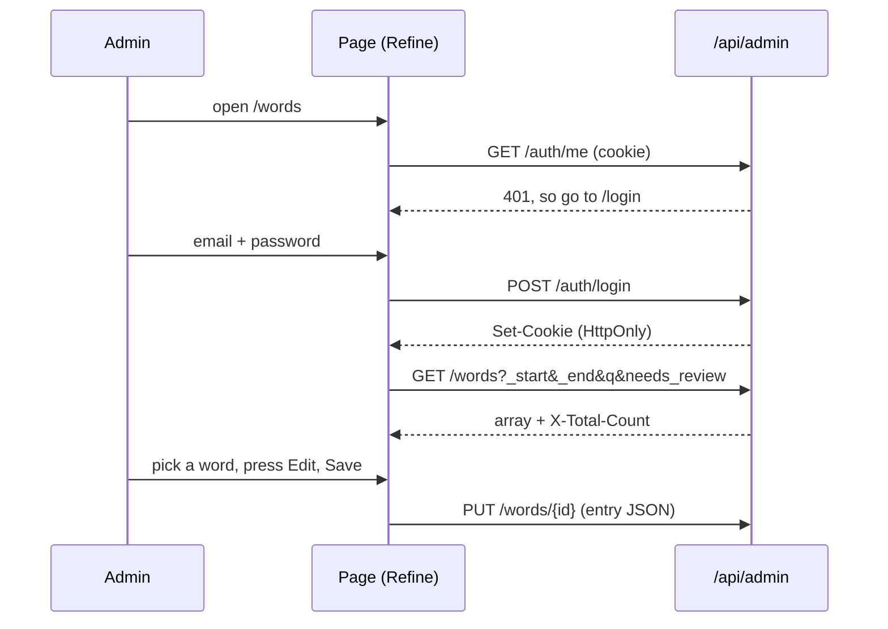

> Status: **built against the API contract of TASK-49.1** (the backend part is built in parallel; names may need small changes in `types.ts`). TASK-49.2. Last traced from code: 2026-10-23 (Filter menu with counts, Pending queue rows, one status badge: TASK-101; edit form sections and the bottom Cancel/Save bar: TASK-99.4; Sentences as a table too: TASK-99.3; Words as a table with a drawer, media chips in a Media menu: TASK-99.2; Isomorphic look: shell, top bar search, account menu, split sign-in: TASK-99.1); earlier: 2026-10-18 (the Sparkles button opens the AI picture dialog and the row shows the drawing job: TASK-91); earlier: 2026-10-16 (list/grid toggle, grid cards, side drawer and the big hover preview: TASK-81; Wrong media and Media to review chips, row badges, Looks right button, Claude verdict under the media: TASK-80; Upload button and drop on the Media row: TASK-79; earlier: Remove all media button: TASK-76; hover to play a clip in the list and the full-size viewer: TASK-77; word list rows with a thumbnail and the Vietnamese line: TASK-62; the Media row resets per word and sense: TASK-64; infinite scroll in the list: TASK-54; Media row: TASK-52; review reasons: TASK-55; every chip is a server filter, Has media and No media chips, the list is read again after the check button: TASK-57, TASK-59, TASK-60).
> Spec: F5 Admin CMS (TASK-49). Decisions: doc-7 rows 10-14 (Admin CMS, shadcn/ui + Refine, layout A, users with roles).

## What it does

**Look (TASK-99, 2026-10-23):** the Isomorphic admin template's look on our own code (doc-7). A white sidebar with the Saynata logo, a CONTENT label and Words, Sentences, Media (the active link has a teal bar on the left); a top bar with a search field ([HeaderSearch](../../../admin/src/components/Layout.tsx#L29): Enter opens `/words?q=<text>`, and the Words list starts with that search, [EntryBrowser.tsx:99](../../../admin/src/components/EntryBrowser.tsx#L99)) and a round avatar that opens the account menu with Sign out ([AccountMenu](../../../admin/src/components/Layout.tsx#L53)); every page has a title and a breadcrumb ([PageHeader](../../../admin/src/components/PageHeader.tsx)) and sits in a white card. Colours are the Saynata sage teal tokens in [index.css](../../../admin/src/index.css); text is Inter, headings Lexend Deca (Google Fonts in `index.html`). Badges are small soft boxes (`outline` grey, `warning`, `success`, `danger`, optional dot). The sign-in page is split: the form on the left, a teal brand panel on the right (hidden on narrow screens).

A web page for the developer (and later other admins) to check what Claude wrote. After signing in, the left sidebar has Words, Sentences and Media.
The **Words** and **Sentences** pages are tables (TASK-99.2, TASK-99.3, Isomorphic list page): search and filter chips above, one row per entry, and a click on a row opens the entry (a plain table of fields) in a drawer on the right. Both load 50 more entries when you scroll near the end (TASK-54).
Icon-only buttons act on the entry: **Mark reviewed** (check), **Edit** (pencil, a form plus a JSON tab) and **Regenerate** (arrow, asks for confirmation in the page, then deletes the entry so Claude makes it again on the next request). On the **Words** page there is a fourth one, **Remove all media** (image-off icon, TASK-76). It is greyed out when no sense of the word has media. It asks "Remove the pictures and clips of all senses of <word>? The app stops showing them." and then sends `DELETE /words/{id}/media`; afterwards the Media rows show "-" and the list thumbnail becomes the dash.
In a word's detail, each sense has a **Media row**: the current photo or clip with its Pixabay credit, and four icon-only buttons to fix it (TASK-52, TASK-79). **Click the photo or clip to see it full size** (TASK-77): **Pick another** (images), **No image** (image-off) **Draw an AI picture** (sparkles, TASK-91: opens a dialog) and **Upload** (a tray with an arrow, TASK-79: your own picture or clip from your computer). The Media page in the sidebar is still a placeholder.

## Big picture



The admin app is only static files (`admin/dist`). The login cookie is HttpOnly, so the page never reads it; it only sends it back (`credentials: 'include'`, axios `withCredentials`).

## Step by step



| Step | File:line | What happens |
|---|---|---|
| Routes, login guard | [App.tsx:25](../../../admin/src/App.tsx#L25) | Pages inside `Authenticated`; without a login, go to `/login` |
| Login, check, logout | [authProvider.ts:21](../../../admin/src/providers/authProvider.ts#L21) | `fetch` to `/api/admin/auth/*`; signed in only if `/me` has the ADMIN role; a 401 anywhere logs out ([onError](../../../admin/src/providers/authProvider.ts#L53)) |
| Data provider | [dataProvider.ts:7](../../../admin/src/providers/dataProvider.ts#L7) | Refine simple-rest on `${VITE_API_URL}/api/admin`, axios with cookies |
| List, search, chips | [EntryBrowser.tsx:83](../../../admin/src/components/EntryBrowser.tsx#L83), [filters:122](../../../admin/src/components/EntryBrowser.tsx#L122), [toggleChip:230](../../../admin/src/components/EntryBrowser.tsx#L230) | `useInfiniteList`, 50 per page. **Filter menu (TASK-101, mockup 2026-10-23):** one **Filter** button ([FilterMenu:39](../../../admin/src/components/FilterMenu.tsx#L39)) opens a menu of parent groups and their choices; the chosen ones show as tags next to it, each with an icon-only X (`Remove filter <name>`). Words: **Level** A1-A2, B1-B2, C1-C2 (check boxes, `combine: "any"`, OR-ed into one `cefr` list), **Source** Bundled ("On the phone, inside the app. Works offline.") or Backend database (round buttons, one at a time), **Status** Pending or Needs review. Sentences: Status Needs review. **Every choice shows a count** ([Count:18](../../../admin/src/components/FilterMenu.tsx#L18)): the list endpoint with that choice alone and one row asked (`_end=1`), read from `X-Total-Count`; it uses the same Refine resource as the list, so every action that reloads the list (`invalidates: ["all"]`) reloads the counts too. The counts are asked only while the menu is open. **Every choice is a server filter** (TASK-59), except Pending: a chip is `{id, label, group, description, field, value, combine, pending}`, `field` is the query parameter; different fields are AND-ed. The level is the level of the **first sense** (the backend column). A new search or choice changes the query key, so the list starts again at page 1. The old media chips (Has media, No media, Wrong media, Media to review) and their menu are gone (the developer's choice), the backend `media` filter stays |
| Infinite scroll | [EntryBrowser.tsx:159](../../../admin/src/components/EntryBrowser.tsx#L159) | A sentinel row at the end of the list is watched with `IntersectionObserver` (200px early). When it shows, `fetchNextPage` runs; there is a next page while the loaded rows are fewer than `X-Total-Count`. A spinner row shows while loading; the footer says "120 of 2,750" (no arrows). The selected id lives outside the pages, so it stays selected; after an edit the loaded pages are fetched again in place, without going back to the top (see the next row) |
| Mark reviewed, regenerate, save | [EntryBrowser.tsx:201](../../../admin/src/components/EntryBrowser.tsx#L201) | `POST /{id}/reviewed`, `DELETE /{id}`, `PUT /{id}`; then the loaded pages are fetched again. This uses `invalidate({ invalidates: ["all"] })`, **not** `["list"]`: Refine keeps an infinite list under the key `infinite`, and `"list"` does not reach it. Before TASK-57 the old rows (and the "Needs review" badge) stayed on screen after the check button until the page was reloaded, although the backend had already cleared the flag. A test marks a word reviewed and checks that the list is loaded again without the badge |
| Regenerate confirm | [EntryActions.tsx:52](../../../admin/src/components/EntryActions.tsx#L52) | Inline panel; nothing is deleted until the check is pressed |
| Remove all media | [EntryActions.tsx:38](../../../admin/src/components/EntryActions.tsx#L38), [removeMedia:205](../../../admin/src/components/EntryBrowser.tsx#L205), [confirm:74](../../../admin/src/components/EntryActions.tsx#L74) | TASK-76. `EntryBrowser` has an optional `hasMedia` prop; only the Words page passes it, so Sentences have no such button. The button (lucide `ImageOff`, the same icon as No image) is `disabled` when `hasMedia(word)` is false (no sense has media). The inline confirm works like Regenerate's. The check button sends `DELETE ${apiUrl}/words/{id}/media` with `Content-Type: application/json` (the backend needs it) through `run()`, which then reads the list again with `invalidates: ["all"]` (the PR #58 fix), so the thumbnail, the Media rows and the disabled state update. An error shows under the buttons. |
| Edit: Form and JSON tabs | [EntryEditor.tsx:33](../../../admin/src/components/EntryEditor.tsx#L33) | One draft; switching to Form parses the JSON and stops with a message if it is not valid. **Isomorphic form look (TASK-99.4):** the tabs are underlined text tabs; Cancel (X) and Save are icon-only at the **bottom**, Cancel first, in a bar that stays visible while the form scrolls. Each part of a form is a [FormSection:100](../../../admin/src/components/EntryEditor.tsx#L100) (a `<section>` named by its title): the title and a short hint on the left, the fields on the right. Words: one section per sense ("Simple English first. Vietnamese is the last field."), the Needs review box on a soft warning background above. Sentences: Meaning, Words, Translation. The drawer is `max-w-3xl` so the two columns fit; dialogs and the drawer are white cards (`bg-card`). |
| Media row, Pick another panel | [MediaRow.tsx:22](../../../admin/src/components/MediaRow.tsx#L22) | Pick another opens a panel **inline, under the row** (not a dialog) and searches at once with the sense's own words: [search:57](../../../admin/src/components/MediaRow.tsx#L57) calls `GET /media/search?sense=b-12:0`, and the answer fills the search input. 3x2 grid of up to 6 results; a clip has a small "clip" mark; the chosen tile gets an accent outline; the check button ([apply:72](../../../admin/src/components/MediaRow.tsx#L72)) sends the result with `PUT /words/{id}/senses/{n}/media`. [noImage:82](../../../admin/src/components/MediaRow.tsx#L82) is `DELETE` and the Sparkles button no longer calls `mark-for-ai`: it opens the AI picture dialog (next rows). A sense that is marked `needs_ai` still shows "Waiting for an AI image" (the old endpoint stays for the pipeline). After a change the word list is read again. Each result tile has a small **zoom icon** (top right, a separate button, so a click on the tile still selects it) that opens the full-size viewer. A marked sense shows "Waiting for an AI image". **Picture review (TASK-80):** an icon-only check button (`Check`, aria-label "Picture looks right", [toggleApproved:101](../../../admin/src/components/MediaRow.tsx#L101)) sits next to the media buttons when the sense has media: `POST .../media/approve`; when the sense is approved a small "Approved" label shows, the button is `aria-pressed` and a click undoes it with `DELETE .../media/approve`. Approving also clears the AI mark. The newest Claude check of the current media shows under the picture as `Claude: wrong — reason` (secondary text, read-only). The list no longer shows picture review badges (TASK-101); the approval state is only in the Media row. Errors show the backend message under the row. Every write sends `Content-Type: application/json` (the backend needs it). |
| Word list row | [Thumb:153](../../../admin/src/pages/WordsPage.tsx#L153), [row markup:322](../../../admin/src/components/EntryBrowser.tsx#L322) | TASK-62, mockup option A (the developer's choice, 2026-10-15). A word row has a small rounded **thumbnail** (about 56x42) on the left. It shows the photo of the **first sense**, a play icon for a clip (it plays on hover, see the next row), or a quiet dash when there is no media. Photos use `loading="lazy"`. On the right of it, line 1 is the bold word with the badges (Bundled or Backend, Needs review, "N problems"), and line 2 is the first sense's **Vietnamese** meaning in secondary text. The English explanation is not in the row; the detail still has it. `EntryBrowser` has an optional `itemThumb` prop; the Sentences list does not pass it, so it is unchanged. The list API already sends `entry` and `media` for every row, so there is no new field. |
| Hover to play | [HoverClip:83](../../../admin/src/pages/WordsPage.tsx#L83), [hoveredId](../../../admin/src/components/EntryBrowser.tsx#L107), [pointer events:326](../../../admin/src/components/EntryBrowser.tsx#L326) | TASK-77 (mockup approved 2026-10-15). While the mouse is over a row whose first sense has a clip, the thumbnail plays it: muted, looping, `playsInline`, covering the 56x42 box (`object-cover`) over the play icon. `EntryBrowser` keeps one `hoveredId` and passes `hovered` to `itemThumb(item, hovered, variant)`. The `<video>` is **created only for the hovered row** (so there is at most one `<video>` in the list, and a list of 50 clips loads nothing until hovered); when the mouse leaves, the effect cleanup calls `pause()`, sets `currentTime = 0`, and the video is removed, so the still shows again. Photos and rows without media do nothing. A finger tap is ignored (`pointerType === "touch"`), so touch screens never start a clip by accident. If `play()` is refused, the still stays. |
| Table view (Words) | [table:353](../../../admin/src/components/EntryBrowser.tsx#L353), [columns:315](../../../admin/src/pages/WordsPage.tsx#L315), [chip groups:322](../../../admin/src/components/EntryBrowser.tsx#L322) | TASK-99.2, mockup A (2026-10-23). `EntryBrowser` takes an optional `columns` prop; with it the list view is a `<table aria-label="Rows">` in place of the split view (grid view is unchanged). The first column is the item (thumbnail, word, Vietnamese line) inside a button with `aria-pressed`; the Words page adds **Level** (first sense CEFR), **Source** (Bundled / Backend, plain grey text) and **Status**. **Only problems get a badge** (TASK-101): a word that is fine shows nothing; a flagged word shows one badge **Needs review · N** ([NeedsReviewBadge:70](../../../admin/src/pages/WordsPage.tsx#L70), N = the number of `reviewReasons`, the reasons are its tooltip). The grid cards show the same badge. The Reviewed, Bundled/Backend, N problems, Wrong media, N to review and No media badges are gone. A click anywhere on the row opens the entry in the same right drawer (`Sheet`) as the grid; the drawer is a modal, so to open another word you close it first (Esc or the X). The header row sticks while the list scrolls; the infinite-scroll sentinel is the last `<tr>`. **Sentences** (TASK-99.3, [columns](../../../admin/src/pages/SentencesPage.tsx)): the sentence with its simple meaning, then **Language**, **Status** (a Needs review badge only when flagged) and **Model**. With `columns` on both pages the old split view is no longer used, but `EntryBrowser` still supports it. |
| Pending (TASK-101) | [PendingQueue:28](../../../admin/src/components/PendingQueue.tsx#L28), [remove:68](../../../admin/src/components/PendingQueue.tsx#L68), [toggleChip:230](../../../admin/src/components/EntryBrowser.tsx#L230) | **Pending** = words a learner met in a sentence that are not in the database yet: rows of the prefill queue (`prefill_item`, TASK-100, doc-18). The night job answers them; then they leave Pending and show up as normal Words rows. Choosing Pending (a chip with `pending: true`, never sent as a filter) shows a second table, `aria-label="Pending"`, in place of the list: Word, Seen (how many sentences had it), From ("In a sentence" for `sentence-words`), Queued (date), a Pending badge, and an icon-only trash button (`Remove <word> from the queue`). It reads `GET /prefill/items?kind=word&status=pending` (with the search as `q`), 50 per page with the same infinite scroll. Pending is **on alone**: choosing it turns the other choices off, and any other choice turns it off. Remove asks first in the row (check / X), then sends `DELETE /prefill/items/{id}` with a JSON `Content-Type` and reloads the `prefill/items` resource, so the row and the Pending count update. The server keeps the row as `skipped`, so the same word is not queued again. The Sentences page asks `kind=sentence`. |
| List / grid toggle | [chooseView:215](../../../admin/src/components/EntryBrowser.tsx#L215), [readView](../../../admin/src/components/EntryBrowser.tsx#L74) | TASK-81, mockup option A (2026-10-16). Next to the search box, two icon-only buttons (lucide `List` and `LayoutGrid`, `aria-label` "List view" / "Grid view", `aria-pressed`). They show only when the page passes `itemThumb` (the Words page; Sentences have no toggle). The choice is saved in `localStorage` under `admin.words.view` (`"list"` or `"grid"`) and read again when the page opens; every read and write is in `try/catch`, so a blocked storage means the list view and a choice that lasts until the page closes. |
| Grid view | [grid ul:308](../../../admin/src/components/EntryBrowser.tsx#L308), [Sheet](../../../admin/src/components/ui/sheet.tsx#L15) | TASK-81. In grid mode the page is one column: the `<ul aria-label="Grid">` is a CSS grid, `repeat(auto-fill, minmax(160px, 1fr))` (about 5 cards on a laptop). A card shows the thumbnail (4:3, a clip shows its first frame with a play icon), the word, the Vietnamese line, and the same badges as the list row (Needs review, Bundled or Backend, "N problems", Wrong media, "N to review"). The selected card has an accent outline. Search, chips, the footer total and **infinite scroll** are the same code as the list: the sentinel is the last grid cell (`col-span-full`) and the grid is the scroll container. A click on a card selects the word and opens the same entry (table, editor, actions) in a **Sheet**: a right drawer made with Radix Dialog (focus trap, Esc, icon-only Close button). Closing it, or deleting the word, clears the selection. The full-size viewer (`MediaLightbox`) opens on top of the drawer. |
| Hover preview | [PreviewCard:126](../../../admin/src/pages/WordsPage.tsx#L126), [previewCaption:115](../../../admin/src/pages/WordsPage.tsx#L115), [HoverCard](../../../admin/src/components/ui/hover-card.tsx#L9) | TASK-81. Resting the mouse on a thumbnail (list row **and** grid card) for 300 ms opens a shadcn HoverCard (`@radix-ui/react-hover-card`) with the full-size photo, or the clip playing muted and looped (the `<video>` exists only while the card is open). The caption is "word, sense 1, source (Pixabay, AI or Upload)", plus "Wrong picture" or "Needs review" (not approved yet) from `mediaReview`. The card opens on the right and flips or slides (`collisionPadding` 12) to stay inside the window. A finger never opens it (Radix ignores touch). Only the first sense is shown, because the list shows only the first sense's picture. |
| Media row, Upload | [uploadFile:100](../../../admin/src/components/MediaRow.tsx#L100), [onDrop:137](../../../admin/src/components/MediaRow.tsx#L137), [MediaCell:291](../../../admin/src/components/MediaRow.tsx#L291) | TASK-79. A fourth icon-only button (lucide `Upload`, `aria-label="Upload a picture or clip"`) next to the three others. It clicks a hidden `<input type="file" accept="image/*,video/*">`. The chosen file (or a file dropped on the Media row) is sent as `FormData` with `POST /words/{id}/senses/{n}/media/upload` and the header `X-Requested-With` (the browser adds the multipart `Content-Type`; the backend needs the header for a form upload). While a file is dragged over the row it gets a light dashed outline; dragged text is ignored. While uploading the Upload icon is a spinner (`role=status`, "Uploading") and the buttons are disabled. Afterwards the list is read again with `invalidates: ["all"]`, so the thumbnail and the Media row update. An upload shows the caption **Uploaded by the admin** (no Pixabay link) in the row and in the viewer. Errors (wrong type, too big, convert failed) show the backend message under the row; a 413 with no details says "That file is too big." |
| Media row, AI picture dialog | [AiPictureDialog.tsx:32](../../../admin/src/components/AiPictureDialog.tsx#L32), [open it: MediaRow.tsx:235](../../../admin/src/components/MediaRow.tsx#L235), [ui/dialog.tsx](../../../admin/src/components/ui/dialog.tsx) | TASK-91, mockup layout A (the developer's choice, 2026-10-18). The Sparkles button (aria-label "Draw an AI picture") opens a **dialog** (Radix Dialog through the new shadcn `Dialog`; focus trap, Esc). Header: sparkles icon, "AI picture", "run, sense 1 (verb)", a Close (X) icon button. Under it the current picture (or "No picture") next to the meaning and a muted line: "Prompt from: last media-ai scene (ai-v1)", "Prompt from: template" or "Prompt from: new Claude scene". Then a tall textarea with the prompt and a counter (n / 4000). Bottom row, all icon-only with `aria-label` and `title`: undo ("Put back the first prompt"), wand ("Write a new scene with Claude", the title says about $0.02), a muted text "today 3 of 30 pictures · $0.04 of $1.00", Cancel (X) and the primary Check ("Draw the picture"). On open the dialog reads `GET .../ai-prompt` ([effect:46](../../../admin/src/components/AiPictureDialog.tsx#L46)); the wand is [writeNewScene:73](../../../admin/src/components/AiPictureDialog.tsx#L73) (`POST .../ai-prompt/scene`); OK is [draw:96](../../../admin/src/components/AiPictureDialog.tsx#L96): an empty prompt shows "Write a prompt first." and a prompt over 4000 characters shows an error, neither sends anything. The body is `{prompt, source}` where `source` is the first source, or `edited` when the text was changed. On 202 the dialog closes; on 409, 429, 503 or 422 it stays open with the backend message. |
| Media row, the drawing job | [drawing:102](../../../admin/src/components/MediaRow.tsx#L102), [polling:105](../../../admin/src/components/MediaRow.tsx#L105), [AI_POLL_MS:16](../../../admin/src/components/MediaRow.tsx#L16) | TASK-91. While a job is queued or drawing (the word says `mediaStatus[n] = "ai_drawing"`, or the job just started) the row shows a dashed placeholder with a spinner and "Drawing an AI picture… you can leave this page", and the Sparkles button is off. Every 3 seconds it asks `GET .../ai-picture`. The state is in the database, so a reloaded page or another browser finds it again (the word list already carries `ai_drawing`). When the job is `done` the word list is read again and the new picture shows with its credit "AI image (codex)" (and the sense is in "Media to review"). When it is `failed` a red line shows the error and says the old picture is kept. If the page is reloaded after a failure, the line is gone (the job stays in the database, the sense is back to normal). |
| Full-size viewer | [MediaLightbox.tsx:23](../../../admin/src/components/MediaLightbox.tsx#L23), [open from the Media row](../../../admin/src/components/MediaRow.tsx#L214), [mount:204](../../../admin/src/components/MediaRow.tsx#L204) | TASK-77. Radix `Dialog` (`@radix-ui/react-dialog`, the part shadcn's Dialog is made of) gives the focus trap, Esc to close and `aria-modal`. Dark backdrop `bg-black/75`; the photo or clip is shown as large as fits (`max-h-[80vh] max-w-[92vw]`, `object-contain`). A clip plays with controls, looping, **muted until the viewer unmutes**. The caption is `<word> · sense N · Photo|Clip by <author> on Pixabay` (the author links to the Pixabay page), or `<word> · sense N · Uploaded by the admin` for an uploaded file and is the dialog title. The only button is an icon-only **Close** (X, top right, `aria-label="Close"`). Esc, Close and a click on the backdrop close it. Radix returns the focus only to a `Dialog.Trigger`, which we do not use, so the component remembers the element that had the focus when it opened and focuses it again on close. The Media row's photo or clip is wrapped in a button (`aria-label="View <word>, sense N full size"`); a Pick-another tile has its own zoom button (`View result N full size`) and shows the result's `downloadUrl` (a 640 px photo, or the clip file). |
| Media row per word | [detailRows:189](../../../admin/src/pages/WordsPage.tsx#L189), [MediaCell video:222](../../../admin/src/components/MediaRow.tsx#L222) | TASK-64. `MediaRow` is keyed by word id and sense index, so choosing another word starts it fresh: the open Pick another panel, its results, the search text and the error are gone, and the photo or video is the new word's. The `<video>` has `key={media.url}` too, so the browser loads the new file instead of keeping the old one. |
| Review reasons | [ReviewReasons:53](../../../admin/src/pages/WordsPage.tsx#L53) | `reviewReasons` from the API (TASK-55). Under the **Status** row ([WordsPage.tsx:195](../../../admin/src/pages/WordsPage.tsx#L195)) a short list next to the "Needs review" badge; the same list at the top of the edit form ([WordForm:242](../../../admin/src/pages/WordsPage.tsx#L242); `EntryBrowser` passes the selected item as the third argument of `renderForm`, [EntryBrowser.tsx:252](../../../admin/src/components/EntryBrowser.tsx#L252)). When the word needs review but the list is empty it says "No problems found now; press ✓ to mark it reviewed". The flag is never cleared by the page. A reviewed word shows nothing. Sentences have no check yet. **In the list row** ([ReasonCount:51](../../../admin/src/pages/WordsPage.tsx#L51), TASK-57) a flagged word shows a small badge next to "Needs review": "2 problems", "1 problem" or "0 problems". The reasons are the tooltip (the `title` attribute, one per line); for "0 problems" the tooltip is the same hint as above. |
| Word fields | [WordsPage.tsx:233](../../../admin/src/pages/WordsPage.tsx#L233) | Table: IPA, sources, each sense (type + CEFR, explanation, 3 examples, usage, Vietnamese last, media) |
| Sentence fields | [SentencesPage.tsx:13](../../../admin/src/pages/SentencesPage.tsx#L13) | Sentence, simple explanation, words, translation last |
| API types | [types.ts](../../../admin/src/api/types.ts) | All shapes in one file; change them here when the backend differs |

## Sources page (TASK-108)

"Sources" in the left navigation (`/sources`, [SourcesPage](../../../admin/src/pages/SourcesPage.tsx)) turns a book into queue items. A drop zone ("Drop a .txt or .md file", "Up to 5 MB. Only the word list is kept, never the text.") and a Title field start an upload (`POST /sources`, multipart with `X-Requested-With`). Then four count tiles (Words in file, Known, New words, New phrases), the filter chips **Useful**, **Rare** and **Names skipped** with their counts, and a table: a pick checkbox, the word (a "phrase" badge for phrases), Times, Common (the Zipf score) and Seen in (a snippet of at most 12 words). Names are listed only to read; they cannot be picked. The footer shows "N picked" and the button "Add N to queue" (`POST /sources/{id}/queue`); afterwards the picks are locked and a green line says how many were added. The table shows 200 rows at a time. See [Admin API](doc-13%20-%20Admin-API.md#sources-a-book-into-the-queue-task-108).

## Errors

| Cause | Where | What the admin sees |
|---|---|---|
| Wrong email or password (401) | login | "Wrong email or password." under the form |
| Too many tries (429) | login | "Too many tries. Wait a minute and try again." |
| Session ended (401 on any call) | `onError` | Back to the login page |
| Invalid JSON in the JSON tab | editor | Red message; the tab does not change |
| Backend rejects the entry (400) | save | The backend message under the editor |
| List cannot load | list | "Could not load the list." |
| Pixabay search or download fails, too many searches, no Pixabay key (502, 429, 503) | Media row | The backend message in red under the row; the panel stays open |
| Upload: wrong type or broken file (400), too big (413), convert failed (502) | Media row | The backend message in red under the row; the old media stays |
| AI picture: Codex not set up (503), job running (409), daily picture limit (429), wand limit (503), cannot be drawn (422), job failed | AI picture dialog, Media row | The backend message in red in the dialog (start errors) or under the row (a failed job); the old picture stays |

## Run it

```bash
cd admin
cp .env.example .env.local      # VITE_API_URL=http://localhost:8081
npm ci
npm run dev                     # http://localhost:5173
```

The backend must allow CORS with credentials for `http://localhost:5173` (TASK-49.1). Production build and Caddy: see [Deploy to a VPS](../guides/doc-11%20-%20Deploy-to-a-VPS.md).

## Tests

`cd admin && npm test` (Vitest + Testing Library, no network).

| Test file | What it covers |
|---|---|
| `src/test/dataProvider.test.ts` | List URL (`_start`, `_end`, `_sort`, `_order`, `q`, `needs_review`), `X-Total-Count`, a level list as repeated `cefr` params with `source` and `media`, PUT, DELETE, cookies on |
| `src/test/login.test.tsx` | Login request (method, body, `credentials: include`), 401 message, ADMIN check, login form |
| `src/test/sourcesPage.test.tsx` | TASK-108: the drop zone text, the form upload with the header and the title (or the file name), a dropped file, the four counts and the chips, the table rows with the phrase badge, the chips switching rows, names without a checkbox, picking and "Add N to queue" with the right body, locked picks after queueing, the backend message and the 413 text |
| `src/test/mediaUpload.test.tsx` | TASK-79: the Upload button is icon only and opens the picker (`image/*,video/*`), the file is sent as FormData with `X-Requested-With`, spinner and disabled buttons while uploading, the backend error and the 413 text, a dropped file is uploaded with a dashed outline while dragging, dragged text is ignored, the caption "Uploaded by the admin" in the row and in the viewer |
| `src/test/mediaRow.test.tsx` | TASK-77: the full-size viewer opens from the photo, a clip and a Pick-another zoom button (right source and caption); Esc, the Close button and a backdrop click close it; the focus goes back; a zoom does not select the tile. Also:  Three icon-only buttons, panel opens inline and fills the search input, up to 6 tiles with the clip mark, search again with typed words, apply sends the chosen result (PUT, JSON header), No image (DELETE), Mark for AI (POST), the marked note, the backend error message |
| `src/test/aiPicture.test.tsx` | TASK-91: the dialog opens with the fetched prompt, the picture, the meaning, the source line and the limits of the day; icon-only buttons with names; an empty prompt and a prompt over 4000 characters show an inline error and send nothing; the wand replaces the prompt and the undo puts the first one back; OK posts `{prompt, source}` (`edited` after a change), closes the dialog and the row shows the drawing state; server errors keep the dialog open; Cancel; with fake timers: a word that is already `ai_drawing` polls every 3 seconds and stops when done, a failed job shows the error with the old picture, one failed request does not stop the polling. |
| `src/test/infiniteScroll.test.tsx` | 50 words first, next page when the end is on screen (fake `IntersectionObserver`), count line "50 of 120" with no arrows, stops at the total, filter change goes back to page 1, **From backend is a server filter: one request, "40 of 40", no extra pages, no "Nothing found"** (TASK-59), selection kept when more load |
| `src/test/wordRows.test.tsx` | TASK-62: lazy photo thumbnail with the Vietnamese line and no English explanation, play icon for a clip (no `<video>` in the list until hover), dash with no media. TASK-77: hover starts and stops playback (`HTMLMediaElement.play`/`pause` are spied), one `<video>` at a time, no video for a photo, none for a touch pointer. TASK-76: the Remove all media button is icon-only and disabled without media, asks first, sends `DELETE /words/{id}/media`, then the list is read again (thumbnail dash, Media row gone, button disabled), and shows an error. TASK-64: select word 1, open Pick another, select word 2: the panel is closed and word 2's media shows |
| `src/test/wordsGrid.test.tsx` | TASK-81: list by default, the toggle buttons are icon only, the choice is saved and read again, blocked storage does not break the toggle, grid cards (thumbnail, word, Vietnamese, badges), a card click opens the drawer and Close closes it, a chip in grid mode is sent to the backend, the hover preview shows the full image and caption, a clip preview is muted and looped |
| `src/test/wordsPage.test.tsx` | List and badges, Needs review chip sends `needs_review=true`, source chip sends `source` and shows only what the server returns, source chips one at a time, level chips OR-ed into one `cefr` list, `media=with` / `without` / `wrong` / `to-review` one at a time, "Wrong media" and "N to review" badges, reason count and tooltip in the list row, the check button posts and the list is loaded again without the flag, field table, icon buttons, regenerate confirm, edit form and JSON tab, review reasons (detail and edit form), "No problems found now" hint |

## Change checklist

- Backend field renamed: change `admin/src/api/types.ts`, then the pages and tests the compiler points at.
- New chip: add it to `chips` in `WordsPage.tsx` or `SentencesPage.tsx`. It needs a query parameter that the backend list endpoint understands (all chips are server filters). Chips with the same `field` replace each other unless they have `combine: "any"`.
- A new write in the page: refresh the list with `invalidates: ["all"]`, never `["list"]`.
- New admin section: route in `App.tsx`, link in `Layout.tsx`.

## Known gaps

- IPA is shown but not edited: the contract says PUT sends the entry only.
- Media page is a placeholder with no list yet; it gets infinite scroll for free when it is built on EntryBrowser (TASK-54). The senses marked for AI are only available from the API (`GET /api/admin/media?status=needs_ai`); a list page for them can come with TASK-53.
- The full-size viewer and hover to play were only tested with jsdom (mocked `play`/`pause`); try them once in a real browser.
- Pick another was not tried in a real browser with a real Pixabay key yet; the tests use mocked data.
- No Sentences "bundled" or CEFR chips: sentences have neither.
- Screens were not checked in a real browser against the real backend yet; the tests use mocked data.
- The AI picture dialog was tested with jsdom and mocked requests (TASK-91); try it once in a real browser with the real backend and Codex.
