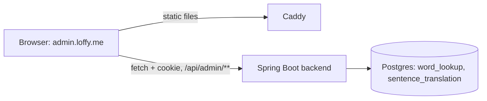
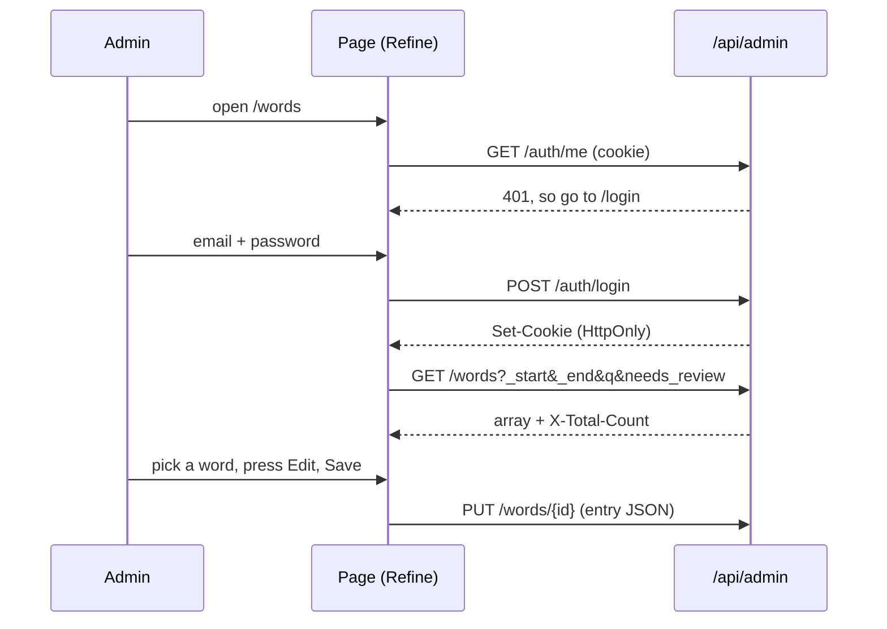

> Status: **built against the API contract of TASK-49.1** (the backend part is built in parallel; names may need small changes in `types.ts`). TASK-49.2. Last traced from code: 2026-10-15 (infinite scroll in the list: TASK-54; Media row: TASK-52; review reasons: TASK-55; every chip is a server filter, Has media and No media chips, the list is read again after the check button: TASK-57, TASK-59, TASK-60).
> Spec: F5 Admin CMS (TASK-49). Decisions: doc-7 rows 10-14 (Admin CMS, shadcn/ui + Refine, layout A, users with roles).

## What it does

A web page for the developer (and later other admins) to check what Claude wrote. After signing in, the left sidebar has Words, Sentences and Media.
Each page is a split view (layout A): a list with a search box and filter chips on the left (it loads 50 more entries when you scroll near the end, TASK-54), and the selected entry as a plain table of fields on the right.
Three icon-only buttons act on the entry: **Mark reviewed** (check), **Edit** (pencil, a form plus a JSON tab) and **Regenerate** (arrow, asks for confirmation in the page, then deletes the entry so Claude makes it again on the next request).
In a word's detail, each sense has a **Media row**: the current photo or clip with its Pixabay credit, and three icon-only buttons to fix it (TASK-52): **Pick another** (images), **No image** (image-off) and **Mark for AI** (sparkles). The Media page in the sidebar is still a placeholder.

## Big picture



The admin app is only static files (`admin/dist`). The login cookie is HttpOnly, so the page never reads it; it only sends it back (`credentials: 'include'`, axios `withCredentials`).

## Step by step



| Step | File:line | What happens |
|---|---|---|
| Routes, login guard | [App.tsx:25](../../../admin/src/App.tsx#L25) | Pages inside `Authenticated`; without a login, go to `/login` |
| Login, check, logout | [authProvider.ts:21](../../../admin/src/providers/authProvider.ts#L21) | `fetch` to `/api/admin/auth/*`; signed in only if `/me` has the ADMIN role; a 401 anywhere logs out ([onError](../../../admin/src/providers/authProvider.ts#L53)) |
| Data provider | [dataProvider.ts:7](../../../admin/src/providers/dataProvider.ts#L7) | Refine simple-rest on `${VITE_API_URL}/api/admin`, axios with cookies |
| List, search, chips | [EntryBrowser.tsx:83](../../../admin/src/components/EntryBrowser.tsx#L83), [filters:68](../../../admin/src/components/EntryBrowser.tsx#L68), [toggleChip:153](../../../admin/src/components/EntryBrowser.tsx#L153) | `useInfiniteList`, 50 per page. **Every chip is a server filter** (TASK-59): nothing is matched on the client, so a chip never loads page after page to find its rows, and the footer shows the filtered total. A chip is `{id, label, field, value, combine}`: `field` is the query parameter. Needs review = `needs_review=true`; Bundled / From backend = `source=bundled` or `backend` (one at a time: turning one on turns the other off); A1-A2 and B1-B2 = `cefr`, `combine: "any"`, so both can be on and the levels are OR-ed into one list (`cefr=A1&cefr=A2&cefr=B1&cefr=B2`); **Has media / No media** = `media=with` or `without` (one at a time, TASK-60; these chips are text filters, not buttons with actions, so the icon-only rule does not apply). Different fields are AND-ed. The level is the level of the **first sense** (the backend column); before TASK-59 the client matched any sense. A new search or chip changes the query key, so the list starts again at page 1 |
| Infinite scroll | [EntryBrowser.tsx:102](../../../admin/src/components/EntryBrowser.tsx#L102) | A sentinel row at the end of the list is watched with `IntersectionObserver` (200px early). When it shows, `fetchNextPage` runs; there is a next page while the loaded rows are fewer than `X-Total-Count`. A spinner row shows while loading; the footer says "120 of 2,750" (no arrows). The selected id lives outside the pages, so it stays selected; after an edit the loaded pages are fetched again in place, without going back to the top (see the next row) |
| Mark reviewed, regenerate, save | [EntryBrowser.tsx:128](../../../admin/src/components/EntryBrowser.tsx#L128) | `POST /{id}/reviewed`, `DELETE /{id}`, `PUT /{id}`; then the loaded pages are fetched again. This uses `invalidate({ invalidates: ["all"] })`, **not** `["list"]`: Refine keeps an infinite list under the key `infinite`, and `"list"` does not reach it. Before TASK-57 the old rows (and the "Needs review" badge) stayed on screen after the check button until the page was reloaded, although the backend had already cleared the flag. A test marks a word reviewed and checks that the list is loaded again without the badge |
| Regenerate confirm | [EntryActions.tsx:38](../../../admin/src/components/EntryActions.tsx#L38) | Inline panel; nothing is deleted until the check is pressed |
| Edit: Form and JSON tabs | [EntryEditor.tsx:32](../../../admin/src/components/EntryEditor.tsx#L32) | One draft; switching to Form parses the JSON and stops with a message if it is not valid |
| Media row, Pick another panel | [MediaRow.tsx:21](../../../admin/src/components/MediaRow.tsx#L21) | Pick another opens a panel **inline, under the row** (not a dialog) and searches at once with the sense's own words: [search:54](../../../admin/src/components/MediaRow.tsx#L54) calls `GET /media/search?sense=b-12:0`, and the answer fills the search input. 3x2 grid of up to 6 results; a clip has a small "clip" mark; the chosen tile gets an accent outline; the check button ([apply:69](../../../admin/src/components/MediaRow.tsx#L69)) sends the result with `PUT /words/{id}/senses/{n}/media`. [noImage:79](../../../admin/src/components/MediaRow.tsx#L79) is `DELETE` and [markForAi:85](../../../admin/src/components/MediaRow.tsx#L85) is `POST .../mark-for-ai`. After a change the word list is read again. A marked sense shows "Waiting for an AI image". Errors show the backend message under the row. Every write sends `Content-Type: application/json` (the backend needs it). |
| Review reasons | [ReviewReasons:27](../../../admin/src/pages/WordsPage.tsx#L27) | `reviewReasons` from the API (TASK-55). Under the **Status** row ([WordsPage.tsx:62](../../../admin/src/pages/WordsPage.tsx#L62)) a short list next to the "Needs review" badge; the same list at the top of the edit form ([WordForm:108](../../../admin/src/pages/WordsPage.tsx#L108); `EntryBrowser` passes the selected item as the third argument of `renderForm`, [EntryBrowser.tsx:246](../../../admin/src/components/EntryBrowser.tsx#L246)). When the word needs review but the list is empty it says "No problems found now; press ✓ to mark it reviewed". The flag is never cleared by the page. A reviewed word shows nothing. Sentences have no check yet. **In the list row** ([ReasonCount:43](../../../admin/src/pages/WordsPage.tsx#L43), TASK-57) a flagged word shows a small badge next to "Needs review": "2 problems", "1 problem" or "0 problems". The reasons are the tooltip (the `title` attribute, one per line); for "0 problems" the tooltip is the same hint as above. |
| Word fields | [WordsPage.tsx:56](../../../admin/src/pages/WordsPage.tsx#L56) | Table: IPA, sources, each sense (type + CEFR, explanation, 3 examples, usage, Vietnamese last, media) |
| Sentence fields | [SentencesPage.tsx:13](../../../admin/src/pages/SentencesPage.tsx#L13) | Sentence, simple explanation, words, translation last |
| API types | [types.ts](../../../admin/src/api/types.ts) | All shapes in one file; change them here when the backend differs |

## Errors

| Cause | Where | What the admin sees |
|---|---|---|
| Wrong email or password (401) | login | "Wrong email or password." under the form |
| Too many tries (429) | login | "Too many tries. Wait a minute and try again." |
| Session ended (401 on any call) | `onError` | Back to the login page |
| Invalid JSON in the JSON tab | editor | Red message; the tab does not change |
| Backend rejects the entry (400) | save | The backend message under the editor |
| List cannot load | list | "Could not load the list." |
| Pixabay search or download fails, too many searches, no Pixabay key (502, 429, 503) | Media row | The backend message in red under the row; the panel stays open |

## Run it

```bash
cd admin
cp .env.example .env.local      # VITE_API_URL=http://localhost:8081
npm ci
npm run dev                     # http://localhost:5173
```

The backend must allow CORS with credentials for `http://localhost:5173` (TASK-49.1). Production build and Caddy: see [Deploy to a VPS](../guides/doc-11%20-%20Deploy-to-a-VPS.md).

## Tests

`cd admin && npm test` (Vitest + Testing Library, no network).

| Test file | What it covers |
|---|---|
| `src/test/dataProvider.test.ts` | List URL (`_start`, `_end`, `_sort`, `_order`, `q`, `needs_review`), `X-Total-Count`, a level list as repeated `cefr` params with `source` and `media`, PUT, DELETE, cookies on |
| `src/test/login.test.tsx` | Login request (method, body, `credentials: include`), 401 message, ADMIN check, login form |
| `src/test/mediaRow.test.tsx` | Three icon-only buttons, panel opens inline and fills the search input, up to 6 tiles with the clip mark, search again with typed words, apply sends the chosen result (PUT, JSON header), No image (DELETE), Mark for AI (POST), the marked note, the backend error message |
| `src/test/infiniteScroll.test.tsx` | 50 words first, next page when the end is on screen (fake `IntersectionObserver`), count line "50 of 120" with no arrows, stops at the total, filter change goes back to page 1, **From backend is a server filter: one request, "40 of 40", no extra pages, no "Nothing found"** (TASK-59), selection kept when more load |
| `src/test/wordsPage.test.tsx` | List and badges, Needs review chip sends `needs_review=true`, source chip sends `source` and shows only what the server returns, source chips one at a time, level chips OR-ed into one `cefr` list, `media=with` / `without` one at a time, reason count and tooltip in the list row, the check button posts and the list is loaded again without the flag, field table, icon buttons, regenerate confirm, edit form and JSON tab, review reasons (detail and edit form), "No problems found now" hint |

## Change checklist

- Backend field renamed: change `admin/src/api/types.ts`, then the pages and tests the compiler points at.
- New chip: add it to `chips` in `WordsPage.tsx` or `SentencesPage.tsx`. It needs a query parameter that the backend list endpoint understands (all chips are server filters). Chips with the same `field` replace each other unless they have `combine: "any"`.
- A new write in the page: refresh the list with `invalidates: ["all"]`, never `["list"]`.
- New admin section: route in `App.tsx`, link in `Layout.tsx`.

## Known gaps

- IPA is shown but not edited: the contract says PUT sends the entry only.
- Media page is a placeholder with no list yet; it gets infinite scroll for free when it is built on EntryBrowser (TASK-54). The senses marked for AI are only available from the API (`GET /api/admin/media?status=needs_ai`); a list page for them can come with TASK-53.
- Pick another was not tried in a real browser with a real Pixabay key yet; the tests use mocked data.
- No Sentences "bundled" or CEFR chips: sentences have neither.
- Screens were not checked in a real browser against the real backend yet; the tests use mocked data.
