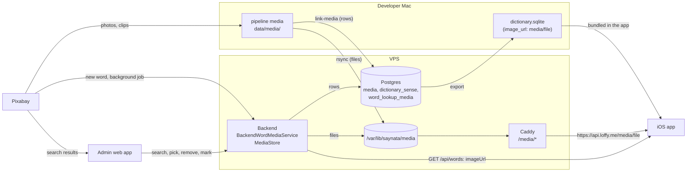
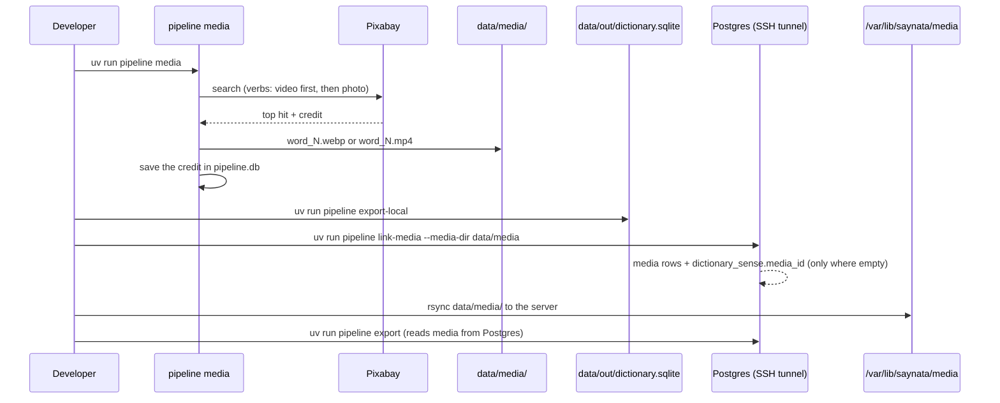
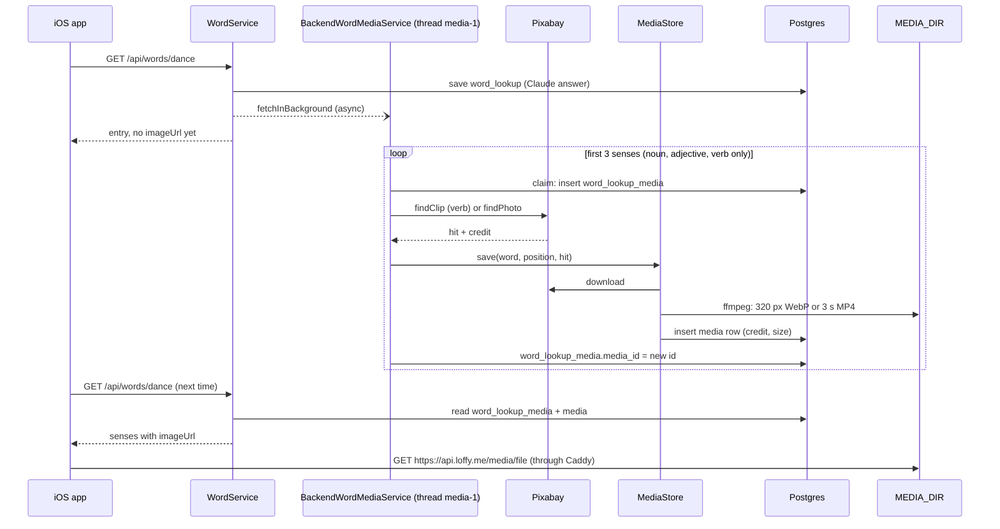
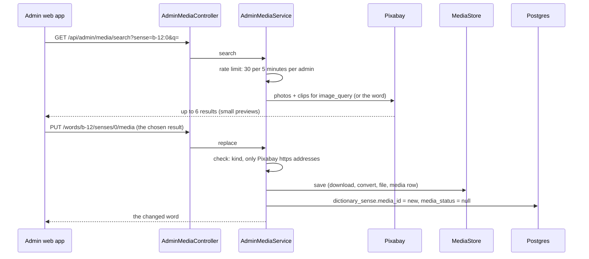
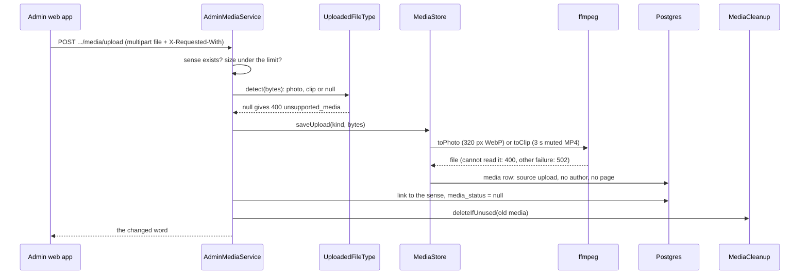
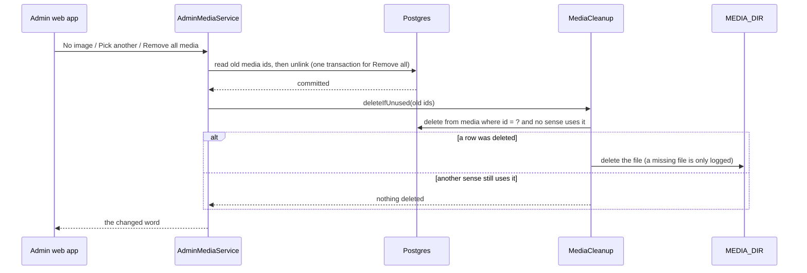
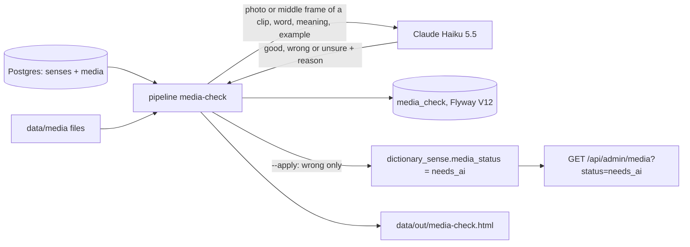
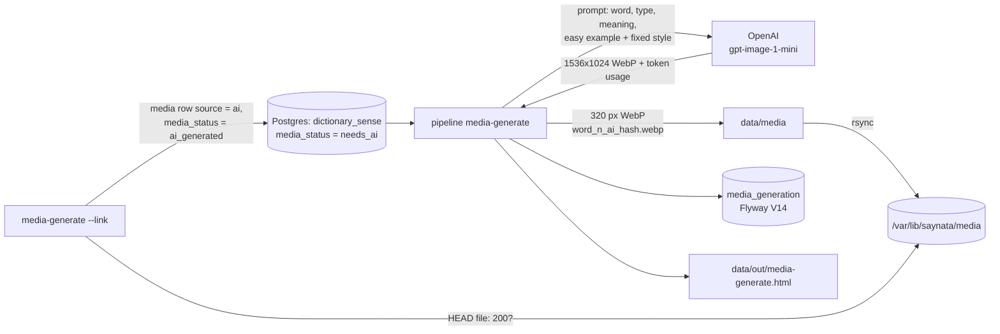
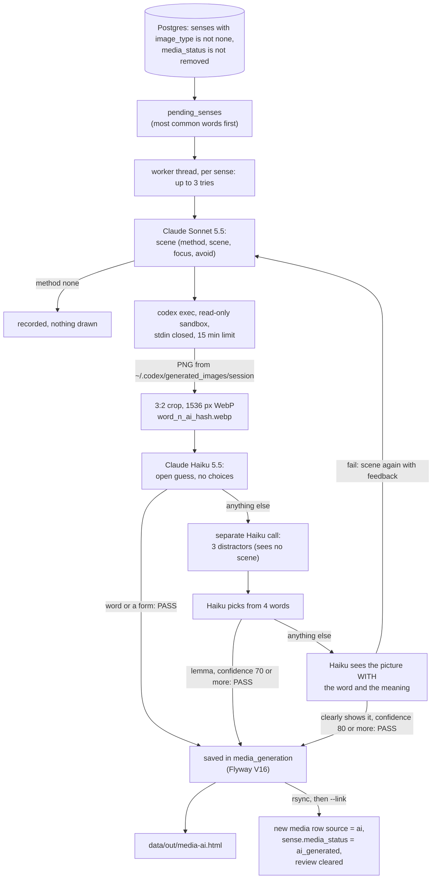
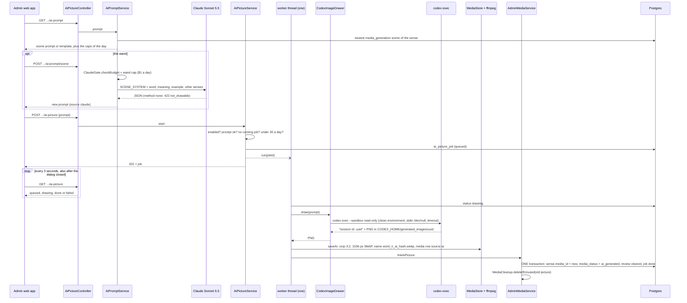

# Media and images

> Status: **working for photos and clips from Pixabay, and for files the admin uploads** (TASK-23, 49.3, 49.4, 52, 79). AI images for `needs_ai` senses: built as a pipeline command (`media-generate`, TASK-53, OpenAI GPT Image mini), trial not run yet. **AI pictures for every sense** (`media-ai`, TASK-82: Claude scene, Codex draws, blind guess, meaning check): built; the 20-sense trial ran on 2026-10-16 (9 passed, 8 failed, 3 none), and the meaning check was added after it. Picture review in the admin ("Wrong media" and "Media to review" chips, "Looks right" approval tied to one picture): TASK-80. The iOS app shows a bundled word's media from the server (TASK-51, PR #48), saved on the phone for offline. Last traced from code: 2026-10-18 (the admin draws an AI picture for one sense with Codex on the server: TASK-91); earlier: 2026-10-17 (the picture frame keeps the picture's shape, from `media.width`/`height`: no more cut-off heads; AI pictures for every sense with `pipeline media-ai`: TASK-82; AI images with `pipeline media-generate`: TASK-53; the admin can upload their own picture or clip: TASK-79; Claude check of the pictures: TASK-78; removing media now deletes the file, and the admin can remove all media of a word: TASK-76; the app loads `media/<file>` from `https://api.loffy.me/media/<file>`, TASK-51; Pixabay 429 is tried again: TASK-63; the admin words list can filter by media with `media=with|without`, TASK-60; a bundled word is answered from Postgres with its media, TASK-58).
> Why: a small picture or a short clip helps a learner remember a meaning (doc-1, Vision and spec). Postgres on the server is the source of truth for content (doc-7).

## What it does

Each sense of a word can have one **photo** (a 320 px WebP) or one **clip** (a 3 second, muted MP4). Nouns and adjectives get photos. Verbs get clips. The files come from Pixabay. There are two ways a sense gets media: the pipeline on the developer's Mac fills it for the 2,750 bundled words, and the backend fills it in the background for every **new** word that Claude writes. An admin can fix any sense in the admin web app: pick another picture, **upload their own picture or clip**, remove it, or **draw an AI picture** (a dialog with an editable prompt, drawn by the Codex CLI on the server, TASK-91). The iOS app shows the picture under the explanation of the sense.

This page follows the files from Pixabay to the screen. It does not repeat the pages for the parts: see [Word lookup](doc-5%20-%20Word-lookup.md), [Dictionary pipeline](doc-6%20-%20Dictionary-pipeline.md), [Admin API](doc-13%20-%20Admin-API.md), [Admin CMS](doc-14%20-%20Admin-CMS.md) and the [VPS guide, section 9](../guides/doc-11%20-%20Deploy-to-a-VPS.md).

## Big picture



The database keeps only a row per file (`media`: name, kind, size, credit). The files themselves live on disk in one folder. The same folder is written by the backend and read by Caddy.

## 1. Pipeline: the bundled words

The bundled words are made on the Mac. The order matters, because the media pass works on `data/pipeline.db` (the old working database) and Postgres is the source of truth.



| Step | File:line | What happens |
|---|---|---|
| Which senses need media | [needs_media:60](../../../pipeline/src/pipeline/media.py#L60) | A sense with `image_type` other than `none` and no media yet. This makes the pass safe to run again. |
| Choose what to search | [fetch_media_for_sense:196](../../../pipeline/src/pipeline/media.py#L196) | Verbs: video first. Icons: illustrations first. Everything else: a photo. If the sense's `image_query` finds nothing, it tries `lemma + pos`. |
| Search Pixabay | [search_pixabay_photo:69](../../../pipeline/src/pipeline/media.py#L69), [search_pixabay_video:101](../../../pipeline/src/pipeline/media.py#L101) | `safesearch`, `order=popular`, top 3 hits, take the first. Waits 0.8 s between calls ([_wait_for_rate_limit:46](../../../pipeline/src/pipeline/media.py#L46)). |
| Resize | [resize_and_save_webp:140](../../../pipeline/src/pipeline/media.py#L140), [transcode_and_save_mp4:151](../../../pipeline/src/pipeline/media.py#L151) | Photo: 320 px wide WebP, quality 80, with Pillow. Clip: short muted MP4 loop, with ffmpeg. |
| Save the file | [process_word_media:256](../../../pipeline/src/pipeline/media.py#L256) | File name is `<word>_<sense number>.webp` or `.mp4` in `data/media/`. The credit (photographer, page) goes into `pipeline.db`. |
| The pass | [run_pass:347](../../../pipeline/src/pipeline/media.py#L347), command in [cli.py:151](../../../pipeline/src/pipeline/cli.py#L151) | `uv run pipeline media [--words run walk] [--workers 4] [--dry-run]`. Uses your Pixabay key (`PIXABAY_API_KEY` in `pipeline/.env`). A full pass is many Pixabay requests and takes a long time. |
| Old export | [export_from_pipeline_db:54](../../../pipeline/src/pipeline/export.py#L54), command at [cli.py:323](../../../pipeline/src/pipeline/cli.py#L323) | `export-local` builds `dictionary.sqlite` from `pipeline.db`. Each sense gets `image_url = "media/<file>"` ([export.py:80-82](../../../pipeline/src/pipeline/export.py#L80-L82)). |
| Link into Postgres | [link_media:195](../../../pipeline/src/pipeline/postgres.py#L195), command at [cli.py:184](../../../pipeline/src/pipeline/cli.py#L184) | Reads those `image_url` values and adds `media` rows. It sets `media_id` only on senses that have none, and never changes text. So admin edits are safe. |
| Copy the files | rsync, see [doc-11 section 9](../guides/doc-11%20-%20Deploy-to-a-VPS.md) | `rsync -av data/media/ vps_sieutoc:/var/lib/saynata/media/`. The rows say a file exists; rsync puts it there. |
| Import (one time) | [import_dictionary:89](../../../pipeline/src/pipeline/postgres.py#L89), command at [cli.py:164](../../../pipeline/src/pipeline/cli.py#L164) | The first copy of the bundled dictionary into Postgres. It also creates `media` rows. It reads file sizes from `--media-dir`. |
| Export from Postgres | [export_from_postgres:119](../../../pipeline/src/pipeline/export.py#L119), [copy_media:197](../../../pipeline/src/pipeline/export.py#L197), command at [cli.py:196](../../../pipeline/src/pipeline/cli.py#L196) | Builds `data/out/dictionary.sqlite` and copies the files that senses use into `data/out/media/`. Files missing from `--media-dir` are listed as a warning. |

Then the developer copies only `dictionary.sqlite` into the app (`EnglishTranslation/EnglishTranslation/Resources`). The media files stay on the server (63 MB; the app does not carry them, see doc-7, 2026-10-15). The app loads `media/<file>` from `https://api.loffy.me/media/<file>` and saves it on the phone. How the run works from the start is in [Dictionary pipeline](doc-6%20-%20Dictionary-pipeline.md).

## 2. Backend: new words

When a learner looks up a word that is not in the bundle and not in the cache, the backend asks Claude, saves the answer, replies, and **then** looks for pictures. The first reply has no `imageUrl`. The next lookup has it.



| Step | File:line | What happens |
|---|---|---|
| Start the job | [WordService.java:105](../../../backend/src/main/java/com/englishtranslation/backend/word/WordService.java#L105), [startMediaJob:158](../../../backend/src/main/java/com/englishtranslation/backend/word/WordService.java#L158) | Called after the new word is saved. If it fails to start, it is logged and the answer is still sent. |
| One worker thread | [MediaConfig.mediaExecutor:21](../../../backend/src/main/java/com/englishtranslation/backend/media/MediaConfig.java#L21) | One thread, queue of 50. A full queue drops the job: the word works, it only has no picture. |
| The job | [fetchInBackground:46](../../../backend/src/main/java/com/englishtranslation/backend/media/BackendWordMediaService.java#L46), [fetch:55](../../../backend/src/main/java/com/englishtranslation/backend/media/BackendWordMediaService.java#L55) | Does nothing when `PIXABAY_API_KEY` is empty. Takes the first 3 senses. Every error is caught, so the word answer never breaks. |
| Photo or clip | [kindFor:75](../../../backend/src/main/java/com/englishtranslation/backend/media/BackendWordMediaService.java#L75) | Verb: clip (photo if there is no clip). Noun or adjective: photo. Other types (adverb, "the") get nothing. |
| Claim first | [claim:88](../../../backend/src/main/java/com/englishtranslation/backend/media/BackendWordMediaService.java#L88) | A row in `word_lookup_media` is inserted before Pixabay is asked. So Pixabay is asked once per sense, even when it finds nothing. To try again, delete the word in the admin. |
| Rate limit | [MIN_GAP_MILLIS:28](../../../backend/src/main/java/com/englishtranslation/backend/media/HttpPixabayClient.java#L28), [waitForTurn:172](../../../backend/src/main/java/com/englishtranslation/backend/media/HttpPixabayClient.java#L172) | At least 1.5 s between Pixabay requests (40 per minute; Pixabay allows 100). With one worker thread we stay far below the limit. Downloads only come from `pixabay.com` over https. |
| Pixabay 429 | [send:179](../../../backend/src/main/java/com/englishtranslation/backend/media/HttpPixabayClient.java#L179), [pauseBeforeRetry:196](../../../backend/src/main/java/com/englishtranslation/backend/media/HttpPixabayClient.java#L196), [PixabayBusyException](../../../backend/src/main/java/com/englishtranslation/backend/media/PixabayBusyException.java) | TASK-63. One Pixabay key is shared by the admin search, the background job and a media pass, so Pixabay can still answer 429 (too many requests). Every Pixabay call (search and download) is tried **3 times in all**. The pause is the `Retry-After` header (seconds) when there is one, else 1 s, then 2 s. The waiting adds up to at most 10 s; a `Retry-After` that would go past that gives up at once. After the last try the client throws `PixabayBusyException`. Other errors (500, 404...) are not tried again. |
| Download, convert, save | [MediaStore.save:48](../../../backend/src/main/java/com/englishtranslation/backend/media/MediaStore.java#L48), [FfmpegMediaConverter:16-27](../../../backend/src/main/java/com/englishtranslation/backend/media/FfmpegMediaConverter.java#L16-L27) | Photo: WebP, max 320 px wide, quality 80. Clip: 3 s, no sound, H.264 MP4, `+faststart`. The name is `<word>_<n>_<8 hex of sha256>.<ext>`, so a new picture is always a new name. If the row cannot be saved, the file is removed. |
| Link to the sense | [fetchOneSense:100](../../../backend/src/main/java/com/englishtranslation/backend/media/BackendWordMediaService.java#L100) | Sets `word_lookup_media.media_id`. |
| Tables | [V7](../../../backend/src/main/resources/db/migration/V7__create_word_lookup_media.sql), [V8](../../../backend/src/main/resources/db/migration/V8__add_media_status.sql) | `word_lookup_media (word_lookup_id, sense_position, media_id, media_status)`. A deleted word deletes its rows. Bundled words use `dictionary_sense.media_id` and `media_status` instead. |
| Read for the answer | [SenseMediaReader.forBackendWords:26](../../../backend/src/main/java/com/englishtranslation/backend/media/SenseMediaReader.java#L26), [WordService.mediaOf:148](../../../backend/src/main/java/com/englishtranslation/backend/word/WordService.java#L148) | Joins `word_lookup_media` to `media`. A read problem is logged and ignored. |
| The address | [MediaProperties.urlFor:18](../../../backend/src/main/java/com/englishtranslation/backend/media/MediaProperties.java#L18), [application.properties:41-45](../../../backend/src/main/resources/application.properties#L41-L45) | `imageUrl` = `app.media.base-url` + `/` + file name. Default base URL: `https://api.loffy.me/media`. |
| The JSON | [WordEntryView.of:18](../../../backend/src/main/java/com/englishtranslation/backend/word/WordEntryView.java#L18) | Adds `imageUrl` to a sense that has media, and `imageWidth`/`imageHeight` from `media.width`/`height` when they are known (the pipeline fills them for photos; media the backend saves from Pixabay or an upload has none yet). Each field is left out when empty, so old app versions see nothing new. |
| Serve the file | Caddy, see [doc-11 section 9](../guides/doc-11%20-%20Deploy-to-a-VPS.md); folder mount in [docker-compose.prod.yml:49-55](../../../backend/docker-compose.prod.yml#L49-L55) | `handle_path /media/*` reads `/var/lib/saynata/media` and adds `Cache-Control: public, max-age=31536000, immutable` (one year). The backend writes to the folder; Caddy only reads it. |

Env: `MEDIA_DIR` (folder), `MEDIA_BASE_URL` (public address), `PIXABAY_API_KEY` (empty means no job). Details of the word flow are in [Word lookup](doc-5%20-%20Word-lookup.md).

## 3. Admin: fix one sense (TASK-52) and remove media for real (TASK-76)

In a word's detail, each sense has a media row with four icon buttons: **Pick another**, **No image**, **Draw an AI picture** (Sparkles, TASK-91) and **Upload**. A sense is named by the word id and the position: `b-12:0` is the first sense of bundled word 12, `w-45:2` is the third sense of backend word 45. The screens are described in [Admin CMS](doc-14%20-%20Admin-CMS.md), the login and rules in [Admin API](doc-13%20-%20Admin-API.md).



| Button | Endpoint | File:line | What happens |
|---|---|---|---|
| (search) | `GET /api/admin/media/search?sense=b-12:0&q=` | [controller:36](../../../backend/src/main/java/com/englishtranslation/backend/admin/AdminMediaController.java#L36), [AdminMediaService.search:104](../../../backend/src/main/java/com/englishtranslation/backend/admin/AdminMediaService.java#L104) | Up to 6 results (usually 2 clips and the rest photos). With an empty `q`, it uses the sense's `image_query`, or the headword. The answer says which words it used. |
| Pick another | `PUT /api/admin/words/{id}/senses/{n}/media` | [controller:51](../../../backend/src/main/java/com/englishtranslation/backend/admin/AdminMediaController.java#L51), [replace:127](../../../backend/src/main/java/com/englishtranslation/backend/admin/AdminMediaService.java#L127) | The result comes from the browser, so [checked:130](../../../backend/src/main/java/com/englishtranslation/backend/admin/AdminMediaService.java#L130) only accepts Pixabay https addresses. Then `MediaStore.save`, then the link. A sense that was "no image" gets `image_type = photo` again. |
| No image | `DELETE .../media` | [controller:57](../../../backend/src/main/java/com/englishtranslation/backend/admin/AdminMediaController.java#L57), [clear:208](../../../backend/src/main/java/com/englishtranslation/backend/admin/AdminMediaService.java#L208) | `media_id` becomes null. For a bundled sense, `image_type = none` tells the pipeline not to fetch again. For a backend word the claim row stays, so the job does not fetch again. |
| (Mark for AI) | `POST .../media/mark-for-ai` | [controller:62](../../../backend/src/main/java/com/englishtranslation/backend/admin/AdminMediaController.java#L62), [markForAi:263](../../../backend/src/main/java/com/englishtranslation/backend/admin/AdminMediaService.java#L263) | Sets `media_status = needs_ai`. The old picture stays until an AI image replaces it (TASK-53). Picking another picture clears the status. Since TASK-91 the admin button no longer calls it (it opens the AI picture dialog, see the section below); the endpoint stays for the pipeline and old clients, and a `needs_ai` sense still shows "Waiting for an AI image". |
| Picture looks right | `POST` and `DELETE .../media/approve` | [controller:87](../../../backend/src/main/java/com/englishtranslation/backend/admin/AdminMediaController.java#L87), [approve:282](../../../backend/src/main/java/com/englishtranslation/backend/admin/AdminMediaService.java#L282) | TASK-80. Stores the approval for the current media file (`media_reviewed_media_id`) and clears `needs_ai`; DELETE undoes it. See "Reviewing pictures" below. |
| Upload | `POST /api/admin/words/{id}/senses/{n}/media/upload` (multipart, part `file`) | [controller:76](../../../backend/src/main/java/com/englishtranslation/backend/admin/AdminMediaController.java#L76), [upload:160](../../../backend/src/main/java/com/englishtranslation/backend/admin/AdminMediaService.java#L160) | TASK-79. See the next section. The admin's own file becomes the media of the sense. Works with no Pixabay key. |
| Remove all media | `DELETE /api/admin/words/{id}/media` | [controller:63](../../../backend/src/main/java/com/englishtranslation/backend/admin/AdminMediaController.java#L63), [removeAllMedia:228](../../../backend/src/main/java/com/englishtranslation/backend/admin/AdminMediaService.java#L228) | TASK-76. Every sense of the word (bundled or backend) loses its media in one transaction and gets `media_status = removed`. A bundled sense also gets `image_type = none`; a backend sense gets a claim row, so the background job never fills it. Then the unused files are deleted (next section). |
| (list) | `GET /api/admin/media?status=needs_ai` | [controller:44](../../../backend/src/main/java/com/englishtranslation/backend/admin/AdminMediaController.java#L44), [listByStatus:316](../../../backend/src/main/java/com/englishtranslation/backend/admin/AdminMediaService.java#L281) | All marked senses, from both tables. Any other status is a 400. |

Shared details:

- **Search rate limit:** [MediaSearchRateLimiter:19-20](../../../backend/src/main/java/com/englishtranslation/backend/admin/MediaSearchRateLimiter.java#L19-L20) allows 30 searches in 5 minutes per admin, kept in memory (a restart clears it). One search is two Pixabay calls, and Pixabay allows 100 per minute for our whole key.
- **Backend words without a claim row:** [ensureBackendRow:241](../../../backend/src/main/java/com/englishtranslation/backend/admin/AdminMediaService.java#L241) makes the `word_lookup_media` row when it is missing (the background job only makes rows for 3 senses).
- **Old files are deleted when nothing uses them (TASK-76).** See the flow below.

### Upload your own file (TASK-79)

Developer decision (2026-10-16, doc-7): the admin can upload their own file for a sense, for example a picture made in ChatGPT. It is a cheap way to fix a bad Pixabay picture, next to the paid AI images (TASK-53).



| Step | File:line | What happens |
|---|---|---|
| Type check | [UploadedFileType.detect:22](../../../backend/src/main/java/com/englishtranslation/backend/media/UploadedFileType.java#L22) | Reads the first bytes, not the name or the `Content-Type`. Photos: JPEG, PNG, WebP, GIF (first frame only), HEIC. Clips: MP4, MOV, WebM. Anything else (text, PDF, SVG) is refused. |
| Size | [upload:160](../../../backend/src/main/java/com/englishtranslation/backend/admin/AdminMediaService.java#L160), [handleTooBig](../../../backend/src/main/java/com/englishtranslation/backend/common/ApiExceptionHandler.java#L39) | `spring.servlet.multipart.max-file-size` (env `UPLOAD_MAX_FILE_SIZE`, default 25 MB) and `max-request-size` (`UPLOAD_MAX_REQUEST_SIZE`, 26 MB). Tomcat refuses a bigger file and the handler answers 413; the service checks too. |
| Convert and save | [MediaStore.saveUpload:60](../../../backend/src/main/java/com/englishtranslation/backend/media/MediaStore.java#L60), [convertAndInsert:69](../../../backend/src/main/java/com/englishtranslation/backend/media/MediaStore.java#L69) | The same code and rules as a Pixabay pick: a photo becomes a 320 px WebP, a clip the first 3 s, muted, 320 px wide. The name is `word_position_hash.webp|mp4`. The row has `source = 'upload'`, `license_note = 'Uploaded by the admin'`, and no `photographer`, `page_url` or `pixabay_id` (columns were already nullable; `source` is new, [V13](../../../backend/src/main/resources/db/migration/V13__add_media_source.sql)). The same bytes twice give the same file and row. |
| Link | [upload:160](../../../backend/src/main/java/com/englishtranslation/backend/admin/AdminMediaService.java#L160) | Same as Pick another: the sense points to the new row, `media_status` is cleared (`needs_ai` and `removed`), a bundled sense with `image_type = none` becomes `photo` again, and the old file is deleted through `MediaCleanup` when no other sense uses it. |
| CSRF | [JsonWritesOnlyFilter](../../../backend/src/main/java/com/englishtranslation/backend/admin/JsonWritesOnlyFilter.java#L48) | Admin writes must be JSON. The upload path may be `multipart/form-data`, but only with the header `X-Requested-With` (a form on another site cannot add it, and CORS refuses the preflight). The header is in the allowed CORS headers ([SecurityConfig](../../../backend/src/main/java/com/englishtranslation/backend/admin/SecurityConfig.java#L75)). |

**The pipeline keeps an uploaded file.** An uploaded file is a normal `media` row linked from `dictionary_sense.media_id`. `uv run pipeline export` copies every linked file and writes its `image_url`, so the next app build contains it ([export.py:166](../../../pipeline/src/pipeline/export.py#L166) only skips `none` and `removed` senses; an upload sets the sense back to `photo` and clears `removed`). `link-media` does not touch a sense that already has `media_id` ([postgres.py:225](../../../pipeline/src/pipeline/postgres.py#L225)). Tested in `test_postgres.py`. `export` copies files from its `--media-dir` (default `data/media`), so rsync the server folder `/var/lib/saynata/media/` there first (see doc-11); a file missing there is listed as missing, as for any other media.

Limit: only the 320 px WebP or the 3 s MP4 is kept. The original upload is not stored.

### Removing media for real (TASK-76)

Before TASK-76, "No image" only unlinked the media in Postgres. The file stayed in `MEDIA_DIR`, and the app's bundled `dictionary.sqlite` still says `image_url = media/<file>`, so the app kept loading `https://api.loffy.me/media/<file>` and showed the picture. Now the file is deleted, the address answers 404, and the app already shows nothing when a download fails.



| Step | File:line | What happens |
|---|---|---|
| Collect the old ids | [currentMediaId:143](../../../backend/src/main/java/com/englishtranslation/backend/admin/AdminMediaService.java#L143) | Read before the sense is changed. |
| Check and delete the row | [MediaCleanup.deleteOne:46](../../../backend/src/main/java/com/englishtranslation/backend/media/MediaCleanup.java#L46) | One `delete from media ... and not exists (dictionary_sense) and not exists (word_lookup_media)`. Zero rows deleted means someone still uses it. |
| Delete the file | [deleteFile:62](../../../backend/src/main/java/com/englishtranslation/backend/media/MediaCleanup.java#L62) | `Files.deleteIfExists`. A missing file is logged. A path outside the media folder is refused. An I/O error is logged and does not fail the request. |
| Same pick again | [replace:127](../../../backend/src/main/java/com/englishtranslation/backend/admin/AdminMediaService.java#L127) | The same Pixabay result gives the same file name and the same row (`MediaStore.save`), which is still linked, so it is kept. |
| Job race | [fetchOneSense:116](../../../backend/src/main/java/com/englishtranslation/backend/media/BackendWordMediaService.java#L116) | The job links its file only if the sense is not `removed`; otherwise it deletes the file it just made. |

A removed sense is not filled again:

- **Backend job:** the claim row exists, so `claim()` fails and Pixabay is never asked.
- **Pipeline `link-media`:** skips a sense with `image_type = 'none'` or `media_status = 'removed'` before it even makes a media row ([postgres.py:225](../../../pipeline/src/pipeline/postgres.py#L225)). Without this, the next `link-media` from an older `dictionary.sqlite` would bring the picture back.
- **Pipeline `export`:** writes no `image_url` for such a sense, even if a link was left behind ([export.py:166](../../../pipeline/src/pipeline/export.py#L166)), so the next app build drops the picture from the bundled file.
- `uv run pipeline media` works on `data/pipeline.db`, which knows nothing about admin changes. It may fetch a file again for a removed sense in that old database, but `link-media` ignores it. (The pipeline media pass already skips `image_type = 'none'`.)

**A phone that already has the picture keeps showing it.** `MediaFileCache` (Caches/SenseMedia, 50 MB) saves each downloaded file by its address, and a saved file is used before the network, so a phone that opened the word before keeps the picture until the cache is cleared (iOS may also clear Caches by itself when space is low; deleting and installing the app clears it). Fresh installs and new devices ask the server, get 404 and show nothing.

**Could the iOS HTTP cache also keep serving it?** Yes, as a second layer. Caddy sends `Cache-Control: public, max-age=31536000, immutable`, and `URLSession.shared` has a default `URLCache` (a few MB in memory, 10 MB on disk), so a recent response can be answered without asking the server. It matters only in the short time before that entry is evicted; the permanent copy is the `MediaFileCache` one. Follow-up idea (not built): make `MediaFileCache` check removal cheaply. The smallest fix is to send a `HEAD` request for a cached file at most once a day (or when the word card opens), and delete the saved copy on 404. A bigger option: send a "removed files" list in the word response. The bundled-in-app samples (`dog_1.webp`, `run_1.mp4`, `tree_1.webp`) are inside the app and also stay until the next app build.

## 4. iOS: how the app shows media

The word card calls `SenseMediaView(path:pixelSize:)` for each sense that has an `imageUrl`. The path can be a bundled path (`media/run_1.mp4`, what `dictionary.sqlite` stores) or an https address (what the backend sends). Last traced: 2026-10-17 (frame size from the picture; TASK-47, TASK-51).

| Step | File:line | What happens |
|---|---|---|
| Read the field | [WordEntry.swift:49](../../../EnglishTranslation/EnglishTranslation/Dictionary/WordEntry.swift#L49), [DictionaryStore.swift:109-110](../../../EnglishTranslation/EnglishTranslation/Dictionary/DictionaryStore.swift#L109-L110) | `Sense.imageUrl` is decoded from the backend JSON (`imageUrl`) and from the bundled file (`senses.image_url`, for example `media/run_1.mp4`). `imageWidth`/`imageHeight` (backend) or `senses.image_width`/`image_height` (bundled file; older files have no such columns) give `Sense.imagePixelSize` ([WordEntry.swift:74](../../../EnglishTranslation/EnglishTranslation/Dictionary/WordEntry.swift#L74)). |
| Show it | [WordCardView.swift:68](../../../EnglishTranslation/EnglishTranslation/Views/Word/WordCardView.swift#L68) | Under the sense title row, `SenseMediaView(path:pixelSize:)` is shown if the sense has an `imageUrl`. |
| Read the path | [SenseMediaSource.swift:16-40](../../../EnglishTranslation/EnglishTranslation/Views/Word/SenseMediaSource.swift#L16-L40) | `SenseMediaSource(path:)` gives `.bundled(path)` or `.remote(https URL)`. Empty text and plain `http` give nothing. It tells a clip from a photo by the file extension. |
| Choose bundle or server | [SenseMediaSource.swift:42-52](../../../EnglishTranslation/EnglishTranslation/Views/Word/SenseMediaSource.swift#L42-L52) | `resolved(serverBase:)`: a bundled path whose file is inside the app stays bundled (only `dog_1.webp`, `run_1.mp4`, `tree_1.webp` are). Any other bundled path becomes `<server>/media/<file name>`. The server address is `AppConfig.backendBaseURL()`, the same `BackendBaseURL` Info.plist value the backend client uses, so it is not written twice. |
| Load | [SenseMediaView.swift:103-126](../../../EnglishTranslation/EnglishTranslation/Views/Word/SenseMediaView.swift#L103-L126) | Bundled file: used directly. Server photo: `MediaFileCache` downloads it once and saves it, so it shows again offline. Server clip: a saved file plays if there is one; else AVPlayer streams the address and the file is saved in the background. |
| Disk cache | [MediaFileCache.swift](../../../EnglishTranslation/EnglishTranslation/Views/Word/MediaFileCache.swift) | `Caches/SenseMedia`, **50 MB**, least recently used files go first. A file bigger than a quarter of the cache is not kept. Two views that ask for the same address share one download. iOS may delete Caches, which is fine: files are downloaded again. |
| Frame and failure | [SenseMediaView.swift:34-38](../../../EnglishTranslation/EnglishTranslation/Views/Word/SenseMediaView.swift#L34-L38), [54-68](../../../EnglishTranslation/EnglishTranslation/Views/Word/SenseMediaView.swift#L54-L68) | The frame has the picture's own shape, fitted inside 240 x 240 (`frameSize(for:)`), so nothing is cut off: a tall 320 x 470 photo is 163 x 240, a wide 320 x 214 one is 240 x 161. With `pixelSize` the shape is right before the file loads, so nothing jumps. Without it (old bundled file, backend media saved without a size) the frame is 240 x 135 until a photo loads, then takes the photo's shape; clips stay 240 x 135. The frame is invisible while loading. If loading fails (offline and not saved yet, 404, bad path), the whole view disappears: no error text, no empty box. |
| Clip player | [SenseMediaView.swift:144-161](../../../EnglishTranslation/EnglishTranslation/Views/Word/SenseMediaView.swift#L144-L161) | An empty `AVQueuePlayer` plus `AVPlayerLooper(templateItem:)` (no stutter at the loop point), muted. If the looper status is `.failed`, the media is hidden. |
| Play only when seen | [SenseMediaView.swift:66](../../../EnglishTranslation/EnglishTranslation/Views/Word/SenseMediaView.swift#L66) | `onScrollVisibilityChange(threshold: 0.33)` and `scenePhase`: a clip plays only when about a third of it is on screen and the app is active. |

Tests: [SenseMediaTests.swift](../../../EnglishTranslation/EnglishTranslationTests/SenseMediaTests.swift) (Sense decoding, `image_url` column, picture size from JSON and from the `image_width`/`image_height` columns, frame size for tall, wide and unknown pictures, bundled path vs https, a bundled file uses the bundle, a bundled path without a file maps to the server URL, https stays as it is, bad values give nothing, cache hit, offline, failure, size limit). The visibility rule needs a real scroll view, so it is checked by hand in the PR card.

## Errors

| Cause | Where | What happens |
|---|---|---|
| `PIXABAY_API_KEY` empty | Background job, admin | Job does nothing and claims nothing. Admin search, pick: 503 "Pixabay is not set up". |
| Pixabay has no result | Background job | The claim row stays with no `media_id`. Pixabay is not asked again for that sense. |
| Pixabay is busy (429 on all 3 tries) | `HttpPixabayClient.send` | `PixabayBusyException`. Admin pick or search: 503 "Pixabay is busy right now. Try again in a minute." and the old picture stays. Job: logged like any other failed download. |
| Download or ffmpeg fails | `MediaStore.save` | No file and no row are left. Job: logged, next sense runs. Admin pick: 502 "Could not download or convert that file", the old picture stays. |
| Pixabay does not answer | Admin search | 502 "Pixabay did not answer". |
| More than 30 searches in 5 minutes | Admin search | 429 "Too many searches". |
| Chosen file is not from Pixabay, or `kind` is wrong | Admin pick | 400, nothing is downloaded. |
| Uploaded file is not a picture or clip (by magic bytes), or empty | Admin upload | 400 `unsupported_media` "That file is not a picture or a short video. Use JPEG, PNG, WebP, HEIC, GIF, MP4, MOV or WebM." Nothing is saved. |
| Uploaded file looks right but ffmpeg cannot read it (broken file, HEIC without support) | Admin upload | 400 `unsupported_media` "That file could not be read. It may be broken. Try another one." The old media stays. |
| Uploaded file is bigger than the limit (25 MB) | Admin upload | 413 `file_too_large` "That file is too big. The limit is 25 MB." |
| ffmpeg is missing, takes more than 60 s, or the disk fails | Admin upload | 502 "Could not download or convert that file. Try another one." (the same message as Pick another). No file and no row are left. |
| Sense does not exist | Admin | 404. |
| Job queue is full (50 waiting) | `mediaExecutor` | Job dropped, the word has no picture. |
| AI pictures not set up (`AI_PICTURES_ENABLED` false) | Admin AI picture | 503 `ai_unavailable`. |
| Codex missing, not signed in, or the plan limit is reached | AI job | The job is `failed` with a plain error ("Codex is not signed in on the server...", "The ChatGPT plan limit is reached..."). The old picture stays. |
| Codex takes longer than the timeout (10 minutes) | AI job | It is stopped; the job is `failed` ("Codex took too long..."). |
| ffmpeg or the database fails after Codex drew | AI job | The job is `failed` ("Could not save the picture. Try again."); a saved but unlinked file is deleted. |
| Server restarts while a job is queued or drawing | AI job | The job is `failed` ("The server restarted.") at the next start. |
| Sense already has a running job, or today's cap is reached | Admin AI picture | 409 `ai_job_running` / 429 `ai_picture_limit`. |
| File missing in `/var/lib/saynata/media` | Caddy | 404 for the file. The app shows nothing for that sense. |
| Bundled path, file not in the app, and the server has no such file | iOS | The app asks the server (404), then shows nothing. |
| Offline, file never saved on the phone | iOS | Nothing is shown. It appears after a first view with the network. |

## Tests

| Test file | What it covers |
|---|---|
| [BackendWordMediaServiceTest](../../../backend/src/test/java/com/englishtranslation/backend/media/BackendWordMediaServiceTest.java) | Noun gets a photo, verb gets a clip (photo fallback), other types skipped, a failure is not thrown and not retried, no leftover file after a failed conversion. |
| [NoPixabayKeyTest](../../../backend/src/test/java/com/englishtranslation/backend/media/NoPixabayKeyTest.java) | Without a key, Pixabay is never called and nothing is claimed. |
| [AdminMediaUploadTest](../../../backend/src/test/java/com/englishtranslation/backend/admin/AdminMediaUploadTest.java) | TASK-79 (fake converter): 401 without login and without the ADMIN role, 415 without `X-Requested-With`, PNG for a bundled sense and MP4 for a backend sense, the type comes from the bytes (not the name), the media row (`source = upload`, no author), status cleared (`needs_ai`, `removed`), old file deleted or kept when another sense uses it, wrong type, empty, broken file (400), convert failure (502), over the limit (413), 404. |
| [AdminMediaUploadFfmpegTest](../../../backend/src/test/java/com/englishtranslation/backend/admin/AdminMediaUploadFfmpegTest.java) | TASK-79 with the real ffmpeg (skipped without it): a 1024 px PNG becomes a 320 px WebP, a 5 s MOV/MP4 becomes an MP4, a broken PNG is 400. |
| [AiPictureApiTest](../../../backend/src/test/java/com/englishtranslation/backend/aipicture/AiPictureApiTest.java) | TASK-91 with a fake Claude, a fake drawer and a fake converter: 401, the prompt (scene, newest first, `none` skipped, template, backend word), the wand (prompt, `not_drawable`, bad JSON, its own cap, the users' budget), the job (queued to done, new `ai` row, status `ai_generated`, review cleared, the old file deleted or kept, a backend word, the admin changed the picture meanwhile), a failed draw keeps the old picture, empty and too long prompt, 409 with `ai_drawing` on the word, the 429 cap, 204, restart marks jobs failed. |
| [AiPictureDisabledTest](../../../backend/src/test/java/com/englishtranslation/backend/aipicture/AiPictureDisabledTest.java), [AiPromptsTest](../../../backend/src/test/java/com/englishtranslation/backend/aipicture/AiPromptsTest.java), [CodexImageDrawerTest](../../../backend/src/test/java/com/englishtranslation/backend/aipicture/CodexImageDrawerTest.java), [ClaudeServiceSceneTest](../../../backend/src/test/java/com/englishtranslation/backend/claude/ClaudeServiceSceneTest.java) | TASK-91: 503 when disabled; the prompt blocks and the match with `media_ai.py`; the clean environment, the picture lookup by session id, the error texts, and a real run with a fake `codex` script (arguments, stdin, environment, timeout, missing program); Sonnet call without temperature, usage as `admin`. |
| [UploadedFileTypeTest](../../../backend/src/test/java/com/englishtranslation/backend/media/UploadedFileTypeTest.java), [TooBigUploadAnswerTest](../../../backend/src/test/java/com/englishtranslation/backend/common/TooBigUploadAnswerTest.java) | TASK-79: magic bytes of each type, text/PDF/SVG refused; Spring's own size limit becomes 413. |
| [WordImageUrlTest](../../../backend/src/test/java/com/englishtranslation/backend/media/WordImageUrlTest.java) | `imageUrl` is absolute, the field is missing when there is no media, `imageWidth`/`imageHeight` come with a photo whose size is known (none for a clip without one), a new word is answered first. |
| [FfmpegMediaConverterTest](../../../backend/src/test/java/com/englishtranslation/backend/media/FfmpegMediaConverterTest.java) | Big photo becomes a small WebP, video becomes a short MP4, bad input fails with a clear message; TASK-91: an AI picture is cropped to 3:2 and at most 1536 px wide (checked with ffprobe, and `MediaStore.aiSize` gives the same size). Needs ffmpeg on the machine. |
| [HttpPixabayClientTest](../../../backend/src/test/java/com/englishtranslation/backend/media/HttpPixabayClientTest.java) | Only Pixabay hosts over https are accepted. A fake HTTP client: 429 then 200 succeeds (one 1 s pause), 429 three times gives `PixabayBusyException`, `Retry-After` is used, a `Retry-After` past the budget gives up at once, other errors are not tried again (TASK-63). |
| [AdminMediaTest](../../../backend/src/test/java/com/englishtranslation/backend/admin/AdminMediaTest.java) | Login and role, search (6 results, default words, rate limit, errors), pick, remove, mark for AI, list, 404. TASK-76: the file and row are deleted when unused and kept while another sense (bundled or backend) uses them, a missing file is fine, picking another deletes the old file, Remove all media for a bundled word and a backend word (also without a claim row), the background job does not fill a removed sense, only ADMIN may call it. |
| [test_media_check.py](../../../pipeline/tests/test_media_check.py) | TASK-78: the Claude check with a fake client and a fake ffmpeg (see doc-6). |
| [test_media_generate.py](../../../pipeline/tests/test_media_generate.py) | TASK-53 with a fake generator and a fake HTTP transport: the prompt, file names, the OpenAI request and real cost, 429 with `Retry-After`, 5 tries, a wrong key or no credit stops the run, a blocked prompt fails one sense, the 320 px WebP, the cap is never passed (also when a call costs more than its estimate), dry run, link only files that are here and on the server, the report. Postgres tests (need `TEST_DATABASE_URL`): which senses are pending, link makes a `source = 'ai'` row and `ai_generated`, link does nothing when the admin changed the sense. |
| [test_media_ai.py](../../../pipeline/tests/test_media_ai.py) | TASK-82 with a fake Claude, a fake Codex and an in-memory store: the locked scene rules are in the prompt, the Codex command (no stdin, 15 minute limit, newest picture of the session), the 3:2 1536 px WebP, the open guess and the multiple choice (70 confidence, distractors from a call that never sees the scene), the retry with feedback, 3 tries keep the best picture, method none draws nothing, the cap is never passed, resume, dry run, the summary, the report. Postgres tests (need `TEST_DATABASE_URL`): which senses are pending, link replaces an approved Pixabay photo or a clip and clears the review, the old row stays, link is committed and seen from a second connection, the undo SQL, `media-generate` ignores these rows. |
| [test_media.py](../../../pipeline/tests/test_media.py) | `needs_media`, file names, WebP resize, dry run, the pass with a fake fetcher. |
| [test_postgres.py](../../../pipeline/tests/test_postgres.py) | TASK-79: `export` keeps and copies an uploaded file, `link-media` does not replace it. TASK-76: `link-media` skips `none` and `removed` senses and makes no media row for them; `export` writes no `image_url` for them. Needs `TEST_DATABASE_URL`. |
| [mediaUpload.test.tsx](../../../admin/src/test/mediaUpload.test.tsx) | TASK-79: the Upload button is icon only and opens the picker, FormData is sent with the header, spinner while uploading, backend error and 413 text, drop and the dashed outline, the caption "Uploaded by the admin" in the row and the viewer; an AI image (TASK-53) names its model instead. |
| [mediaRow.test.tsx](../../../admin/src/test/mediaRow.test.tsx) | The admin buttons and the Pick another panel, the full-size viewer (TASK-77). |
| [aiPicture.test.tsx](../../../admin/src/test/aiPicture.test.tsx) | TASK-91: the dialog, the wand, the validation, OK, and the drawing, done and failed states of the row (doc-14). |
| [wordRows.test.tsx](../../../admin/src/test/wordRows.test.tsx) | Thumbnails, hover to play, Remove all media (TASK-76, TASK-77). |

Run: `cd backend && ./mvnw -B test`, `cd pipeline && uv run pytest`, `cd admin && npm test`. iOS: `SenseMediaTests.swift` (command in doc-2).

## Change checklist

- Change the picture size, quality or clip length: [FfmpegMediaConverter](../../../backend/src/main/java/com/englishtranslation/backend/media/FfmpegMediaConverter.java) **and** `resize_and_save_webp` / `transcode_and_save_mp4` in the pipeline. Keep both the same.
- Change the file name rule: `MediaStore.save`, the pipeline file name, `link_media`, and the Caddy cache note (a name must change when the content changes).
- Change the accepted upload types: [UploadedFileType](../../../backend/src/main/java/com/englishtranslation/backend/media/UploadedFileType.java#L22) (and the message in `AdminMediaService.UNSUPPORTED_MESSAGE`).
- Add a new media `kind`: `kindFor`, `MediaStore`, `SenseMedia`, the admin `checked`, the iOS source type.
- Change `MEDIA_BASE_URL` or the folder: [doc-11](../guides/doc-11%20-%20Deploy-to-a-VPS.md), `docker-compose.prod.yml` and the Caddyfile together.
- Change Pixabay limits: `HttpPixabayClient` (backend), `_wait_for_rate_limit` (pipeline), `MediaSearchRateLimiter` (admin).
- Change the AI picture prompt texts (`KID`, `STYLE`, `SCENE_SYSTEM`, the Codex wrapper): [AiPrompts](../../../backend/src/main/java/com/englishtranslation/backend/aipicture/AiPrompts.java) **and** `media_ai.py`, with a new `PROMPT_VERSION`, `app.claude.scene-prompt-version`, and `AiPromptsTest` (it fails when they differ).

## Claude check of the pictures (TASK-78)

Developer decision (2026-10-15, doc-7): every Pixabay picture is checked by Claude first, the wrong ones are marked `needs_ai`, and AI images (TASK-53) are made only for those. Marking by hand in the admin still works for pictures Claude missed.



How to run it, the costs and the table: doc-6, section 12. In short: `uv run pipeline media-check --limit 50`, open the report, then the full run, then `--apply`. `--apply` writes the same `media_status = 'needs_ai'` as the admin's Mark for AI, so the existing list shows the result. A sense that already has a status (`removed`, `needs_ai`) is never checked or changed.

The admin shows the newest verdict and reason for the current media, read-only, under the picture (TASK-80, see "Reviewing pictures").

## Reviewing pictures (TASK-80)

Picture review is separate from the word-text "Needs review" flag. Four states per sense (`SenseReview.stateOf`): `wrong` (`media_status = needs_ai`, for example the 743 senses that `media-check --apply` marked), `to_review` (has media, nobody approved this file), `approved`, `none`. **The meaning of `media_status` and its changes did not change**; the approval is stored apart, in `media_reviewed_at` and `media_reviewed_media_id` on `dictionary_sense` and `word_lookup_media` ([V15](../../../backend/src/main/resources/db/migration/V15__add_media_review.sql)). A sense counts as approved only while its current `media_id` equals `media_reviewed_media_id`, so a new picture (Pick another, upload, AI) needs a new review by itself. The same bytes give the same `media` row (see Upload), so choosing an identical file keeps the approval, which is correct: it is the same file.

- "Picture looks right" (`POST .../media/approve`) also clears `needs_ai`. The admin is the final judge, so the AI image job (TASK-53) must skip a sense that is no longer `needs_ai` (it re-checks the status before each paid call). `DELETE .../media/approve` undoes the approval; it does not bring `needs_ai` back.
- The words list filters `media=wrong` and `media=to-review`, and every word has `wrongMediaCount`, `mediaToReviewCount` and `mediaReview[]` (doc-13). The admin has the chips **Wrong media** and **Media to review**, row badges, and a check button on the Media row (doc-14).

## AI images for needs_ai senses (TASK-53)

Developer decisions (2026-10-16, doc-7): one provider, **OpenAI GPT Image mini** (`gpt-image-1-mini`, low quality), a **$5 budget cap per run**, and a pipeline command on the Mac first (the admin button "Generate with AI" is a later step). 743 bundled photo senses were `needs_ai` on 2026-10-16 (742 from `media-check --apply`, 1 by hand).



The run has **two steps**, because a sense may only point to a file that is already on the server:

1. **Generate** (costs money). For each `needs_ai` sense: build the prompt, call the model, save a 320 px WebP in `data/media/`, add a `media_generation` row. Nothing in the app changes. The report shows the old picture next to the new one, cropped to 240 x 135 (the app now shows the whole picture).
2. **Link** (free), after `rsync`. For the newest unlinked picture of each sense that is still `needs_ai`: check that `MEDIA_BASE_URL/<file>` answers 200, then in one transaction add a `media` row (`source = 'ai'`, `license_note = 'AI image (openai gpt-image-1-mini)'`), set `dictionary_sense.media_id` to it and `media_status = 'ai_generated'`, and set `media_generation.media_id`. The app shows the new picture after the next `export` and app build.

| Part | File:line | What happens |
|---|---|---|
| Senses | [PostgresStore.pending_senses:408](../../../pipeline/src/pipeline/media_generate.py#L408) | Bundled senses with `media_status = 'needs_ai'` and `image_type` not `none`, most common words first. A sense that already has an unlinked picture (for example from the trial) is skipped, unless `--regenerate`. |
| Prompt | [build_prompt:77](../../../pipeline/src/pipeline/media_generate.py#L77), [STYLE:65](../../../pipeline/src/pipeline/media_generate.py#L65) | Built from the sense alone: headword, part of speech, simple explanation, easy example (told not to write it), then one fixed style rule: flat simple illustration, one subject in the middle 16:9 area, plain light background, sage green and teal `#1F6B5F`, no text, no realistic faces. No extra LLM call (TASK-53 first planned a Claude-written prompt; the template is free and the same for every provider). |
| Provider | [ImageGenerator:113](../../../pipeline/src/pipeline/media_generate.py#L113), [OpenAIImageGenerator:124](../../../pipeline/src/pipeline/media_generate.py#L124) | A small interface, so another provider can be added. OpenAI: `POST /v1/images/generations`, `size 1536x1024` (3:2, the closest to the app's 16:9 frame), `quality low`, `output_format webp`. 429 and 5xx are tried 5 times, with `Retry-After` when sent (a new OpenAI account may make only a few images a minute). A wrong key or no credit (`401`, `insufficient_quota`) stops the whole run; a blocked prompt (`moderation_blocked`) fails only that sense. |
| Cost | [PRICES:53](../../../pipeline/src/pipeline/media_generate.py#L53), [estimate_cost:150](../../../pipeline/src/pipeline/media_generate.py#L150), [_read:177](../../../pipeline/src/pipeline/media_generate.py#L177) | Real cost from the answer's `usage`: text input tokens x $2.00 and image output tokens x $8.00 per million (gpt-image-1-mini, checked 2026-10-16). A model without a price is refused. Low 1536x1024 is about 400 output tokens, so a picture is about $0.0035 (the estimate says $0.0038 to stay on the high side). |
| Budget cap | [run:267](../../../pipeline/src/pipeline/media_generate.py#L267) | A new call starts only when spent + the estimate of every call in flight + its own estimate stays within `--max-cost` (default $5). Just before each call the sense is checked again: one the admin approved ("Looks right") or changed during the run is skipped. The estimate grows to the biggest real cost seen. So the cap is never passed. 2 calls at a time (`--workers`). |
| File | [generate_one:223](../../../pipeline/src/pipeline/media_generate.py#L223), [file_name_for:92](../../../pipeline/src/pipeline/media_generate.py#L92) | `resize_and_save_webp` (the Pixabay code: 320 px wide, quality 80). Name `<word>_<n>_ai_<8 hex of sha256>.webp`, a new name for new content, because Caddy and the phones cache a file for a year. |
| Link | [link_generated:370](../../../pipeline/src/pipeline/media_generate.py#L370), [PostgresStore.link:462](../../../pipeline/src/pipeline/media_generate.py#L462) | The `link-media` rules: a sense with `image_type = 'none'`, `media_status = 'removed'`, or any status other than `needs_ai` (the admin picked another picture meanwhile) is not touched. The old picture's media row and file stay. |
| Report | [write_report:509](../../../pipeline/src/pipeline/media_generate.py#L509) | `data/out/media-generate.html`: old and new picture, word, meaning, model, cost, linked or not, the prompt. |
| Table | [V14](../../../backend/src/main/resources/db/migration/V14__add_ai_media.sql) | `media.source` may be `'ai'`. `media_generation`: sense, file, provider, model, prompt, tokens, cost, `old_media_id` (the picture it replaces), `media_id` and `linked_at` once linked. Provider, model, prompt and cost live here, not on `media`; join on `media_generation.media_id`. |
| Admin | [MediaRow.tsx](../../../admin/src/components/MediaRow.tsx), [MediaLightbox.tsx](../../../admin/src/components/MediaLightbox.tsx) | A `source = 'ai'` file shows its `licenseNote` ("AI image (openai gpt-image-1-mini)") instead of "Photo by ... on Pixabay". |

How to run it (the commands and costs are also in doc-6, section 13):

```bash
cd pipeline
uv run pipeline media-generate --dry-run          # free: prompts and the estimate (about $0.0038 a picture)
uv run pipeline media-generate --limit 20         # the trial: about $0.08, then open data/out/media-generate.html
uv run pipeline media-generate                    # all 743: about $2.80, stops at the $5 cap
rsync -av data/media/ vps_sieutoc:/var/lib/saynata/media/
uv run pipeline media-generate --link             # free: link the files that are on the server
uv run pipeline export                            # then a new app build
```

`media-check` checks `ai_generated` senses on its next run like any other picture (it skips only `removed` and `needs_ai`), so a wrong AI picture can be found the same way.

**Commercial use.** Saynata is public, so the terms matter. OpenAI's [Services Agreement](https://openai.com/policies/services-agreement/) (it covers API use) says the customer owns the Output and OpenAI assigns its rights in it, so the pictures may be used in the app. The developer is responsible for how the pictures are used, and the usage policies still apply. AI pictures may have no copyright of their own in some countries, so others may be able to copy them. Details and the other sources in doc-11, section 9 ("Provider terms").

## AI pictures for every sense (TASK-82)

Developer decisions (2026-10-16, doc-7): **every sense gets an AI picture**, because "Pixabay still didn't show exactly what the word means". Claude writes the scene, the local **Codex CLI** draws it through the developer's ChatGPT plan (no per-picture cost, about 1 minute each), and Claude checks the picture with a **blind guess**. This replaces `media-generate` (the OpenAI API, TASK-53) as the way to make pictures; `media-generate` stays in the code but is not used. The rules below were locked after a 12-sense trial that passed 12 of 12.



**Rules for the pictures** (the prompt text is in [SCENE_SYSTEM:80](../../../pipeline/src/pipeline/media_ai.py#L80) and [STYLE:72](../../../pipeline/src/pipeline/media_ai.py#L72); it comes from the trial and changes only with a new `PROMPT_VERSION`):

- one green cartoon kid (8 years old, short brown hair, sage green T-shirt, deep teal jeans) for needs, feelings, actions and stories;
- people and animals have expressive faces, objects never have faces;
- no kid and no extra people for things and places; people appear only when they are part of the thing (customers and a cashier at a bank counter);
- a building whose meaning is what happens inside (bank, hospital) is shown cut open;
- a part of a place (river bank) is shown as the whole place with that part as the focus;
- a quality (old, empty) is one typical person or thing (an old man with a stick, an empty transparent box);
- Claude first picks a **method**: object, need, emotion, action, quality, relation, role, story, repetition or none. A `none` sense is recorded and not drawn. Its `image_type` is **not** changed by the command; the summary lists these senses for the developer to decide.

| Part | File:line | What happens |
|---|---|---|
| Senses | [PostgresStore.pending_senses:804](../../../pipeline/src/pipeline/media_ai.py#L804) | Bundled senses with `image_type` not `none` and `media_status` not `removed`, most common words first, with the other senses of the word and the word forms. Skips a sense that is **finished** for the current `PROMPT_VERSION` ([_NOT_FINISHED:783](../../../pipeline/src/pipeline/media_ai.py#L783)): one try passed, or the method was `none`, or all 3 tries failed. A sense that stopped with an error is tried again. `--redo` ignores this. |
| Scene | [write_scene:271](../../../pipeline/src/pipeline/media_ai.py#L271) | One Sonnet 5.5 call: word, part of speech, this meaning, the easy example, the other senses. Reads the first *text* block (a thinking block may come first). No `temperature` (Sonnet 5.5 refuses it). |
| Draw | [CodexDrawer:300](../../../pipeline/src/pipeline/media_ai.py#L300) | `codex exec --skip-git-repo-check --sandbox read-only <wrapper>` with `stdin=DEVNULL` (without it Codex waits forever) and a 15 minute limit. The session id Codex prints names the folder of our picture, so four workers never mix pictures up. A plan limit or a missing login stops the run. The wrapper prompt is [codex_prompt:154](../../../pipeline/src/pipeline/media_ai.py#L154). |
| File | [prepare_images:338](../../../pipeline/src/pipeline/media_ai.py#L338), [file_name_for:362](../../../pipeline/src/pipeline/media_ai.py#L362) | Cropped to 3:2 around the middle, 1536 px wide, WebP quality 80, named `<lemma>_<n>_ai_<8 hex>.webp`. |
| Blind guess | [blind_guess:410](../../../pipeline/src/pipeline/media_ai.py#L410) | **a.** Open guess ("Which single English word does this picture show?"): the lemma or one of its forms (table `dictionary_form`) passes. **b.** Otherwise multiple choice: the lemma and 3 distractors from [pick_distractors:395](../../../pipeline/src/pipeline/media_ai.py#L395), a separate call that sees only the word and the meaning, never the scene. It passes only if the lemma is picked with confidence 70 or more. **c.** Otherwise the meaning check ([meaning_check:437](../../../pipeline/src/pipeline/media_ai.py#L437)): Haiku sees the picture with the word and this meaning and passes it when it "clearly shows this meaning" with confidence 80 or more. Step c came after the 20-sense trial (2026-10-16): a right picture of "have" = eat or drink shows drinking, so the guesser says "drink" and the word guess can never pass. The guesser sees a 768 px JPEG. |
| Tries | [make_sense:525](../../../pipeline/src/pipeline/media_ai.py#L525) | After a fail the scene is written again with what the guesser said, and redrawn: 3 tries in all. A sense that still fails keeps its best picture (the lemma picked at the highest confidence) as a **candidate**: it is saved, not linked, and listed in the summary and at the top of the report. |
| Recheck | [recheck_failed:753](../../../pipeline/src/pipeline/media_ai.py#L753) | `--recheck-failed` runs only step c on the pictures of senses that failed all 3 tries (newest try first), without drawing again. A picture that passes is marked passed on its own row and becomes the newest try, so `--link` takes it. A sense is rechecked once. |
| Run | [run:599](../../../pipeline/src/pipeline/media_ai.py#L599) | Worker threads call Claude and Codex; only the main thread uses Postgres and saves each sense. The Claude cap `--max-cost` (default $5) is never passed: a sense starts only if spent + the estimate of the senses in flight + its own estimate fits. Ctrl-C once: running senses finish, no new ones start; twice: quit. |
| Table | [V16](../../../backend/src/main/resources/db/migration/V16__media_generation_ai_scene.sql) | Nullable columns on `media_generation`: `prompt_version`, `method`, `scene_json`, `guess_json`, `passed`, `attempt`; `file_name` may be empty (method `none`). One row per try. `provider` = `codex`, `model` = `codex-image_gen`. `cost_usd` is the Claude spend only. The two JSON columns are `JSON`, not `JSONB`, because the backend tests run on H2. The backend does not read them. |
| Link | [link_passed:720](../../../pipeline/src/pipeline/media_ai.py#L720), [PostgresStore.link:875](../../../pipeline/src/pipeline/media_ai.py#L875) | After `rsync`. For each sense whose **newest** try for `PROMPT_VERSION` passed and whose file answers 200 at `MEDIA_BASE_URL`: a new `media` row (`source = 'ai'`), the sense points at it, `media_status = 'ai_generated'`, and `media_reviewed_at` / `media_reviewed_media_id` are cleared, so the sense is in "Media to review" again (section "Reviewing pictures"). It replaces **any** picture: Pixabay photo, clip, upload, an approved picture. The old `media` row and file stay. A sense with `image_type = 'none'` or `removed` is not touched. |
| Report | [write_report:982](../../../pipeline/src/pipeline/media_ai.py#L982) | `data/out/media-ai.html`: failed and not-drawn senses first, then passed ones; each shows the old picture, every try (picture, method, scene, open guess, multiple choice) and the cost. |

How to run it (the "Test it" card of the PR has the same commands with the numbers):

```bash
cd pipeline
uv run pipeline media-ai --dry-run --limit 3      # 3 scenes + Codex prompts + estimate; draws nothing (3 Claude calls, about $0.05)
uv run pipeline media-ai --limit 20               # the trial: 20 most common senses, then open data/out/media-ai.html
uv run pipeline media-ai --words bank,old         # only these words
uv run pipeline media-ai --all --workers 4        # everything not finished; stops at --max-cost (default $5), run again to go on
rsync -av data/media/ vps_sieutoc:/var/lib/saynata/media/
uv run pipeline media-ai --recheck-failed         # a few cents: meaning check on failed senses' pictures, no drawing
uv run pipeline media-ai --link                   # free: link the passed pictures that are on the server
uv run pipeline export                            # then a new app build
```

Codex must be installed and logged in once (`codex login`, ChatGPT plan). The numbers: about 1 minute a picture and about 1.3 tries a sense, so the 3,364 senses take about 14 to 18 hours with 4 workers (if the plan allows that many pictures). Claude costs about $0.02 to $0.03 a sense, so $50 to $100 for all senses; the 20-sense trial shows the real number, and `--scene-effort medium` or `low` makes the scene call cheaper.

**How to undo.** The old `media` rows stay, and `media_generation.old_media_id` remembers the picture each sense had. To put the old pictures back for every linked sense of this version (the admin can also "Pick another" per sense):

```sql
UPDATE dictionary_sense s SET media_id = g.old_media_id, media_status = NULL
FROM media_generation g
WHERE g.sense_id = s.id AND g.prompt_version = 'ai-v1' AND g.linked_at IS NOT NULL
  AND s.media_id = g.media_id AND g.old_media_id IS NOT NULL;
```

This SQL is tested (`test_pg_undo_with_the_sql_from_doc_15_brings_the_old_picture_back`). The approval of the old picture is not restored; approve it again in the admin. To draw a sense again, run with `--redo --words <word>`; to redraw everything after a rule change, raise `PROMPT_VERSION`.

Known limits: the scene prompt still asks Claude for 3 distractors, which the code ignores (the guess uses its own separate call; the prompt text is kept word for word from the trial). The report shows old pictures from `https://api.loffy.me/media/`.

## AI picture from the admin (TASK-91)

Developer decisions (2026-10-18, doc-7): the admin fixes **one sense** at a time. The Sparkles button opens a **dialog** (layout A) with the picture prompt already filled in; the admin edits it and presses OK; the **server** draws the picture with the **Codex CLI**, signed in with the developer's ChatGPT login (`auth.json` copied to the VPS; no per-picture cost, about 1 minute), and links it to the sense like Upload does. The wand button has Claude Sonnet 5.5 write a new scene (about $0.02). Caps: 30 pictures a day and $1 a day for the wand. Not chosen: the OpenAI image API (about $0.004 a picture), see doc-7.



| Part | File:line | What happens |
|---|---|---|
| Prompt from a scene | [AiPromptService.prompt:107](../../../backend/src/main/java/com/englishtranslation/backend/aipicture/AiPromptService.java#L107), [newestScene:165](../../../backend/src/main/java/com/englishtranslation/backend/aipicture/AiPromptService.java#L165), [AiPrompts.imagePrompt:104](../../../backend/src/main/java/com/englishtranslation/backend/aipicture/AiPrompts.java#L104) | A bundled sense: the newest `media_generation` row with a `scene_json` and a method other than `none` (the pipeline's `media-ai`). The image prompt is built like [codex_prompt](../../../pipeline/src/pipeline/media_ai.py#L154) after "IMAGE PROMPT:": the kid text after the first "the kid", "Main focus: ...  Must not appear: ...", then the style. The admin shows and edits only this inner prompt; the server adds the Codex wrapper text when it runs Codex ([codexPrompt:96](../../../backend/src/main/java/com/englishtranslation/backend/aipicture/AiPrompts.java#L96)). |
| Prompt from a template | [AiPrompts.template:118](../../../backend/src/main/java/com/englishtranslation/backend/aipicture/AiPrompts.java#L118) | No scene (or a backend word): like [build_prompt](../../../pipeline/src/pipeline/media_generate.py#L77) (word, type, simple meaning, easy example "do not write it in the picture", "Show this meaning clearly...") but ending with the **media-ai style**, so the picture matches the others. Works for `w-45` words too: their senses come from the word JSON. |
| Locked texts | [AiPrompts.java:15](../../../backend/src/main/java/com/englishtranslation/backend/aipicture/AiPrompts.java#L15) | `KID`, `STYLE`, `SCENE_SYSTEM` and the Codex wrapper are copied word for word from `media_ai.py` and must match `PROMPT_VERSION = "ai-v1"`. [AiPromptsTest](../../../backend/src/test/java/com/englishtranslation/backend/aipicture/AiPromptsTest.java) compares them with the Python file. A change needs a new version in both places and `app.claude.scene-prompt-version`. |
| The wand | [AiPromptService.newScene:125](../../../backend/src/main/java/com/englishtranslation/backend/aipicture/AiPromptService.java#L125), [ClaudeService.writePictureScene:211](../../../backend/src/main/java/com/englishtranslation/backend/claude/ClaudeService.java#L211) | `claude-sonnet-5-5`, no temperature (Sonnet 5.5 refuses it), usage saved as feature `ADMIN` with the Sonnet price ([application.properties:112](../../../backend/src/main/resources/application.properties#L112), $2.00 / $10.00 per million tokens, copied from `media_ai.py` PRICES: check them). First `ClaudeGate.checkBudget()` (503 `daily_limit_reached`), then the wand's own cap: today's `ADMIN` spend must be under `app.media.ai.scene-daily-usd` (503 `ai_budget_reached`). Method `none` is 422 `not_drawable`. |
| Start | [AiPictureService.start:95](../../../backend/src/main/java/com/englishtranslation/backend/aipicture/AiPictureService.java#L95) | Checks in this order: `app.media.ai.enabled` (503 `ai_unavailable`), prompt not empty and at most 4000 characters (400), the sense exists (404), no queued or drawing job for the sense (409 `ai_job_running`), today's started jobs under `pictures-per-day` (429 `ai_picture_limit`). Saves the job and gives it to **one** worker thread, so Codex draws one picture at a time and the other jobs wait. |
| Run | [AiPictureService.run:129](../../../backend/src/main/java/com/englishtranslation/backend/aipicture/AiPictureService.java#L129) | Never throws: every problem ends as a `failed` job with a plain `error`. A picture that was saved but could not be linked is deleted again. |
| Codex | [CodexImageDrawer.draw:52](../../../backend/src/main/java/com/englishtranslation/backend/aipicture/CodexImageDrawer.java#L52) | Port of `CodexDrawer`: `codex exec --skip-git-repo-check --sandbox <sandbox> <wrapper + prompt>`, stdin from `/dev/null` (else Codex waits forever), a temp working folder, stdout and stderr in a temp file, a timeout (`app.media.ai.timeout`, 10 minutes) and then `destroyForcibly` (also the child processes). It finds `session id: <uuid>` in the output and takes the newest PNG in `$CODEX_HOME/generated_images/<uuid>/` ([newestPicture:120](../../../backend/src/main/java/com/englishtranslation/backend/aipicture/CodexImageDrawer.java#L120)). "usage limit" gives "The ChatGPT plan limit is reached"; "not logged in", "please log in" or "codex login" gives "Codex is not signed in on the server" ([problemText:138](../../../backend/src/main/java/com/englishtranslation/backend/aipicture/CodexImageDrawer.java#L138)). |
| Clean environment | [cleanEnvironment:110](../../../backend/src/main/java/com/englishtranslation/backend/aipicture/CodexImageDrawer.java#L110) | `environment().clear()`, then only `PATH`, `HOME`, `CODEX_HOME` and `LANG`. The backend's `CLAUDE_API_KEY`, database password and JWT secrets never reach Codex. The sandbox is `read-only` by default and no "danger" flag is ever passed. Tested with a real fake `codex` script that prints its environment. |
| Save the file | [MediaStore.saveAi:74](../../../backend/src/main/java/com/englishtranslation/backend/media/MediaStore.java#L74), [aiSize:84](../../../backend/src/main/java/com/englishtranslation/backend/media/MediaStore.java#L84), [FfmpegMediaConverter.toAiPicture:29](../../../backend/src/main/java/com/englishtranslation/backend/media/FfmpegMediaConverter.java#L29) | ffmpeg crops to 3:2 around the middle and scales to at most 1536 px wide (WebP quality 80, like `prepare_images` in the pipeline). The name is `<word>_<n>_ai_<8 hex of sha256>.webp`. The row has `source = 'ai'`, `license_note = 'AI image (codex)'`, and `width`/`height` worked out from the PNG with the same rule. |
| Link | [AdminMediaService.linkAiPicture:214](../../../backend/src/main/java/com/englishtranslation/backend/admin/AdminMediaService.java#L214) | One transaction, like Upload: the sense points to the new row, `media_status = 'ai_generated'`, `media_reviewed_at` and `media_reviewed_media_id` are cleared (so it is in "Media to review"), a bundled sense with `image_type = none` becomes `photo`, and the job becomes `done`. Then `MediaCleanup.deleteIfUnused(old)`. **If the admin changed the sense's picture while the job ran, the AI picture still wins** (the admin asked for it last); the picture the admin had just chosen is then cleaned up like any replaced picture. |
| State on the word | [SenseMediaReader.withDrawingJobs:62](../../../backend/src/main/java/com/englishtranslation/backend/media/SenseMediaReader.java#L62) | While a job is queued or drawing, `mediaStatus[n]` of the word answer is `ai_drawing`. It is worked out from `ai_picture_job` on every read, not saved in the sense, so a failed job leaves the sense as it was. |
| Restart | [AiPictureService.failUnfinishedJobs:78](../../../backend/src/main/java/com/englishtranslation/backend/aipicture/AiPictureService.java#L78) | On `ApplicationReadyEvent`, jobs that were queued or drawing become `failed` with "The server restarted." |
| Table | [V21](../../../backend/src/main/resources/db/migration/V21__create_ai_picture_job.sql) | `ai_picture_job (id, word_id "b-12"/"w-45", position, prompt, prompt_source, status, error, media_id, old_media_id, created_by, created_at, started_at, finished_at)`, index on `(word_id, position, created_at desc)`. `media_id` and `old_media_id` are `ON DELETE SET NULL`. |
| Settings | [application.properties:51-62](../../../backend/src/main/resources/application.properties#L51-L62) | `AI_PICTURES_ENABLED` (default **false**), `AI_PICTURES_PER_DAY` (30), `AI_SCENE_DAILY_USD` (1.00), `CODEX_HOME` (default `~/.codex`), `AI_CODEX_SANDBOX` (`read-only`; try `workspace-write` if drawing fails inside Docker), `AI_CODEX_TIMEOUT` (10m). |
| Server | [Dockerfile](../../../backend/Dockerfile), [docker-compose.prod.yml:67-80](../../../backend/docker-compose.prod.yml#L67-L80) | The image has the static Codex binary (`CODEX_VERSION` 0.163.0, chosen by `TARGETARCH`). The compose file mounts `${CODEX_HOST_DIR:-/var/lib/saynata/codex}` at `/app/.codex` (writable: Codex refreshes the tokens in `auth.json`). Setup steps: doc-11, "AI pictures with Codex". |

**What it costs.** A Codex picture uses the developer's ChatGPT plan and has no per-picture cost. The wand is one Sonnet call, about $0.02, and counts toward the users' daily budget too. The 30 pictures a day cap protects the plan, not money.

**Risks the developer accepted (doc-7, 2026-10-18).** `auth.json` on the server works like a password. The ChatGPT plan has its own limits. OpenAI's consumer terms forbid taking Output "automatically or programmatically", and OpenAI's own docs recommend an API key for automation. If the account is ever blocked, the other choice is the OpenAI image API.

**Not done on purpose.** No blind-guess check on the server: the new picture goes to "Media to review" and the admin is the judge. Jobs are not cancelled; a stuck Codex ends at the timeout.


## Finding words by media (TASK-60)

`GET /api/admin/words?media=with` keeps the words where any sense has a media file, `media=without` the words where no sense has one (doc-13). A bundled word counts through `dictionary_sense.media_id`, a backend word through `word_lookup_media.media_id`. A claim row with no file does not count. The admin has two chips for it, **Has media** and **No media** (doc-14). `media=wrong` and `media=to-review` find the pictures to look at (TASK-80). This is the way to see which bundled words the Pixabay pass has not reached yet: press "No media", and the count line shows how many are left.

## Known gaps

- AI images (TASK-53): only bundled senses. Backend-word senses marked `needs_ai` (`word_lookup_media`) are not generated yet. Since TASK-91 the admin draws one sense at a time with Codex (section above); there is still no button for this OpenAI API generator, and the prompts and jobs of the admin are only in the database (`ai_picture_job`). The old Pixabay file and row of a linked sense stay on the server; phones with the current app build keep loading the old file until the next export and app build.
- TASK-91: the picture is not checked by Claude on the server (no blind guess). After a failed job the red error line is shown only while the page is open; the job stays in `ai_picture_job`. A job cannot be cancelled. If the server restarts while Codex draws, the job is marked failed (the picture may be lost). Codex was not run inside Docker by the implementer: the read-only sandbox may need `workspace-write` there (doc-11). The `auth.json` login can end if the Mac logs out or the token is revoked; copy it again. The 3:2 size in the media row is worked out from the PNG, so it can be 1 px off the real file for odd sizes.

- The Claude check (`media-check`) looks at the bundled senses only, not at the pictures of backend words (`word_lookup_media`). Its verdict is not shown in the admin yet.
- Flyway V9 (TASK-58) deleted the `word_lookup` rows of words that are in the bundled dictionary, with their `word_lookup_media` links. The media rows and files of those words stay on disk (same gap as the next lines).

- A new word's first answer has no `imageUrl`. The picture shows from the second lookup (on purpose: the answer must not wait for Pixabay).
- If the server restarts while jobs wait in the queue, those words get no picture until an admin deletes the word.
- A sense whose Pixabay search found nothing is never tried again by itself.
- Pipeline file names have no hash (`run_1.mp4`). Caddy caches every file for a year as `immutable`. If you rsync a different picture under the same name, phones may keep the old one.
- A picture an admin picks for a bundled sense changes Postgres, but the app learns the new file name only after the next `export` and a new app build (the sqlite file in the app holds the paths). A new file under the same name is also held by the one-year phone and Caddy caches.
- The first view of a bundled word's picture needs the network. A word the user never opened online has no picture offline.
- Files of a **deleted word** (Regenerate) and of the Flyway V9 clean-up are still not deleted from `/var/lib/saynata/media`. Replaced and removed pictures are (TASK-76).
- A phone that cached a picture before an admin removed it keeps showing it until its cache is cleared (see the TASK-76 section). Follow-up idea: check cached files with `HEAD` and delete them on 404.
- The pipeline media pass (`data/pipeline.db`) does not know about admin removals; `link-media` and `export` protect the result.
- Pixabay credit (photographer, page) is stored and sent to the admin, but the iOS card does not show it yet.
- The Media page of the admin web app is still a placeholder (see doc-14).
