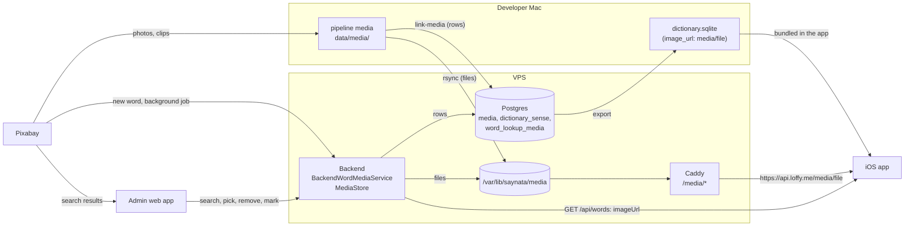
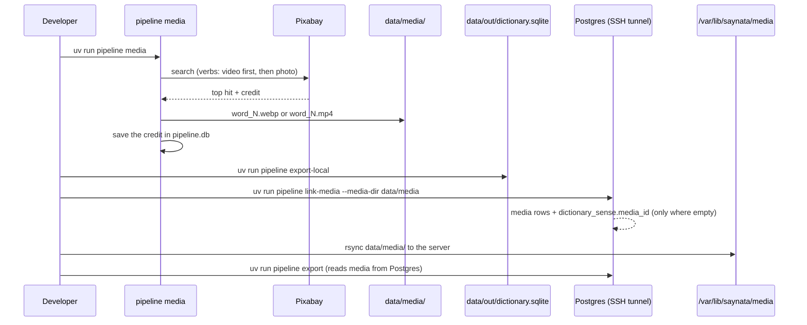
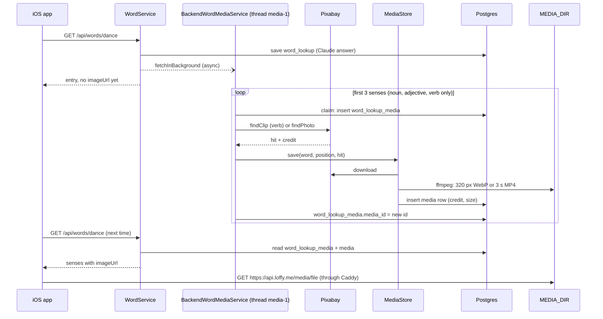
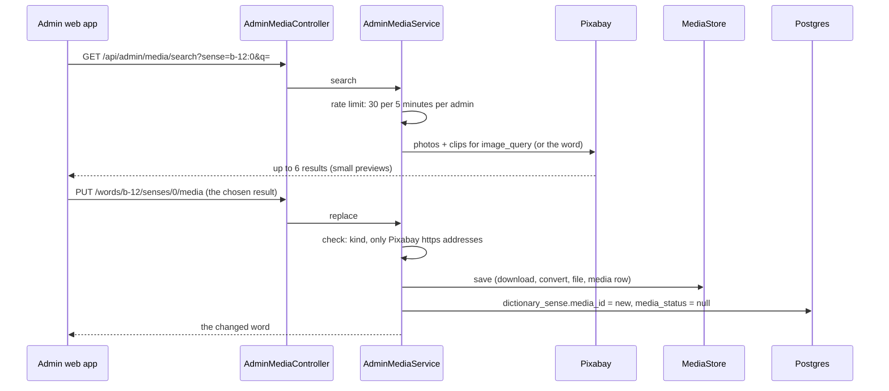
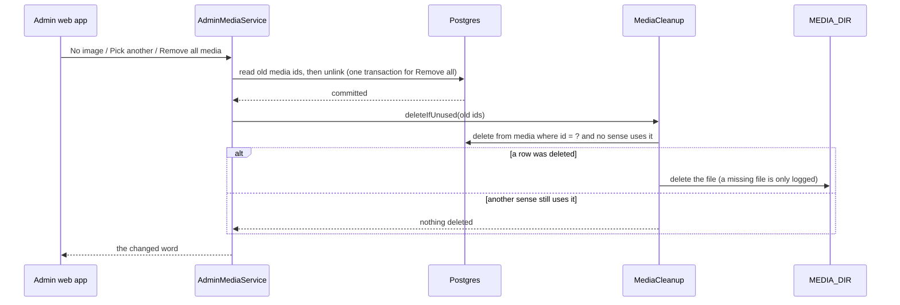

# Media and images

> Status: **working for photos and clips from Pixabay** (TASK-23, 49.3, 49.4, 52). AI images are not built yet (TASK-53). The iOS app shows a bundled word's media from the server (TASK-51, PR #48), saved on the phone for offline. Last traced from code: 2026-10-15 (removing media now deletes the file, and the admin can remove all media of a word: TASK-76; the app loads `media/<file>` from `https://api.loffy.me/media/<file>`, TASK-51; Pixabay 429 is tried again: TASK-63; the admin words list can filter by media with `media=with|without`, TASK-60; a bundled word is answered from Postgres with its media, TASK-58).
> Why: a small picture or a short clip helps a learner remember a meaning (doc-1, Vision and spec). Postgres on the server is the source of truth for content (doc-7).

## What it does

Each sense of a word can have one **photo** (a 320 px WebP) or one **clip** (a 3 second, muted MP4). Nouns and adjectives get photos. Verbs get clips. The files come from Pixabay. There are two ways a sense gets media: the pipeline on the developer's Mac fills it for the 2,750 bundled words, and the backend fills it in the background for every **new** word that Claude writes. An admin can fix any sense in the admin web app: pick another picture, remove it, or mark it for an AI image. The iOS app shows the picture under the explanation of the sense.

This page follows the files from Pixabay to the screen. It does not repeat the pages for the parts: see [Word lookup](doc-5%20-%20Word-lookup.md), [Dictionary pipeline](doc-6%20-%20Dictionary-pipeline.md), [Admin API](doc-13%20-%20Admin-API.md), [Admin CMS](doc-14%20-%20Admin-CMS.md) and the [VPS guide, section 9](../guides/doc-11%20-%20Deploy-to-a-VPS.md).

## Big picture

The database keeps only a row per file (`media`: name, kind, size, credit). The files themselves live on disk in one folder. The same folder is written by the backend and read by Caddy.

## 1. Pipeline: the bundled words

The bundled words are made on the Mac. The order matters, because the media pass works on `data/pipeline.db` (the old working database) and Postgres is the source of truth.

| Step | File:line | What happens |
|---|---|---|
| Which senses need media | [needs_media:60](../../../pipeline/src/pipeline/media.py#L60) | A sense with `image_type` other than `none` and no media yet. This makes the pass safe to run again. |
| Choose what to search | [fetch_media_for_sense:196](../../../pipeline/src/pipeline/media.py#L196) | Verbs: video first. Icons: illustrations first. Everything else: a photo. If the sense's `image_query` finds nothing, it tries `lemma + pos`. |
| Search Pixabay | [search_pixabay_photo:69](../../../pipeline/src/pipeline/media.py#L69), [search_pixabay_video:101](../../../pipeline/src/pipeline/media.py#L101) | `safesearch`, `order=popular`, top 3 hits, take the first. Waits 0.8 s between calls ([_wait_for_rate_limit:46](../../../pipeline/src/pipeline/media.py#L46)). |
| Resize | [resize_and_save_webp:140](../../../pipeline/src/pipeline/media.py#L140), [transcode_and_save_mp4:151](../../../pipeline/src/pipeline/media.py#L151) | Photo: 320 px wide WebP, quality 80, with Pillow. Clip: short muted MP4 loop, with ffmpeg. |
| Save the file | [process_word_media:256](../../../pipeline/src/pipeline/media.py#L256) | File name is `<word>_<sense number>.webp` or `.mp4` in `data/media/`. The credit (photographer, page) goes into `pipeline.db`. |
| The pass | [run_pass:347](../../../pipeline/src/pipeline/media.py#L347), command in [cli.py:151](../../../pipeline/src/pipeline/cli.py#L151) | `uv run pipeline media [--words run walk] [--workers 4] [--dry-run]`. Uses your Pixabay key (`PIXABAY_API_KEY` in `pipeline/.env`). A full pass is many Pixabay requests and takes a long time. |
| Old export | [export_from_pipeline_db:52](../../../pipeline/src/pipeline/export.py#L52), command at [cli.py:323](../../../pipeline/src/pipeline/cli.py#L323) | `export-local` builds `dictionary.sqlite` from `pipeline.db`. Each sense gets `image_url = "media/<file>"` ([export.py:78-80](../../../pipeline/src/pipeline/export.py#L78-L80)). |
| Link into Postgres | [link_media:195](../../../pipeline/src/pipeline/postgres.py#L195), command at [cli.py:184](../../../pipeline/src/pipeline/cli.py#L184) | Reads those `image_url` values and adds `media` rows. It sets `media_id` only on senses that have none, and never changes text. So admin edits are safe. |
| Copy the files | rsync, see [doc-11 section 9](../guides/doc-11%20-%20Deploy-to-a-VPS.md) | `rsync -av data/media/ vps_sieutoc:/var/lib/saynata/media/`. The rows say a file exists; rsync puts it there. |
| Import (one time) | [import_dictionary:89](../../../pipeline/src/pipeline/postgres.py#L89), command at [cli.py:164](../../../pipeline/src/pipeline/cli.py#L164) | The first copy of the bundled dictionary into Postgres. It also creates `media` rows. It reads file sizes from `--media-dir`. |
| Export from Postgres | [export_from_postgres:117](../../../pipeline/src/pipeline/export.py#L117), [copy_media:191](../../../pipeline/src/pipeline/export.py#L191), command at [cli.py:196](../../../pipeline/src/pipeline/cli.py#L196) | Builds `data/out/dictionary.sqlite` and copies the files that senses use into `data/out/media/`. Files missing from `--media-dir` are listed as a warning. |

Then the developer copies only `dictionary.sqlite` into the app (`EnglishTranslation/EnglishTranslation/Resources`). The media files stay on the server (63 MB; the app does not carry them, see doc-7, 2026-10-15). The app loads `media/<file>` from `https://api.loffy.me/media/<file>` and saves it on the phone. How the run works from the start is in [Dictionary pipeline](doc-6%20-%20Dictionary-pipeline.md).

## 2. Backend: new words

When a learner looks up a word that is not in the bundle and not in the cache, the backend asks Claude, saves the answer, replies, and **then** looks for pictures. The first reply has no `imageUrl`. The next lookup has it.

| Step | File:line | What happens |
|---|---|---|
| Start the job | [WordService.java:105](../../../backend/src/main/java/com/englishtranslation/backend/word/WordService.java#L105), [startMediaJob:158](../../../backend/src/main/java/com/englishtranslation/backend/word/WordService.java#L158) | Called after the new word is saved. If it fails to start, it is logged and the answer is still sent. |
| One worker thread | [MediaConfig.mediaExecutor:21](../../../backend/src/main/java/com/englishtranslation/backend/media/MediaConfig.java#L21) | One thread, queue of 50. A full queue drops the job: the word works, it only has no picture. |
| The job | [fetchInBackground:46](../../../backend/src/main/java/com/englishtranslation/backend/media/BackendWordMediaService.java#L46), [fetch:55](../../../backend/src/main/java/com/englishtranslation/backend/media/BackendWordMediaService.java#L55) | Does nothing when `PIXABAY_API_KEY` is empty. Takes the first 3 senses. Every error is caught, so the word answer never breaks. |
| Photo or clip | [kindFor:75](../../../backend/src/main/java/com/englishtranslation/backend/media/BackendWordMediaService.java#L75) | Verb: clip (photo if there is no clip). Noun or adjective: photo. Other types (adverb, "the") get nothing. |
| Claim first | [claim:88](../../../backend/src/main/java/com/englishtranslation/backend/media/BackendWordMediaService.java#L88) | A row in `word_lookup_media` is inserted before Pixabay is asked. So Pixabay is asked once per sense, even when it finds nothing. To try again, delete the word in the admin. |
| Rate limit | [MIN_GAP_MILLIS:28](../../../backend/src/main/java/com/englishtranslation/backend/media/HttpPixabayClient.java#L28), [waitForTurn:172](../../../backend/src/main/java/com/englishtranslation/backend/media/HttpPixabayClient.java#L172) | At least 1.5 s between Pixabay requests (40 per minute; Pixabay allows 100). With one worker thread we stay far below the limit. Downloads only come from `pixabay.com` over https. |
| Pixabay 429 | [send:179](../../../backend/src/main/java/com/englishtranslation/backend/media/HttpPixabayClient.java#L179), [pauseBeforeRetry:196](../../../backend/src/main/java/com/englishtranslation/backend/media/HttpPixabayClient.java#L196), [PixabayBusyException](../../../backend/src/main/java/com/englishtranslation/backend/media/PixabayBusyException.java) | TASK-63. One Pixabay key is shared by the admin search, the background job and a media pass, so Pixabay can still answer 429 (too many requests). Every Pixabay call (search and download) is tried **3 times in all**. The pause is the `Retry-After` header (seconds) when there is one, else 1 s, then 2 s. The waiting adds up to at most 10 s; a `Retry-After` that would go past that gives up at once. After the last try the client throws `PixabayBusyException`. Other errors (500, 404...) are not tried again. |
| Download, convert, save | [MediaStore.save:44](../../../backend/src/main/java/com/englishtranslation/backend/media/MediaStore.java#L44), [FfmpegMediaConverter:16-27](../../../backend/src/main/java/com/englishtranslation/backend/media/FfmpegMediaConverter.java#L16-L27) | Photo: WebP, max 320 px wide, quality 80. Clip: 3 s, no sound, H.264 MP4, `+faststart`. The name is `<word>_<n>_<8 hex of sha256>.<ext>`, so a new picture is always a new name. If the row cannot be saved, the file is removed. |
| Link to the sense | [fetchOneSense:100](../../../backend/src/main/java/com/englishtranslation/backend/media/BackendWordMediaService.java#L100) | Sets `word_lookup_media.media_id`. |
| Tables | [V7](../../../backend/src/main/resources/db/migration/V7__create_word_lookup_media.sql), [V8](../../../backend/src/main/resources/db/migration/V8__add_media_status.sql) | `word_lookup_media (word_lookup_id, sense_position, media_id, media_status)`. A deleted word deletes its rows. Bundled words use `dictionary_sense.media_id` and `media_status` instead. |
| Read for the answer | [SenseMediaReader.forBackendWords:26](../../../backend/src/main/java/com/englishtranslation/backend/media/SenseMediaReader.java#L26), [WordService.mediaOf:148](../../../backend/src/main/java/com/englishtranslation/backend/word/WordService.java#L148) | Joins `word_lookup_media` to `media`. A read problem is logged and ignored. |
| The address | [MediaProperties.urlFor:18](../../../backend/src/main/java/com/englishtranslation/backend/media/MediaProperties.java#L18), [application.properties:41-45](../../../backend/src/main/resources/application.properties#L41-L45) | `imageUrl` = `app.media.base-url` + `/` + file name. Default base URL: `https://api.loffy.me/media`. |
| The JSON | [WordEntryView.of:17](../../../backend/src/main/java/com/englishtranslation/backend/word/WordEntryView.java#L17) | Adds `imageUrl` to a sense that has media. It is left out when there is none, so old app versions see nothing new. |
| Serve the file | Caddy, see [doc-11 section 9](../guides/doc-11%20-%20Deploy-to-a-VPS.md); folder mount in [docker-compose.prod.yml:49-55](../../../backend/docker-compose.prod.yml#L49-L55) | `handle_path /media/*` reads `/var/lib/saynata/media` and adds `Cache-Control: public, max-age=31536000, immutable` (one year). The backend writes to the folder; Caddy only reads it. |

Env: `MEDIA_DIR` (folder), `MEDIA_BASE_URL` (public address), `PIXABAY_API_KEY` (empty means no job). Details of the word flow are in [Word lookup](doc-5%20-%20Word-lookup.md).

## 3. Admin: fix one sense (TASK-52) and remove media for real (TASK-76)

In a word's detail, each sense has a media row with three icon buttons: **Pick another**, **No image** and **Mark for AI**. A sense is named by the word id and the position: `b-12:0` is the first sense of bundled word 12, `w-45:2` is the third sense of backend word 45. The screens are described in [Admin CMS](doc-14%20-%20Admin-CMS.md), the login and rules in [Admin API](doc-13%20-%20Admin-API.md).

| Button | Endpoint | File:line | What happens |
|---|---|---|---|
| (search) | `GET /api/admin/media/search?sense=b-12:0&q=` | [controller:33](../../../backend/src/main/java/com/englishtranslation/backend/admin/AdminMediaController.java#L33), [AdminMediaService.search:91](../../../backend/src/main/java/com/englishtranslation/backend/admin/AdminMediaService.java#L91) | Up to 6 results (usually 2 clips and the rest photos). With an empty `q`, it uses the sense's `image_query`, or the headword. The answer says which words it used. |
| Pick another | `PUT /api/admin/words/{id}/senses/{n}/media` | [controller:51](../../../backend/src/main/java/com/englishtranslation/backend/admin/AdminMediaController.java#L51), [replace:114](../../../backend/src/main/java/com/englishtranslation/backend/admin/AdminMediaService.java#L114) | The result comes from the browser, so [checked:325](../../../backend/src/main/java/com/englishtranslation/backend/admin/AdminMediaService.java#L325) only accepts Pixabay https addresses. Then `MediaStore.save`, then the link. A sense that was "no image" gets `image_type = photo` again. |
| No image | `DELETE .../media` | [controller:57](../../../backend/src/main/java/com/englishtranslation/backend/admin/AdminMediaController.java#L57), [clear:143](../../../backend/src/main/java/com/englishtranslation/backend/admin/AdminMediaService.java#L143) | `media_id` becomes null. For a bundled sense, `image_type = none` tells the pipeline not to fetch again. For a backend word the claim row stays, so the job does not fetch again. |
| Mark for AI | `POST .../media/mark-for-ai` | [controller:62](../../../backend/src/main/java/com/englishtranslation/backend/admin/AdminMediaController.java#L62), [markForAi:198](../../../backend/src/main/java/com/englishtranslation/backend/admin/AdminMediaService.java#L198) | Sets `media_status = needs_ai`. The old picture stays until an AI image replaces it (TASK-53). Picking another picture clears the status. |
| Remove all media | `DELETE /api/admin/words/{id}/media` | [controller:63](../../../backend/src/main/java/com/englishtranslation/backend/admin/AdminMediaController.java#L63), [removeAllMedia:163](../../../backend/src/main/java/com/englishtranslation/backend/admin/AdminMediaService.java#L163) | TASK-76. Every sense of the word (bundled or backend) loses its media in one transaction and gets `media_status = removed`. A bundled sense also gets `image_type = none`; a backend sense gets a claim row, so the background job never fills it. Then the unused files are deleted (next section). |
| (list) | `GET /api/admin/media?status=needs_ai` | [controller:44](../../../backend/src/main/java/com/englishtranslation/backend/admin/AdminMediaController.java#L44), [listByStatus:216](../../../backend/src/main/java/com/englishtranslation/backend/admin/AdminMediaService.java#L216) | All marked senses, from both tables. Any other status is a 400. |

Shared details:

- **Search rate limit:** [MediaSearchRateLimiter:19-20](../../../backend/src/main/java/com/englishtranslation/backend/admin/MediaSearchRateLimiter.java#L19-L20) allows 30 searches in 5 minutes per admin, kept in memory (a restart clears it). One search is two Pixabay calls, and Pixabay allows 100 per minute for our whole key.
- **Backend words without a claim row:** [ensureBackendRow:267](../../../backend/src/main/java/com/englishtranslation/backend/admin/AdminMediaService.java#L267) makes the `word_lookup_media` row when it is missing (the background job only makes rows for 3 senses).
- **Old files are deleted when nothing uses them (TASK-76).** See the flow below.

### Removing media for real (TASK-76)

Before TASK-76, "No image" only unlinked the media in Postgres. The file stayed in `MEDIA_DIR`, and the app's bundled `dictionary.sqlite` still says `image_url = media/<file>`, so the app kept loading `https://api.loffy.me/media/<file>` and showed the picture. Now the file is deleted, the address answers 404, and the app already shows nothing when a download fails.

| Step | File:line | What happens |
|---|---|---|
| Collect the old ids | [currentMediaId:189](../../../backend/src/main/java/com/englishtranslation/backend/admin/AdminMediaService.java#L189) | Read before the sense is changed. |
| Check and delete the row | [MediaCleanup.deleteOne:46](../../../backend/src/main/java/com/englishtranslation/backend/media/MediaCleanup.java#L46) | One `delete from media ... and not exists (dictionary_sense) and not exists (word_lookup_media)`. Zero rows deleted means someone still uses it. |
| Delete the file | [deleteFile:62](../../../backend/src/main/java/com/englishtranslation/backend/media/MediaCleanup.java#L62) | `Files.deleteIfExists`. A missing file is logged. A path outside the media folder is refused. An I/O error is logged and does not fail the request. |
| Same pick again | [replace:114](../../../backend/src/main/java/com/englishtranslation/backend/admin/AdminMediaService.java#L114) | The same Pixabay result gives the same file name and the same row (`MediaStore.save`), which is still linked, so it is kept. |
| Job race | [fetchOneSense:116](../../../backend/src/main/java/com/englishtranslation/backend/media/BackendWordMediaService.java#L116) | The job links its file only if the sense is not `removed`; otherwise it deletes the file it just made. |

A removed sense is not filled again:

- **Backend job:** the claim row exists, so `claim()` fails and Pixabay is never asked.
- **Pipeline `link-media`:** skips a sense with `image_type = 'none'` or `media_status = 'removed'` before it even makes a media row ([postgres.py:225](../../../pipeline/src/pipeline/postgres.py#L225)). Without this, the next `link-media` from an older `dictionary.sqlite` would bring the picture back.
- **Pipeline `export`:** writes no `image_url` for such a sense, even if a link was left behind ([export.py:162](../../../pipeline/src/pipeline/export.py#L162)), so the next app build drops the picture from the bundled file.
- `uv run pipeline media` works on `data/pipeline.db`, which knows nothing about admin changes. It may fetch a file again for a removed sense in that old database, but `link-media` ignores it. (The pipeline media pass already skips `image_type = 'none'`.)

**A phone that already has the picture keeps showing it.** `MediaFileCache` (Caches/SenseMedia, 50 MB) saves each downloaded file by its address, and a saved file is used before the network, so a phone that opened the word before keeps the picture until the cache is cleared (iOS may also clear Caches by itself when space is low; deleting and installing the app clears it). Fresh installs and new devices ask the server, get 404 and show nothing.

**Could the iOS HTTP cache also keep serving it?** Yes, as a second layer. Caddy sends `Cache-Control: public, max-age=31536000, immutable`, and `URLSession.shared` has a default `URLCache` (a few MB in memory, 10 MB on disk), so a recent response can be answered without asking the server. It matters only in the short time before that entry is evicted; the permanent copy is the `MediaFileCache` one. Follow-up idea (not built): make `MediaFileCache` check removal cheaply. The smallest fix is to send a `HEAD` request for a cached file at most once a day (or when the word card opens), and delete the saved copy on 404. A bigger option: send a "removed files" list in the word response. The bundled-in-app samples (`dog_1.webp`, `run_1.mp4`, `tree_1.webp`) are inside the app and also stay until the next app build.

## 4. iOS: how the app shows media

The word card calls `SenseMediaView(path:)` for each sense that has an `imageUrl`. The path can be a bundled path (`media/run_1.mp4`, what `dictionary.sqlite` stores) or an https address (what the backend sends). Last traced: 2026-10-15 (TASK-47, TASK-51).

| Step | File:line | What happens |
|---|---|---|
| Read the field | [WordEntry.swift:48](../../../EnglishTranslation/EnglishTranslation/Dictionary/WordEntry.swift#L48), [DictionaryStore.swift:106](../../../EnglishTranslation/EnglishTranslation/Dictionary/DictionaryStore.swift#L106) | `Sense.imageUrl` is decoded from the backend JSON (`imageUrl`) and from the bundled file (`senses.image_url`, for example `media/run_1.mp4`). |
| Show it | [WordCardView.swift:68](../../../EnglishTranslation/EnglishTranslation/Views/Word/WordCardView.swift#L68) | Under the sense title row, `SenseMediaView(path:)` is shown if the sense has an `imageUrl`. |
| Read the path | [SenseMediaSource.swift:16-40](../../../EnglishTranslation/EnglishTranslation/Views/Word/SenseMediaSource.swift#L16-L40) | `SenseMediaSource(path:)` gives `.bundled(path)` or `.remote(https URL)`. Empty text and plain `http` give nothing. It tells a clip from a photo by the file extension. |
| Choose bundle or server | [SenseMediaSource.swift:42-52](../../../EnglishTranslation/EnglishTranslation/Views/Word/SenseMediaSource.swift#L42-L52) | `resolved(serverBase:)`: a bundled path whose file is inside the app stays bundled (only `dog_1.webp`, `run_1.mp4`, `tree_1.webp` are). Any other bundled path becomes `<server>/media/<file name>`. The server address is `AppConfig.backendBaseURL()`, the same `BackendBaseURL` Info.plist value the backend client uses, so it is not written twice. |
| Load | [SenseMediaView.swift:82-105](../../../EnglishTranslation/EnglishTranslation/Views/Word/SenseMediaView.swift#L82-L105) | Bundled file: used directly. Server photo: `MediaFileCache` downloads it once and saves it, so it shows again offline. Server clip: a saved file plays if there is one; else AVPlayer streams the address and the file is saved in the background. |
| Disk cache | [MediaFileCache.swift](../../../EnglishTranslation/EnglishTranslation/Views/Word/MediaFileCache.swift) | `Caches/SenseMedia`, **50 MB**, least recently used files go first. A file bigger than a quarter of the cache is not kept. Two views that ask for the same address share one download. iOS may delete Caches, which is fine: files are downloaded again. |
| Frame and failure | [SenseMediaView.swift:40-52](../../../EnglishTranslation/EnglishTranslation/Views/Word/SenseMediaView.swift#L40-L52) | The frame is always 240 x 135 and invisible while loading, so nothing jumps. If loading fails (offline and not saved yet, 404, bad path), the whole view disappears: no error text, no empty box. |
| Clip player | [SenseMediaView.swift:123-185](../../../EnglishTranslation/EnglishTranslation/Views/Word/SenseMediaView.swift#L123-L185) | An empty `AVQueuePlayer` plus `AVPlayerLooper(templateItem:)` (no stutter at the loop point), muted. If the looper status is `.failed`, the media is hidden. |
| Play only when seen | [SenseMediaView.swift:51](../../../EnglishTranslation/EnglishTranslation/Views/Word/SenseMediaView.swift#L51) | `onScrollVisibilityChange(threshold: 0.33)` and `scenePhase`: a clip plays only when about a third of it is on screen and the app is active. |

Tests: [SenseMediaTests.swift](../../../EnglishTranslation/EnglishTranslationTests/SenseMediaTests.swift) (Sense decoding, `image_url` column, bundled path vs https, a bundled file uses the bundle, a bundled path without a file maps to the server URL, https stays as it is, bad values give nothing, cache hit, offline, failure, size limit). The visibility rule needs a real scroll view, so it is checked by hand in the PR card.

## Errors

| Cause | Where | What happens |
|---|---|---|
| `PIXABAY_API_KEY` empty | Background job, admin | Job does nothing and claims nothing. Admin search, pick: 503 "Pixabay is not set up". |
| Pixabay has no result | Background job | The claim row stays with no `media_id`. Pixabay is not asked again for that sense. |
| Pixabay is busy (429 on all 3 tries) | `HttpPixabayClient.send` | `PixabayBusyException`. Admin pick or search: 503 "Pixabay is busy right now. Try again in a minute." and the old picture stays. Job: logged like any other failed download. |
| Download or ffmpeg fails | `MediaStore.save` | No file and no row are left. Job: logged, next sense runs. Admin pick: 502 "Could not download or convert that file", the old picture stays. |
| Pixabay does not answer | Admin search | 502 "Pixabay did not answer". |
| More than 30 searches in 5 minutes | Admin search | 429 "Too many searches". |
| Chosen file is not from Pixabay, or `kind` is wrong | Admin pick | 400, nothing is downloaded. |
| Sense does not exist | Admin | 404. |
| Job queue is full (50 waiting) | `mediaExecutor` | Job dropped, the word has no picture. |
| File missing in `/var/lib/saynata/media` | Caddy | 404 for the file. The app shows nothing for that sense. |
| Bundled path, file not in the app, and the server has no such file | iOS | The app asks the server (404), then shows nothing. |
| Offline, file never saved on the phone | iOS | Nothing is shown. It appears after a first view with the network. |

## Tests

| Test file | What it covers |
|---|---|
| [BackendWordMediaServiceTest](../../../backend/src/test/java/com/englishtranslation/backend/media/BackendWordMediaServiceTest.java) | Noun gets a photo, verb gets a clip (photo fallback), other types skipped, a failure is not thrown and not retried, no leftover file after a failed conversion. |
| [NoPixabayKeyTest](../../../backend/src/test/java/com/englishtranslation/backend/media/NoPixabayKeyTest.java) | Without a key, Pixabay is never called and nothing is claimed. |
| [WordImageUrlTest](../../../backend/src/test/java/com/englishtranslation/backend/media/WordImageUrlTest.java) | `imageUrl` is absolute, the field is missing when there is no media, a new word is answered first. |
| [FfmpegMediaConverterTest](../../../backend/src/test/java/com/englishtranslation/backend/media/FfmpegMediaConverterTest.java) | Big photo becomes a small WebP, video becomes a short MP4, bad input fails with a clear message. Needs ffmpeg on the machine. |
| [HttpPixabayClientTest](../../../backend/src/test/java/com/englishtranslation/backend/media/HttpPixabayClientTest.java) | Only Pixabay hosts over https are accepted. A fake HTTP client: 429 then 200 succeeds (one 1 s pause), 429 three times gives `PixabayBusyException`, `Retry-After` is used, a `Retry-After` past the budget gives up at once, other errors are not tried again (TASK-63). |
| [AdminMediaTest](../../../backend/src/test/java/com/englishtranslation/backend/admin/AdminMediaTest.java) | Login and role, search (6 results, default words, rate limit, errors), pick, remove, mark for AI, list, 404. TASK-76: the file and row are deleted when unused and kept while another sense (bundled or backend) uses them, a missing file is fine, picking another deletes the old file, Remove all media for a bundled word and a backend word (also without a claim row), the background job does not fill a removed sense, only ADMIN may call it. |
| [test_media.py](../../../pipeline/tests/test_media.py) | `needs_media`, file names, WebP resize, dry run, the pass with a fake fetcher. |
| [test_postgres.py](../../../pipeline/tests/test_postgres.py) | TASK-76: `link-media` skips `none` and `removed` senses and makes no media row for them; `export` writes no `image_url` for them. Needs `TEST_DATABASE_URL`. |
| [mediaRow.test.tsx](../../../admin/src/test/mediaRow.test.tsx) | The admin buttons and the Pick another panel, the full-size viewer (TASK-77). |
| [wordRows.test.tsx](../../../admin/src/test/wordRows.test.tsx) | Thumbnails, hover to play, Remove all media (TASK-76, TASK-77). |

Run: `cd backend && ./mvnw -B test`, `cd pipeline && uv run pytest`, `cd admin && npm test`. iOS: `SenseMediaTests.swift` (command in doc-2).

## Change checklist

- Change the picture size, quality or clip length: [FfmpegMediaConverter](../../../backend/src/main/java/com/englishtranslation/backend/media/FfmpegMediaConverter.java) **and** `resize_and_save_webp` / `transcode_and_save_mp4` in the pipeline. Keep both the same.
- Change the file name rule: `MediaStore.save`, the pipeline file name, `link_media`, and the Caddy cache note (a name must change when the content changes).
- Add a new media `kind`: `kindFor`, `MediaStore`, `SenseMedia`, the admin `checked`, the iOS source type.
- Change `MEDIA_BASE_URL` or the folder: [doc-11](../guides/doc-11%20-%20Deploy-to-a-VPS.md), `docker-compose.prod.yml` and the Caddyfile together.
- Change Pixabay limits: `HttpPixabayClient` (backend), `_wait_for_rate_limit` (pipeline), `MediaSearchRateLimiter` (admin).

## TASK-53: AI images (not built)

AI images plug in at `media_status = needs_ai` (set by Mark for AI, listed by `GET /api/admin/media?status=needs_ai`). A future job reads those senses, makes an image, saves it through `MediaStore` with `source = ai` (plus provider, prompt and cost) on the `media` row, links it, and clears the status.

## Finding words by media (TASK-60)

`GET /api/admin/words?media=with` keeps the words where any sense has a media file, `media=without` the words where no sense has one (doc-13). A bundled word counts through `dictionary_sense.media_id`, a backend word through `word_lookup_media.media_id`. A claim row with no file does not count. The admin has two chips for it, **Has media** and **No media** (doc-14). This is the way to see which bundled words the Pixabay pass has not reached yet: press "No media", and the count line shows how many are left.

## Known gaps

- Flyway V9 (TASK-58) deleted the `word_lookup` rows of words that are in the bundled dictionary, with their `word_lookup_media` links. The media rows and files of those words stay on disk (same gap as the next lines).

- A new word's first answer has no `imageUrl`. The picture shows from the second lookup (on purpose: the answer must not wait for Pixabay).
- If the server restarts while jobs wait in the queue, those words get no picture until an admin deletes the word.
- A sense whose Pixabay search found nothing is never tried again by itself.
- Pipeline file names have no hash (`run_1.mp4`). Caddy caches every file for a year as `immutable`. If you rsync a different picture under the same name, phones may keep the old one.
- A picture an admin picks for a bundled sense changes Postgres, but the app learns the new file name only after the next `export` and a new app build (the sqlite file in the app holds the paths). A new file under the same name is also held by the one-year phone and Caddy caches.
- The first view of a bundled word's picture needs the network. A word the user never opened online has no picture offline.
- Files of a **deleted word** (Regenerate) and of the Flyway V9 clean-up are still not deleted from `/var/lib/saynata/media`. Replaced and removed pictures are (TASK-76).
- A phone that cached a picture before an admin removed it keeps showing it until its cache is cleared (see the TASK-76 section). Follow-up idea: check cached files with `HEAD` and delete them on 404.
- The pipeline media pass (`data/pipeline.db`) does not know about admin removals; `link-media` and `export` protect the result.
- Pixabay credit (photographer, page) is stored and sent to the admin, but the iOS card does not show it yet.
- The Media page of the admin web app is still a placeholder (see doc-14).
