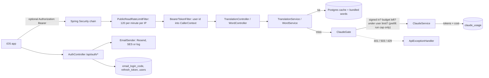
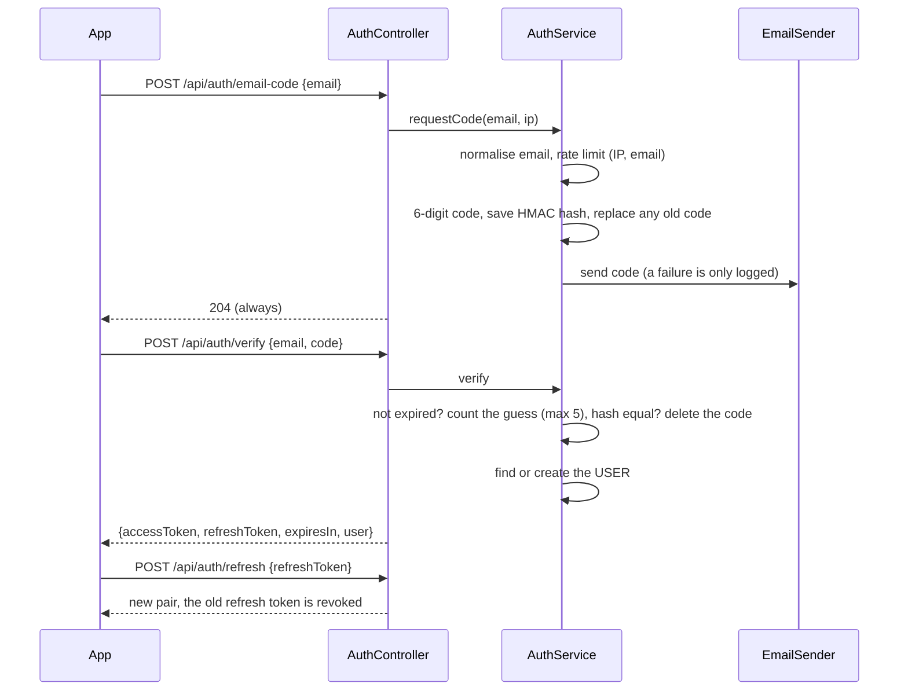
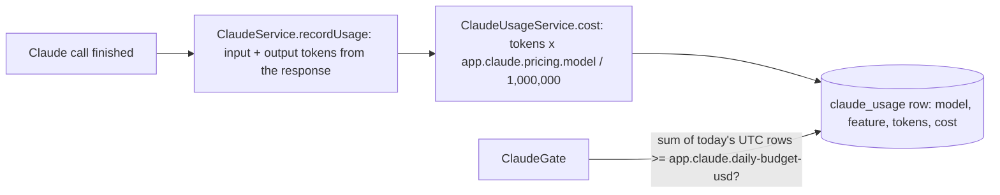
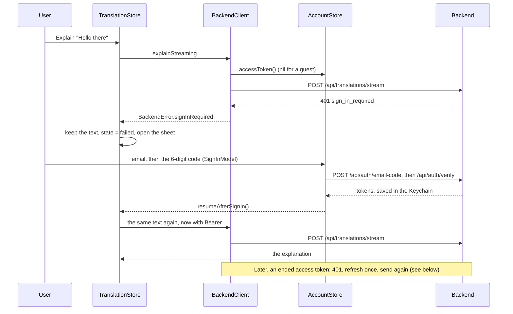

# Accounts and limits

> Status: **backend built** (TASK-66 accounts, TASK-68 sign-in for new Claude calls, TASK-69 rate limits, TASK-67 daily budget). The iOS side is built too (TASK-70, see "iOS app" below). Last traced from code: 2026-10-16.
> Why: doc-7 rows of 2026-10-15. Related: [Admin API](doc-13%20-%20Admin-API.md) (the admin has its own cookie login), [Sentence translation](doc-4%20-%20Sentence-translation.md), [Word lookup](doc-5%20-%20Word-lookup.md), the Resend and SES setup in the [deploy guide](../guides/doc-11%20-%20Deploy-to-a-VPS.md) (sections 10 and 11).

## What it does

A learner signs in with an **email code**: type an email, get a 6-digit code by email, type it, done. There are no passwords.
A signed-in learner may ask for **new** explanations from Claude. A **guest** (no token) gets only what costs nothing new:
the bundled words (on the device) and anything already in the shared cache. Claude spending also has a hard
**daily cap in dollars**, and every path has a **rate limit**.

| Caller | Cache hit or bundled word | New sentence, or word not bundled and not cached |
|---|---|---|
| Guest | Works | 401 `sign_in_required` |
| Signed in | Works | Calls Claude (if the budget and the user limit allow) |
| Anyone, budget used up | Works | 503 `daily_limit_reached` |
| The prefill job (no user, TASK-83.1) | Works | Calls Claude with its **own** run cap, not the users' budget (see "Prefill job: its own budget") |

An iOS app **without** the sign-in screen sends no token. With the default (`REQUIRE_SIGN_IN=true`), **a new sentence or an uncached word from such an app gives 401**. The app with TASK-70 shows the sign-in sheet instead.
**Switch `REQUIRE_SIGN_IN`:** keep `REQUIRE_SIGN_IN=false` in `backend/.env` until the app with sign-in is released. Then a guest miss does call Claude, but it still goes through `ClaudeGate`: the daily budget cap applies (503 `daily_limit_reached`), and so does a per-IP limit for guests' new calls (30 per hour by default, 429 `rate_limited`), so one guest cannot burn the budget alone. Bundled words and cached answers work in both modes. Set it back to `true` (or remove the line) when the new app is out.

## Big picture

## Sign-in flow

| Step | File:line | What happens |
|---|---|---|
| Tables | [V10__create_accounts.sql](../../../backend/src/main/resources/db/migration/V10__create_accounts.sql) | `email_login_code` (one row per email: keyed hash, attempts, expiry), `refresh_token` (SHA-256 of the token, `revoked_at`, cascade delete with the user). `users.password_hash` may now be empty: app users have no password. |
| Ask for a code | [AuthService.requestCode:82](../../../backend/src/main/java/com/englishtranslation/backend/auth/AuthService.java#L82) | Validates and lower-cases the email ([Emails.normalize:17](../../../backend/src/main/java/com/englishtranslation/backend/auth/Emails.java#L17)), applies the two rate limits, saves the code (a second code **replaces** the first: one per email), sends it. The same for known and unknown emails, so the controller can always answer 204. |
| Code hash | [AuthService.hashCode:200](../../../backend/src/main/java/com/englishtranslation/backend/auth/AuthService.java#L200) | HMAC-SHA256 with a key from the server secret, over `email:code`. A plain hash of 6 digits could be reversed in a second; the secret makes a stolen database useless. The code itself is never saved or logged by the SES sender. |
| Verify | [AuthService.verify:98](../../../backend/src/main/java/com/englishtranslation/backend/auth/AuthService.java#L98) | Expired: row deleted. The guess is counted by one atomic SQL update (max 5), so parallel requests cannot get extra guesses. A right code is deleted in the same step that accepts it, so it works once. Every failure is the same 401 `invalid_code`. First sign-in creates the user (role USER); an existing user (even an admin) just signs in. |
| Tokens | [AuthService.issueTokens:181](../../../backend/src/main/java/com/englishtranslation/backend/auth/AuthService.java#L181) | Access token: JWT HS256, 1 hour, only the user id, claim `typ=access`, own key ([AccessTokenService](../../../backend/src/main/java/com/englishtranslation/backend/auth/AccessTokenService.java)). Refresh token: 32 random bytes, 60 days, only its SHA-256 is saved. |
| Keys | [AuthKeys:29](../../../backend/src/main/java/com/englishtranslation/backend/auth/AuthKeys.java#L29) | One base secret gives separate keys for the access token and the code hash: `USER_JWT_SECRET`, else `ADMIN_JWT_SECRET`, else random at start-up (a warning is logged). So a missing variable never stops a deploy. |
| Refresh | [AuthService.refresh:126](../../../backend/src/main/java/com/englishtranslation/backend/auth/AuthService.java#L126) | Rotation: the used token is revoked and a new pair is issued. If a **revoked** token is sent again, all tokens of that user are revoked (someone may have copied it) and the app must sign in again. |
| Sign out | [AuthService.signOut:143](../../../backend/src/main/java/com/englishtranslation/backend/auth/AuthService.java#L143) | Revokes that refresh token. Always 204. |
| Delete account | [AuthService.deleteAccount:153](../../../backend/src/main/java/com/englishtranslation/backend/auth/AuthService.java#L153) | `DELETE /api/me` removes the user, its roles, its refresh tokens and a pending code. The access token stops working at once (the filter checks that the user exists). An account with the ADMIN role is refused (403 `admin_account`). |
| Bearer filter | [BearerTokenFilter:41](../../../backend/src/main/java/com/englishtranslation/backend/auth/BearerTokenFilter.java#L41) | Optional token. Bad, expired or unknown-user token = a guest, no error. A good one authenticates as role USER and sets `CallerContext`. It never touches `/api/admin`, so an access token cannot open the admin API and the admin cookie cannot open `/api/me`. |
| Rules | [SecurityConfig:43](../../../backend/src/main/java/com/englishtranslation/backend/admin/SecurityConfig.java#L43) | `/api/me` needs USER; `/api/auth/*`, `/api/translations*`, `/api/words/*` stay open. |
| Email | [AuthConfig:21](../../../backend/src/main/java/com/englishtranslation/backend/auth/AuthConfig.java#L21), [ResendEmailSender](../../../backend/src/main/java/com/englishtranslation/backend/auth/ResendEmailSender.java), [SesEmailSender](../../../backend/src/main/java/com/englishtranslation/backend/auth/SesEmailSender.java), [LoggingEmailSender](../../../backend/src/main/java/com/englishtranslation/backend/auth/LoggingEmailSender.java) | The sender is chosen at start-up (TASK-71) and logged. (1) `RESEND_API_KEY` and `EMAIL_FROM` set: **Resend**, one HTTPS `POST https://api.resend.com/emails` with `Authorization: Bearer` and JSON `{from, to, subject, text, html}`, 10 s timeout; 2xx is success; on 429, 5xx or a network error it waits 1 s and tries once more; errors are logged (status only, never the key or the code) and not thrown. (2) Else a from address set (`EMAIL_FROM`, or the older `SES_FROM_EMAIL`): SES v2, region `AWS_REGION`, keys from the standard AWS variables, client built on the first send. (3) Else the code is written to the log and a warning is logged at start-up. A send failure is logged and the answer is still 204. Resend was chosen over SES for now (doc-7, 2026-10-15). |

Endpoints (all JSON, no cookie):

| Method and path | Body | Answer |
|---|---|---|
| `POST /api/auth/email-code` | `{email}` | 204 always. 400 `invalid_email` for a bad format. 429 `rate_limited`. |
| `POST /api/auth/verify` | `{email, code}` | `{accessToken, refreshToken, expiresIn (seconds), user: {id, email}}`. 401 `invalid_code`. |
| `POST /api/auth/refresh` | `{refreshToken}` | Same shape as verify. 401 `invalid_refresh_token`. |
| `POST /api/auth/sign-out` | `{refreshToken}` | 204 always. |
| `GET /api/me` | Bearer | `{id, email}`. 401 without a token. |
| `DELETE /api/me` | Bearer | 204. |

## The gate for new Claude calls

[ClaudeGate.beforeNewCall:34](../../../backend/src/main/java/com/englishtranslation/backend/limits/ClaudeGate.java#L34) runs right before every Claude call, and only after the cache and bundled lookups missed:
[TranslationService:69](../../../backend/src/main/java/com/englishtranslation/backend/translation/TranslationService.java#L69) (sentences, also personal-looking text and the stream) and [WordService:86](../../../backend/src/main/java/com/englishtranslation/backend/word/WordService.java#L86) (words).
The order is: (1) guest: 401 `sign_in_required` (skipped when `REQUIRE_SIGN_IN=false`); (2) budget used up: 503 `daily_limit_reached`; (3) user over 60 per hour or 300 per day: 429 `rate_limited`; for a guest (only possible with `REQUIRE_SIGN_IN=false`) over 30 new calls per hour from one IP: 429 `rate_limited`.
The budget comes before the user limit so a refused call does not use up a user's allowance.
The word retry (a second call for hard words) only re-checks the budget ([checkBudget:74](../../../backend/src/main/java/com/englishtranslation/backend/limits/ClaudeGate.java#L74)).

Who is asking (user id and client IP): [CallerContext](../../../backend/src/main/java/com/englishtranslation/backend/limits/CallerContext.java) holds the user id in a thread-local. `BearerTokenFilter` sets it for the request. The sentence stream runs on its own thread, so [TranslationController:66](../../../backend/src/main/java/com/englishtranslation/backend/translation/TranslationController.java#L66) copies the caller there. For the stream, the error is an `error` event: `{"status": 401, "message": "...", "code": "sign_in_required"}` (the `code` field is only there for these coded errors).

Admin tools: the admin API makes no Claude call today (deleting a row is "regenerate": the next **public** lookup asks Claude, and that lookup goes through the gate). A future admin tool that calls Claude must call `ClaudeGate.checkBudget()` and record with `Feature.ADMIN`.

## Prefill job: its own budget

The nightly prefill job (TASK-83.1, see [Prefill](doc-18%20-%20Prefill.md)) fills the shared cache and has no user. On its own thread `ClaudeGate` takes a different path ([checkPrefillCap:59](../../../backend/src/main/java/com/englishtranslation/backend/limits/ClaudeGate.java#L59)): no sign-in check, no per-user limit, no users' budget check. It checks the **run cap** instead (`app.prefill.max-usd-per-run`, default $0.50: the `PREFILL` rows since the run start). Its calls are saved with `Feature.PREFILL` ([ClaudeUsageService.record:68](../../../backend/src/main/java/com/englishtranslation/backend/claude/ClaudeUsageService.java#L68)) and are left out of the users' budget sum, so a night run cannot use the users' $1 day, and a used-up users' budget does not stop a run. The path opens only inside `PrefillContext`, which only `PrefillRunner` sets.

## Rate limits

[RateLimiter](../../../backend/src/main/java/com/englishtranslation/backend/limits/RateLimiter.java#L16) is a small token bucket in memory (no Redis; a restart clears it; one server). "5 per hour" is a bucket of 5 that refills evenly. When several limits apply, a refused request uses up none of them. Numbers live in `app.limits.*` ([LimitProperties](../../../backend/src/main/java/com/englishtranslation/backend/limits/LimitProperties.java)); each can be set from env.

| What | Default | Env |
|---|---|---|
| `/api/auth/email-code` per IP | 5 per hour | `LIMIT_EMAIL_CODE_IP_MAX`, `LIMIT_EMAIL_CODE_IP_PERIOD` |
| `/api/auth/email-code` per email | 3 per 15 minutes | `LIMIT_EMAIL_CODE_EMAIL_MAX`, `LIMIT_EMAIL_CODE_EMAIL_PERIOD` |
| New Claude calls per signed-in user | 60 per hour, 300 per day | `LIMIT_CLAUDE_USER_HOUR_MAX`, `LIMIT_CLAUDE_USER_DAY_MAX` |
| New Claude calls by a guest, per IP (only when `REQUIRE_SIGN_IN=false`) | 30 per hour | `LIMIT_CLAUDE_GUEST_IP_MAX` |
| `/api/translations*`, `/api/words/*` per IP (cache hits too) | 120 per minute | `LIMIT_PUBLIC_READ_IP_MAX`, `LIMIT_PUBLIC_READ_IP_PERIOD` |

Over a limit: **429**, header `Retry-After` (seconds), body code `rate_limited`. The public read limit is a servlet filter ([PublicReadRateLimitFilter:34](../../../backend/src/main/java/com/englishtranslation/backend/limits/PublicReadRateLimitFilter.java#L34)), so even the event stream gets a real 429.
The client IP is `request.getRemoteAddr()`, like the admin login limit ([ClientIp](../../../backend/src/main/java/com/englishtranslation/backend/limits/ClientIp.java)). Tomcat's remote-ip valve (`server.tomcat.remoteip.*`) swaps in `X-Forwarded-For` only when the request comes from a loopback or private proxy (Caddy). The backend port is on loopback only (PR #51), so a client cannot fake the header.

## Daily Claude budget

| Step | File:line | What happens |
|---|---|---|
| Table | [V11__create_claude_usage.sql](../../../backend/src/main/resources/db/migration/V11__create_claude_usage.sql) | One row per call: time, model, feature (`SENTENCE`, `WORD`, `ADMIN`, `WARMUP`), input and output tokens, cost in USD (8 decimals). The cost is saved, so a later price change does not rewrite history. |
| Record | [ClaudeService.recordUsage:232](../../../backend/src/main/java/com/englishtranslation/backend/claude/ClaudeService.java#L232) | Called for the normal sentence call, the streamed call (the stream accumulator sums the start and end events) and the word call, **before** the answer is read, so a refused or "not English" answer is counted too (it cost money). Never throws. |
| Cost | [ClaudeUsageService.cost:74](../../../backend/src/main/java/com/englishtranslation/backend/claude/ClaudeUsageService.java#L74) | `(input x inputPerMtok + output x outputPerMtok) / 1,000,000`. A model with no price in config is counted at the **highest** configured price (never free) and a warning is logged. |
| Prices | `app.claude.pricing.<model>.input-per-mtok` / `output-per-mtok` in [application.properties](../../../backend/src/main/resources/application.properties) | `claude-haiku-5-5`: $0.10 in, $0.50 out per million tokens (prompts up to 100K tokens; checked 2026-10-15). **Check them when the model or Anthropic's prices change.** |
| Cap | [ClaudeUsageService.budgetReached:119](../../../backend/src/main/java/com/englishtranslation/backend/claude/ClaudeUsageService.java#L119) | Sum of today's rows **except feature `PREFILL`** (the day starts at 00:00 UTC) `>=` `app.claude.daily-budget-usd` (`CLAUDE_DAILY_BUDGET_USD`, default 1.00). Then the answer is 503 `daily_limit_reached`, "Saynata has reached today's limit for new explanations. Cached words still work. Try again tomorrow." |
| Report | [AdminUsageController](../../../backend/src/main/java/com/englishtranslation/backend/admin/AdminUsageController.java), [ClaudeUsageService.report:124](../../../backend/src/main/java/com/englishtranslation/backend/claude/ClaudeUsageService.java#L124) | `GET /api/admin/usage?days=7` (admin cookie; 1 to 90 days): `{dailyBudgetUsd, todayUsd, prefillTodayUsd, days: [{date, total, byFeature}]}` (`todayUsd` is what the users' budget counts, so it leaves the prefill spend out; `prefillTodayUsd` is that spend; a day's `total` and `byFeature.prefill` include it), newest first, empty days included. No admin screen yet. |

## Errors

| Cause | HTTP | Code | Message |
|---|---|---|---|
| Guest needs a new Claude call | 401 | `sign_in_required` | "Sign in to get a new explanation." |
| Today's budget used up | 503 | `daily_limit_reached` | "Saynata has reached today's limit for new explanations. Cached words still work. Try again tomorrow." |
| Any limit above | 429 + `Retry-After` | `rate_limited` | "Too many requests. Try again in a little while." |
| Bad email format | 400 | `invalid_email` | "Enter a valid email address." |
| Wrong, expired, used or locked code | 401 | `invalid_code` | "That code is wrong or has expired. Ask for a new code." |
| Unknown, expired or used refresh token | 401 | `invalid_refresh_token` | "Your session has ended. Sign in again." |
| `/api/me` without a good token | 401 | none (empty body) | |
| Delete an admin account through `/api/me` | 403 | `admin_account` | "An admin account cannot be deleted here. Ask the developer." |

The body is Spring problem details (`type`, `title`, `status`, `detail`) plus `code`. The app should switch on `code`, not on the text.

## iOS app (TASK-70)

The app signs in with the email code, keeps the tokens in the **Keychain**, sends `Authorization: Bearer` on translations, the stream and words, and shows the sign-in sheet when the backend answers `sign_in_required`. A guest with no token sends no header, so against a backend with `REQUIRE_SIGN_IN=false` nothing changes until a 401 comes back.

| Part | File:line | What happens |
|---|---|---|
| Keychain | [SecretStore.swift:22](../../../EnglishTranslation/EnglishTranslation/Account/SecretStore.swift#L22) | `KeychainSecretStore` (SecItem, `AfterFirstUnlockThisDeviceOnly`) behind the small `SecretStoring` protocol, so tests use a fake. The whole session (access token, refresh token, user) is **one JSON item** under the key `session`, saved and deleted in one step. No access group (see known gaps). |
| Calls | [AuthClient.swift:28](../../../EnglishTranslation/EnglishTranslation/Account/AuthClient.swift#L28) | `requestCode`, `verify`, `refresh`, `signOut`, `deleteAccount` (`DELETE /api/me` with the Bearer). A failed reply becomes an `AuthError` ([AuthModels.swift:31](../../../EnglishTranslation/EnglishTranslation/Account/AuthModels.swift#L31)): the `code` is read first, then the status (`invalid_code`, `invalid_refresh_token`, `invalid_email`, `admin_account`, 429 with `Retry-After`). |
| Account | [AccountStore.swift:24](../../../EnglishTranslation/EnglishTranslation/Account/AccountStore.swift#L24) | `@Observable`, one shared instance (`AccountStore.shared`, also given to the views with `.environment`). Loads the session from the Keychain at start. `signIn` saves the tokens. `signOut` clears the device first, then tells the server (a failed call is ignored). `deleteAccount` calls `DELETE /api/me` (an ended token is refreshed once), then signs out locally; an admin account (403) stays signed in and shows the server message. |
| Refresh | [AccountStore.swift:102](../../../EnglishTranslation/EnglishTranslation/Account/AccountStore.swift#L102) | `refreshedAccessToken(replacing:)`. If the session already has another token, it returns that one. Requests that fail together **share one refresh task**, because the server accepts each refresh token once and a second use would revoke every session (doc-17 "Refresh"). If the server says `invalid_refresh_token`, the user is **signed out locally** and the call returns nil. A network error is thrown and the session stays, so one bad connection does not sign the user out. |
| Bearer and retry | [BackendClient.swift:280](../../../EnglishTranslation/EnglishTranslation/Network/BackendClient.swift#L280) | `withAuthRetry`: runs the request with the token; on 401 **with a token**, refreshes once and runs it again. The stream goes through it too, also for an `error` event with status 401. A guest's 401 (no token) goes straight to the caller. After a failed refresh the caller gets `signInRequired`, which opens the sheet. Only one retry, so a server that keeps saying 401 cannot loop. |
| Errors | [BackendClient.swift:86](../../../EnglishTranslation/EnglishTranslation/Network/BackendClient.swift#L86) | `BackendError.make` reads the `code` of the body (or of the stream event), then the status: `signInRequired`, `rateLimited(retryAfter:)`, `dailyLimitReached(message:)`, else `badStatus`. All three new ones are final answers, so the stream is not retried on the old endpoint. |
| Store | [TranslationStore.swift:103](../../../EnglishTranslation/EnglishTranslation/Stores/TranslationStore.swift#L103) | On `signInRequired` (a sentence, or a word that is not bundled and not cached): keeps the text (`textNeedingSignIn`), sets `.failed("Sign in to get a new explanation.")` and opens the sheet (`isSignInSheetOpen`). After sign-in, `resumeAfterSignIn()` runs **the same text** again, even if the user typed something else meanwhile. Closing the sheet leaves the message in the result area. |
| Sheet | [SignInSheet.swift:11](../../../EnglishTranslation/EnglishTranslation/Views/Account/SignInSheet.swift#L11), [SignInModel.swift:12](../../../EnglishTranslation/EnglishTranslation/Account/SignInModel.swift#L12), [CodeBoxes.swift:11](../../../EnglishTranslation/EnglishTranslation/DesignSystem/Components/CodeBoxes.swift#L11) | A bottom sheet with a grabber, opened by [TranslateView](../../../EnglishTranslation/EnglishTranslation/Views/Translate/TranslateView.swift) over the result. Step 1: "Sign in to explain new sentences", "Saved words still work without an account.", an email field and a round icon-only send button (label "Send code"). Step 2: "Enter the code", "We sent 6 numbers to <email>", six boxes that are **one text field** with `.oneTimeCode` (Mail fills it), and a "Send a new code" text link. The 6th digit checks the code by itself. Pictures: [step 1](../../../docs/design/signin-sheet-step1-email.png), [step 2](../../../docs/design/signin-sheet-step2-code.png). |
| Code errors | [SignInModel.swift:107](../../../EnglishTranslation/EnglishTranslation/Account/SignInModel.swift#L107) | The server answers every bad code with the same `invalid_code`, so the app counts the wrong tries itself: 1 to 4 give "That code is wrong or has expired. Try again, or send a new code."; the 5th gives "Too many tries. Send a new code." (the server locks the code after 5). "Send a new code" starts the count again. A 429 shows "Too many requests. Try again in N minutes." |
| Result area | [BackendClient.swift:49](../../../EnglishTranslation/EnglishTranslation/Network/BackendClient.swift#L49) | `daily_limit_reached` shows the **server's message** as it is. `rate_limited` shows "Too many requests. Try again in N minutes." (`Retry-After` in whole minutes, rounded up; "in a little while" when there is no header, as in a stream event). |
| Settings | [SettingsView.swift:82](../../../EnglishTranslation/EnglishTranslation/Views/Settings/SettingsView.swift#L82) | "Account" section on top. Signed out: a **Sign in** row (opens the same sheet, with no request waiting). Signed in: the email, **Sign out**, **Delete account** (confirmation dialog, then `DELETE /api/me`, then local sign out). A failed delete shows its reason under the section. |
| Extensions | [SelectedTextResultView.swift:62](../../../EnglishTranslation/EnglishTranslation/Views/SelectedText/SelectedTextResultView.swift#L62) | The Share and Translation extensions have their own empty Keychain, so they are **guests**. When a request needs sign-in they show "Sign in from the Saynata app to explain new text." The share sheet already has the "Open in Saynata" button, and the app then asks for the sign-in itself. The extensions never open the sheet. |

Tests: `KeychainSecretStoreTests` (the real simulator Keychain, own service name), `AuthClientTests` (fake server, bodies, error mapping, Retry-After), `AccountStoreTests` (save, reload, sign out, refresh, shared refresh, failed refresh signs out, network error keeps the session, delete account), `BackendClientAuthTests` (header on translations, stream and words, 401 then refresh then retry for each, only one retry, guest 401, 429, 503, stream `error` events with codes), `SignInFlowTests` (401 then sheet then verify then the same request runs again, for a sentence and a word; cancel; wrong code; daily limit and rate limit in the result area), `SignInModelTests` (steps, digits only, auto-check at 6, wrong tries, resend). The fake server and Keychain are in `AccountTestSupport.swift`.

## Tests

| Test file | What it covers |
|---|---|
| `AuthFlowTest` | 204 for known and unknown email, bad email 400, the code is 6 digits and only a keyed hash is saved, expiry (10 minutes), 5 wrong tries then locked, a code works once, a second code replaces the first, a failing email sender still gives 204, user created on first sign-in, refresh rotation, reuse of an old refresh token revokes the rest, refresh stored as a hash, expired refresh token, sign-out, `/api/me`, access token vs admin cookie, account deletion (user, tokens, access token), admin account not deletable, app user cannot log in to the admin, email-code rate limits (per email and per IP). |
| `ClaudeGateTest` | Guest cache hit works with no Claude call, guest miss is 401 (sentence, word, stream error event), signed-in miss calls Claude (also in the stream thread), per-user limit gives 429 + `Retry-After`, cache hits do not use the limit, budget used up gives 503 with **no Claude call** (HTTP and stream) while cached answers still work, per-IP public read limit. |
| `ClaudeUsageServiceTest` | Cost maths, unknown model price, the UTC day boundary, the budget cap, the report. |
| `GuestModeTest` | `REQUIRE_SIGN_IN=false`: a guest miss calls Claude, a guest IP over its limit gets 429 (also in the stream), a used-up budget gives 503 with no Claude call. |
| `ClaudeServiceStreamingTest` | Tokens from a stream are recorded for the sentence feature, also for a refused answer. |
| `RateLimiterTest` | Bucket maths with a clock moved by hand, no partial use of several limits. |
| `EmailSenderConfigTest` | Starts with no email settings (logging fake), with SES settings (no AWS call at start-up), with Resend and SES together (Resend wins), with only `SES_FROM_EMAIL` (SES); the choice Resend over SES over the fake; email text; email checks. |
| `ResendEmailSenderTest` | A fake HTTP server: one POST with the Bearer header, JSON body (`from`, `to`, `subject`, `text`, `html`), retry once after 429 or 5xx, no retry after 403, a network error is logged and not thrown, the log never has the key or the code. |
| `AdminUsageTest` | `/api/admin/usage` needs the admin login, spend per feature, `days` default and cap. |

The old tests set `app.auth.require-sign-in=false` (and a very high guest IP limit) in `src/test/resources/config/application.properties`, so they still call the services as a guest. `ClaudeGateTest` sets it to `true`. Run: `cd backend && ./mvnw -B test`.

## Change checklist

- New place that calls Claude: call `ClaudeGate.beforeNewCall()` (or `checkBudget()` for admin tools) before it and record the usage with the right `Feature`.
- New model: add its price to `app.claude.pricing.*`.
- New env key: also `backend/.env.example`, `backend/docker-compose.prod.yml` (it lists env keys by hand) and doc-11.
- New coded error: extend `ApiException`; the stream already sends `code` for any `ApiException`.

## Known gaps

- Old iOS builds have no sign-in screen. With `REQUIRE_SIGN_IN=true` a new sentence or uncached word from such a build gives 401; keep `REQUIRE_SIGN_IN=false` until the app with sign-in (TASK-70) is released.
- **The Share and Translation extensions are guests (TASK-70).** They would need a shared Keychain access group to read the app's tokens, and a free Apple ID cannot sign access groups or App Groups (`scripts/install-on-phone.sh`, `FreeAccount.entitlements`). So an extension shows "Sign in from the Saynata app" when a request needs sign-in. With a paid account: add the same `keychain-access-groups` entry to the three entitlements files, set `kSecAttrAccessGroup` in `KeychainSecretStore`, and let the extension open the sheet.
- The sentence word sheet (tap a word in a result) does not offer sign-in: a guest sees "Sign in to get a new explanation." there. Type the word in the main box to get the sheet.
- The code errors "wrong" and "expired" look the same to the app (one `invalid_code`), so the sheet cannot say which one it was.
- Real emails only go out after SES is set up (doc-11, section 10). Until then read the code in the backend log on the VPS: `docker compose -f docker-compose.prod.yml logs backend | grep "fake email"`.
- With `REQUIRE_SIGN_IN=false`, many guests behind different IPs can still use up the $1 budget together; the cap then stops everyone's new calls until midnight UTC.
- Sign-in emails go out only after `RESEND_API_KEY` and `EMAIL_FROM` are set (doc-11, section 10), or SES is set up (section 11). Before that, codes are only in the backend log.
- A Resend send that fails (after the one retry) is only logged: the learner sees "code sent" and gets nothing. Check the log and the Resend Logs page.
- Rate limits and the code attempts live partly in memory: a restart clears the rate limits (the code attempts are in Postgres).
- The budget check and the usage write are not one atomic step, so a burst of parallel calls can pass the check together and go a little over the cap.
- If a stream breaks half way, the tokens already spent are not recorded (the usage is read from the finished message).
- The budget counts input and output tokens only. We use no prompt caching, so there is nothing else to count. Prompts over 100K tokens would cost more per token; ours are far smaller.
- `GET /api/me` does not return a display name or roles.
- Expired refresh tokens are deleted when someone signs in (a week after they expire), not by a timer.
- Migration numbers: V10 and V11. If another branch also added a V10 before this merged, renumber one of them.

The start-up warm-up call (TASK-75, `ClaudeWarmUp`) is recorded with `Feature.WARMUP` (about 8 input and 1 output token, a tiny fraction of a cent) and does **not** go through `ClaudeGate`: no sign-in, no budget check, no rate limit, because it is not made for a person.
