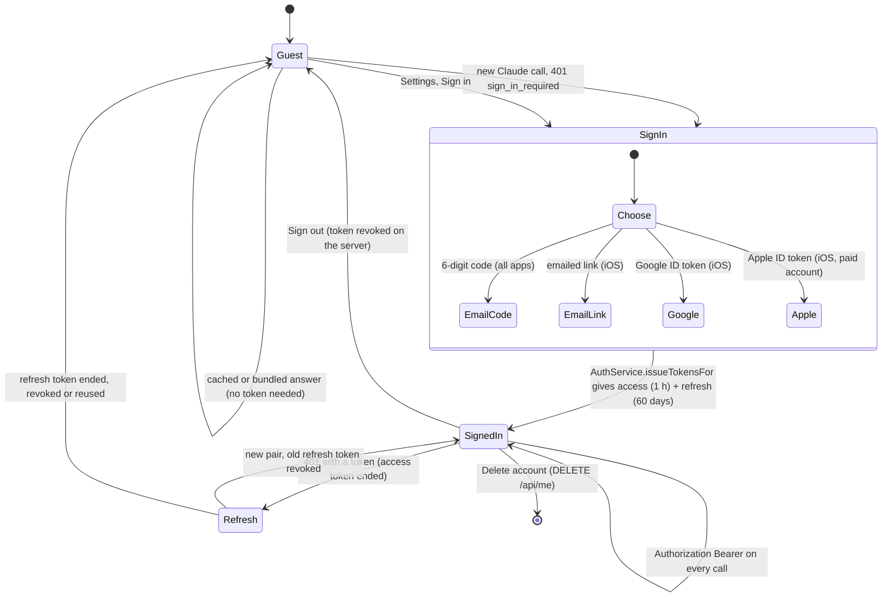
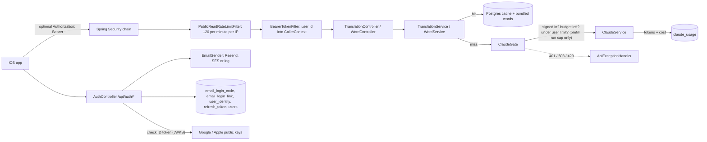
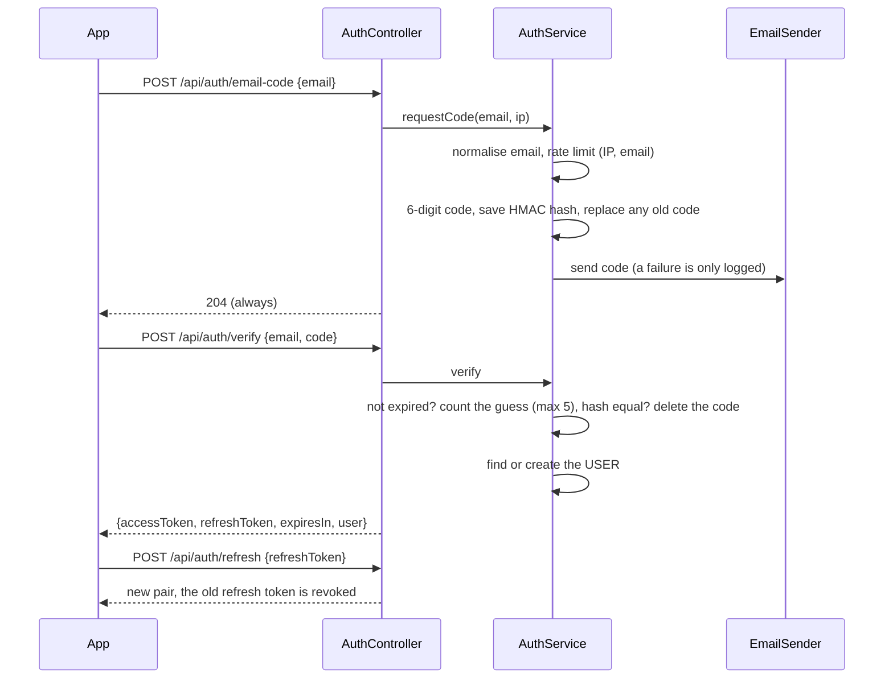
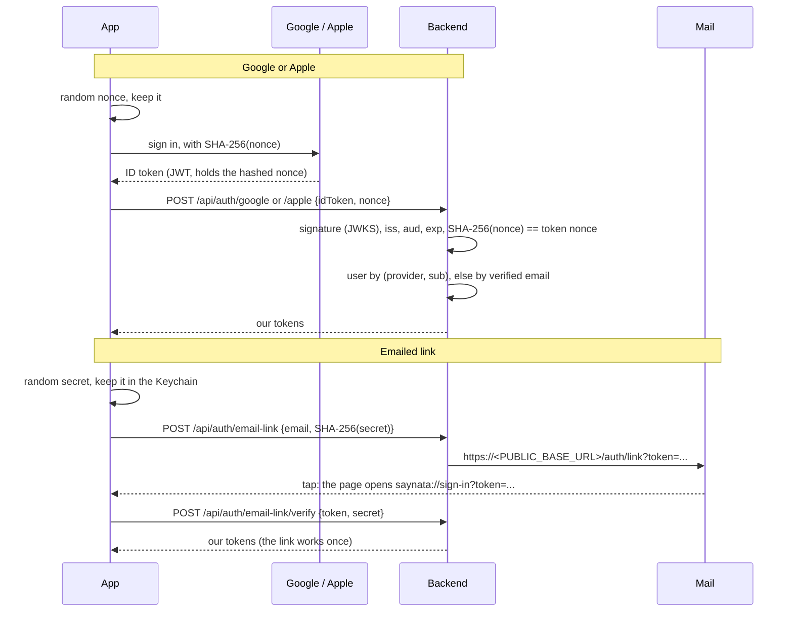
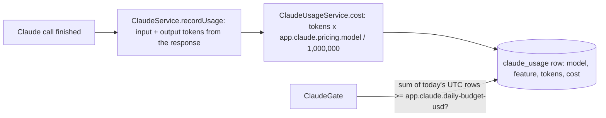
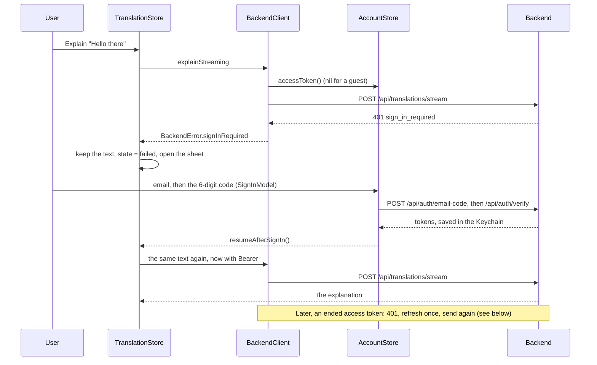

# Accounts and limits

> Status: **backend built** (TASK-66 accounts, TASK-68 sign-in for new Claude calls, TASK-69 rate limits, TASK-67 daily budget). The iOS side is built too (TASK-70, see "iOS app" below). Sign in with Google, Apple and an emailed link: TASK-92, see "Other ways to sign in". The short version of the whole flow: "Workflow at a glance". Last traced from code: 2026-10-24 (language lines use the gate: TASK-106.2; before that 2026-10-23: sign-in sheet, TASK-96).
> Why: doc-7 rows of 2026-10-15. Related: [Admin API](doc-13%20-%20Admin-API.md) (the admin has its own cookie login), [Sentence translation](doc-4%20-%20Sentence-translation.md), [Word lookup](doc-5%20-%20Word-lookup.md), the Resend and SES setup in the [deploy guide](../guides/doc-11%20-%20Deploy-to-a-VPS.md) (sections 10 and 11).

## What it does

A learner signs in with an **email code**: type an email, get a 6-digit code by email, type it, done. There are no passwords.
Since TASK-92 there are three more ways in, all ending with the same tokens: an emailed **link**, **Sign in with Google** and **Sign in with Apple** (see "Other ways to sign in").
A signed-in learner may ask for **new** explanations from Claude. A **guest** (no token) gets only what costs nothing new:
the bundled words (on the device) and anything already in the shared cache. Claude spending also has a hard
**daily cap in dollars**, and every path has a **rate limit**.

| Caller | Cache hit or bundled word | New sentence, or word not bundled and not cached |
|---|---|---|
| Guest | Works | 401 `sign_in_required` |
| Signed in | Works | Calls Claude (if the budget and the user limit allow) |
| Anyone, budget used up | Works | 503 `daily_limit_reached` |
| The prefill job (no user, TASK-83.1) | Works | Calls Claude with its **own** run cap, not the users' budget (see "Prefill job: its own budget") |

An iOS app **without** the sign-in screen sends no token. With the default (`REQUIRE_SIGN_IN=true`), **a new sentence or an uncached word from such an app gives 401**. The app with TASK-70 shows the sign-in sheet instead.
**Switch `REQUIRE_SIGN_IN`:** keep `REQUIRE_SIGN_IN=false` in `backend/.env` until the app with sign-in is released. Then a guest miss does call Claude, but it still goes through `ClaudeGate`: the daily budget cap applies (503 `daily_limit_reached`), and so does a per-IP limit for guests' new calls (30 per hour by default, 429 `rate_limited`), so one guest cannot burn the budget alone. Bundled words and cached answers work in both modes. Set it back to `true` (or remove the line) when the new app is out.

## Workflow at a glance

The whole life of a sign-in, from guest to signed out. The sections below have the details and the `file:line` links.

**Every way in ends in the same place.** The email code, the link, Google and Apple each prove the email (or the provider account) in their own way, then call `AuthService.issueTokensFor`. After that there is one kind of session, so refresh, sign out, limits and account deletion work the same for all of them.

| Setting | Value | Where |
|---|---|---|
| Access token | JWT, 1 hour | `app.auth.access-token-lifetime` |
| Refresh token | 60 days, rotated on each use | `app.auth.refresh-token-lifetime` |
| Email code | 10 minutes, 5 tries | `app.auth.code-lifetime`, `app.auth.max-code-tries` |
| Email link | 15 minutes, works once | `app.auth.link.lifetime` |
| Google / Apple | Allowed client IDs | `GOOGLE_CLIENT_IDS`, `APPLE_CLIENT_IDS` |
| Guests may call Claude | Off by default | `REQUIRE_SIGN_IN` |

Which app offers which way in:

| App | Email code | Email link | Google | Apple | Where the session is kept |
|---|---|---|---|---|---|
| iPhone app | Yes | Yes | Yes | Yes (paid account) | Keychain, App Group group |
| Share and Translation extensions | No sheet: they use the app's session | | | | The app's Keychain item |
| Mac app | Yes | No | No | No | The Mac's own Keychain |
| Browser extension | Yes | No | No | No | `chrome.storage.local` |

Each app has its own session, except the two iOS extensions, which share the iPhone app's.

Example: Minh opens the iPhone app as a guest and types "give up". It is in the cache, so the answer comes back with no sign-in. Then Minh types a new sentence. The cache misses, `ClaudeGate` answers 401 `sign_in_required`, and the sign-in sheet opens with the sentence kept. Minh taps "Sign in with Google", picks the account, and the app sends the Google ID token to `/api/auth/google`. The backend checks it and returns our two tokens, which go into the Keychain. The app sends the same sentence again with `Authorization: Bearer`, and the explanation streams in. An hour later the access token has ended: the next call gets 401, the app refreshes once and sends the call again, and Minh sees nothing of it. After 60 days with no use, the refresh token has ended too, and Minh is a guest again.

## Big picture

## Sign-in flow

| Step | File:line | What happens |
|---|---|---|
| Tables | [V10__create_accounts.sql](../../../backend/src/main/resources/db/migration/V10__create_accounts.sql) | `email_login_code` (one row per email: keyed hash, attempts, expiry), `refresh_token` (SHA-256 of the token, `revoked_at`, cascade delete with the user). `users.password_hash` may now be empty: app users have no password. |
| Ask for a code | [AuthService.requestCode:85](../../../backend/src/main/java/com/englishtranslation/backend/auth/AuthService.java#L85) | Validates and lower-cases the email ([Emails.normalize:17](../../../backend/src/main/java/com/englishtranslation/backend/auth/Emails.java#L17)), applies the two rate limits, saves the code (a second code **replaces** the first: one per email), sends it. The same for known and unknown emails, so the controller can always answer 204. |
| Code hash | [AuthService.hashCode:209](../../../backend/src/main/java/com/englishtranslation/backend/auth/AuthService.java#L209) | HMAC-SHA256 with a key from the server secret, over `email:code`. A plain hash of 6 digits could be reversed in a second; the secret makes a stolen database useless. The code itself is never saved or logged by the SES sender. |
| Verify | [AuthService.verify:101](../../../backend/src/main/java/com/englishtranslation/backend/auth/AuthService.java#L101) | Expired: row deleted. The guess is counted by one atomic SQL update (max 5), so parallel requests cannot get extra guesses. A right code is deleted in the same step that accepts it, so it works once. Every failure is the same 401 `invalid_code`. First sign-in creates the user (role USER); an existing user (even an admin) just signs in. |
| Tokens | [AuthService.issueTokens:190](../../../backend/src/main/java/com/englishtranslation/backend/auth/AuthService.java#L190) | Access token: JWT HS256, 1 hour, only the user id, claim `typ=access`, own key ([AccessTokenService](../../../backend/src/main/java/com/englishtranslation/backend/auth/AccessTokenService.java)). Refresh token: 32 random bytes, 60 days, only its SHA-256 is saved. |
| Keys | [AuthKeys:29](../../../backend/src/main/java/com/englishtranslation/backend/auth/AuthKeys.java#L29) | One base secret gives separate keys for the access token and the code hash: `USER_JWT_SECRET`, else `ADMIN_JWT_SECRET`, else random at start-up (a warning is logged). So a missing variable never stops a deploy. |
| Refresh | [AuthService.refresh:127](../../../backend/src/main/java/com/englishtranslation/backend/auth/AuthService.java#L127) | Rotation: the used token is revoked and a new pair is issued. If a **revoked** token is sent again, all tokens of that user are revoked (someone may have copied it) and the app must sign in again. |
| Sign out | [AuthService.signOut:144](../../../backend/src/main/java/com/englishtranslation/backend/auth/AuthService.java#L144) | Revokes that refresh token. Always 204. |
| Delete account | [AuthService.deleteAccount:154](../../../backend/src/main/java/com/englishtranslation/backend/auth/AuthService.java#L154) | `DELETE /api/me` removes the user, its roles, its refresh tokens and a pending code. The access token stops working at once (the filter checks that the user exists). An account with the ADMIN role is refused (403 `admin_account`). |
| Bearer filter | [BearerTokenFilter:41](../../../backend/src/main/java/com/englishtranslation/backend/auth/BearerTokenFilter.java#L41) | Optional token. Bad, expired or unknown-user token = a guest, no error. A good one authenticates as role USER and sets `CallerContext`. It never touches `/api/admin`, so an access token cannot open the admin API and the admin cookie cannot open `/api/me`. |
| Rules | [SecurityConfig:43](../../../backend/src/main/java/com/englishtranslation/backend/admin/SecurityConfig.java#L43) | `/api/me` needs USER; `/api/auth/*`, `/api/translations*`, `/api/words/*`, `/api/suggest` stay open. |
| Email | [AuthConfig:21](../../../backend/src/main/java/com/englishtranslation/backend/auth/AuthConfig.java#L21), [ResendEmailSender](../../../backend/src/main/java/com/englishtranslation/backend/auth/ResendEmailSender.java), [SesEmailSender](../../../backend/src/main/java/com/englishtranslation/backend/auth/SesEmailSender.java), [LoggingEmailSender](../../../backend/src/main/java/com/englishtranslation/backend/auth/LoggingEmailSender.java) | The sender is chosen at start-up (TASK-71) and logged. (1) `RESEND_API_KEY` and `EMAIL_FROM` set: **Resend**, one HTTPS `POST https://api.resend.com/emails` with `Authorization: Bearer` and JSON `{from, to, subject, text, html}`, 10 s timeout; 2xx is success; on 429, 5xx or a network error it waits 1 s and tries once more; errors are logged (status only, never the key or the code) and not thrown. (2) Else a from address set (`EMAIL_FROM`, or the older `SES_FROM_EMAIL`): SES v2, region `AWS_REGION`, keys from the standard AWS variables, client built on the first send. (3) Else the code is written to the log and a warning is logged at start-up. A send failure is logged and the answer is still 204. Resend was chosen over SES for now (doc-7, 2026-10-15). |

Endpoints (all JSON, no cookie):

| Method and path | Body | Answer |
|---|---|---|
| `POST /api/auth/email-code` | `{email}` | 204 always. 400 `invalid_email` for a bad format. 429 `rate_limited`. |
| `POST /api/auth/verify` | `{email, code}` | `{accessToken, refreshToken, expiresIn (seconds), user: {id, email}}`. 401 `invalid_code`. |
| `POST /api/auth/refresh` | `{refreshToken}` | Same shape as verify. 401 `invalid_refresh_token`. |
| `POST /api/auth/sign-out` | `{refreshToken}` | 204 always. |
| `POST /api/auth/email-link` | `{email, codeChallenge}` | 204 always (like `email-code`; the two share the rate limits). 400 `invalid_email`, 400 `invalid_code_challenge`, 429. |
| `POST /api/auth/email-link/verify` | `{token, codeVerifier}` | Same shape as verify. 401 `invalid_link`. |
| `POST /api/auth/google` | `{idToken, nonce}` | Same shape as verify. 401 `invalid_id_token`, 503 `provider_not_configured`. |
| `POST /api/auth/apple` | `{idToken, nonce}` | Same as Google. |
| `GET /auth/link?token=` | | HTML page that opens `saynata://sign-in?token=...`. Does not use the link up. |
| `GET /.well-known/apple-app-site-association` | | JSON for universal links when `APPLE_APP_IDS` is set, else 404. |
| `GET /api/me` | Bearer | `{id, email}`. 401 without a token. |
| `DELETE /api/me` | Bearer | 204. |

## Other ways to sign in (TASK-92)

Three more ways in, next to the email code. Each one ends in [AuthService.issueTokensFor:185](../../../backend/src/main/java/com/englishtranslation/backend/auth/AuthService.java#L185), so the app gets the same `{accessToken, refreshToken, expiresIn, user}` and the rest of this page (refresh, sign out, limits) does not change. The user is found or made by [AuthService.findOrCreateUser:167](../../../backend/src/main/java/com/englishtranslation/backend/auth/AuthService.java#L167), so the same email always means the same account, whichever way the learner signs in.

Example: Lan opens Saynata on her iPhone, the sheet asks her to sign in, and she taps "Email me a link instead". The app makes a secret, keeps it in the Keychain and sends only its hash. Lan opens Gmail, taps "Sign in to Saynata", Safari shows our small page and asks "Open in Saynata?". The app opens with `saynata://sign-in?token=...`, sends the token with the secret, and the sentence she was waiting for is explained. If a mail scanner had visited the link first, nothing would change: opening the page uses nothing up.

| Part | File:line | What happens |
|---|---|---|
| Tables | [V22__create_social_sign_in.sql](../../../backend/src/main/resources/db/migration/V22__create_social_sign_in.sql) | `user_identity` (provider, subject, unique together; cascade delete with the user) and `email_login_link` (SHA-256 of the token, email, code challenge, expiry). |
| Check an ID token | [IdTokenVerifier.verify:54](../../../backend/src/main/java/com/englishtranslation/backend/auth/IdTokenVerifier.java#L54) | RS256 signature with the provider's keys, `iss` (Google: `https://accounts.google.com` or `accounts.google.com`; Apple: `https://appleid.apple.com`), `aud` in `GOOGLE_CLIENT_IDS` / `APPLE_CLIENT_IDS`, `exp` (1 minute of clock skew), and `nonce` == SHA-256 (hex) of the nonce the app sent. The email counts only when `email_verified` is true (Apple sends the text `"true"`). No client IDs for that provider: 503 `provider_not_configured`. Every other failure: 401 `invalid_id_token`. |
| Provider keys | [RemoteIdTokenKeys:17](../../../backend/src/main/java/com/englishtranslation/backend/auth/RemoteIdTokenKeys.java#L17) | Nimbus fetches each JWKS on first use (not at start-up, so a network problem never stops the backend), caches it, and fetches again for an unknown key id (key rotation). Tests replace `IdTokenKeys` with a local RSA key. |
| Find the user | [SocialSignInService.signIn:35](../../../backend/src/main/java/com/englishtranslation/backend/auth/SocialSignInService.java#L35) | First by `(provider, sub)`. The first time, by the verified email (an email-code user keeps the same account), and the identity is saved, so a later email change at Google or Apple keeps the account. No verified email and an unknown `sub`: 401 (Apple sends the email at least on the first sign-in). |
| Ask for a link | [SignInLinkService.requestLink:55](../../../backend/src/main/java/com/englishtranslation/backend/auth/SignInLinkService.java#L55) | Same email check and the **same rate limits** as the email code. 32 random bytes, only the SHA-256 is saved, one link per email (a new one deletes the old), 15 minutes (`app.auth.link.lifetime`). The email goes through the same `EmailSender` (Resend, SES or the log) with a button and the plain link. |
| Use a link | [SignInLinkService.verifyLink:79](../../../backend/src/main/java/com/englishtranslation/backend/auth/SignInLinkService.java#L79) | Token and secret must match (`SHA-256(codeVerifier) == codeChallenge`). This is the PKCE idea (RFC 7636): another app that registered our URL scheme could catch the token, but not the secret. A wrong secret does **not** use the link up. A right one deletes the row in the same step, so a link works once. Every failure is 401 `invalid_link`. |
| Link page | [SignInLinkPageController.linkPage:42](../../../backend/src/main/java/com/englishtranslation/backend/auth/SignInLinkPageController.java#L42) | Mail apps do not open a custom scheme from an email, so the email links to this HTTPS page, which opens `{APP_URL_SCHEME}://sign-in?token=...`. `no-store`, `Referrer-Policy: no-referrer` and a strict CSP, because the token is in the address. A token that does not look right gets a "This link does not work" page. |
| Universal link (later) | [SignInLinkPageController.appleAppSiteAssociation:54](../../../backend/src/main/java/com/englishtranslation/backend/auth/SignInLinkPageController.java#L54) | With `APPLE_APP_IDS` set and the app's Associated Domains entitlement (paid account), iOS opens `/auth/link` in the app directly and the page is never shown. |
| iOS calls | [AuthClient.swift:68](../../../EnglishTranslation/EnglishTranslation/Account/AuthClient.swift#L68), [:81](../../../EnglishTranslation/EnglishTranslation/Account/AuthClient.swift#L81) | `requestLink`, `verifyLink`, `signIn(with:idToken:nonce:)`. New `AuthError` cases: `invalidLink`, `invalidIdToken`, `providerNotConfigured`. |
| iOS account | [AccountStore.swift:91](../../../EnglishTranslation/EnglishTranslation/Account/AccountStore.swift#L91) | `requestLink` makes the secret (`SignInSecrets`) and keeps it in the Keychain under `pendingLinkVerifier`, so it survives the app being closed while the user is in Mail. `completeLinkSignIn` ([:109](../../../EnglishTranslation/EnglishTranslation/Account/AccountStore.swift#L109)) signs in and deletes the secret, or keeps the reason in `linkSignInError` for the app's alert. |
| Opening the link | [EnglishTranslationApp.swift:26](../../../EnglishTranslation/EnglishTranslation/EnglishTranslationApp.swift#L26), [DeepLink.signInToken:37](../../../EnglishTranslation/EnglishTranslation/Translation/DeepLink.swift#L37) | `onOpenURL` reads `saynata://sign-in?token=...` (today) or `https://.../auth/link?token=...` (a universal link, later). An open sign-in sheet sees `isAccountSignedIn` turn true, closes, and runs the waiting request again ([SignInModel.accountSignedInElsewhere:175](../../../EnglishTranslation/EnglishTranslation/Account/SignInModel.swift#L175)). |
| Google on iOS | [GoogleSignInFlow.idToken:88](../../../EnglishTranslation/EnglishTranslation/Account/GoogleSignInFlow.swift#L88), [SignInModel.signInWithGoogle:121](../../../EnglishTranslation/EnglishTranslation/Account/SignInModel.swift#L121) | No Google SDK. OAuth for native apps (RFC 8252) with PKCE: SwiftUI's `webAuthenticationSession` shows Google's page, the callback comes back on the reversed client ID scheme, the app swaps the code for an ID token at `oauth2.googleapis.com/token` and sends it to the backend. The client ID is `GoogleIOSClientID` in Info.plist ([AppConfig.googleIOSClientID:34](../../../EnglishTranslation/EnglishTranslation/Config/AppConfig.swift#L34)); empty = the button says "not set up yet". Closing Google's sheet shows nothing. |
| Apple on iOS | [SignInSheet.swift:233](../../../EnglishTranslation/EnglishTranslation/Views/Account/SignInSheet.swift#L233), [SignInModel.prepareAppleRequest:144](../../../EnglishTranslation/EnglishTranslation/Account/SignInModel.swift#L144) | `SignInWithAppleButton` asks for the email scope with the hashed nonce; the identity token and the raw nonce go to `POST /api/auth/apple`. Needs the `com.apple.developer.applesignin` entitlement (in `EnglishTranslation.entitlements`), so it works only with `PAID_ACCOUNT=1`. Cancel shows nothing. |
| Sheet | [SignInSheet.swift:18](../../../EnglishTranslation/EnglishTranslation/Views/Account/SignInSheet.swift#L18), [SignInCatRoom.swift](../../../EnglishTranslation/EnglishTranslation/Views/Account/SignInCatRoom.swift) | Redone in TASK-96 (mockup A, 2026-10-23). iOS first screen: the **cat room** on top, the serif title "Welcome to Saynata", Sign in with Apple (black) and Sign in with Google (white, hairline border) as equal full-width pills ([ProviderButtons:224](../../../EnglishTranslation/EnglishTranslation/Views/Account/SignInSheet.swift#L224)), and a "Use email instead" link that shows the email step (field, round send button, a back chevron, and the "Email me a link instead" link). The `.linkSent` step ("Check your email", "Send a new link", "Use a code instead") and the code step work as before. The Apple and Google pills keep their words because the providers' brand rules ask for them. The **Mac** has no Apple or Google button: it shows the room and goes straight to the email step. See "Cat room" below. |

What changes **when the domain moves**, and the setup by hand (Google Cloud client, Apple capability, universal links): deploy guide section 13.

## The gate for new Claude calls

[ClaudeGate.beforeNewCall:34](../../../backend/src/main/java/com/englishtranslation/backend/limits/ClaudeGate.java#L34) runs right before every Claude call, and only after the cache and bundled lookups missed:
[TranslationService:69](../../../backend/src/main/java/com/englishtranslation/backend/translation/TranslationService.java#L69) (sentences, also personal-looking text and the stream) and [WordService:108](../../../backend/src/main/java/com/englishtranslation/backend/word/WordService.java#L108) (words).
The order is: (1) guest: 401 `sign_in_required` (skipped when `REQUIRE_SIGN_IN=false`); (2) budget used up: 503 `daily_limit_reached`; (3) user over 60 per hour or 300 per day: 429 `rate_limited`; for a guest (only possible with `REQUIRE_SIGN_IN=false`) over 30 new calls per hour from one IP: 429 `rate_limited`.
The budget comes before the user limit so a refused call does not use up a user's allowance.
The word retry (a second call for hard words) only re-checks the budget ([checkBudget:74](../../../backend/src/main/java/com/englishtranslation/backend/limits/ClaudeGate.java#L74)).

Who is asking (user id and client IP): [CallerContext](../../../backend/src/main/java/com/englishtranslation/backend/limits/CallerContext.java) holds the user id in a thread-local. `BearerTokenFilter` sets it for the request. The sentence stream runs on its own thread, so [TranslationController:75](../../../backend/src/main/java/com/englishtranslation/backend/translation/TranslationController.java#L75) copies the caller there. For the stream, the error is an `error` event: `{"status": 401, "message": "...", "code": "sign_in_required"}` (the `code` field is only there for these coded errors).

Admin tools: the admin API makes no Claude call today (deleting a row is "regenerate": the next **public** lookup asks Claude, and that lookup goes through the gate). A future admin tool that calls Claude must call `ClaudeGate.checkBudget()` and record with `Feature.ADMIN`.

## Prefill job: its own budget

The nightly prefill job (TASK-83.1, see [Prefill](doc-18%20-%20Prefill.md)) fills the shared cache and has no user. On its own thread `ClaudeGate` takes a different path ([checkPrefillCap:59](../../../backend/src/main/java/com/englishtranslation/backend/limits/ClaudeGate.java#L59)): no sign-in check, no per-user limit, no users' budget check. It checks the **run cap** instead (`app.prefill.max-usd-per-run`, default $0.50: the `PREFILL` rows since the run start). Its calls are saved with `Feature.PREFILL` ([ClaudeUsageService.record:68](../../../backend/src/main/java/com/englishtranslation/backend/claude/ClaudeUsageService.java#L68)) and are left out of the users' budget sum, so a night run cannot use the users' $1 day, and a used-up users' budget does not stop a run. The path opens only inside `PrefillContext`, which only `PrefillRunner` sets.

## Rate limits

[RateLimiter](../../../backend/src/main/java/com/englishtranslation/backend/limits/RateLimiter.java#L16) is a small token bucket in memory (no Redis; a restart clears it; one server). "5 per hour" is a bucket of 5 that refills evenly. When several limits apply, a refused request uses up none of them. Numbers live in `app.limits.*` ([LimitProperties](../../../backend/src/main/java/com/englishtranslation/backend/limits/LimitProperties.java)); each can be set from env.

| What | Default | Env |
|---|---|---|
| `/api/auth/email-code` per IP | 5 per hour | `LIMIT_EMAIL_CODE_IP_MAX`, `LIMIT_EMAIL_CODE_IP_PERIOD` |
| `/api/auth/email-code` per email | 3 per 15 minutes | `LIMIT_EMAIL_CODE_EMAIL_MAX`, `LIMIT_EMAIL_CODE_EMAIL_PERIOD` |
| New Claude calls per signed-in user | 60 per hour, 300 per day | `LIMIT_CLAUDE_USER_HOUR_MAX`, `LIMIT_CLAUDE_USER_DAY_MAX` |
| New Claude calls by a guest, per IP (only when `REQUIRE_SIGN_IN=false`) | 30 per hour | `LIMIT_CLAUDE_GUEST_IP_MAX` |
| `/api/translations*`, `/api/words/*`, `/api/suggest` per IP (cache hits too) | 120 per minute | `LIMIT_PUBLIC_READ_IP_MAX`, `LIMIT_PUBLIC_READ_IP_PERIOD` |

Over a limit: **429**, header `Retry-After` (seconds), body code `rate_limited`. The public read limit is a servlet filter ([PublicReadRateLimitFilter:35](../../../backend/src/main/java/com/englishtranslation/backend/limits/PublicReadRateLimitFilter.java#L35)), so even the event stream gets a real 429. `?cachedOnly=true` lookups (TASK-83.4) never reach `ClaudeGate`: a miss is 404 `not_cached`, so typing-time prefetch can never cause 401, 429 from the gate, 503 or a Claude call (doc-4, doc-5).
The client IP is `request.getRemoteAddr()`, like the admin login limit ([ClientIp](../../../backend/src/main/java/com/englishtranslation/backend/limits/ClientIp.java)). Tomcat's remote-ip valve (`server.tomcat.remoteip.*`) swaps in `X-Forwarded-For` only when the request comes from a loopback or private proxy (Caddy). The backend port is on loopback only (PR #51), so a client cannot fake the header.

## Daily Claude budget

| Step | File:line | What happens |
|---|---|---|
| Table | [V11__create_claude_usage.sql](../../../backend/src/main/resources/db/migration/V11__create_claude_usage.sql) | One row per call: time, model, feature (`SENTENCE`, `WORD`, `ADMIN`, `WARMUP`), input and output tokens, cost in USD (8 decimals). The cost is saved, so a later price change does not rewrite history. |
| Record | [ClaudeService.recordUsage:410](../../../backend/src/main/java/com/englishtranslation/backend/claude/ClaudeService.java#L410) | Called for the normal sentence call, the streamed call (the stream accumulator sums the start and end events) and the word call, **before** the answer is read, so a refused or "not English" answer is counted too (it cost money). Never throws. |
| Cost | [ClaudeUsageService.cost:74](../../../backend/src/main/java/com/englishtranslation/backend/claude/ClaudeUsageService.java#L74) | `(input x inputPerMtok + output x outputPerMtok) / 1,000,000`. A model with no price in config is counted at the **highest** configured price (never free) and a warning is logged. |
| Prices | `app.claude.pricing.<model>.input-per-mtok` / `output-per-mtok` in [application.properties](../../../backend/src/main/resources/application.properties) | `claude-haiku-5-5`: $0.10 in, $0.50 out per million tokens (prompts up to 100K tokens; checked 2026-10-15). **Check them when the model or Anthropic's prices change.** |
| Cap | [ClaudeUsageService.budgetReached:119](../../../backend/src/main/java/com/englishtranslation/backend/claude/ClaudeUsageService.java#L119) | Sum of today's rows **except feature `PREFILL`** (the day starts at 00:00 UTC) `>=` `app.claude.daily-budget-usd` (`CLAUDE_DAILY_BUDGET_USD`, default 1.00). Then the answer is 503 `daily_limit_reached`, "Saynata has reached today's limit for new explanations. Cached words still work. Try again tomorrow." |
| Report | [AdminUsageController](../../../backend/src/main/java/com/englishtranslation/backend/admin/AdminUsageController.java), [ClaudeUsageService.report:124](../../../backend/src/main/java/com/englishtranslation/backend/claude/ClaudeUsageService.java#L124) | `GET /api/admin/usage?days=7` (admin cookie; 1 to 90 days): `{dailyBudgetUsd, todayUsd, prefillTodayUsd, days: [{date, total, byFeature}]}` (`todayUsd` is what the users' budget counts, so it leaves the prefill spend out; `prefillTodayUsd` is that spend; a day's `total` and `byFeature.prefill` include it), newest first, empty days included. No admin screen yet. |

## Errors

| Cause | HTTP | Code | Message |
|---|---|---|---|
| Guest needs a new Claude call | 401 | `sign_in_required` | "Sign in to get a new explanation." |
| Today's budget used up | 503 | `daily_limit_reached` | "Saynata has reached today's limit for new explanations. Cached words still work. Try again tomorrow." |
| Any limit above | 429 + `Retry-After` | `rate_limited` | "Too many requests. Try again in a little while." |
| Bad email format | 400 | `invalid_email` | "Enter a valid email address." |
| Wrong, expired, used or locked code | 401 | `invalid_code` | "That code is wrong or has expired. Ask for a new code." |
| Used, old or other-device sign-in link | 401 | `invalid_link` | "This sign-in link is used or has expired. Ask for a new one." |
| Bad `codeChallenge` | 400 | `invalid_code_challenge` | "codeChallenge must be the SHA-256 of the app's secret, as 64 hex characters." |
| Bad Google or Apple ID token, or no shared email | 401 | `invalid_id_token` | "Sign-in did not work. Try again." |
| No client ID set for that provider | 503 | `provider_not_configured` | "This sign-in option is not set up yet. Use your email." |
| Unknown, expired or used refresh token | 401 | `invalid_refresh_token` | "Your session has ended. Sign in again." |
| `/api/me` without a good token | 401 | none (empty body) | |
| `/api/liked` without a good token | 401 | `sign_in_required` | "Sign in to like words and sentences." |
| Bad `kind`, empty or too long text, too long preview on `PUT /api/liked` | 400 | `invalid_kind`, `invalid_text`, `invalid_preview` | |
| More than 5000 liked items | 400 | `liked_limit_reached` | "You can like at most 5000 items. Remove some first." |
| Delete an admin account through `/api/me` | 403 | `admin_account` | "An admin account cannot be deleted here. Ask the developer." |

The body is Spring problem details (`type`, `title`, `status`, `detail`) plus `code`. The app should switch on `code`, not on the text.

## iOS app (TASK-70)

The app signs in with the email code, keeps the tokens in the **Keychain**, sends `Authorization: Bearer` on translations, the stream and words, and shows the sign-in sheet when the backend answers `sign_in_required`. A guest with no token sends no header, so against a backend with `REQUIRE_SIGN_IN=false` nothing changes until a 401 comes back.

| Part | File:line | What happens |
|---|---|---|
| Keychain | [SecretStore.swift:22](../../../EnglishTranslation/EnglishTranslation/Account/SecretStore.swift#L22) | On iOS the item lives in the App Group's Keychain group (`group.com.luke.EnglishTranslation`; an App Group name works as an access group), so the app and both extensions share one sign-in. An item from an older build (the app's own group) is moved there the first time it is read. A build without App Groups (free Apple ID) gets `errSecMissingEntitlement` and falls back to the target's own group, as before. The Mac app keeps its own group. `KeychainSecretStore` (SecItem, `AfterFirstUnlockThisDeviceOnly`) behind the small `SecretStoring` protocol, so tests use a fake. The whole session (access token, refresh token, user) is **one JSON item** under the key `session`, saved and deleted in one step. No access group (see known gaps). |
| Calls | [AuthClient.swift:49](../../../EnglishTranslation/EnglishTranslation/Account/AuthClient.swift#L49) | `requestCode`, `verify`, `refresh`, `signOut`, `deleteAccount` (`DELETE /api/me` with the Bearer). A failed reply becomes an `AuthError` ([AuthModels.swift:31](../../../EnglishTranslation/EnglishTranslation/Account/AuthModels.swift#L31)): the `code` is read first, then the status (`invalid_code`, `invalid_refresh_token`, `invalid_email`, `admin_account`, 429 with `Retry-After`). |
| Account | [AccountStore.swift:24](../../../EnglishTranslation/EnglishTranslation/Account/AccountStore.swift#L24) | `@Observable`, one shared instance (`AccountStore.shared`, also given to the views with `.environment`). Loads the session from the Keychain at start. `signIn` saves the tokens. `signOut` clears the device first, then tells the server (a failed call is ignored). `deleteAccount` calls `DELETE /api/me` (an ended token is refreshed once), then signs out locally; an admin account (403) stays signed in and shows the server message. |
| Refresh | [AccountStore.swift:161](../../../EnglishTranslation/EnglishTranslation/Account/AccountStore.swift#L161) | `refreshedAccessToken(replacing:)`. Before it uses the session it **reads the Keychain again** (as `accessToken()` does), because the other process (app or extension) may have refreshed: refreshing with a used refresh token would end every session of the user. If the session already has another token, it returns that one. Requests that fail together **share one refresh task**, because the server accepts each refresh token once and a second use would revoke every session (doc-17 "Refresh"). If the server says `invalid_refresh_token`, the user is **signed out locally** and the call returns nil. A network error is thrown and the session stays, so one bad connection does not sign the user out. |
| Bearer and retry | [BackendClient.swift:280](../../../EnglishTranslation/EnglishTranslation/Network/BackendClient.swift#L280) | `withAuthRetry`: runs the request with the token; on 401 **with a token**, refreshes once and runs it again. The stream goes through it too, also for an `error` event with status 401. A guest's 401 (no token) goes straight to the caller. After a failed refresh the caller gets `signInRequired`, which opens the sheet. Only one retry, so a server that keeps saying 401 cannot loop. |
| Errors | [BackendClient.swift:86](../../../EnglishTranslation/EnglishTranslation/Network/BackendClient.swift#L86) | `BackendError.make` reads the `code` of the body (or of the stream event), then the status: `signInRequired`, `rateLimited(retryAfter:)`, `dailyLimitReached(message:)`, else `badStatus`. All three new ones are final answers, so the stream is not retried on the old endpoint. |
| Store | [TranslationStore.swift:103](../../../EnglishTranslation/EnglishTranslation/Stores/TranslationStore.swift#L103) | On `signInRequired` (a sentence, or a word that is not bundled and not cached): keeps the text (`textNeedingSignIn`), sets `.failed("Sign in to get a new explanation.")` and opens the sheet (`isSignInSheetOpen`). After sign-in, `resumeAfterSignIn()` runs **the same text** again, even if the user typed something else meanwhile. Closing the sheet leaves the message in the result area. |
| Sheet | [SignInSheet.swift:18](../../../EnglishTranslation/EnglishTranslation/Views/Account/SignInSheet.swift#L18), [SignInModel.swift:13](../../../EnglishTranslation/EnglishTranslation/Account/SignInModel.swift#L13), [CodeBoxes.swift:11](../../../EnglishTranslation/EnglishTranslation/DesignSystem/Components/CodeBoxes.swift#L11) | A bottom sheet with a grabber (large detent), opened by [TranslateView](../../../EnglishTranslation/EnglishTranslation/Views/Translate/TranslateView.swift) over the result. Step 1 (TASK-96): the cat room, "Welcome to Saynata", then the providers, or the email field and a round icon-only send button (label "Send code") after "Use email instead". Step 2: "Enter the code", "We sent 6 numbers to <email>", six boxes that are **one text field** with `.oneTimeCode` (Mail fills it), and a "Send a new code" text link. The 6th digit checks the code by itself. Pictures: [first screen without the cat pack](../../../docs/design/signin-sheet-cat-fallback.png), [step 1 (older)](../../../docs/design/signin-sheet-step1-email.png), [step 2](../../../docs/design/signin-sheet-step2-code.png). |
| Code errors | [SignInModel.swift:234](../../../EnglishTranslation/EnglishTranslation/Account/SignInModel.swift#L234) | The server answers every bad code with the same `invalid_code`, so the app counts the wrong tries itself: 1 to 4 give "That code is wrong or has expired. Try again, or send a new code."; the 5th gives "Too many tries. Send a new code." (the server locks the code after 5). "Send a new code" starts the count again. A 429 shows "Too many requests. Try again in N minutes." |
| Result area | [BackendClient.swift:49](../../../EnglishTranslation/EnglishTranslation/Network/BackendClient.swift#L49) | `daily_limit_reached` shows the **server's message** as it is. `rate_limited` shows "Too many requests. Try again in N minutes." (`Retry-After` in whole minutes, rounded up; "in a little while" when there is no header, as in a stream event). |
| Settings | [SettingsView.swift:82](../../../EnglishTranslation/EnglishTranslation/Views/Settings/SettingsView.swift#L82) | "Account" section on top. Signed out: a **Sign in** row (opens the same sheet, with no request waiting). Signed in: the email, **Sign out**, **Delete account** (confirmation dialog, then `DELETE /api/me`, then local sign out). A failed delete shows its reason under the section. |
| Extensions | [SelectedTextResultView.swift:62](../../../EnglishTranslation/EnglishTranslation/Views/SelectedText/SelectedTextResultView.swift#L62) | The Share and Translation extensions **share the app's sign-in** (one Keychain item in the App Group group). They have no sign-in sheet: when the user is signed out (or the build has no App Group) When a request needs sign-in they show "Sign in from the Saynata app to explain new text." The share sheet already has the "Open in Saynata" button, and the app then asks for the sign-in itself. The extensions never open the sheet. |

Tests: `KeychainSecretStoreTests` (the real simulator Keychain, own service name), `AuthClientTests` (fake server, bodies, error mapping, Retry-After), `AccountStoreTests` (save, reload, sign out, refresh, shared refresh, failed refresh signs out, network error keeps the session, delete account), `BackendClientAuthTests` (header on translations, stream and words, 401 then refresh then retry for each, only one retry, guest 401, 429, 503, stream `error` events with codes), `SignInFlowTests` (401 then sheet then verify then the same request runs again, for a sentence and a word; cancel; wrong code; daily limit and rate limit in the result area), `SignInModelTests` (steps, digits only, auto-check at 6, wrong tries, resend), `OtherSignInTests` (TASK-92: link secret and hash, link sign-in, used link, no kept secret, the `.linkSent` step and closing once, deep links, the Google URL, PKCE and token swap, a wrong state, Google not set up, Apple nonce, Apple cancel and refusal). The fake server and Keychain are in `AccountTestSupport.swift`.

## Liked words and sentences (TASK-93.1)

A signed-in user can star words and sentences; the list follows the account to the iPhone, the Mac app and the browser extension. No Claude call, so `ClaudeGate` is not involved.

| Step | Code | What happens |
|---|---|---|
| Endpoints | [LikedController.java:30](../../../backend/src/main/java/com/englishtranslation/backend/liked/LikedController.java#L30) | `GET /api/liked`, `PUT /api/liked`, `DELETE /api/liked?kind=&text=`. The user id comes from `CallerContext` (set by the Bearer filter). A guest gets 401 `sign_in_required` with the problem-details body (not the empty 401 of `/api/me`, so the app can show its sign-in sheet). |
| Like | [LikedService.like:32](../../../backend/src/main/java/com/englishtranslation/backend/liked/LikedService.java#L32) | Checks `kind` (`word` or `sentence`), `text` (1-500 after trim), `preview` (at most 300; empty is fine). The key is kind + normalized text: a word is lowercased with one space (`CacheKeys.normalizeWord`, as the word lookup), a sentence is only trimmed. Liking again updates `text` and `preview` and keeps `createdAt`. At 5000 items a new one gives 400 `liked_limit_reached`. |
| Unlike | [LikedService.unlike:63](../../../backend/src/main/java/com/englishtranslation/backend/liked/LikedService.java#L63) | Deletes by the same key; 204 even when nothing was there. |
| Table | `V23__create_liked_item.sql` | `liked_item(user_id, kind, text_key, text, preview, created_at)`, unique on `(user_id, kind, text_key)`, `user_id` has `ON DELETE CASCADE`, so deleting the account (`DELETE /api/me`) deletes the liked rows. |

JSON: `GET` answers `{"items":[{"kind","text","preview","createdAt"}]}` newest first. `PUT` takes `{"kind","text","preview"}` and answers the saved item. Error codes (all 400 unless noted): `invalid_kind`, `invalid_text`, `invalid_preview`, `liked_limit_reached`; 401 `sign_in_required`.

## Language lines and the gate (TASK-106.2)

`POST /api/translate-lines` ([doc-5](doc-5%20-%20Word-lookup.md), "Language lines") is a third place that calls `ClaudeGate.beforeNewCall()` ([LineTranslationService.askClaude:98](../../../backend/src/main/java/com/englishtranslation/backend/lines/LineTranslationService.java#L98)), once per request, only when at least one text is not in `line_translation`. Its usage is saved as `Feature.LINE` and counts toward the users' $1 daily budget (only `PREFILL` is left out). A guest gets 401 `sign_in_required` for a miss (unless `REQUIRE_SIGN_IN=false`), 429 `rate_limited`, 503 `daily_limit_reached`. A request with `?cachedOnly=true` never reaches the gate, and a request whose texts are all saved needs no sign-in.

## Browser extension (TASK-86.3)

The extension signs in the same way, in its toolbar popup, keeps the session in `chrome.storage.local` and shares one refresh in its service worker. Details: [Browser extension](doc-19%20-%20Browser-extension.md).

## Tests

| Test file | What it covers |
|---|---|
| `AuthFlowTest` | 204 for known and unknown email, bad email 400, the code is 6 digits and only a keyed hash is saved, expiry (10 minutes), 5 wrong tries then locked, a code works once, a second code replaces the first, a failing email sender still gives 204, user created on first sign-in, refresh rotation, reuse of an old refresh token revokes the rest, refresh stored as a hash, expired refresh token, sign-out, `/api/me`, access token vs admin cookie, account deletion (user, tokens, access token), admin account not deletable, app user cannot log in to the admin, email-code rate limits (per email and per IP). |
| `SocialSignInTest` | A local RSA key plays Google and Apple: a good token creates the user, the same `sub` finds it after an email change, an email-code user keeps the account, wrong `aud`, wrong `iss`, expired, wrong or missing nonce, another key, unverified email, Apple without email (known and unknown `sub`), account deletion removes the identity, 503 with no client IDs. |
| `SignInLinkTest` | The link works once and only its hash is saved, a wrong secret neither works nor uses the link up, a new link replaces the old, an old link is refused, an existing user keeps the account, bad email and challenge, a failing sender still gives 204, links and codes share the limit, the link page (scheme link, no-referrer, no-store, does not use the link), a broken token page with no echo, the apple-app-site-association file. |
| `LikedApiTest` | `/api/liked`: empty list, like then list newest first, same word again keeps one row and updates the preview, sentences keep their case, delete by normalized key and delete of nothing (204), users only touch their own rows, guest 401 `sign_in_required` on all three, bad input 400 with codes, the 5000 limit, account deletion removes the rows. |
| `ClaudeGateTest` | Guest cache hit works with no Claude call, guest miss is 401 (sentence, word, stream error event), signed-in miss calls Claude (also in the stream thread), per-user limit gives 429 + `Retry-After`, cache hits do not use the limit, budget used up gives 503 with **no Claude call** (HTTP and stream) while cached answers still work, per-IP public read limit. |
| `ClaudeUsageServiceTest` | Cost maths, unknown model price, the UTC day boundary, the budget cap, the report. |
| `GuestModeTest` | `REQUIRE_SIGN_IN=false`: a guest miss calls Claude, a guest IP over its limit gets 429 (also in the stream), a used-up budget gives 503 with no Claude call. |
| `ClaudeServiceStreamingTest` | Tokens from a stream are recorded for the sentence feature, also for a refused answer. |
| `RateLimiterTest` | Bucket maths with a clock moved by hand, no partial use of several limits. |
| `EmailSenderConfigTest` | Starts with no email settings (logging fake), with SES settings (no AWS call at start-up), with Resend and SES together (Resend wins), with only `SES_FROM_EMAIL` (SES); the choice Resend over SES over the fake; email text; email checks. |
| `ResendEmailSenderTest` | A fake HTTP server: one POST with the Bearer header, JSON body (`from`, `to`, `subject`, `text`, `html`), retry once after 429 or 5xx, no retry after 403, a network error is logged and not thrown, the log never has the key or the code. |
| `AdminUsageTest` | `/api/admin/usage` needs the admin login, spend per feature, `days` default and cap. |

The old tests set `app.auth.require-sign-in=false` (and a very high guest IP limit) in `src/test/resources/config/application.properties`, so they still call the services as a guest. `ClaudeGateTest` sets it to `true`. Run: `cd backend && ./mvnw -B test`.

## Change checklist

- New place that calls Claude: call `ClaudeGate.beforeNewCall()` (or `checkBudget()` for admin tools) before it and record the usage with the right `Feature`.
- New model: add its price to `app.claude.pricing.*`.
- New env key: also `backend/.env.example`, `backend/docker-compose.prod.yml` (it lists env keys by hand) and doc-11.
- New coded error: extend `ApiException`; the stream already sends `code` for any `ApiException`.
- New way to sign in: end it in `AuthService.issueTokensFor` and find the user with `findOrCreateUser`, so the tokens and accounts stay one system.
- New domain: deploy guide section 13, "When the domain moves". No domain is written in the code, only in config.

## Known gaps

- Old iOS builds have no sign-in screen. With `REQUIRE_SIGN_IN=true` a new sentence or uncached word from such a build gives 401; keep `REQUIRE_SIGN_IN=false` until the app with sign-in (TASK-70) is released.
- **The extensions cannot sign in by themselves.** They share the app's sign-in (App Group Keychain, 2026-10-17), but they have no sign-in sheet: a signed-out user signs in in the app. A free-account build has no App Group, so there the extensions are still guests.
- The sentence word sheet (tap a word in a result) does not offer sign-in: a guest sees "Sign in to get a new explanation." there. Type the word in the main box to get the sheet.
- The code errors "wrong" and "expired" look the same to the app (one `invalid_code`), so the sheet cannot say which one it was.
- Real emails only go out after SES is set up (doc-11, section 10). Until then read the code in the backend log on the VPS: `docker compose -f docker-compose.prod.yml logs backend | grep "fake email"`.
- With `REQUIRE_SIGN_IN=false`, many guests behind different IPs can still use up the $1 budget together; the cap then stops everyone's new calls until midnight UTC.
- Sign-in emails go out only after `RESEND_API_KEY` and `EMAIL_FROM` are set (doc-11, section 10), or SES is set up (section 11). Before that, codes are only in the backend log.
- A Resend send that fails (after the one retry) is only logged: the learner sees "code sent" and gets nothing. Check the log and the Resend Logs page.
- Rate limits and the code attempts live partly in memory: a restart clears the rate limits (the code attempts are in Postgres).
- **Google and Apple need setup by hand** (deploy guide section 13). Google is set up (2026-10-18): `GOOGLE_CLIENT_IDS` on the server and `GoogleIOSClientID` in Info.plist hold the same iOS client ID. A new client ID must change both, or the Google button says "not set up yet". Sign in with Apple works only in a `PAID_ACCOUNT=1` build.
- The emailed link opens the app through the `saynata://` scheme, so iOS asks "Open in Saynata?" on the page. Universal links (no question) need the paid account and Associated Domains.
- The link works only on the device that asked for it (the secret stays there). Opening it on a Mac or another phone shows the page, but the app there refuses it.
- The Mac app and the extensions have only the email code. The new options are iOS only.
- The new options in the sheet are a plain first version, not a reviewed design.
- The budget check and the usage write are not one atomic step, so a burst of parallel calls can pass the check together and go a little over the cap.
- If a stream breaks half way, the tokens already spent are not recorded (the usage is read from the finished message).
- The budget counts input and output tokens only. We use no prompt caching, so there is nothing else to count. Prompts over 100K tokens would cost more per token; ours are far smaller.
- `GET /api/me` does not return a display name or roles.
- Expired refresh tokens are deleted when someone signs in (a week after they expire), not by a timer.
- Migration numbers: V10 and V11. If another branch also added a V10 before this merged, renumber one of them.

The start-up warm-up call (TASK-75, `ClaudeWarmUp`) is recorded with `Feature.WARMUP` (about 8 input and 1 output token, a tiny fraction of a cent) and does **not** go through `ClaudeGate`: no sign-in, no budget check, no rate limit, because it is not made for a person.

## Cat room on the sign-in sheet (TASK-96)

The top of the sheet is a pixel-art room: the cat sleeping in its bed, "z z" above it and a blue ball that rolls on the floor.
It is a **paid pack** (CatMegaBundle, no license to redistribute) and this repo is public, so the pictures are **never in git**.

| Step | Where | What happens |
|---|---|---|
| Copy the pictures | [install-cat-assets.sh](../../../scripts/install-cat-assets.sh) | `scripts/install-cat-assets.sh [path-to-CatMegaBundle]` copies four files into `EnglishTranslation/PaidAssets/Cats/` (git-ignored) with simple names: `cat-room.png`, `cat-sleep.png`, `cat-idle.png` (for Settings, TASK-98), `cat-ball.png`. |
| Put them in the app | Xcode build phase "Copy cat assets" (app and SaynataMac targets) | Copies the PNGs into the bundle when the folder exists. It never fails: no folder, no files, no error. `ENABLE_USER_SCRIPT_SANDBOXING = NO` on these two targets, because the script reads a folder that is not a declared input. The Share and Translation extensions do not copy them (they never show the sheet). |
| Load | [CatSpriteImageCache](../../../EnglishTranslation/EnglishTranslation/DesignSystem/Components/CatSpriteEngine.swift) | `Bundle.main`, decoded once, one shared `CGImage` per file. A missing file returns `nil`. |
| Draw the room | [SignInCatRoom.swift](../../../EnglishTranslation/EnglishTranslation/Views/Account/SignInCatRoom.swift) | The 512 px room at 312 pt with `.interpolation(.none)`, centred on the sky colour `Theme.Colors.roomSky` (the same blue as the picture). The cat, "z z" and the ball are placed in the room's own coordinates. |
| Animate | [CatSpriteView](../../../EnglishTranslation/EnglishTranslation/DesignSystem/Components/CatSpriteView.swift), [CatSpritePlayer](../../../EnglishTranslation/EnglishTranslation/DesignSystem/Components/CatSpriteEngine.swift) | One `CALayer` per sprite. Frames: a discrete `CAKeyframeAnimation` on `contentsRect`, nearest filter. The ball moves with a `CABasicAnimation` on `position.x` (autoreverses). No SwiftUI state changes per frame. The animations are removed when the view leaves the window; with Reduce Motion the first frame stands still. |
| Without the pictures | same files | The room area is the sky colour with a still `cat.fill` symbol in `textSecondary`; the sheet works the same. |

The ball sheet has 5 frames of 24x16 pixels (a bounce), not 10 of 12 wide.
