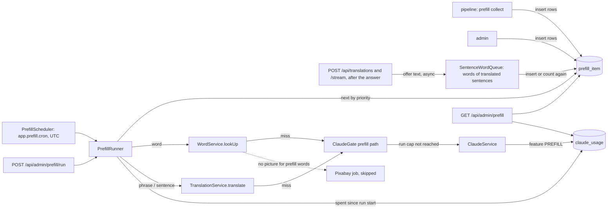
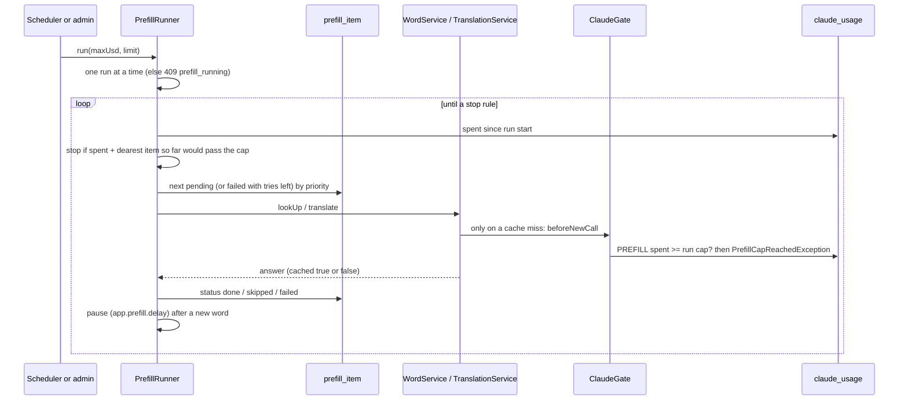

# Prefill

> Status: **backend built** (TASK-83.1, the queue and the job; TASK-83.8 queues the unknown words of translated sentences). The collector in the pipeline (TASK-83.2) fills the queue; cached-only lookups and suggestions (TASK-83.4 and later) come after. Last traced from code: 2026-10-16.
> Why: doc-7, decisions of 2026-10-16. Related: [Accounts and limits](doc-17%20-%20Accounts-and-limits.md) (the user budget), [Word lookup](doc-5%20-%20Word-lookup.md), [Sentence translation](doc-4%20-%20Sentence-translation.md), [Media and images](doc-15%20-%20Media-and-images.md), the cron and env keys in the [deploy guide](../guides/doc-11%20-%20Deploy-to-a-VPS.md).

## What it does

A cached answer comes back in about 25-50 ms; a new Claude call takes about 2 seconds, and a guest gets no new call at all. The **prefill job** fills the shared cache before users ask. It takes words and phrases (for example "give up") from a queue and answers each one with the **same code a user reaches**: `WordService.lookUp` and `TranslationService.translate`. So the prompt, the prompt version, the cache key and the SimpleWords retry are identical to a real lookup. One thing is left out on purpose: **a prefilled word gets no picture** (no Pixabay call, no claim row, no ffmpeg; developer, 10-16). `WordService.startMediaJob` returns at once inside a prefill run, and `media-ai` only draws bundled senses (`dictionary_sense`), never `word_lookup` words.

The job has **its own money cap per run** (default $0.50) and its calls do **not** count toward the users' daily budget (`app.claude.daily-budget-usd`). A night run cannot eat the users' day.

## Big picture

## Step by step

| Step | File:line | What happens |
|---|---|---|
| Table | [V17__create_prefill_item.sql](../../../backend/src/main/resources/db/migration/V17__create_prefill_item.sql) | `prefill_item(kind word/sentence, text, target_lang, source, priority, status pending/done/skipped/failed, attempts, last_error, timestamps)`, unique on `(kind, text, target_lang)`, index `(status, priority DESC, id)`. A word is stored with `CacheKeys.normalizeWord`, a phrase or sentence with `normalizeSentence` and `target_lang` `vi`. (V16 was already taken by `media_generation_ai_scene`, so this is V17.) |
| Start | [PrefillRunner.startInBackground:99](../../../backend/src/main/java/com/englishtranslation/backend/prefill/PrefillRunner.java#L99), [runNow:110](../../../backend/src/main/java/com/englishtranslation/backend/prefill/PrefillRunner.java#L110) | An atomic flag allows one run at a time; a second start gets 409 `prefill_running`. The admin call runs on its own `prefill` thread; the cron calls `runNow` on its scheduler thread. |
| Context | [runClaimed:121](../../../backend/src/main/java/com/englishtranslation/backend/prefill/PrefillRunner.java#L121), [PrefillContext](../../../backend/src/main/java/com/englishtranslation/backend/limits/PrefillContext.java) | A thread-local `Run(startedAt, maxUsd)` marks the thread as "a prefill run" for the whole run. |
| Loop and stop rules | [loop:156](../../../backend/src/main/java/com/englishtranslation/backend/prefill/PrefillRunner.java#L156) | Before each item it reads the real spend (`PREFILL` rows since the run start) and stops if `spent + dearest item so far > cap` (`cap`). Other stops: `queue-empty`, `limit`, 5 failures in a row (`failures`, Claude is probably down), `interrupted`. Items come by `priority DESC, id`. |
| One item | [handle:203](../../../backend/src/main/java/com/englishtranslation/backend/prefill/PrefillRunner.java#L203) | `done` after an answer; `skipped` for a non-word, personal text, an unknown language or a Claude "not English"; any other error: `attempts + 1`, `last_error`, status `failed`. |
| Word | [answerWord:225](../../../backend/src/main/java/com/englishtranslation/backend/prefill/PrefillRunner.java#L225) | `WordService.lookUp`. A cached or bundled answer is `done` with no Claude call. "No senses" means not on the word list: `skipped`, nothing saved. |
| Phrase | [answerSentence:235](../../../backend/src/main/java/com/englishtranslation/backend/prefill/PrefillRunner.java#L235) | `PersonalTextDetector` first (email, phone, link, long number): `skipped`, and never sent to Claude or saved. Else `TranslationService.translate(text, language)`. |
| Pace | [pause:265](../../../backend/src/main/java/com/englishtranslation/backend/prefill/PrefillRunner.java#L265) | After each item that made a NEW word the run waits `app.prefill.delay` (default 0 s, so no pause). It was 3 s to protect Pixabay, but prefilled words get no picture any more, so nothing needs the pause; it stays as a knob to slow a run down. Cached items and sentences never wait. |
| Gate | [ClaudeGate.checkPrefillCap:59](../../../backend/src/main/java/com/englishtranslation/backend/limits/ClaudeGate.java#L59) | On a prefill thread `beforeNewCall` and `checkBudget` skip the sign-in, the per-user limits and the users' budget, and throw `PrefillCapReachedException` when this run's spend reached its cap. The runner leaves that item `pending`. The SimpleWords retry (second call) hits the same check; if it fails the first entry is kept, as for users. |
| Money | [ClaudeUsageService.record:68](../../../backend/src/main/java/com/englishtranslation/backend/claude/ClaudeUsageService.java#L68), [totalCostSince](../../../backend/src/main/java/com/englishtranslation/backend/claude/ClaudeUsageRepository.java#L14) | On a prefill thread every call is saved with `Feature.PREFILL`. The users' budget query leaves `PREFILL` out. `report` shows the prefill spend per day under `byFeature.prefill`, and `todayUsd` (what the users' budget counts) leaves it out; `prefillTodayUsd` is new. |
| Schedule | [PrefillScheduler.start:34](../../../backend/src/main/java/com/englishtranslation/backend/prefill/PrefillScheduler.java#L34) | `app.prefill.cron` (`PREFILL_CRON`, six-field Spring cron, UTC). Empty = off; an invalid cron is logged and ignored. A run still going (or a failure) never stops the next night. |
| Sentence words | [SentenceWordQueue.offer:124](../../../backend/src/main/java/com/englishtranslation/backend/prefill/SentenceWordQueue.java#L124), [queueWords:148](../../../backend/src/main/java/com/englishtranslation/backend/prefill/SentenceWordQueue.java#L148), [addOrCount:275](../../../backend/src/main/java/com/englishtranslation/backend/prefill/SentenceWordQueue.java#L275), [V20__prefill_item_seen_count.sql](../../../backend/src/main/resources/db/migration/V20__prefill_item_seen_count.sql) | TASK-83.8, the third way into the queue. `TranslationController` calls `offer(text)` after `/api/translations` and `/stream` answered (cache hit or miss). `offer` only hands the text to one worker thread (queue of 50, a full queue drops the text) and returns, so the response time does not change; errors are logged only. Personal text (`PersonalTextDetector`) is never looked at and the sentence is never saved. The worker takes the English words (`EnglishWords`, `normalizeWord`, a possessive `'s` cut off, contractions left out, at most 60 per sentence) and checks them in 3 batch queries: bundled (`dictionary_word.lemma`, or a form in `dictionary_form`) and cached (`word_lookup` key for the current word prompt version). The rest goes into `prefill_item` as kind `word`, `target_lang` empty, source `sentence-words`. A form is skipped when its obvious base (endings -s, -es, -ies, -ing, -ed, only bases on the word list) is bundled or cached; a form with an unknown base is queued as written. Claude's `words` list in the explanation is not used (it holds hard words and phrases as written, not all the words). A word already queued: `seen_count + 1` once per sentence, priority `300 + 50 * (seen - 1)` up to 800 (the pipeline uses `round(zipf * 100)`, about 300-600 for common words), never lowered. A `done` or `skipped` row stays as it is. V20 adds `seen_count INT NOT NULL DEFAULT 1` (V18 and V19 are the Java migrations of TASK-83.3 and TASK-83.4). |
| Admin | [AdminPrefillController](../../../backend/src/main/java/com/englishtranslation/backend/admin/AdminPrefillController.java) | `POST /api/admin/prefill/run?maxUsd=&limit=` (202; `maxUsd` over 0 and at most 10; `limit` at least 1; 409 if running) and `GET /api/admin/prefill`: `{running, byStatus, bySource[], maxUsdPerRun, spentTodayUsd, lastRuns[]}`. Both need the ADMIN cookie. The POST needs `Content-Type: application/json` like every admin write. |

## Settings

| Env | Property | Default | Meaning |
|---|---|---|---|
| `PREFILL_CRON` | `app.prefill.cron` | empty (off) | Six-field cron in UTC, for example `0 0 20 * * *` (20:00 UTC = 03:00 in Vietnam). |
| `PREFILL_MAX_USD_PER_RUN` | `app.prefill.max-usd-per-run` | `0.50` | The most one run may spend. |
| `PREFILL_DELAY` | `app.prefill.delay` | `0s` | Optional pause after each new word. |
| none | `app.prefill.max-attempts` | `3` | A failed item is tried again by later runs until it failed this many times, then stays `failed`. |

## Errors

| Cause | Where | HTTP | What the admin sees |
|---|---|---|---|
| A run is already going | `PrefillRunner` | 409 `prefill_running` | "A prefill run is already running." |
| `maxUsd` not in (0, 10] or `limit` under 1 | `AdminPrefillController` | 400 | The reason. |
| Not logged in as ADMIN | Spring Security | 401 | Nothing. |
| Run cap reached | `ClaudeGate` | none (stops the run) | `stoppedBecause: "cap"` in `lastRuns`; the item stays `pending`. |

## Tests

| Test file | What it covers |
|---|---|
| `prefill/PrefillRunnerTest` | A new word and phrase are answered with no user (sign-in required) and saved as PREFILL; the users' budget is not touched and a used-up users' budget does not stop prefill; a cached word costs nothing; non-word and personal text are skipped with no Claude call; the cap stops the run; priority and `limit`; a failed item is retried up to 3 attempts and can succeed later; one run at a time; a normal guest is still refused. |
| `prefill/SentenceWordQueueTest` | Words queued after `/api/translations` (miss and cache hit) and `/stream`; bundled lemma and form, cached, non-words, contractions and personal text not queued; possessive and punctuation; a form with a bundled or cached base skipped, with an unknown base queued; seen again raises `seen_count` and priority without a duplicate, stops at 800, keeps a higher pipeline priority; done and skipped rows unchanged; `offer` returns before the work is done; a full queue or a failing worker never reaches the caller; the night job answers them through the prefill cap, most seen first. |
| `admin/AdminPrefillTest` | Both calls need the admin login; bad `maxUsd` and `limit` give 400; the run answers 202; the overview counts by status and source and shows the prefill spend; `/api/admin/usage` splits it out. |
| `limits/ClaudeGateTest`, `claude/ClaudeUsageServiceTest`, `admin/AdminUsageTest` | The user path and the report did not change. |

Run: `cd backend && ./mvnw -B test`. No test calls the real API.

## Change checklist

- New code that calls Claude from the job: it must run inside `PrefillContext` (the runner does this) and go through `ClaudeGate`.
- A new `Feature`: `claude_usage.feature` is `VARCHAR(20)`.
- A prompt version bump: old cache rows stay under the old key, so the next run does not see them as cached. Re-queue the items you want refreshed.
- The queue columns are a contract with the pipeline collector (TASK-83.2). Change them only together.

## Known gaps

- `lastRuns` lives in memory (the last 10 runs since the server started). Older spend is in `GET /api/admin/usage`, feature `prefill`.
- The cap check is "spend so far + the dearest item so far". The first item of a run has no history, so a run can go over its cap by one call.
- There is no admin screen yet (the admin web app is another task). Use curl.
- The loose sentence match (TASK-83.3) is not here: a phrase is cached under its exact normalized text.
- Sentence words (TASK-83.8): only the words of sentences that were answered are counted; the work is dropped when 50 texts wait. A word queued before its base was cached is still answered (a cached item is `done` for free). The nightly job is the same Spring `@Scheduled`-style schedule above; there is no second scheduler.
- A word that Claude returns with no senses is saved by `WordService` like any other word; prefill does not look at the quality of the answer.
