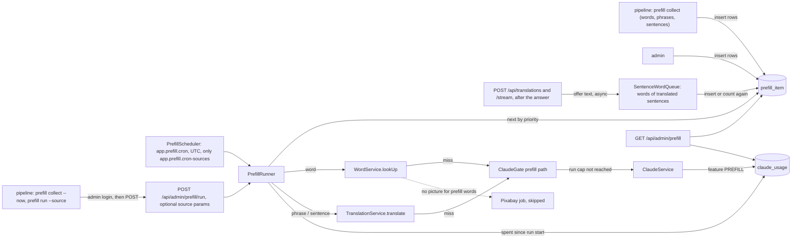
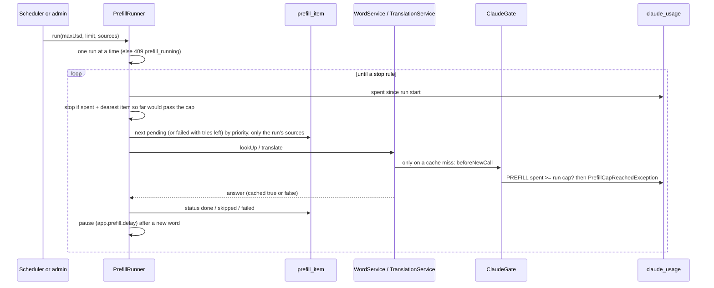
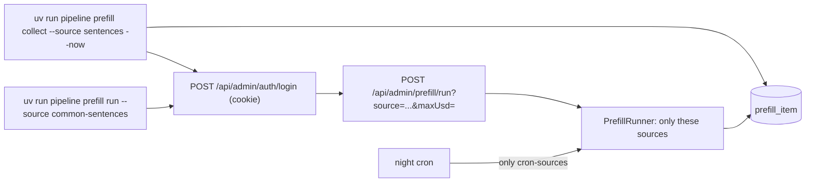
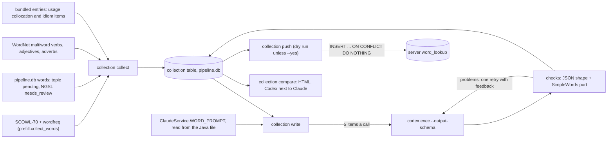

# Prefill

> Status: **backend built** (TASK-83.1, the queue and the job; TASK-83.8 queues the unknown words of translated sentences). The collector in the pipeline (TASK-83.2) fills the queue, and since TASK-83.11 also with about 2,500 everyday lines ("Looks good.", "I'll get back to you.", [Common everyday sentences](#common-everyday-sentences-task-8311)); cached-only lookups and suggestions (TASK-83.4 and later) come after. The free way, entries written by Codex on the developer's Mac and pushed to `word_lookup`, is [Local collection written by Codex](#local-collection-written-by-codex-task-839) at the end (TASK-83.9). TASK-83.12 splits the runs: the night job answers only what users typed, and what the developer queues is run at once, see [Run at once](#run-at-once-task-8312). Last traced from code: 2026-10-23 (TASK-83.3: queued phrases and sentences use the loose sentence match).
> Why: doc-7, decisions of 2026-10-16. Related: [Accounts and limits](doc-17%20-%20Accounts-and-limits.md) (the user budget), [Word lookup](doc-5%20-%20Word-lookup.md), [Sentence translation](doc-4%20-%20Sentence-translation.md), [Media and images](doc-15%20-%20Media-and-images.md), the cron and env keys in the [deploy guide](../guides/doc-11%20-%20Deploy-to-a-VPS.md).

## What it does

A cached answer comes back in about 25-50 ms; a new Claude call takes about 2 seconds, and a guest gets no new call at all. The **prefill job** fills the shared cache before users ask. It takes words and phrases (for example "give up") from a queue and answers each one with the **same code a user reaches**: `WordService.lookUp` and `TranslationService.translate`. So the prompt, the prompt version, the cache key and the SimpleWords retry are identical to a real lookup. One thing is left out on purpose: **a prefilled word gets no picture** (no Pixabay call, no claim row, no ffmpeg; developer, 10-16). `WordService.startMediaJob` returns at once inside a prefill run, and `media-ai` only draws bundled senses (`dictionary_sense`), never `word_lookup` words.

The job has **its own money cap per run** (default $0.50) and its calls do **not** count toward the users' daily budget (`app.claude.daily-budget-usd`). A night run cannot eat the users' day.

## Big picture

## Step by step

| Step | File:line | What happens |
|---|---|---|
| Table | [V17__create_prefill_item.sql](../../../backend/src/main/resources/db/migration/V17__create_prefill_item.sql) | `prefill_item(kind word/sentence, text, target_lang, source, priority, status pending/done/skipped/failed, attempts, last_error, timestamps)`, unique on `(kind, text, target_lang)`, index `(status, priority DESC, id)`. A word is stored with `CacheKeys.normalizeWord`, a phrase or sentence with `normalizeSentence` and `target_lang` `vi`. (V16 was already taken by `media_generation_ai_scene`, so this is V17.) |
| Start | [PrefillRunner.startInBackground:101](../../../backend/src/main/java/com/englishtranslation/backend/prefill/PrefillRunner.java#L101), [runNow:117](../../../backend/src/main/java/com/englishtranslation/backend/prefill/PrefillRunner.java#L117) | An atomic flag allows one run at a time; a second start gets 409 `prefill_running`. The admin call runs on its own `prefill` thread; the cron calls `runNow` on its scheduler thread. Both take a list of sources (empty = every source); the loop passes it to `PrefillItemRepository.next`, which then skips other sources (TASK-83.12). |
| Context | [runClaimed:133](../../../backend/src/main/java/com/englishtranslation/backend/prefill/PrefillRunner.java#L133), [PrefillContext](../../../backend/src/main/java/com/englishtranslation/backend/limits/PrefillContext.java) | A thread-local `Run(startedAt, maxUsd)` marks the thread as "a prefill run" for the whole run. |
| Loop and stop rules | [loop:168](../../../backend/src/main/java/com/englishtranslation/backend/prefill/PrefillRunner.java#L168) | Before each item it reads the real spend (`PREFILL` rows since the run start) and stops if `spent + dearest item so far > cap` (`cap`). Other stops: `queue-empty`, `limit`, 5 failures in a row (`failures`, Claude is probably down), `interrupted`. Items come by `priority DESC, id`. |
| One item | [handle:217](../../../backend/src/main/java/com/englishtranslation/backend/prefill/PrefillRunner.java#L217) | `done` after an answer; `skipped` for a non-word, personal text, an unknown language or a Claude "not English"; any other error: `attempts + 1`, `last_error`, status `failed`. |
| Word | [answerWord:239](../../../backend/src/main/java/com/englishtranslation/backend/prefill/PrefillRunner.java#L239) | `WordService.lookUp`. A cached or bundled answer is `done` with no Claude call. "No senses" means not on the word list: `skipped`, nothing saved. |
| Phrase | [answerSentence:249](../../../backend/src/main/java/com/englishtranslation/backend/prefill/PrefillRunner.java#L249) | `PersonalTextDetector` first (email, phone, link, long number): `skipped`, and never sent to Claude or saved. Else `TranslationService.translate(text, language)`. |
| Pace | [pause:279](../../../backend/src/main/java/com/englishtranslation/backend/prefill/PrefillRunner.java#L279) | After each item that made a NEW word the run waits `app.prefill.delay` (default 0 s, so no pause). It was 3 s to protect Pixabay, but prefilled words get no picture any more, so nothing needs the pause; it stays as a knob to slow a run down. Cached items and sentences never wait. |
| Gate | [ClaudeGate.checkPrefillCap:59](../../../backend/src/main/java/com/englishtranslation/backend/limits/ClaudeGate.java#L59) | On a prefill thread `beforeNewCall` and `checkBudget` skip the sign-in, the per-user limits and the users' budget, and throw `PrefillCapReachedException` when this run's spend reached its cap. The runner leaves that item `pending`. The SimpleWords retry (second call) hits the same check; if it fails the first entry is kept, as for users. |
| Money | [ClaudeUsageService.record:68](../../../backend/src/main/java/com/englishtranslation/backend/claude/ClaudeUsageService.java#L68), [totalCostSince](../../../backend/src/main/java/com/englishtranslation/backend/claude/ClaudeUsageRepository.java#L14) | On a prefill thread every call is saved with `Feature.PREFILL`. The users' budget query leaves `PREFILL` out. `report` shows the prefill spend per day under `byFeature.prefill`, and `todayUsd` (what the users' budget counts) leaves it out; `prefillTodayUsd` is new. |
| Schedule | [PrefillScheduler.start:36](../../../backend/src/main/java/com/englishtranslation/backend/prefill/PrefillScheduler.java#L36) | `app.prefill.cron` (`PREFILL_CRON`, six-field Spring cron, UTC). Empty = off; an invalid cron is logged and ignored. A run still going (or a failure) never stops the next night. The scheduled run answers only the sources in `app.prefill.cron-sources` (`PREFILL_CRON_SOURCES`, default `sentence-words`); other sources stay `pending` at night. An empty list switches the night job off (it would otherwise mean every source). |
| Sentence words | [SentenceWordQueue.offer:124](../../../backend/src/main/java/com/englishtranslation/backend/prefill/SentenceWordQueue.java#L124), [queueWords:148](../../../backend/src/main/java/com/englishtranslation/backend/prefill/SentenceWordQueue.java#L148), [addOrCount:275](../../../backend/src/main/java/com/englishtranslation/backend/prefill/SentenceWordQueue.java#L275), [V20__prefill_item_seen_count.sql](../../../backend/src/main/resources/db/migration/V20__prefill_item_seen_count.sql) | TASK-83.8, the third way into the queue. `TranslationController` calls `offer(text)` after `/api/translations` and `/stream` answered (cache hit or miss). `offer` only hands the text to one worker thread (queue of 50, a full queue drops the text) and returns, so the response time does not change; errors are logged only. Personal text (`PersonalTextDetector`) is never looked at and the sentence is never saved. The worker takes the English words (`EnglishWords`, `normalizeWord`, a possessive `'s` cut off, contractions left out, at most 60 per sentence) and checks them in 3 batch queries: bundled (`dictionary_word.lemma`, or a form in `dictionary_form`) and cached (`word_lookup` key for the current word prompt version). The rest goes into `prefill_item` as kind `word`, `target_lang` empty, source `sentence-words`. A form is skipped when its obvious base (endings -s, -es, -ies, -ing, -ed, only bases on the word list) is bundled or cached; a form with an unknown base is queued as written. Claude's `words` list in the explanation is not used (it holds hard words and phrases as written, not all the words). A word already queued: `seen_count + 1` once per sentence, priority `300 + 50 * (seen - 1)` up to 800 (the pipeline uses `round(zipf * 100)`, about 300-600 for common words), never lowered. A `done` or `skipped` row stays as it is. V20 adds `seen_count INT NOT NULL DEFAULT 1` (V18 and V19 are the Java migrations of TASK-83.3 and TASK-83.4). |
| Admin | [AdminPrefillController](../../../backend/src/main/java/com/englishtranslation/backend/admin/AdminPrefillController.java) | `POST /api/admin/prefill/run?maxUsd=&limit=&source=` (`source` repeats; none = every source; the answer lists `sources`; 202; `maxUsd` over 0 and at most 10; `limit` at least 1; 409 if running) and `GET /api/admin/prefill`: `{running, byStatus, bySource[], maxUsdPerRun, spentTodayUsd, lastRuns[]}`. Both need the ADMIN cookie. The POST needs `Content-Type: application/json` like every admin write. |

## Settings

| Env | Property | Default | Meaning |
|---|---|---|---|
| `PREFILL_CRON` | `app.prefill.cron` | empty (off) | Six-field cron in UTC, for example `0 0 20 * * *` (20:00 UTC = 03:00 in Vietnam). |
| `PREFILL_CRON_SOURCES` | `app.prefill.cron-sources` | `sentence-words` | Comma list of queue sources the scheduled run answers. The others wait for a run by hand (`prefill run`, `collect --now`). |
| `PREFILL_MAX_USD_PER_RUN` | `app.prefill.max-usd-per-run` | `0.50` | The most one run may spend. |
| `PREFILL_DELAY` | `app.prefill.delay` | `0s` | Optional pause after each new word. |
| none | `app.prefill.max-attempts` | `3` | A failed item is tried again by later runs until it failed this many times, then stays `failed`. |

## Errors

| Cause | Where | HTTP | What the admin sees |
|---|---|---|---|
| A run is already going | `PrefillRunner` | 409 `prefill_running` | "A prefill run is already running." |
| `maxUsd` not in (0, 10] or `limit` under 1 | `AdminPrefillController` | 400 | The reason. |
| Not logged in as ADMIN | Spring Security | 401 | Nothing. |
| Run cap reached | `ClaudeGate` | none (stops the run) | `stoppedBecause: "cap"` in `lastRuns`; the item stays `pending`. |

## Tests

| Test file | What it covers |
|---|---|
| `prefill/PrefillRunnerTest` | A new word and phrase are answered with no user (sign-in required) and saved as PREFILL; the users' budget is not touched and a used-up users' budget does not stop prefill; a cached word costs nothing; non-word and personal text are skipped with no Claude call; the cap stops the run; priority and `limit`; a failed item is retried up to 3 attempts and can succeed later; one run at a time; a normal guest is still refused; a run with sources answers only those; the scheduled run skips sources not in `cron-sources`; the default of `cron-sources`. |
| `prefill/SentenceWordQueueTest` | Words queued after `/api/translations` (miss and cache hit) and `/stream`; bundled lemma and form, cached, non-words, contractions and personal text not queued; possessive and punctuation; a form with a bundled or cached base skipped, with an unknown base queued; seen again raises `seen_count` and priority without a duplicate, stops at 800, keeps a higher pipeline priority; done and skipped rows unchanged; `offer` returns before the work is done; a full queue or a failing worker never reaches the caller; the night job answers them through the prefill cap, most seen first. |
| `admin/AdminPrefillTest` | Both calls need the admin login; bad `maxUsd` and `limit` give 400; the run answers 202; `source` params limit the run, no param answers every source; the overview counts by status and source and shows the prefill spend; `/api/admin/usage` splits it out. |
| `limits/ClaudeGateTest`, `claude/ClaudeUsageServiceTest`, `admin/AdminUsageTest` | The user path and the report did not change. |

Run: `cd backend && ./mvnw -B test`. No test calls the real API.

## Change checklist

- New code that calls Claude from the job: it must run inside `PrefillContext` (the runner does this) and go through `ClaudeGate`.
- A new `Feature`: `claude_usage.feature` is `VARCHAR(20)`.
- A prompt version bump: old cache rows stay under the old key, so the next run does not see them as cached. Re-queue the items you want refreshed.
- The queue columns are a contract with the pipeline collector (TASK-83.2). Change them only together.

## Known gaps

- `lastRuns` lives in memory (the last 10 runs since the server started). Older spend is in `GET /api/admin/usage`, feature `prefill`.
- The cap check is "spend so far + the dearest item so far". The first item of a run has no history, so a run can go over its cap by one call.
- There is no admin screen yet (the admin web app is another task). Use curl.
- The loose sentence match (TASK-83.3) is used when a phrase or sentence is answered, but not when it is queued: `prefill_item` is unique on the exact text, so "Looks good!", "looks good" and "\"Looks good.\"" (quotes around the whole text, ignored by the match since TASK-83.13) can all be queued. The second costs nothing (a loose cache hit, `done`), but it is a row in the queue and in `prefill report`.
- Sentence words (TASK-83.8): only the words of sentences that were answered are counted; the work is dropped when 50 texts wait. A word queued before its base was cached is still answered (a cached item is `done` for free). The nightly job is the same Spring `@Scheduled`-style schedule above; there is no second scheduler.
- A word that Claude returns with no senses is saved by `WordService` like any other word; prefill does not look at the quality of the answer.

## Common everyday sentences (TASK-83.11)

Words are well covered (about 34 thousand cached), but the short lines a learner meets every day were not: each one cost a slow first Claude call, and a guest got nothing. [common_sentences.tsv](../../../pipeline/data/common_sentences.tsv) is a list of **2,488 everyday English lines**, written by hand for Saynata (no paid call; not copied from Tatoeba, a textbook or any other list): replies ("Sounds good to me."), greetings, polite requests, common questions, small talk and texting, feelings, plans, work chat and email lines, shops, food, travel, home, health, school, phones and computers, weather and money. Columns `text`, `situation` (a short note such as "agreeing"), `kind` (`reply`, `greeting`, `polite`, `question`, `chat`, `feeling`, `plans`, `work`, `email`, `shop`, `food`, `travel`, `home`, `health`, `school`, `tech`, `phone`, `weather`, `money`). 2 to 15 words, normal casing and punctuation, no names or personal data, no rude lines.

`uv run pipeline prefill collect --source sentences [--file other.tsv] [--dry-run] [--limit N]` queues them:

| Part | Code | What it does |
|---|---|---|
| Read and check | [read_sentence_file:296](../../../pipeline/src/pipeline/prefill.py#L296) | Header `text, situation, kind` (tab separated) or it stops. Blank lines and `#` lines are skipped. A line is left out (and printed) with the wrong number of columns, under 2 or over 15 words, a rude word (`BLOCKED`), personal text, no kind, or the same loose key as an earlier line. |
| Loose key | [loose_key:279](../../../pipeline/src/pipeline/prefill.py#L279) | The copy of `CacheKeys.normalizeSentenceLoose` (TASK-83.3): lowercase, no `. ? !` at the end. "No worries." and "no worries!" are one row, since they are one cached answer. |
| Personal text | [looks_personal:285](../../../pipeline/src/pipeline/prefill.py#L285) | A copy of the backend `PersonalTextDetector` (email, link, 6+ digits, phone number of 7+ digits); the night job would skip such a line, so it is never queued. |
| Priority | [sentence_priority:332](../../../pipeline/src/pipeline/prefill.py#L332), [KIND_PRIORITY](../../../pipeline/src/pipeline/prefill.py#L249) | Common replies first: `reply` 900, `greeting` 890, `polite` 880, `question` 860 ... `money` 740, other kinds 700, plus `4 x (15 - words)`, so "Looks good." (952) comes before a long work line. Words are 300-800, so these lines come before most of the queue. |
| Queue rows | [sentence_items:337](../../../pipeline/src/pipeline/prefill.py#L337), [prefill_sentences:445](../../../pipeline/src/pipeline/cli.py#L445) | `kind = 'sentence'`, `target_lang = 'vi'`, `source = 'common-sentences'`. A line whose loose key is already queued as a `vi` sentence ([queued_sentence_keys:389](../../../pipeline/src/pipeline/prefill.py#L389), "give up" from the phrases too) is skipped; the insert is `ON CONFLICT DO NOTHING` as before. |
| Dry run cost | [model_price:344](../../../pipeline/src/pipeline/prefill.py#L344), [sentence_night_lines:362](../../../pipeline/src/pipeline/prefill.py#L362) | Prices of `deepseek-v4.1-flash` (the server model, doc-7 10-20) read from `app.claude.pricing.[deepseek-v4.1-flash].*` in `application.properties`; an estimate of 1,000 tokens in and 200 out per sentence. |

Measured on 2026-10-23 (dry run, no database): **2,488 lines, about $1.34** at $0.30 / $1.20 per million tokens ($0.00054 a line), about 925 a night at the $0.50 cap, so **about 3 nights**. The token numbers are an estimate; `prefill report` after a run shows the real spend.

Items of 2-6 words are also looked up as phrases by the app (`CacheKeys.phraseQuery`, TASK-83.10) before the sentence path; they are queued as sentences all the same. To add lines: append to the TSV (or pass `--file`) and run the command again; only new lines are queued.

## Run at once (TASK-83.12)

The night job is for what **users** typed (`sentence-words`). Words, phrases and sentences that the **developer** queues must be in the cache right away, so they are run by hand, not at night.

| Part | Code | What it does |
|---|---|---|
| Settings | [admin_settings:485](../../../pipeline/src/pipeline/prefill.py#L485), `ADMIN_API_URL`, `ADMIN_EMAIL`, `ADMIN_PASSWORD` in `pipeline/.env` | Missing keys stop the command with a clear message **before** anything is queued. |
| Start | [start_run:501](../../../pipeline/src/pipeline/prefill.py#L501) | Logs in like the admin web app (cookie `saynata_admin`), then `POST /api/admin/prefill/run` with one `source` param per label and `maxUsd`. Messages for a wrong login (401), a run already going (409) and a cap outside (0, 10]. The HTTP client can be replaced, so tests use `httpx.MockTransport`. |
| Collect | [prefill_command:374](../../../pipeline/src/pipeline/cli.py#L374) | `collect ... --now [--max-usd 0.50]` queues, then runs the label of that collect: words `scowl-70`, phrases `oewn-2025`, sentences `common-sentences` (`SOURCE_LABELS`). `--dry-run` never starts a run. |
| Run | [prefill_start_run:362](../../../pipeline/src/pipeline/cli.py#L362) | `prefill run --source <label> [--source ...] [--max-usd]` starts a run for rows that are already queued. Prints what started and "watch with: uv run pipeline prefill report". |

The run happens on the server in the background and spends Claude money there, capped by `--max-usd` (default 0.50, at most 10, one run at a time). For the 2,488 `common-sentences` rows (about $1.34): `uv run pipeline prefill run --source common-sentences --max-usd 1.50`. Tests: `pipeline/tests/test_prefill.py` (fake server, no network, no Postgres).

## Local collection written by Codex (TASK-83.9)

> Status: **code built, trial not run yet** (2026-10-17). Nothing has been pushed to the server.

The night job above pays Claude for every new answer. The **local collection** is the free way: the Codex CLI on the developer's Mac (`codex exec`, the ChatGPT plan, no per-call cost) writes the entries in advance, the same checks as the backend run on them, and a push step copies the good ones into the server cache `word_lookup`. A pushed word is then an ordinary cached answer: about 25-50 ms, and a guest gets it too.

It covers four kinds: **word**, **phrasal_verb**, **idiom** and **collocation**. Everything lives in one table, `collection`, in `pipeline/data/pipeline.db` (not on the server until the push).

| Step | File:line | What happens |
|---|---|---|
| Table | [collection.py SCHEMA:52](../../../pipeline/src/pipeline/collection.py#L52) | `collection(kind, text UNIQUE, source, zipf, priority, status pending/done/needs_review/skipped/failed, attempts, model, prompt_version, entry, problems, claude_entry, claude_model, pushed_at)`. `text` is normalised like `CacheKeys.normalizeWord`. The first source that brings a text keeps it. |
| Collect words | [_collect:505](../../../pipeline/src/pipeline/cli.py#L505), [word_items:414](../../../pipeline/src/pipeline/collection.py#L414), [pipeline_word_items:436](../../../pipeline/src/pipeline/collection.py#L436) | The prefill word collector (SCOWL-70 lemmas, wordfreq Zipf >= 3.5, `--all-wordfreq` for every word), minus everything bundled or already in the `words` table. Plus the kept topic words that are still pending and the NGSL words left `needs_review`. A word the backend would call "not a word" (not on SCOWL-70 or NGSL) starts as `skipped`: the backend answers such a word with "no senses" before it looks in the cache. A word WordNet knows only as a capitalised noun is `skipped` as a name ([name_only_words:400](../../../pipeline/src/pipeline/collection.py#L400)). |
| Collect phrases | [wordnet_items:377](../../../pipeline/src/pipeline/collection.py#L377), [phrase_kind:362](../../../pipeline/src/pipeline/collection.py#L362) | The prefill phrase collector (WordNet 2025, 2-4 words, verbs, adjectives and adverbs only), `--phrase-zipf` 3.0. A verb whose words after the first are all particles ("give up", "put up with") is a `phrasal_verb`; every other phrase is an `idiom` ("in time", "break the ice"). Rude phrases and numbers are left out. |
| Collect collocations | [bundled_usage_items:422](../../../pipeline/src/pipeline/collection.py#L422), [typed_phrase:389](../../../pipeline/src/pipeline/collection.py#L389) | The `collocation` and `idiom` usage items of the 2,750 bundled entries (TASK-24), but only the ones a learner could type: no placeholder (`someone`, `+ noun`, `/`), 2-6 words. Each was written for a sense of a common word, so learners meet them. |
| Prompt | [backend_word_prompt:103](../../../pipeline/src/pipeline/collection.py#L103), [build_prompt:148](../../../pipeline/src/pipeline/collection.py#L148) | `WORD_PROMPT` is read from `ClaudeService.java` at run time (the Java text block rules: common indent removed, `\"` read), so Codex and Claude always get the same instructions. A batch with a phrase also gets `PHRASE_NOTE` (pos "phrasal verb", "idiom" or "phrase"; every example uses the whole phrase). |
| Codex call | [CodexWriter:538](../../../pipeline/src/pipeline/collection.py#L538) | `codex exec --sandbox read-only --ephemeral --ignore-user-config --output-schema <schema> -o <answer>`, model from `~/.codex/config.toml` (or `--model`), effort `low` like the backend. `--ignore-user-config` keeps the user's notify hook from firing after every call. "usage limit" or "not logged in" stops the run (`ProviderStop`); everything done so far is kept. |
| Checks | [entry_problems:325](../../../pipeline/src/pipeline/collection.py#L325), [simple_word_problems:281](../../../pipeline/src/pipeline/collection.py#L281) | The JSON must be the `WordEntry` shape; then the shape rules Claude's structured output gives for free (at most 4 senses, exactly 3 examples easy, medium, harder, CEFR A1-C2, at most 3 usage items, no sb/sth), then a line-for-line copy of `SimpleWords.problems` with the same word lists (`ngsl.txt`, `simple-extra.txt`) and the same wording. One addition for phrases: every word of the phrase and its forms count as the headword. |
| Retry and status | [write_batch:625](../../../pipeline/src/pipeline/collection.py#L625), [write_rows:708](../../../pipeline/src/pipeline/collection.py#L708) | Like `WordService`: one retry with feedback for an item that failed the checks, never more. Then `done`, or `needs_review` (the retry's entry is kept). No senses: `skipped`. A broken call: the batch is `failed` and tried again by the next run, up to 3 calls. The row keeps `model` (for example `codex:gpt-5.6-terra`) and the backend `prompt_version`. |
| Compare | [compare_page:897](../../../pipeline/src/pipeline/collection.py#L897), [claude_from_api:839](../../../pipeline/src/pipeline/collection.py#L839) | `data/out/collection-compare.html`: the first N written rows of each kind, the Codex entry on the left and a Claude entry on the right. Claude entries come free from the NGSL pipeline (the 59 `needs_review` words) and, with `--from-server`, from `word_lookup`; `--claude` asks Claude Haiku 5.5 exactly like `ClaudeService.describeWord` (paid, about $0.0005 a call, `--max-cost`, default $0.25). |
| Push | [plan_push:962](../../../pipeline/src/pipeline/collection.py#L962), [push:986](../../../pipeline/src/pipeline/collection.py#L986) | `done` rows (and `needs_review` with `--include-review`, saved with `needs_review = true`) into `word_lookup` under `CacheKeys.key("word", v7, text)`. A word that is bundled on the server is skipped (the bundled entry wins). `ON CONFLICT (cache_key) DO NOTHING`: a Claude row is never overwritten. Without `--yes` it opens a read-only connection and only prints the plan. Pushed words get no picture, like prefilled words. |

### Counts (collected 2026-10-17; words down to Zipf 2 added 2026-10-18)

| Kind | Source | Rows |
|---|---|---|
| word | scowl-70, Zipf >= 2 (2026-10-18; 996 skipped as names or blocked) | 39,667 |
| word | topic (kept topic words, still pending) | 944 |
| word | ngsl-review | 59 |
| phrasal_verb | oewn-2025 | 1,818 |
| idiom | oewn-2025 / bundled-usage | 1,600 / 744 |
| collocation | bundled-usage | 5,719 |
| all | | 50,551 (49,476 to write on 2026-10-18) |

### Commands and time

Run in `pipeline/`. Codex calls use the ChatGPT plan's limits, so agents never start these; the developer does.

| Command | What | Time |
|---|---|---|
| `uv run pipeline collection collect` | Fill or top up the table (no LLM, safe to run again). | 30 s |
| `uv run pipeline collection report` | Counts per kind, source and status. | instant |
| `uv run pipeline collection write --per-kind 20` | The trial: 20 of each kind (80 rows, 16 calls plus retries). | about 5 minutes |
| `uv run pipeline collection compare --claude` | The side-by-side page; Claude for the items with no Claude entry (about 60 calls, about $0.03; measured $0.0005 a call). | 2 minutes |
| `uv run pipeline collection write --kind word --limit 1000` | The next 1,000 words. Stop with Ctrl-C at any time; the next run goes on. | about 40 minutes |
| `uv run pipeline collection write` | Everything left. | about 9 hours (4 calls at once) |
| `uv run pipeline collection revalidate --common-zipf 3.5` | Check the `needs_review` and `retry` entries again with no LLM call, and allow one more word outside the simple list in a definition or example when it is common (wordfreq Zipf ≥ 3.5, "apples", "fox"). Without the flag it is the backend rule. On 2026-10-23: 5,520 of 9,534 became `done`. | seconds |
| `uv run pipeline collection push` | Dry run: what would go into `word_lookup` (needs the SSH tunnel and `DATABASE_URL`). | seconds |
| `uv run pipeline collection push --yes` | Write, only after the developer's go-ahead. | seconds |

### Claude Haiku 5.5 Batch writer (paid, half price)

The developer chose this for the big run (2026-10-18): Codex is free but needs about 3.3 s a row (about 45 hours for 50,000 rows, with plan limits on the way); Claude Haiku 5.5 through the [Message Batches API](https://platform.claude.com/docs/en/build-with-claude/batch-processing) costs about $0.00025 a row (half of the measured $0.0005) and a batch usually ends within an hour. It is also the model the backend uses, so a pushed entry looks like a live one.

| Step | File:line | What happens |
|---|---|---|
| Request | [request_for:69](../../../pipeline/src/pipeline/collection_batch.py#L69) | Exactly `ClaudeService.describeWord`: model `claude-haiku-5-5`, `max_tokens` 8000, system = `WORD_PROMPT` (plus `PHRASE_NOTE` for a phrase) marked for prompt caching, user = `<word>text</word>`, effort low, the `WordEntry` JSON schema. `custom_id` = `c<row id>-a<attempt>`. |
| Submit | [_batch:610](../../../pipeline/src/pipeline/cli.py#L610) | Retry rows first, then pending and failed rows, in batches of 5,000 (each request carries the 10 KB prompt; a batch may be at most 256 MB). Each row gets `batch_id`, so neither writer sends it twice. `--max-cost` (default $5) refuses a bigger estimate; `--dry-run` prints the count, the cost and one request. |
| Collect | [collect:164](../../../pipeline/src/pipeline/collection_batch.py#L164), [apply_result:134](../../../pipeline/src/pipeline/collection_batch.py#L134) | For every ended batch: the same checks as Codex. First answer with problems: `retry` (the entry is kept); the next `submit` sends the backend's retry message (`<word>…</word>`, a new line, "Your last answer used words that are too hard… Problems: …"). Second answer: `done` or `needs_review`. Errored or expired: `failed`, sent again (up to 3 tries). The real cost (input, cache writes 1.25x, cache reads 0.1x, output, all at half price) is saved per batch in `collection_batch`. |

Commands (in `pipeline/`): `uv run pipeline collection batch submit --max-cost 15` (all 49,476 rows, about $12.40), `uv run pipeline collection batch collect --wait` (checks every 2 minutes until every batch ended), `uv run pipeline collection batch submit` again for the retries, then `uv run pipeline collection batch status`.

### Where the entries go (developer's choice)

- **A. Server cache `word_lookup` (built).** Works today with no app or backend change for single words. The admin lists them as backend words (`w-...`) with model `codex:...`, so they can be reviewed and fixed. Words are served from the network, not offline.
- **B. Bundled dictionary tables (not built).** `dictionary_word` / `dictionary_sense` / `dictionary_form`, then `export` puts them in the app: offline and instant, but the app grows (about 2 KB a word, so about 15 MB for 7,000 words before pictures), each sense needs `image_type`/`image_query`, and every word needs a rank and its forms. Best for the 944 topic words, which were always meant to be bundled.

### How the app shows phrases (TASK-83.10)

1. Backend: in `WordService.lookUp`, a text with a space is answered **only from the cache** (`word_lookup`): a hit is the word card, a miss is 404 `not_cached`. It never calls Claude and is never "not a word". The IPA is the words' IPA joined. See doc-5, "Phrase".
2. App: for 2-6 words (`CacheKeys.phraseQuery`), it first asks `GET /api/words/{phrase}?cachedOnly=true`; a hit shows the normal word card (the sense `pos` says "phrasal verb", "idiom" or "phrase"; simple explanation first, Vietnamese last and closed); a 404 falls back to the sentence path. Quick explain does the same.

The phrases still have to be pushed: `uv run pipeline collection push --kind phrasal_verb idiom collocation --yes` (dry run without `--yes`), only after the developer's go-ahead and after the backend change is deployed.

### Known gaps

- WordNet 2025 has no place or person names, so SCOWL names like "london" or "david" are still collected; Codex may describe them ("London: the capital city of the UK") or return no senses.
- A phrase's Zipf comes from its words combined (wordfreq cannot count phrases), so it only says "made of common words".
- The backend example check counts "giving" as hard for "give" (only words that start with the headword are free). The copy keeps that rule for words, so Codex entries get the same verdicts as Claude entries.
- Phrases match the whole typed text only: "what time is it" does not find "what time".
- Fixed 2026-10-18: `backend/src/main/resources/words/ngsl.txt` missed 219 NGSL lemmas and forms (the 59 NGSL words that were never bundled, such as group, eat, air, black, angry, color, and their forms), so the backend's `SimpleWords` and this copy called them hard. They are added. `uv run pipeline collection revalidate` checks the `retry` and `needs_review` entries again with no LLM call (it moved 3,585 rows to `done`).
- With the Claude batch, about 48% of first answers failed the checks (rare words need harder words to explain them: "informal", "clever", place names). Like the backend, they get one retry with feedback and are then `needs_review`.
