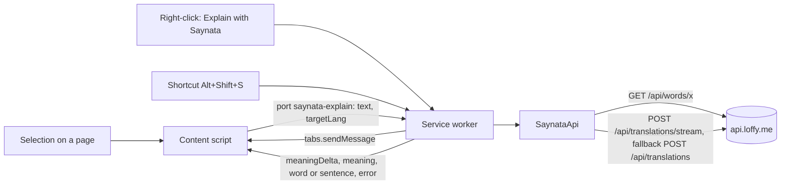
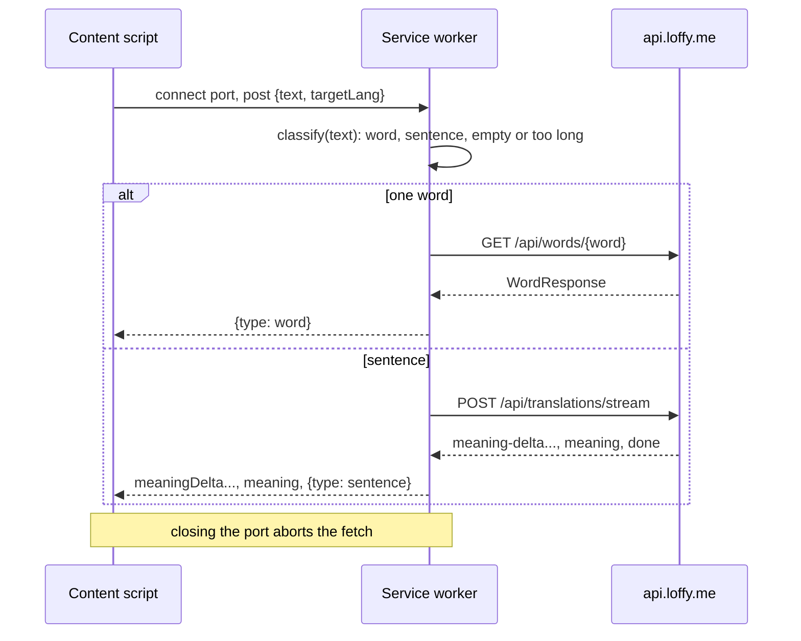

# Browser extension

> Status: **built** (TASK-86.1 API client, stream, tests, CI; 86.2 selection icon and card; 86.4 settings popup; 86.3 email-code sign-in). Checked with unit tests and a browser harness that fakes `chrome.*`; not yet loaded unpacked in Brave against the real server. Last traced from code: 2026-10-16 (sign-in in a tab, saved step, six code boxes: the developer's Brave test found that the popup closed while they read the code).
> Plan: [doc-16](../doc-16%20-%20Plan-Mac-menu-bar-app-and-browser-extension.md) Part 2, option A. Related: [Sentence translation](doc-4%20-%20Sentence-translation.md) (the stream), [Word lookup](doc-5%20-%20Word-lookup.md), [Accounts and limits](doc-17%20-%20Accounts-and-limits.md).

## What it does

A Chromium Manifest V3 extension (Brave, Chrome, Edge, Arc) in `extension/`. The user selects English on any web page and gets the same answer as the app: one word goes to `GET /api/words/{word}`, more than one to `POST /api/translations/stream`, so the meaning grows word by word. It follows the product rule: simple English first, words next, the target language last and closed.

## Big picture

**Why the service worker makes every call:** an extension page or service worker with `host_permissions` for the API origin is not bound by CORS, so the backend needs no change (its CORS rule covers only `/api/admin/**`). A content script runs with the page's origin and would need CORS.

## Step by step

| Step | File | What happens |
|---|---|---|
| Word or sentence | [textKind.ts:27](../../../extension/src/shared/textKind.ts#L27) | Collapses spaces, makes curly quotes straight. Over 500 characters is refused before any request. [wordQuery:36](../../../extension/src/shared/textKind.ts#L36): one token, or a/an/the plus one token (like the app, TASK-44), edge punctuation stripped, only letters, `'` and `-`, 1-64 characters (the word API's rule). |
| Word | [api.ts:167](../../../extension/src/shared/api.ts#L167) | `GET /api/words/{word}`. |
| Sentence | [api.ts:177](../../../extension/src/shared/api.ts#L177) | The stream first. If it fails with anything but a final 4xx answer or a cancel, `POST /api/translations` once (same as the iOS `explainWithFallback`). |
| Stream | [api.ts:204](../../../extension/src/shared/api.ts#L204), [sse.ts](../../../extension/src/shared/sse.ts) | Reads the body chunk by chunk through `SseParser` (lines may be cut anywhere, also inside a multi-byte character). `meaning-delta` gives new characters, `meaning` the full text (it wins), `done` the full `TranslationResponse`, `error` an `ApiError`. An end without `done` is `streamEnded` (then the fallback). |
| Bearer and retry | [api.ts:264](../../../extension/src/shared/api.ts#L264) | The token comes from a `TokenSource` (a guest has none). A 401 **with** a token refreshes once and runs the request again; the stream does the same for an `error` event with status 401 ([api.ts:274](../../../extension/src/shared/api.ts#L274)). A guest's 401 goes straight to the card. |
| Port | [background/index.ts:29](../../../extension/src/background/index.ts#L29), [explain.ts](../../../extension/src/shared/explain.ts) | One port per explanation; its events are typed in [messages.ts](../../../extension/src/shared/messages.ts). |
| Menu and shortcut | [background/index.ts:16](../../../extension/src/background/index.ts#L16), [:24](../../../extension/src/background/index.ts#L24) | "Explain with Saynata" on selected text; command `explain-selection` (default Alt+Shift+S, change it at `brave://extensions/shortcuts`). Tabs opened before the install get the content script on the first use ([sendToTab:49](../../../extension/src/background/index.ts#L49), through `activeTab` + `scripting`). |
| Icon | [content/index.ts:94](../../../extension/src/content/index.ts#L94), [placement.ts:30](../../../extension/src/content/placement.ts#L30) | After a mouse-up or a Shift selection, a round teal "S" (icon A, doc-7 10-16) appears just below the end of the selection's last line, inside the viewport. Not while typing in a field ([isEditing:238](../../../extension/src/content/index.ts#L238)). A mousedown on it keeps the page selection. It goes away on a click elsewhere, Escape, or an empty selection. |
| Card | [content/index.ts:148](../../../extension/src/content/index.ts#L148), [placeCard:66](../../../extension/src/content/placement.ts#L66) | **Beside the text, centred on it** (the developer's rule, doc-7 10-17): to the right of the selection with a 10 px gap, its vertical centre level with the text's centre; on the left when the right has no room; when neither side has room, under the whole selection centred on it, then over it. A wide multi-line selection (wider than half the window) is placed against its last line. Kept inside the window with an 8 px margin; beside the text the card never covers it. The side and the left edge are chosen once, from the first render's size. While the answer arrives the top follows the height, so the centre stays on the text; once it is complete the top is frozen, and a row, an opened word or a picture only grows the card downward. At the window's bottom it scrolls inside (`max-height`, 560 px at most) instead of moving. The settings (language, Show translation) are read when it opens. Closes on the Close button, Escape, or a click outside; closing disconnects the port, which aborts the request. Lives in a **closed Shadow DOM** (`<saynata-popover>`), so page CSS and scripts cannot reach it, and inline styles need no page CSP. |
| Card content | [card.ts:65](../../../extension/src/content/card.ts#L65), [renderCard:154](../../../extension/src/content/card.ts#L154) | `applyEvent` is a pure reducer: deltas add to the meaning (with a caret), the full `meaning` wins. Sentence: the quoted text with Listen, Copy and Close; Meaning; Words (word, gloss, word-type chip); the target-language row last. Word ([wordBody:234](../../../extension/src/content/card.ts#L234)): headword, IPA, Listen, Close; each sense with a number (when more than one), the simple definition, a `adj · B2` chip and the first example; then Vietnamese. Empty senses: "This doesn't look like an English word." |
| Pictures | [media.ts:28](../../../extension/src/content/media.ts#L28), [wordBody:234](../../../extension/src/content/card.ts#L234) | Option A (doc-7 10-16): each sense's `imageUrl` as a 240x135 frame under its meaning, before the example, like the iOS `SenseMediaView`. A `.mp4` clip plays muted and loops. Only addresses on our API origin under `/media/` are shown. The frame keeps its size and fades the picture in, so nothing jumps. `MediaNodes` keeps one node per address while the card is open, so a re-render (Listen, a row) does not restart a clip; closing the card drops them. **Strict sites:** when the page's CSP blocks our server (`img-src`/`media-src`), the ``/`<video>` fires `error` and is swapped for an iframe of the extension page [public/media.html](../../../extension/public/media.html) (`web_accessible_resources`), which page CSP does not cover. |
| Open a word | [card.ts:210](../../../extension/src/content/card.ts#L210), [applyOpenedEvent:88](../../../extension/src/content/card.ts#L88), [content/index.ts:179](../../../extension/src/content/index.ts#L179) | Each single word in the sentence card's Words list has a round icon-only arrow ("Open reluctant"); a phrase ("went ahead") has none, because the word API takes one word. It opens that word's card in the same popover (`GET /api/words/{word}` on its own port), with a Back arrow at the left of the header. The sentence answer is kept in `state`, so Back shows it again with no request; Back cancels a word still loading. A guest's uncached word shows the sign-in card inside the word view, and after sign-in the word is asked again. |
| Target-language row | [fold:218](../../../extension/src/content/card.ts#L218), [settings.ts:47](../../../extension/src/shared/settings.ts#L47) | Titled with the language name, closed unless Show translation says otherwise (Collapsed default, Always open, Remember last choice: `lastRowOpen` is saved on every toggle, like iOS `TranslationRowPreference`). |
| Sign-in | [accountView.ts:67](../../../extension/src/popup/accountView.ts#L67), [background/index.ts:54](../../../extension/src/background/index.ts#L54) | The toolbar popup closes as soon as it loses focus (for example when you switch to your mail to read the code), so it only shows a round **Sign in** button; the form opens in a **tab** (`popup/index.html?tab=1`) that stays open. Same steps as the approved iOS sheet (option A): email and a round icon-only send button (`POST /api/auth/email-code`); then the code in **six boxes** over one `one-time-code` field ([codeBoxes:227](../../../extension/src/popup/accountView.ts#L227)), so typing, paste and autofill fill all six; only digits are kept and a pasted "Code: 123456" works ([extractCode:55](../../../extension/src/popup/accountView.ts#L55)); checked as soon as it has 6 digits (`POST /api/auth/verify`), with "Send a new code" and "Use another email"; signed in: the email and an icon-only Sign out. The step in progress (`signInPending`: email and when the code was sent) is saved in `chrome.storage.local`, so the page (or the popup) opened again goes straight to the code boxes for that email while the code can still work (10 minutes). A right code, Sign out and "Use another email" clear it. The page never changes the session: it sends `RuntimeRequest`s to the service worker, which checks `sender.id`. |
| Session | [auth.ts:102](../../../extension/src/shared/auth.ts#L102) | `AuthStore` keeps `{accessToken, refreshToken, user}` under `session` in `chrome.storage.local` (this browser only, not synced) and is the API's `TokenSource`. [refreshedAccessToken:142](../../../extension/src/shared/auth.ts#L142): calls that fail together share one refresh (a refresh token works once; a second use revokes every session, doc-17); a newer token already saved is returned as it is; `invalid_refresh_token` signs out and gives null (then the card asks to sign in); a network error keeps the session. Sign out clears the browser first, then tells the server ([signOut:130](../../../extension/src/shared/auth.ts#L130)). |
| Sign in from a card | [background/index.ts:86](../../../extension/src/background/index.ts#L86), [content/index.ts:97](../../../extension/src/content/index.ts#L97) | The guest card's round Sign in button (and the popup's) asks the worker to open the sign-in tab, or to bring an open one to the front. The tab closes itself after a right code. When the session appears, a card that asked for sign-in runs the same text again. |
| Errors on the card | [errorBlock:228](../../../extension/src/content/card.ts#L228) | A guest sees a lock and "Sign in to get a new explanation." Network, server and cut streams get a Try again icon button; final answers (not English, 4xx) do not. |
| Settings popup | [popup/index.html](../../../extension/src/popup/index.html), [settingsView.ts:15](../../../extension/src/popup/settingsView.ts#L15) | The toolbar button opens it. **Language** (the 9 backend languages, default Vietnamese) and **Show translation** (Collapsed, Always open, Remember last choice, with a checkmark), the same as the iOS Settings screen. Saved at once in `chrome.storage.sync`; the next card uses them. English has no target-language row (the app's rule). The hint at the bottom shows the shortcut the user set. |
| Listen | [speech.ts](../../../extension/src/content/speech.ts) | `speechSynthesis`, `en-US`, a local US voice when there is one; the button turns into Stop while it reads. |
| Build | [scripts/build.mjs](../../../extension/scripts/build.mjs) | Vite builds each entry alone (a content script cannot import modules): `background.js` (ES module), `content.js` (IIFE), the popup, and writes `manifest.json`. `VITE_API_BASE=http://localhost:8081 npm run build` points it at a local backend (and asks host permission for that origin). |

## Errors

| Cause | Where | HTTP | What the user sees |
|---|---|---|---|
| Guest asks for a new sentence or an uncached word | `ClaudeGate` | 401 `sign_in_required` | "Sign in to get a new explanation." |
| Too many requests | `ClaudeGate`, per-IP filter | 429 `rate_limited` | "Too many requests. Try again in N minutes." (`Retry-After`, whole minutes; "in a little while" without it) |
| Today's budget used up | `ClaudeGate` | 503 `daily_limit_reached` | The server's message |
| Not English | Claude | 422 | The server's message |
| No network | fetch | - | "Can't reach Saynata. Check your connection and try again." |
| Over 500 characters / nothing selected | `classify` | - | "Select up to 500 characters." / "Select some English text first." |

## Tests

`cd extension && npm test` (Vitest). CI job "Browser extension": `npm ci`, `npm test`, `npm run build`.

| Test file | What it covers |
|---|---|
| [textKind.test.ts](../../../extension/test/textKind.test.ts) | Word vs sentence, articles, punctuation, `'` and `-`, digits, 64-character limit, empty, over 500, curly quotes |
| [sse.test.ts](../../../extension/test/sse.test.ts) | Events cut at every position, `\r\n`, a multi-byte character cut between chunks, comments, id/retry |
| [api.test.ts](../../../extension/test/api.test.ts) | Word URL, Bearer, refresh once then retry, only one retry, failed refresh, guest 401 with no refresh, network error; stream order, cache hit, coded error event, 422 final, 401 event refresh, fallback after an early end and a 5xx, no fallback after a cancel; error mapping and Retry-After |
| [card.test.ts](../../../extension/test/card.test.ts) (jsdom) | Deltas grow, full meaning wins; sentence order Meaning, Words, target language last; row closed by default, open when set, named after the language; icon-only buttons with labels; Listen reads the sentence; word card (headword, IPA, chip, example, Vietnamese last, no row for other languages, not-a-word message); guest card with and without the sign-in action; Try again only for errors that can change; Open buttons only on single words, the opened word card with Back, the sentence kept while a word is open, sign-in inside the word view; the picture under its meaning and before the example |
| [media.test.ts](../../../extension/test/media.test.ts) (jsdom) | Only our `/media/` addresses, clip vs picture, a muted looping video, the same node twice, another site gives nothing, the extension page after a blocked picture, the loaded mark |
| [placement.test.ts](../../../extension/test/placement.test.ts) | Icon below the end of the line, page scroll, right and bottom edges; card right of the text with the centres level, left when the right has no room, below centred when neither side has room, above when below has less room, clamped at the top and bottom margins without covering the text, the last line of a wide multi-line selection, below starts under the whole selection, page scroll, a frozen top with the card scrolling inside, the 560 px cap |
| [settings.test.ts](../../../extension/test/settings.test.ts) | Defaults, saved and broken values, save, how the row starts in each mode |
| [settingsView.test.ts](../../../extension/test/settingsView.test.ts) (jsdom) | The 9 languages, the saved one picked, three options with Collapsed checked, saving a mode and a language, the footer names the language |
| [auth.test.ts](../../../extension/test/auth.test.ts) | Request and verify bodies, error texts (wrong code, bad email, 429 with Retry-After, ended session, 500), network; session saved, sign out even when the server fails, one shared refresh, newer token reused, refused refresh signs out, network error keeps the session, Bearer then refresh and retry through the API |
| [accountView.test.ts](../../../extension/test/accountView.test.ts) (jsdom) | Code from typed or pasted text; a saved step is used only for 10 minutes; the popup shows only a Sign in button that opens the page, and says when a code is waiting; email check before sending; the step saved when the code is sent; the page opened again goes to the code boxes; an old step is ignored; sign-in at 6 digits clears the step; a pasted "Code: 123456" signs in; wrong code message and empty boxes; Send a new code; Use another email forgets the step; signed-in row and Sign out |
| [explain.test.ts](../../../extension/test/explain.test.ts) | Word vs stream routing, event order, one error event, no request for empty or long text |

## Change checklist

- A new target language in `TargetLanguage.java`: add it to [languages.ts](../../../extension/src/shared/languages.ts).
- A new stream event or field: [api.ts](../../../extension/src/shared/api.ts) `stream`, and doc-4.
- A new error `code`: `errorFrom` in [api.ts](../../../extension/src/shared/api.ts).
- The card's colours: [styles.ts](../../../extension/src/content/styles.ts) copies the app palette (`docs/design/design-system.md`); change both.
- A new permission or host: [scripts/build.mjs](../../../extension/scripts/build.mjs) `manifest()`.

## Known gaps

- The tokens are in `chrome.storage.local`, which content scripts can read too. Pages cannot, but a compromised page process could. `storage.session` is safer but is cleared when the browser closes, so the user would sign in every day.
- The extension and the iOS app have separate sessions (one sign-in each).

- A word's target-language row exists only for Vietnamese (the dictionary has no other language). The iOS app translates on the device with Apple Translation; the extension has no such API in Brave yet.
- Sentence words have no CEFR level in the chip (the sentence API sends only the word type; the app adds the level from its bundled dictionary).
- Sentence words have no picture (the sentence API has none); the picture shows when the word is opened.
- The card does not follow text that moves after it opens (for example a page that re-flows); it stays where the selection was.

- Not in the Chrome Web Store: load it unpacked. Safari comes later inside the Mac app (doc-16).
- Selected text is sent to api.loffy.me and Claude (personal text is never cached on the server, but it is still sent). The manifest description says so.
