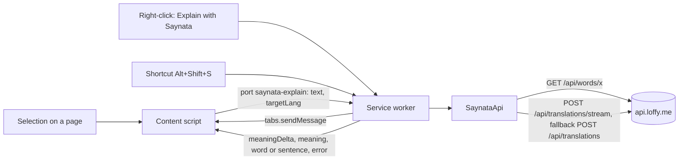
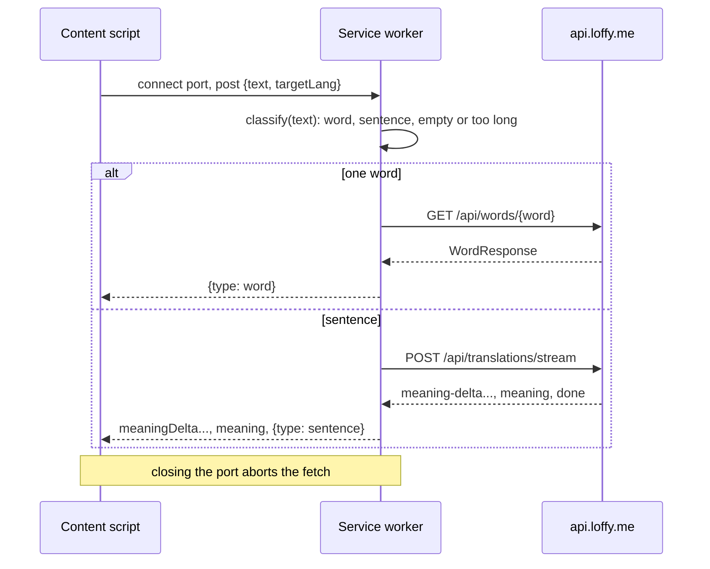

# Browser extension

> Status: **TASK-86.1 built** (skeleton, API client, stream, tests, CI). The selection icon and card (TASK-86.2), the settings popup (TASK-86.4) and sign-in (TASK-86.3) come next. Last traced from code: 2026-10-16.
> Plan: [doc-16](../doc-16%20-%20Plan-Mac-menu-bar-app-and-browser-extension.md) Part 2, option A. Related: [Sentence translation](doc-4%20-%20Sentence-translation.md) (the stream), [Word lookup](doc-5%20-%20Word-lookup.md), [Accounts and limits](doc-17%20-%20Accounts-and-limits.md).

## What it does

A Chromium Manifest V3 extension (Brave, Chrome, Edge, Arc) in `extension/`. The user selects English on any web page and gets the same answer as the app: one word goes to `GET /api/words/{word}`, more than one to `POST /api/translations/stream`, so the meaning grows word by word. It follows the product rule: simple English first, words next, the target language last and closed.

## Big picture

**Why the service worker makes every call:** an extension page or service worker with `host_permissions` for the API origin is not bound by CORS, so the backend needs no change (its CORS rule covers only `/api/admin/**`). A content script runs with the page's origin and would need CORS.

## Step by step

| Step | File | What happens |
|---|---|---|
| Word or sentence | [textKind.ts:27](../../../extension/src/shared/textKind.ts#L27) | Collapses spaces, makes curly quotes straight. Over 500 characters is refused before any request. [wordQuery:36](../../../extension/src/shared/textKind.ts#L36): one token, or a/an/the plus one token (like the app, TASK-44), edge punctuation stripped, only letters, `'` and `-`, 1-64 characters (the word API's rule). |
| Word | [api.ts:167](../../../extension/src/shared/api.ts#L167) | `GET /api/words/{word}`. |
| Sentence | [api.ts:177](../../../extension/src/shared/api.ts#L177) | The stream first. If it fails with anything but a final 4xx answer or a cancel, `POST /api/translations` once (same as the iOS `explainWithFallback`). |
| Stream | [api.ts:204](../../../extension/src/shared/api.ts#L204), [sse.ts](../../../extension/src/shared/sse.ts) | Reads the body chunk by chunk through `SseParser` (lines may be cut anywhere, also inside a multi-byte character). `meaning-delta` gives new characters, `meaning` the full text (it wins), `done` the full `TranslationResponse`, `error` an `ApiError`. An end without `done` is `streamEnded` (then the fallback). |
| Bearer and retry | [api.ts:264](../../../extension/src/shared/api.ts#L264) | The token comes from a `TokenSource` (a guest has none). A 401 **with** a token refreshes once and runs the request again; the stream does the same for an `error` event with status 401 ([api.ts:274](../../../extension/src/shared/api.ts#L274)). A guest's 401 goes straight to the card. |
| Port | [background/index.ts:29](../../../extension/src/background/index.ts#L29), [explain.ts](../../../extension/src/shared/explain.ts) | One port per explanation; its events are typed in [messages.ts](../../../extension/src/shared/messages.ts). |
| Menu and shortcut | [background/index.ts:16](../../../extension/src/background/index.ts#L16), [:24](../../../extension/src/background/index.ts#L24) | "Explain with Saynata" on selected text; command `explain-selection` (default Alt+Shift+S, change it at `brave://extensions/shortcuts`). Tabs opened before the install get the content script on the first use ([sendToTab:49](../../../extension/src/background/index.ts#L49), through `activeTab` + `scripting`). |
| Build | [scripts/build.mjs](../../../extension/scripts/build.mjs) | Vite builds each entry alone (a content script cannot import modules): `background.js` (ES module), `content.js` (IIFE), the popup, and writes `manifest.json`. `VITE_API_BASE=http://localhost:8081 npm run build` points it at a local backend (and asks host permission for that origin). |

## Errors

| Cause | Where | HTTP | What the user sees |
|---|---|---|---|
| Guest asks for a new sentence or an uncached word | `ClaudeGate` | 401 `sign_in_required` | "Sign in to get a new explanation." |
| Too many requests | `ClaudeGate`, per-IP filter | 429 `rate_limited` | "Too many requests. Try again in N minutes." (`Retry-After`, whole minutes; "in a little while" without it) |
| Today's budget used up | `ClaudeGate` | 503 `daily_limit_reached` | The server's message |
| Not English | Claude | 422 | The server's message |
| No network | fetch | - | "Can't reach Saynata. Check your connection and try again." |
| Over 500 characters / nothing selected | `classify` | - | "Select up to 500 characters." / "Select some English text first." |

## Tests

`cd extension && npm test` (Vitest). CI job "Browser extension": `npm ci`, `npm test`, `npm run build`.

| Test file | What it covers |
|---|---|
| [textKind.test.ts](../../../extension/test/textKind.test.ts) | Word vs sentence, articles, punctuation, `'` and `-`, digits, 64-character limit, empty, over 500, curly quotes |
| [sse.test.ts](../../../extension/test/sse.test.ts) | Events cut at every position, `\r\n`, a multi-byte character cut between chunks, comments, id/retry |
| [api.test.ts](../../../extension/test/api.test.ts) | Word URL, Bearer, refresh once then retry, only one retry, failed refresh, guest 401 with no refresh, network error; stream order, cache hit, coded error event, 422 final, 401 event refresh, fallback after an early end and a 5xx, no fallback after a cancel; error mapping and Retry-After |
| [explain.test.ts](../../../extension/test/explain.test.ts) | Word vs stream routing, event order, one error event, no request for empty or long text |

## Change checklist

- A new target language in `TargetLanguage.java`: add it to [languages.ts](../../../extension/src/shared/languages.ts).
- A new stream event or field: [api.ts](../../../extension/src/shared/api.ts) `stream`, and doc-4.
- A new error `code`: `errorFrom` in [api.ts](../../../extension/src/shared/api.ts).
- A new permission or host: [scripts/build.mjs](../../../extension/scripts/build.mjs) `manifest()`.

## Known gaps

- Not in the Chrome Web Store: load it unpacked. Safari comes later inside the Mac app (doc-16).
- Selected text is sent to api.loffy.me and Claude (personal text is never cached on the server, but it is still sent). The manifest description says so.
