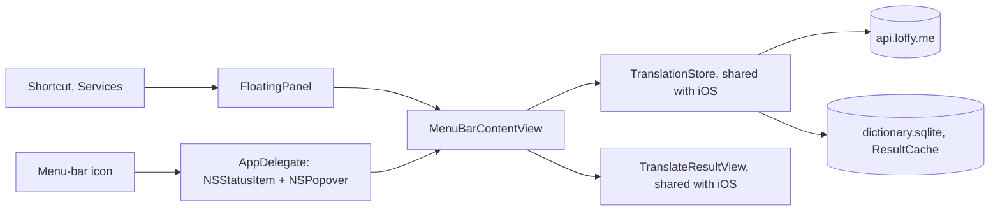

# Mac app

> Status: built: menu-bar popover (TASK-85.2), global shortcut (TASK-85.3), Services item and launch at login (TASK-85.4). Last traced from code: 2026-10-16 (panel fix).
> Plan: [doc-16](../doc-16%20-%20Plan-Mac-menu-bar-app-and-browser-extension.md) Part 1. Decisions: doc-7, 10-16.

## What it does

Saynata lives in the Mac menu bar, with no Dock icon. A click on the book icon opens a popover under it (420 × 560 pt). The shortcut ⌥⇧Space opens the same content in a floating panel near the top middle of the screen, like Spotlight. Both put the cursor in the input box. Type a word or a sentence and press Return: the result is the same as on the iPhone, the simple English explanation first, then the words, then the target language, folded.

In any app, select text, then right-click → Services → **Explain with Saynata**: the popover opens and explains it. Settings → Start → **Open at login** starts Saynata with the Mac.

## Big picture

**How the code is shared.** The `SaynataMac` target compiles the iOS app folder `EnglishTranslation/EnglishTranslation/` too, like the extensions (doc-10). The project's exception list leaves out the iPhone-only screen (`ContentView`, `TranslateView`, the input and options views), the gallery and the lessons. The few UIKit/AppKit differences are in [PlatformSupport.swift](../../../EnglishTranslation/EnglishTranslation/Platform/PlatformSupport.swift) (image type, clipboard, spell checker, email field, navigation title) and in small `#if os(...)` blocks (the clip player in `SenseMediaView`, `OneTimeCodeField`, `AVAudioSession`, the cache folder).

## Step by step

| Step | File | What happens |
|---|---|---|
| Start | [AppDelegate.swift:33](../../../EnglishTranslation/SaynataMac/AppDelegate.swift#L33) | Makes the status item and a transient, light-mode popover that hosts `MenuBarContentView` with the store, the speech player, the account and `MenuBarFocus` |
| Shortcut | [AppDelegate.swift:58](../../../EnglishTranslation/SaynataMac/AppDelegate.swift#L58) | [KeyboardShortcuts](https://github.com/sindresorhus/KeyboardShortcuts) (MIT, 2.4) calls [`toggleFromShortcut`](../../../EnglishTranslation/SaynataMac/AppDelegate.swift#L132) on key up (opens the panel, or closes what is open). Text copied in the last 20 seconds is explained at once (see "Books" below). The name and default ⌥⇧Space are in [MacSettingsSections.swift](../../../EnglishTranslation/SaynataMac/MacSettingsSections.swift); Settings > Shortcut has the recorder, and the package saves the choice in UserDefaults. It uses Carbon hot keys, so no Accessibility permission |
| Click | [AppDelegate.swift:120](../../../EnglishTranslation/SaynataMac/AppDelegate.swift#L120) | A click on the icon opens the popover under it. If the icon cannot really be seen ([`isStatusItemVisible`](../../../EnglishTranslation/SaynataMac/AppDelegate.swift#L162): no window, covered, or behind the notch between `auxiliaryTopLeftArea` and `auxiliaryTopRightArea`), the panel opens instead |
| Popover | [AppDelegate.swift:144](../../../EnglishTranslation/SaynataMac/AppDelegate.swift#L144) | Activates the app (a menu-bar app is never active), shows the popover under the icon, makes it key and asks for focus |
| Panel | [AppDelegate.swift:154](../../../EnglishTranslation/SaynataMac/AppDelegate.swift#L154), [FloatingPanel.swift](../../../EnglishTranslation/SaynataMac/FloatingPanel.swift) | The shortcut, the Services item and a hidden icon open a Spotlight-style panel: the same view, 420 × 560 pt, centred on the screen with the mouse, a sixth of the way down. Non-activating (the other app stays in front) but it takes the keyboard. Esc or a click outside closes it; an open sheet keeps it open |
| Focus | [MenuBarContentView.swift:13](../../../EnglishTranslation/SaynataMac/MenuBarContentView.swift#L13) | Watches `MenuBarFocus.request` and puts the cursor in the box |
| Explain | [MenuBarContentView.swift:115](../../../EnglishTranslation/SaynataMac/MenuBarContentView.swift#L115) | Return or the arrow button runs `TranslationStore.translate()`, the same code as iOS |
| Result | [MenuBarContentView.swift:34](../../../EnglishTranslation/SaynataMac/MenuBarContentView.swift#L34) | `TranslateResultView`: word card or the sentence card (TASK-89.2: the sentence and its simple summary in one card, speakers, folded target language). Every word is a tappable link with a dotted underline and opens the word card in a sheet. Selecting text uses the normal Mac menu; the popup for a selected part is **iOS only for now** (the Mac uses a `Text` with links, not an `NSTextView`) |
| Sign in | [MenuBarContentView.swift:52](../../../EnglishTranslation/SaynataMac/MenuBarContentView.swift#L52) | `sign_in_required` opens the shared `SignInSheet` as a sheet on the popover. On the Mac it has a Close button (Esc) |
| Services | [AppDelegate.swift:188](../../../EnglishTranslation/SaynataMac/AppDelegate.swift#L188) | `NSServices` in [Info.plist](../../../EnglishTranslation/SaynataMac/Info.plist) declares "Explain with Saynata" for plain text; `NSApp.servicesProvider = self` at start. macOS calls `explainSelection` with the selected text on a pasteboard, which calls `explain(_:)`. No Accessibility permission |
| Login | [MacSettingsSections.swift:52](../../../EnglishTranslation/SaynataMac/MacSettingsSections.swift#L52) | Settings → Start → Open at login: `SMAppService.mainApp.register()` / `unregister()`. If macOS wants approval, the footer says where |
| Close | [AppDelegate.swift:175](../../../EnglishTranslation/SaynataMac/AppDelegate.swift#L175) | A click outside or Esc closes the popover; speech stops |

## Books and other apps without Services

macOS has **no "default translation app" setting**: Apple's `TranslationUIProvider` (what the iPhone's `TranslationExtension` uses) is `@available(macOS, unavailable)` in the SDK, so the Mac's Translate menu item always opens Apple's own translator.

Apple's Books guide lists no Services item in the right-click menu on a selection (only highlights, underline and notes; not checked on this Mac). Two ways that work without permissions:

1. **Select, ⌘C, ⌥⇧Space.** [CopiedTextWatcher.swift](../../../EnglishTranslation/SaynataMac/CopiedTextWatcher.swift) notes when the clipboard changes (it reads only the change count every half second). On the shortcut, a copy from the last 20 seconds is read once, cleaned by [CopiedText.swift](../../../EnglishTranslation/EnglishTranslation/Translation/CopiedText.swift) (Books adds "Excerpt From … This material may be protected by copyright." and curly quotes), and explained. Saynata's own Copy button is ignored. Settings → Shortcut → **Explain copied text** turns it off.
2. **Books menu → Services → Explain with Saynata** in the menu bar, when Books offers it for the selection.

Reading the selection with no ⌘C would need Accessibility permission. Sandboxed apps cannot reliably get it (Apple forum reports), so it would mean turning off the sandbox. Not built.

## Sign-in and storage

- The Mac app signs in with the same email code as iOS (doc-17). Its tokens are in the Mac's Keychain (`SecretStore`). It does not share the iPhone's sign-in.
- The app is sandboxed (network client only). The result cache is in its own container: `~/Library/Containers/com.luke.EnglishTranslation.Mac/Data/Library/Application Support/result-cache.sqlite`.

## Errors

The same as the iPhone app: `sign_in_required` opens the sign-in sheet, `rate_limited` and `daily_limit_reached` show the store's error text (doc-17).

## Tests

`CopiedTextTests` (iOS test target) covers the Books citation, one word, plain text and inner quotes.

No Mac-only tests yet: all the logic is the shared code, tested by `EnglishTranslationTests` on iOS. For a quick look without clicking, a Debug build takes `-explain "<text>" -snapshot` (and `-pressShortcut`, which acts as a shortcut press after 3 s): it opens the popover, explains the text and saves `saynata-popover.png` in the app's temp folder after 6 s.

## Change checklist

- A new file in `EnglishTranslation/EnglishTranslation/` is in the Mac app too. If it uses UIKit, wrap it or add it to the Mac target's exception list in the project.
- A new iPhone-only screen: add it to the exception lists of the Mac target and both extensions.

## Known gaps

- A new Services item may only show after the app ran once (or after `/System/Library/CoreServices/pbs -update`). It is also in System Settings → Keyboard → Keyboard Shortcuts → Services, where the user can give it its own keys.
- "Shortcut explains the selection" (reading the selection without Services) needs Accessibility permission; not built (doc-16, optional).
- On the Mac, `List` footers in Settings are cut to one line.
- The Mac app has no app icon of its own yet (the generic one shows in Finder).
- Sharing the iPhone's sign-in needs iCloud Keychain and a paid account.
- Giving the app to other people needs a paid account (Developer ID signing and notarization).
