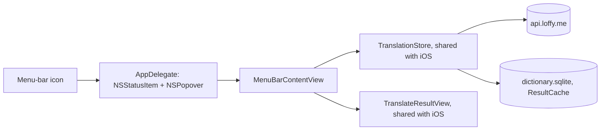

# Mac app

> Status: menu-bar popover built (TASK-85.2); shortcut (TASK-85.3) and Services + launch at login (TASK-85.4) next. Last traced from code: 2026-10-16.
> Plan: [doc-16](../doc-16%20-%20Plan-Mac-menu-bar-app-and-browser-extension.md) Part 1. Decisions: doc-7, 10-16.

## What it does

Saynata lives in the Mac menu bar, with no Dock icon. A click on the book icon opens a popover (420 × 560 pt) with the cursor in the input box. Type a word or a sentence and press Return: the result is the same as on the iPhone, the simple English explanation first, then the words, then the target language, folded.

## Big picture

**How the code is shared.** The `SaynataMac` target compiles the iOS app folder `EnglishTranslation/EnglishTranslation/` too, like the extensions (doc-10). The project's exception list leaves out the iPhone-only screen (`ContentView`, `TranslateView`, the input and options views), the gallery and the lessons. The few UIKit/AppKit differences are in [PlatformSupport.swift](../../../EnglishTranslation/EnglishTranslation/Platform/PlatformSupport.swift) (image type, clipboard, spell checker, email field, navigation title) and in small `#if os(...)` blocks (the clip player in `SenseMediaView`, `OneTimeCodeField`, `AVAudioSession`, the cache folder).

## Step by step

| Step | File | What happens |
|---|---|---|
| Start | [AppDelegate.swift:24](../../../EnglishTranslation/SaynataMac/AppDelegate.swift#L24) | Makes the status item and a transient, light-mode popover that hosts `MenuBarContentView` with the store, the speech player, the account and `MenuBarFocus` |
| Open | [AppDelegate.swift:76](../../../EnglishTranslation/SaynataMac/AppDelegate.swift#L76) | Activates the app (a menu-bar app is never active), shows the popover, makes it key and asks for focus |
| Focus | [MenuBarContentView.swift:13](../../../EnglishTranslation/SaynataMac/MenuBarContentView.swift#L13) | Watches `MenuBarFocus.request` and puts the cursor in the box |
| Explain | [MenuBarContentView.swift:113](../../../EnglishTranslation/SaynataMac/MenuBarContentView.swift#L113) | Return or the arrow button runs `TranslationStore.translate()`, the same code as iOS |
| Result | [MenuBarContentView.swift:34](../../../EnglishTranslation/SaynataMac/MenuBarContentView.swift#L34) | `TranslateResultView`: word card or sentence cards, speakers, folded target language |
| Sign in | [MenuBarContentView.swift:52](../../../EnglishTranslation/SaynataMac/MenuBarContentView.swift#L52) | `sign_in_required` opens the shared `SignInSheet` as a sheet on the popover. On the Mac it has a Close button (Esc) |
| Close | [AppDelegate.swift:85](../../../EnglishTranslation/SaynataMac/AppDelegate.swift#L85) | A click outside or Esc closes the popover; speech stops |

## Sign-in and storage

- The Mac app signs in with the same email code as iOS (doc-17). Its tokens are in the Mac's Keychain (`SecretStore`). It does not share the iPhone's sign-in.
- The app is sandboxed (network client only). The result cache is in its own container: `~/Library/Containers/com.luke.EnglishTranslation.Mac/Data/Library/Application Support/result-cache.sqlite`.

## Errors

The same as the iPhone app: `sign_in_required` opens the sign-in sheet, `rate_limited` and `daily_limit_reached` show the store's error text (doc-17).

## Tests

No Mac-only tests yet: all the logic is the shared code, tested by `EnglishTranslationTests` on iOS. For a quick look without clicking, a Debug build takes `-explain "<text>" -snapshot`: it opens the popover, explains the text and saves `saynata-popover.png` in the app's temp folder after 6 s.

## Change checklist

- A new file in `EnglishTranslation/EnglishTranslation/` is in the Mac app too. If it uses UIKit, wrap it or add it to the Mac target's exception list in the project.
- A new iPhone-only screen: add it to the exception lists of the Mac target and both extensions.

## Known gaps

- No global shortcut yet (TASK-85.3), no Services item and no launch at login yet (TASK-85.4).
- The Mac app has no app icon of its own yet (the generic one shows in Finder).
- Sharing the iPhone's sign-in needs iCloud Keychain and a paid account.
- Giving the app to other people needs a paid account (Developer ID signing and notarization).
