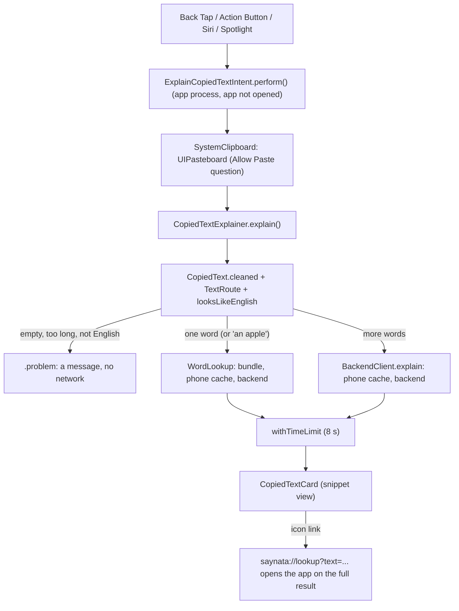

# Explain copied text (Back Tap and Action Button)

> Status: **built** (TASK-87), tested in the iPhone 16 Pro (iOS 18.5) simulator through the Shortcuts app. Back Tap and the Action Button need a real phone. Last traced from code: 2026-10-17.
> Spec: R1, R2 in [Vision and spec](../doc-1%20-%20Vision-and-spec.md). Builds on [Word lookup](doc-5%20-%20Word-lookup.md) and [Sentence translation](doc-4%20-%20Sentence-translation.md).

## What it does

The user copies text in any app, then double-taps the back of the phone (Back Tap) or presses the Action Button. A Shortcuts card opens on top of that app, and Saynata itself does not open. The card shows the simple English meaning first (layout B: up to three senses for a word; the meaning and up to three words for a sentence) and the Vietnamese line last, small. An icon-only link opens the full result in Saynata.

iOS cannot draw over other apps, so a Shortcuts card is the fastest way that works on older phones too: Back Tap needs an iPhone 8 or later on iOS 14+, the Action Button an iPhone 15 Pro or later.

## Big picture

## Step by step

| Step | File | What happens |
|---|---|---|
| 1 | [ExplainCopiedTextIntent.swift:26](../../../EnglishTranslation/EnglishTranslation/Intents/ExplainCopiedTextIntent.swift#L26) | `openAppWhenRun = false`, so the intent runs in the background and returns a snippet view. An optional `text` parameter lets a user's own shortcut pass text; empty means the clipboard. |
| 2 | [ExplainCopiedTextIntent.swift:38](../../../EnglishTranslation/EnglishTranslation/Intents/ExplainCopiedTextIntent.swift#L38) | `SystemClipboard` checks `hasStrings` first (no permission question), then reads `UIPasteboard.general.string`, which shows iOS's "Allow Paste" question unless the user set Paste from Other Apps to Allow. |
| 3 | [CopiedTextExplainer.swift:54](../../../EnglishTranslation/EnglishTranslation/Translation/CopiedTextExplainer.swift#L54) | Cleans the text (`CopiedText`, drops the Apple Books citation), checks it with `TextRoute` (empty, over 500) and `looksLikeEnglish`, then routes by `CacheKeys.wordQuery`, the same split as the app. |
| 4 | [CopiedTextExplainer.swift:84](../../../EnglishTranslation/EnglishTranslation/Translation/CopiedTextExplainer.swift#L84) | A word goes through `WordLookup` (bundle, phone cache, backend). |
| 5 | [CopiedTextExplainer.swift:95](../../../EnglishTranslation/EnglishTranslation/Translation/CopiedTextExplainer.swift#L95) | A sentence goes through `Translating.explain` (phone cache first). Its bundled words are found offline first, so a slow or signed-out card still lists them. |
| 6 | [CopiedTextExplainer.swift:130](../../../EnglishTranslation/EnglishTranslation/Translation/CopiedTextExplainer.swift#L130) | Both race an 8-second timer: a card cannot update once it is shown, so a slow answer becomes "Still working…" instead of a long wait. Bundled and cached answers return long before. |
| 7 | [CopiedTextExplainer.swift:111](../../../EnglishTranslation/EnglishTranslation/Translation/CopiedTextExplainer.swift#L111) | Errors become cards: 401 `sign_in_required` is "Sign in to explain new text", a 4xx with a message (for example "doesn't look like English") is shown as it is, anything else is "Couldn't explain this". |
| 8 | [CopiedTextCard.swift:41](../../../EnglishTranslation/EnglishTranslation/Views/CopiedText/CopiedTextCard.swift#L41) | Layout B. The Vietnamese line is the last line, small, open (a Shortcuts card on iOS 18 cannot fold a row). |
| 9 | [SaynataShortcuts.swift:12](../../../EnglishTranslation/EnglishTranslation/Intents/SaynataShortcuts.swift#L12) | The App Shortcut, so iOS lists "Explain copied text" in the Shortcuts app, Spotlight, Siri and the Action Button with no setup. |

## The card cannot read the asset catalog

When Shortcuts draws the card, the app process logs `No color named 'Theme/TextPrimary' found in asset catalog` and the text comes out invisible (seen on the iOS 18.5 simulator). So the card uses `Theme.SnippetColors`, the same colors written as numbers ([Theme+Snippet.swift:14](../../../EnglishTranslation/EnglishTranslation/DesignSystem/Theme+Snippet.swift#L14)), and small copies of `LevelChip` and `MeaningBlock`. `ThemeSnippetColorsTests` fails if the catalog and the numbers drift apart.

## Setup on the phone

- **Action Button** (iPhone 15 Pro and later): Settings, Action Button, swipe to Shortcut, tap the shortcut name, pick Saynata, then Explain copied text. No Shortcuts app setup.
- **Back Tap** (iPhone 8 and later): Settings, Accessibility, Touch, Back Tap, Double Tap, then pick "Explain copied text" in the Shortcuts part of the list. If it is not listed there, add it to My Shortcuts once: Shortcuts app, Shortcuts tab, App Shortcuts, Saynata, touch and hold "Explain copied text", Add to My Shortcuts.
- **No paste question each time:** Settings, Apps, Saynata, Paste from Other Apps, Allow.

## The app is not built into the extensions

`Intents/` is in the membership exceptions of ShareExtension, TranslationExtension and SaynataMac in `project.pbxproj`: an `AppShortcutsProvider` belongs to the app only. `CopiedTextExplainer`, `CopiedTextCard` and `Theme+Snippet` compile everywhere (they are plain Swift and SwiftUI).

## Errors

| Cause | Where | HTTP | What the user sees |
|---|---|---|---|
| Clipboard empty or only spaces | `explain` | none | "Nothing to explain. Copy some English text, then try again." |
| Over 500 characters | `TextRoute` | none | "Text too long" with the length |
| No Latin letters, or 3+ words the recognizer is sure are another language | `looksLikeEnglish` | none | "Not English" |
| Guest, answer not cached | backend | 401 | "Sign in to explain new text", the bundled words, a person icon that opens the app (which shows its sign-in sheet) |
| No answer in 8 seconds | `withTimeLimit` | none | "Still working…", the bundled words, the open link |
| Word not English, server "no" | `WordLookup` / backend | 4xx | "Can't explain this" with the message |
| No network, other errors | backend | any | "Couldn't explain this" with the message |

## Tests

| Test file | What it covers |
|---|---|
| `EnglishTranslationTests/CopiedTextExplainerTests.swift` | Word vs sentence routing, "an apple", Books citation, empty / too long / not English, guest (word and sentence with bundled words), slow answer, fast answer not cut, server 400, no network, the open link text, the Vietnamese line without repeats |
| `EnglishTranslationTests/ThemeSnippetColorsTests.swift` | `Theme.SnippetColors` equals the asset catalog |

Run: `xcodebuild test -project EnglishTranslation/EnglishTranslation.xcodeproj -scheme EnglishTranslation -destination 'platform=iOS Simulator,name=iPhone 16 Pro,OS=18.5' -only-testing:EnglishTranslationTests -parallel-testing-enabled NO`.

## Change checklist

- A Theme color changes: update `Theme.SnippetColors` (the test tells you).
- The word or sentence lookup order changes: `CopiedTextExplainer` reuses `WordLookup` and `Translating`, so nothing else should be needed; check the card still has the meaning first.
- A new file in `Intents/`: add it to the three membership exception lists.

## Known gaps

- The card cannot play audio or fold rows (iOS 18 cards have no buttons, only links).
- The target language is always Vietnamese: the app does not save the picked language yet.
- Back Tap and the Action Button were not tested in the simulator (no hardware); the same intent was run from the Shortcuts app there.
