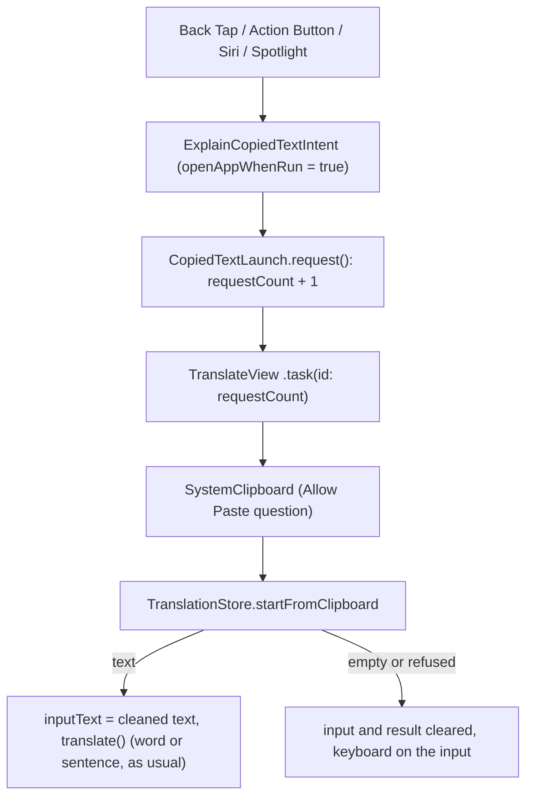
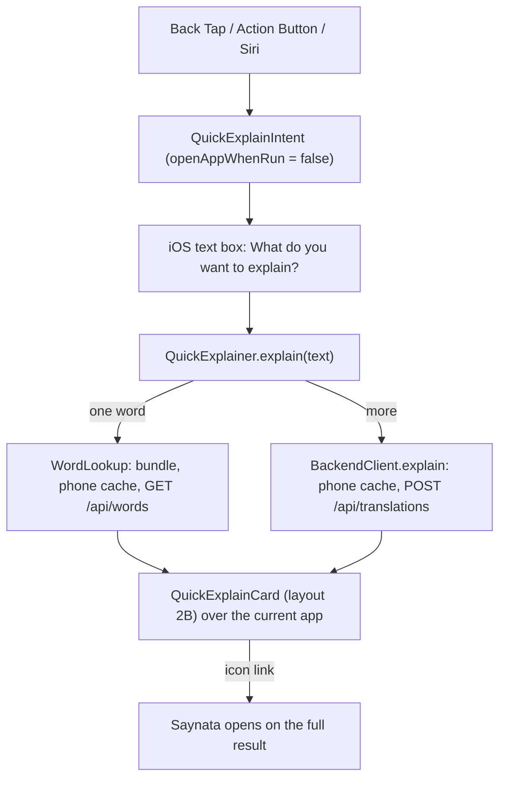

# Explain copied text and Quick explain (Back Tap and Action Button)

> Status: **built** (TASK-87; Quick explain TASK-90, tested on the iPhone 16 Pro iOS 18.5 simulator, not yet on the phone). Tested on the iPhone 17e (iOS 26.3) simulator from the Shortcuts app. The developer's iPhone 13 (iOS 26.5) runs the shortcut from Back Tap. Last traced from code: 2026-10-17 (evening).
> Spec: R1, R2 in [Vision and spec](../doc-1%20-%20Vision-and-spec.md). Builds on [Word lookup](doc-5%20-%20Word-lookup.md) and [Sentence translation](doc-4%20-%20Sentence-translation.md).

## What it does

The user copies text in any app, then double-taps the back of the phone (Back Tap) or presses the Action Button. Saynata opens with the copied text in the input and explains it at once, the same as typing it. With nothing copied (or the paste refused), the input is empty and has the keyboard, so the user types.

Back Tap works on an iPhone 8 or later (iOS 14+), the Action Button on an iPhone 15 Pro or later.

## Why it opens the app (and is not a card over the current app)

The first version (same task, same day) showed a Shortcuts card over the current app without opening Saynata. On the developer's phone (iOS 26.5) it read nothing: a background App Intent cannot show iOS's "Allow Paste" question, so the paste was refused silently, and the "Paste from Other Apps" setting never appeared (iOS adds it only after the first question). The card also had to copy the theme colors as numbers and was cut at a fixed height on iOS 26. The developer chose to open the app instead (doc-7, 10-17). The app reads the clipboard while it is on screen, so iOS asks normally.

## Big picture

## Step by step

| Step | File | What happens |
|---|---|---|
| 1 | [ExplainCopiedTextIntent.swift:21](../../../EnglishTranslation/EnglishTranslation/Intents/ExplainCopiedTextIntent.swift#L21) | `openAppWhenRun = true`: iOS opens Saynata, then `perform()` calls `CopiedTextLaunch.shared.request()`. |
| 2 | [CopiedTextLaunch.swift:31](../../../EnglishTranslation/EnglishTranslation/Translation/CopiedTextLaunch.swift#L31) | An `@Observable` counter. A count (not a flag) so two Back Taps in a row are both seen. |
| 3 | [TranslateView.swift:45](../../../EnglishTranslation/EnglishTranslation/Views/Translate/TranslateView.swift#L45) | `.task(id: requestCount)` runs on each request, and also on a cold start (the count is already 1). If a sign-in sheet was open it waits 0.5 s before focusing, since a closing sheet takes the focus. |
| 4 | [ExplainCopiedTextIntent.swift:29](../../../EnglishTranslation/EnglishTranslation/Intents/ExplainCopiedTextIntent.swift#L29) | `SystemClipboard`: `hasStrings` first (never asks), then `UIPasteboard.string` (asks "Allow Paste"). Text there but `string` nil means the user refused. |
| 5 | [TranslationStore.swift:132](../../../EnglishTranslation/EnglishTranslation/Stores/TranslationStore.swift#L132) | Closes a leftover sign-in sheet, cleans the text (`CopiedText`, drops the Apple Books citation), puts it in the input and calls `translate()`. Otherwise clears the input and result and returns true (keyboard). |
| 6 | [SaynataShortcuts.swift:12](../../../EnglishTranslation/EnglishTranslation/Intents/SaynataShortcuts.swift#L12) | The App Shortcut, so iOS lists "Explain copied text" in Shortcuts, Spotlight, Siri, Back Tap and the Action Button with no setup. |

## Setup on the phone

- **Back Tap:** Settings, Accessibility, Touch, Back Tap, Double Tap, then **Explain copied text**.
- **Action Button** (iPhone 15 Pro and later): Settings, Action Button, Shortcut, then Saynata, **Explain copied text**.
- **No paste question each time:** after the first question, Settings, Apps, Saynata, Paste from Other Apps, Allow. On iOS 26 the highlighted button of the question is Don't Allow Paste.

## The app is not built into the extensions

`Intents/` is in the membership exceptions of ShareExtension, TranslationExtension and SaynataMac in `project.pbxproj`: an `AppShortcutsProvider` belongs to the app only, and `SystemClipboard` uses UIKit. `CopiedTextLaunch` and `startFromClipboard` compile everywhere.

## Quick explain (TASK-90): a card over the current app

For words heard in a full-screen video, where opening Saynata would leave full screen. Back Tap, the Action Button or Siri runs **Quick explain**; iOS asks "What do you want to explain?" in its own small box (type, paste or speak), and a short card shows the answer over the app. Saynata does not open.

The text is a **parameter the user fills**, not the clipboard: a background App Intent cannot ask "Allow Paste" (see above), but text the user pastes into iOS's own box needs no question.

| Step | File | What happens |
|---|---|---|
| 1 | [QuickExplainIntent.swift:22](../../../EnglishTranslation/EnglishTranslation/Intents/QuickExplainIntent.swift#L22) | A required `text` parameter with the dialog "What do you want to explain?": iOS asks for it before `perform()`. `openAppWhenRun = false`. |
| 2 | [QuickExplainer.swift:49](../../../EnglishTranslation/EnglishTranslation/Translation/QuickExplainer.swift#L49) | Cleans the text (`CopiedText`), then empty, too long or not English (`looksLikeEnglish`) give a short message and no call. |
| 3 | [QuickExplainer.swift:67](../../../EnglishTranslation/EnglishTranslation/Translation/QuickExplainer.swift#L67) | One word (or "an apple") goes to the word lookup; more goes to the sentence API (non-streaming). The token is the shared App Group Keychain one (`AccountStore`, doc-17). |
| 4 | [QuickExplainer.swift:119](../../../EnglishTranslation/EnglishTranslation/Translation/QuickExplainer.swift#L119) | An 8 s limit: a card cannot show an answer that is still coming, so after that it says "Still working". |
| 5 | [QuickExplainCard.swift:42](../../../EnglishTranslation/EnglishTranslation/Views/QuickExplain/QuickExplainCard.swift#L42) | Layout 2B: a word shows its title, IPA and **first** meaning; a sentence shows the sentence (2 lines) and the meaning box; the target-language line is last, small and open (an iOS 18 card cannot fold a row). |
| 6 | [QuickExplainCard.swift:220](../../../EnglishTranslation/EnglishTranslation/Views/QuickExplain/QuickExplainCard.swift#L220) | The only control is an icon link that opens the full result in Saynata (a `Link`; buttons do not run in a card). |
| 7 | [Theme+Snippet.swift:14](../../../EnglishTranslation/EnglishTranslation/DesignSystem/Theme+Snippet.swift#L14) | The card's colors as numbers: Shortcuts cannot read the asset catalog, so `Color("Theme/...")` drew invisible text. `ThemeSnippetColorsTests` keeps them equal to the catalog. |
| 8 | [SaynataShortcuts.swift:22](../../../EnglishTranslation/EnglishTranslation/Intents/SaynataShortcuts.swift#L22) | The App Shortcut "Quick explain with Saynata". |

**Setup:** Back Tap: Settings, Accessibility, Touch, Back Tap, Double Tap (or Triple Tap), **Quick explain**. Action Button: Settings, Action Button, Shortcut, Saynata, **Quick explain**. Siri: "Quick explain with Saynata".

| Cause | What the card shows |
|---|---|
| Empty or only spaces | "Nothing to explain" |
| Over 500 characters | "Text too long" |
| Clearly not English | "Not English", no call |
| Guest, answer not cached | "Sign in to explain new text", the sentence's bundled words, the link to sign in |
| No answer in 8 s | "Still working…", the bundled words, the link |
| The server says no (4xx with a message) | "Can't explain this" and the server's message |
| Anything else | "Couldn't explain this" and the error |

## Errors

| Cause | What the user sees |
|---|---|
| Nothing copied, or only spaces | Empty input with the keyboard |
| Don't Allow Paste | Empty input with the keyboard |
| Over 500 characters | The text in the input with "Make it shorter", no request |
| Guest, answer not cached | The text in the input and the sign-in sheet (doc-17) |
| Anything else | The normal error under the input, as when typing |

## Tests

| Test file | What it covers |
|---|---|
| `EnglishTranslationTests/QuickExplainerTests.swift` | Quick explain: a word goes to the word lookup, a sentence to the sentence API, the Books citation is left out, empty / too long / non-English text is not sent, a guest is told to sign in (with bundled words), a slow answer says still working, server and network errors |
| `EnglishTranslationTests/ThemeSnippetColorsTests.swift` | The card's number colors equal the asset catalog |
| `EnglishTranslationTests/StartFromClipboardTests.swift` | A copied word is pasted and looked up, a sentence is explained, the Books citation is left out, empty / refused / spaces clear the input and the result, close the sign-in sheet and ask for the keyboard, each request is counted |

Run: `xcodebuild test -project EnglishTranslation/EnglishTranslation.xcodeproj -scheme EnglishTranslation -destination 'platform=iOS Simulator,name=iPhone 16 Pro,OS=18.5' -only-testing:EnglishTranslationTests -parallel-testing-enabled NO`.

## Change checklist

- A new file in `Intents/`: add it to the three membership exception lists.
- A color in `Assets.xcassets/Theme` changes: update `Theme.SnippetColors` (the test fails until you do).
- `TranslateView` or the input focus changes: keep the `.task(id: launch.requestCount)` and the focus after the sheet closes.

## Known gaps

- iOS asks "Allow Paste" every time until the user sets Paste from Other Apps to Allow.
- The app opens on the text; going back to the app you were in is the system "◀ App" link at the top left.
- Quick explain: on iOS 26 a card has a fixed height, so long meanings are cut at 2-3 lines.
- Quick explain: the card always uses the light colors and Vietnamese (the language picked in the app is not saved yet); for a word, other languages show no line.
- Quick explain over a full-screen YouTube video is not yet checked on the phone.
