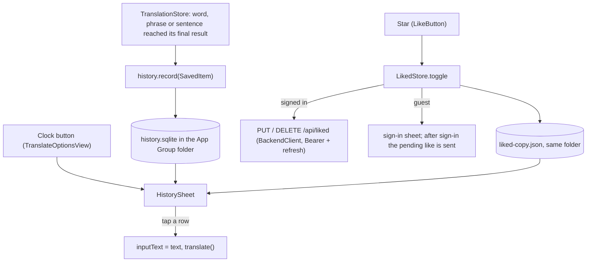

# History and Liked

> Status: **built** (TASK-93.2, iOS; the backend is TASK-93.1). Tested on the iPhone 16 Pro, iOS 18.5 simulator. Last traced from code: 2026-10-19.
> Builds on [Word lookup](doc-5%20-%20Word-lookup.md) and [Sentence translation](doc-4%20-%20Sentence-translation.md). Accounts: doc-17.

## What it does

A clock button, at the top right (the Settings hamburger is at the top left, TASK-97), opens one sheet with two lists:

- **History**: every word, phrase and sentence that reached a final result (bundle, cache or backend). It lives on the device, so it works for guests. The newest 1000 are kept; a repeat moves to the top.
- **Liked**: what the learner starred. It lives on the server per account (`/api/liked`), with a copy on the phone, so it works offline and follows the user to other devices.

Tapping a row closes the sheet, puts the text in the input and runs the normal search (a cached answer costs nothing). Swipe left deletes (History) or unlikes (Liked). The trash button clears all of History, after a question. The search box filters by the word or its short meaning. Rows are grouped by day: Today, Yesterday, then the date.

A star (icon only, "Like" / "Unlike") sits next to the speaker on the word header and on the finished sentence card.

## Big picture

## Step by step: History

| Step | File | What happens |
|---|---|---|
| 1 | [TranslationStore.swift:103](../../../EnglishTranslation/EnglishTranslation/Stores/TranslationStore.swift#L103) | `showWord` sets `.loadedWord` and records it. Used by the word path and by a cached phrase. |
| 2 | [TranslationStore.swift:221](../../../EnglishTranslation/EnglishTranslation/Stores/TranslationStore.swift#L221) | A sentence is recorded when `.loaded` is set. Never for `.meaning` (partial) or a failure. |
| 3 | [HistoryStore.swift:68](../../../EnglishTranslation/EnglishTranslation/History/HistoryStore.swift#L68) | `INSERT OR REPLACE` on the key (`word:apple`, case ignored for words), then `trim()` keeps the newest 1000 (line 116). |
| 4 | [HistoryStore.swift:24](../../../EnglishTranslation/EnglishTranslation/History/HistoryStore.swift#L24) | The file is next to `ResultCache` (same folder logic, `ResultCache.cacheFolder()`), so the Share and Translation extensions add to the same list. The Mac app uses its own Application Support folder. |
| 5 | [SavedItem.swift:1](../../../EnglishTranslation/EnglishTranslation/History/SavedItem.swift#L1) | One item: kind (`word` or `sentence`), text, short preview, a label like "verb · A2" (not for a phrase), date. The key rule is the same as in the backend. |
| 6 | [HistorySheet.swift:11](../../../EnglishTranslation/EnglishTranslation/Views/History/HistorySheet.swift#L11) | The sheet; `DayGroup.groups` ([DayGroups.swift:15](../../../EnglishTranslation/EnglishTranslation/History/DayGroups.swift#L15)) and `matching` (line 47) do the grouping and the search. |
| 7 | [TranslateOptionsView.swift:24](../../../EnglishTranslation/EnglishTranslation/Views/Translate/Subviews/TranslateOptionsView.swift#L24) | The clock button and the sheet; a tapped row sets the input and calls `translate()`. |

## Step by step: Liked

| Step | File | What happens |
|---|---|---|
| 1 | [LikeButton.swift:1](../../../EnglishTranslation/EnglishTranslation/Views/History/LikeButton.swift#L1) | The star. It reads `LikedStore` from the environment as an optional, so a screen without one just hides the star. Used in [WordCardView.swift:59](../../../EnglishTranslation/EnglishTranslation/Views/Word/WordCardView.swift#L59), [SentenceCard.swift:57](../../../EnglishTranslation/EnglishTranslation/Views/Sentence/SentenceCard.swift#L57) (only when the answer is complete) and [SelectedTextResultView.swift:144](../../../EnglishTranslation/EnglishTranslation/Views/SelectedText/SelectedTextResultView.swift#L144) (extensions). |
| 2 | [LikedStore.swift:94](../../../EnglishTranslation/EnglishTranslation/History/LikedStore.swift#L94) | `toggle`: a guest sets `pending` and `signInRequested`; a signed-in user likes or unlikes at once, then sends it. A failed call is undone (line 131). A 401 with a session asks for sign-in again. |
| 3 | [TranslateView.swift:64](../../../EnglishTranslation/EnglishTranslation/Views/Translate/TranslateView.swift#L64) | `signInRequested` opens the existing sign-in sheet; after sign-in the sheet calls `liked.signedIn()` (line 60): it sends the pending like, then loads the list. Closing the sheet drops the pending like. |
| 4 | [TranslateView.swift:70](../../../EnglishTranslation/EnglishTranslation/Views/Translate/TranslateView.swift#L70) | Signed in: `refresh()` (stars right for items liked on another device). Signed out: `clear()` empties the local copy. |
| 5 | [BackendClient.swift:373](../../../EnglishTranslation/EnglishTranslation/Network/BackendClient.swift#L373) | `GET /api/liked`, `PUT` (line 387), `DELETE ?kind=&text=` (line 396), through the same `sendChecked` / `withAuthRetry` as words. Any 2xx counts as success (the delete answers 204). |
| 6 | [LikedStore.swift:24](../../../EnglishTranslation/EnglishTranslation/History/LikedStore.swift#L24) | `LikedCopyFile`: the liked list as JSON in the App Group folder. The server keeps no label ("noun · A1"), so `refresh` keeps it from the copy. |

Extensions have no sign-in sheet: a guest who taps the star sees "Sign in from the Saynata app to like". The Mac app opens its sign-in sheet; it has no History button yet.

## Errors

| Cause | What happens |
|---|---|
| Guest taps the star | Sign-in sheet; like sent after sign-in |
| Offline or server error while liking | The star goes back, `errorMessage` is set |
| Offline when the list loads | The copy on the phone stays |
| Session ended (401 after refresh) | Sign-in sheet again; the like is sent after |
| File cannot be opened | `HistoryStore.shared` is nil: no clock button, no recording |

## Tests

`EnglishTranslationTests/HistoryStoreTests.swift` (order, repeat, 1000 cap, file, key, day groups, search) and `LikedStoreTests.swift` (guest, like, unlike, undo, offline copy, refresh, sign-out, the three API calls with a fake server, History recorded by `TranslationStore`).

## Known gaps

- The sign-in sheet still says "Sign in to explain new sentences" when it opens from the star.
- The Mac app has the star but no History button yet.
- A like made offline is undone (no queue to send it later).
- `TranslationStore` records into the shared History by default, so unit tests that make a store with defaults write to the simulator file.
