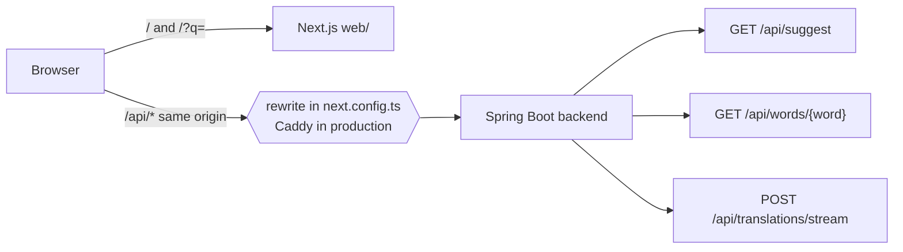
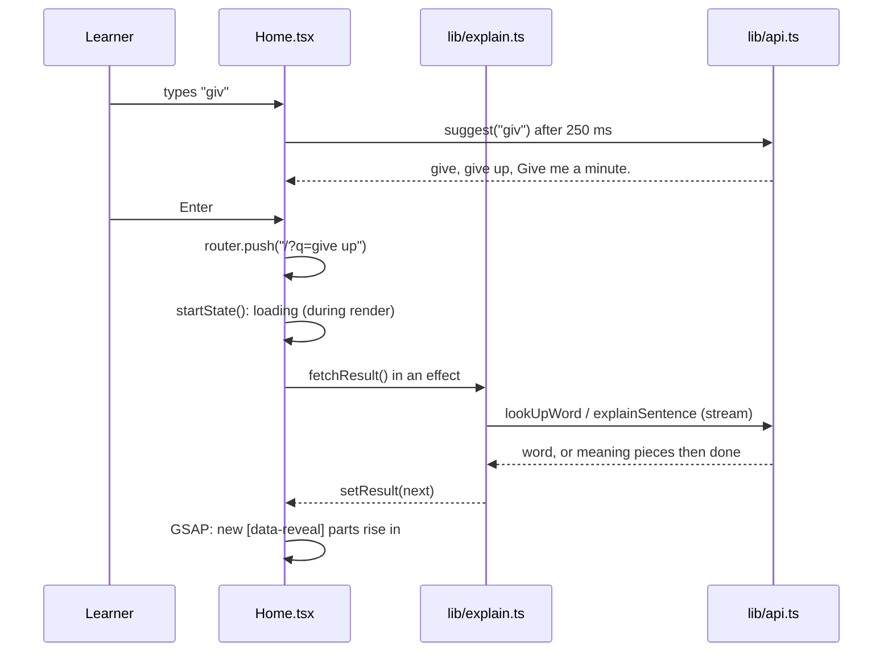
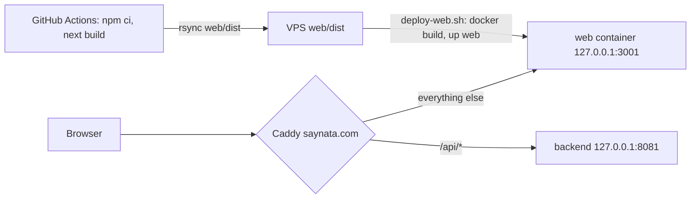

# Web app

> Status: homepage built (TASK-102.1), the other 7 MVP pages not started (TASK-102). Last traced from code: 2026-10-24 (language row, TASK-106.4).
> Spec: R1 and R2 in [Vision and spec](../doc-1%20-%20Vision-and-spec.md). Brainstorm and mockups: https://claude.ai/artifact/P4yQXKHykS8zMhFkFKtHyA

## What it does

A website for learners in `web/` (Next.js 16 App Router, Tailwind 4, GSAP). The homepage is the tool itself: type an
English word or sentence, read the simple English explanation, and open your language at the bottom only if you need it.
The text goes into the address (`/?q=give+up`), so a result can be shared, reloaded and reached with Back.
A Mochi cat (the paid sprite pack, served from the server, never from git) sits on the composer card; each visit picks one of Dance, Sleeping, Excited, Sick 1 or Box. Without the sprites, our own pixel cat sleeps there instead, wakes up while you type and hops while Saynata works.

## Big picture

The backend has no CORS setup, so the browser only calls its own origin. In dev, `next.config.ts` rewrites `/api/*` to
`SAYNATA_API_ORIGIN` (default `https://api.saynata.com`), see [next.config.ts:20](../../../web/next.config.ts#L20).

## Step by step

| Step | File | What happens |
|---|---|---|
| Page | [page.tsx](../../../web/src/app/page.tsx) | Static header and intro; `Home` inside `Suspense` because it reads `?q=` |
| State | [Home.tsx:25](../../../web/src/components/home/Home.tsx#L25) | The address is the source of truth. A new query, language or retry sets the first state during render ([Home.tsx:41](../../../web/src/components/home/Home.tsx#L41)) and an effect fetches the rest ([Home.tsx:54](../../../web/src/components/home/Home.tsx#L54)) |
| Search | [explain.ts:20](../../../web/src/lib/explain.ts#L20), [explain.ts:35](../../../web/src/lib/explain.ts#L35) | `startState` and `fetchResult`, no React, tested. One word (or a/an/the + word) goes to the word API, the rest to the sentence stream |
| Client | [api.ts:180](../../../web/src/lib/api.ts#L180) | Copied from the extension (`extension/src/shared/api.ts`) plus `suggest()`. Stream first, `POST /api/translations` once as a fallback |
| Suggestions | [Home.tsx:69](../../../web/src/components/home/Home.tsx#L69) | 1-40 characters, 250 ms after the last key, cached and bundled only, so a guest costs nothing |
| Word card | [WordCard.tsx](../../../web/src/components/home/WordCard.tsx) | Headword, IPA, Listen; one card per sense with level chip and picture or clip; Examples, How to use it and the target language as closed rows, the language last. **Language row (TASK-106.4, doc-5):** every language except English gets it ([useLanguageLines:40](../../../web/src/components/home/WordCard.tsx#L40)); the first time any row opens, one `POST /api/translate-lines` carries all sense explanations ([translateLines:203](../../../web/src/lib/api.ts#L203), [loadLines:61](../../../web/src/lib/lines.ts#L61)). The web app has no sign-in yet, so it is always a guest: `?cachedOnly=true`, never a Claude call. Lines are kept in memory per (text, language) (`LineCache`). While it loads Vietnamese shows the dictionary text and other languages a small loading bar; a guest miss shows the dictionary text (Vietnamese) or "Sign in to see this line in your language." with a link to `/sign-in` ([LanguageLine:170](../../../web/src/components/home/WordCard.tsx#L170)); an error shows a short line (Vietnamese keeps the dictionary text). What the row shows is decided by the pure [rowContent:99](../../../web/src/lib/lines.ts#L99) |
| Sentence card | [SentenceCard.tsx](../../../web/src/components/home/SentenceCard.tsx) | Original with tappable words (a tap opens the word sheet; the box, `?q=` and the sentence stay), summary that grows while it streams, key words, the target language last and closed, Copy under the card |
| Word sheet | [WordSheet.tsx](../../../web/src/components/home/WordSheet.tsx) | A word tapped in a sentence (or in its Words list) opens the same `WordCard` in a native `<dialog>` with `showModal()`: a bottom sheet on a phone, a centered card from 640 px. It looks the word up with the same `fetchResult` call as a search. Esc, a click on the backdrop and the Close button (aria-label "Close") close it; focus goes back to where it was. Like the iOS `SentenceWordSheet` |
| Language | [targetLanguage.ts](../../../web/src/lib/targetLanguage.ts) | `localStorage` through `useSyncExternalStore`; a change runs the search again |
| Speech | [speech.ts](../../../web/src/lib/speech.ts) | Web Speech API, en-US, rate 0.92 |
| Cat | [MochiCat.tsx](../../../web/src/components/MochiCat.tsx), [mochi.ts:48](../../../web/src/lib/mochi.ts#L48) | One sheet per page visit: Dance (4 frames, 6 fps), Sleep (4, 3), Excited (12, 8), Sick 1 `catsick1` (5, 4) or Box, which picks Box1 (4, 6), Box2 (12, 6) or Box3 (4, 6); the five have equal chance ([pickCat](../../../web/src/lib/mochi.ts#L36)). The pick lives in module memory, so typing, focus, re-renders and tab hide/show keep it; only a reload picks again. Frames are 32 px, shown at 3x (96 px) with `image-rendering: pixelated`; every frame ends on its bottom row, so one box on the card edge fits every sheet, IV stand included. `pointer-events: none`, `aria-hidden`. The sheet is loaded from `/cats/<file>.png`; if it fails, the own `PixelCat` is shown |

### Motion (GSAP)

All motion runs through [withMotion](../../../web/src/lib/motion.ts#L15) (`gsap.matchMedia` with
`prefers-reduced-motion: no-preference`), so reduced motion shows the final state at once.

| Moment | Where | What moves |
|---|---|---|
| Page enters, once | [Home.tsx:89](../../../web/src/components/home/Home.tsx#L89) | `[data-enter]` (intro, composer) rise and fade in, the send button pops in. CSS hides `[data-enter]` only when motion is allowed, and a `<noscript>` rule in `layout.tsx` shows it without JavaScript |
| A result arrives | [Home.tsx:103](../../../web/src/components/home/Home.tsx#L103) | Each new `[data-reveal]` part rises 12 px, 0.42 s, 0.06 s apart. Parts already shown are marked `data-shown`, so the stream finishing does not replay the card |
| Suggestions change | [Home.tsx:119](../../../web/src/components/home/Home.tsx#L119) | Chips fan out, 0.25 s, 0.03 s apart |
| The cat appears | [MochiCat.tsx:53](../../../web/src/components/MochiCat.tsx#L53) | Drops onto the card with `bounce.out` once its picture is ready (GSAP) |
| The Mochi loop | [globals.css:111](../../../web/src/app/globals.css#L111) | CSS `steps(frames)` on `background-position`, no JavaScript timer. Paused while the tab is hidden (`data-tab-hidden` on `<html>`), frame 1 only with reduced motion |
| The fallback cat | [PixelCat.tsx:68](../../../web/src/components/PixelCat.tsx#L68) | Asleep: slow breathing and three z letters; awake: faster breathing, open eyes; busy: small hops |
| The word sheet opens | [WordSheet.tsx](../../../web/src/components/home/WordSheet.tsx) | The panel rises 28 px and fades in, 0.32 s |

Folded rows open with a CSS grid-rows transition, not GSAP and not `height`, and a closed row is `inert`.

Focus: the global `:focus-visible` outline sits in `@layer base` (`globals.css`), so a Tailwind utility can turn it off. The composer textarea uses `outline-none`, and its card shows focus instead (`focus-within`: accent border and a soft ring).

## Deploy (saynata.com, TASK-102.2, moved from loffy.me in TASK-104)

`next.config.ts` sets `output: "standalone"` ([next.config.ts:11](../../../web/next.config.ts#L11)), so the build writes a small
Node server. The job `deploy-web` in [deploy.yml](../../../.github/workflows/deploy.yml) builds it on GitHub (not on the VPS: `next build`
can run out of memory there), copies server, static files and `public` to `web/dist` on the server, and runs
[deploy-web.sh](../../../web/scripts/deploy-web.sh). That builds [web/Dockerfile](../../../web/Dockerfile) (`node:22-alpine`, only a copy) and
restarts the `web` service of [docker-compose.prod.yml](../../../backend/docker-compose.prod.yml). `cacheComponents` and the prerendered
homepage work in this mode (checked with `node server.js` locally). Caddy lines, DNS and the by-hand steps: doc-11 section 14.
In production Caddy sends `/api/*` to the backend, so the rewrite in `next.config.ts` is not used.

## Errors

| Cause | Where | HTTP | What the user sees |
|---|---|---|---|
| Guest asks for something not cached | `errorMessage` in [explain.ts:79](../../../web/src/lib/explain.ts#L79) | 401 `sign_in_required` | "Sign in to explain new text. Dictionary words and common sentences work without an account." (no Sign in page yet) |
| Word not on the word list | same | 404 | "This word is not in the dictionary yet. Check the spelling." |
| Too many requests | `rateLimitMessage` in api.ts | 429 | "Too many requests. Try again in N minutes." |
| No connection | api.ts | — | "Can't reach Saynata. Check your connection and try again." |
| Over 500 characters | `startState` | — | "Make it shorter: up to 500 characters." and the counter turns red |

## Tests

`cd web && npm test` (Vitest) and `npm run build`. CI runs both (job `web`). The deploy has no unit test; its check is `curl -f https://saynata.com` at the end of `deploy-web`.

| Test file | What it covers |
|---|---|
| `web/test/api.test.ts` | The client (from the extension) and `suggest()` |
| `web/test/sse.test.ts` | The stream parser |
| `web/test/textKind.test.ts` | Word or sentence |
| `web/test/mochi.test.ts` | The five choices have equal shares, Box picks one of three, the visit keeps its cat, a missing file means fallback, `steps()` and frame 1 with reduced motion in `globals.css` |
| `web/test/explain.test.ts` | `startState`, word result, meaning growing piece by piece, sign-in message, nothing after a cancel |

## Change checklist

- The Mochi PNGs never go in git or in `web/public` (no right to redistribute, the repo is public). `scripts/upload-web-cats.sh` copies them to the server; the file names in it and in `CAT_SHEETS` (`lib/mochi.ts`) must match.
- `lib/api.ts`, `lib/sse.ts`, `lib/textKind.ts`, `lib/languages.ts`, `lib/lines.ts` are copies of `extension/src/shared/`. A fix in one belongs in the other.
- Colors are tokens in `globals.css`, the same values as the iOS Color Sets. Change the Color Set first (design-system.md).
- A new element that should enter with the page gets `data-enter`; a new part of a result gets `data-reveal`.

## Known gaps

- Only the homepage exists. Word page (`/word/run`), Introduction, Sign in, History & Liked, Settings, Privacy & Terms and 404 are TASK-102.
- No sign-in yet, so a guest's miss ends with a message, not a sign-in sheet. No Like star.
- The `/sign-in` link in the language row's guest hint goes to a page that does not exist yet (TASK-102). Until the web has sign-in, a guest sees a line only when the backend already has it (TASK-106.5 fills them all).
- The `deploy-web` check fails until the developer adds the DNS record and the Caddy block once (doc-11 section 14); the repo does not manage the Caddyfile.
- The Mochi sprites are only on the server (`/var/lib/saynata/web-cats`, uploaded by hand). Local dev shows the fallback cat unless you copy them into `web/public/cats/` (git-ignored).
