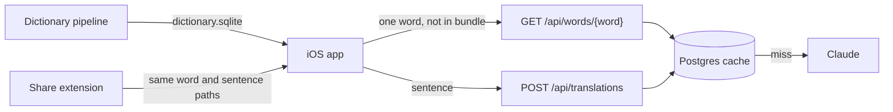

One page per flow: what it does, a diagram, every file and line on the path, the rules that matter,
what can go wrong, which tests cover it, and what is still missing.

| Feature | Status | Parts |
|---|---|---|
| [Sentence translation](doc-4%20-%20Sentence-translation.md) | Working | iOS → backend → Claude → Postgres |
| [Word lookup](doc-5%20-%20Word-lookup.md) | Working: bundle, local cache, backend, word card | iOS + backend |
| [Dictionary pipeline](doc-6%20-%20Dictionary-pipeline.md) | 245 / 2,809 words | Python, offline |
| [Share extension](doc-10%20-%20Share-extension.md) | Plumbing works; final layout waits for a mockup | iOS (extension target) |

Not started yet: **text to speech** (TASK-7), **speech to text with a score** (TASK-8). Add a page when work starts.

## How the pieces connect



## Keeping these up to date

These pages are only useful if they match the code. The rule:

> **A task that changes a flow updates that flow's page in the same commit.**

Backlog.md adds "Feature doc updated if a flow changed" to every new task's Definition of Done,
and `CLAUDE.md` tells every Claude session to do it. To check a page by hand, ask Claude:
"trace the sentence translation flow and update doc-4 (Sentence translation)".

## Template for a new page

```markdown
# <Feature>

> Status: … Last traced from code: YYYY-MM-DD.
> Spec: R… in [Vision and spec](../doc-1%20-%20Vision-and-spec.md).

## What it does
2–3 sentences, from the user's point of view.

## Big picture
Mermaid flowchart of the parts.

## Step by step
Mermaid sequence diagram, then tables: Step | File:line link | What happens.

## Errors
Cause | Where | HTTP | What the user sees.

## Tests
Test file | What it covers. Plus the run command.

## Change checklist
"If you change X, also change Y."

## Known gaps
Bugs, missing parts, and differences from the spec.
```

Diagrams use [Mermaid](https://mermaid.js.org/). GitHub draws them, and so does VS Code with the
"Markdown Preview Mermaid Support" extension.
