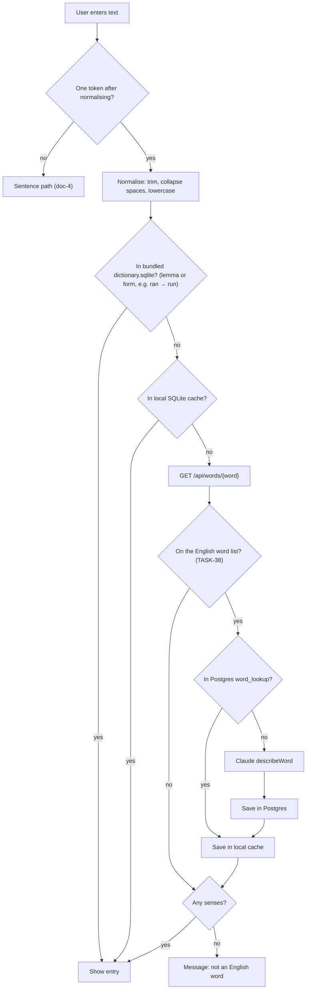
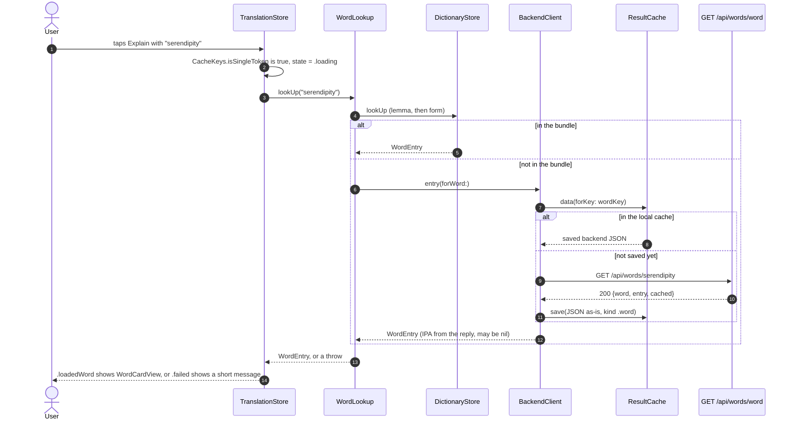
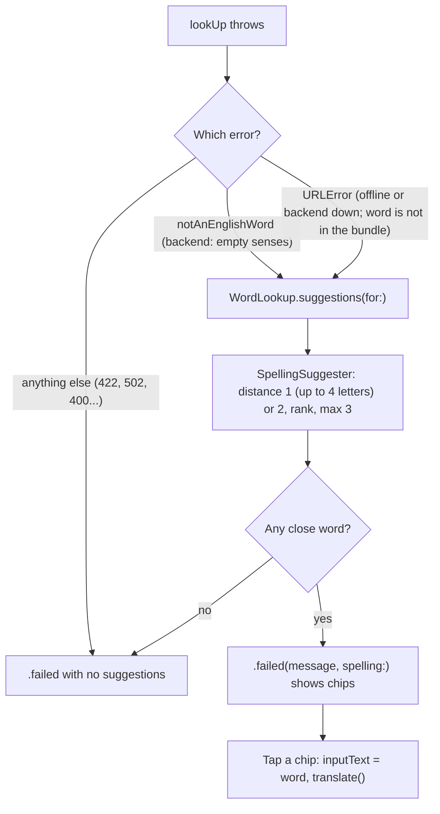

> Status: **working end to end** (bundle, local cache, backend, word card). iOS lookup: TASK-4, TASK-5, TASK-6; single-word routing and card: TASK-19. Last traced from code: 2026-10-11 (IPA from a word list: TASK-39; not-a-word check before Claude: TASK-38; did you mean: TASK-37; levelled examples and form types: TASK-35).
> Spec: R1, R2 in [Vision and spec](../doc-1%20-%20Vision-and-spec.md).

## What it does

A single word gets a **learner dictionary entry**: 1–4 senses, each with part of speech, CEFR level,
a simple English definition, a Vietnamese meaning, 3 **examples** ordered easy, medium, harder (`{ level, text }`), and up to 3 **usage** items
(`{ kind, pattern, example }`, see the glossary in doc-1). It has no collocations or synonyms any more (decision-2, TASK-24).
Most words come from the dictionary bundled in the app (built by the [dictionary pipeline](doc-6%20-%20Dictionary-pipeline.md)).
Only words the bundle doesn't have go to the backend, which asks Claude once and caches the answer for everyone.

## Full flow (spec R2)



## Backend: step by step (works today)

```mermaid
sequenceDiagram
    autonumber
    participant App as Client (curl today, iOS later)
    participant WC as WordController
    participant WS as WordService
    participant DB as Postgres word_lookup
    participant CS as ClaudeService
    participant CL as Claude API

    App->>WC: GET /api/words/Reluctant
    WC->>WC: @Pattern letters, ' and - only, 1 to 64 chars, else 400
    WC->>WS: lookUp("Reluctant")
    WS->>WS: normalizeWord gives "reluctant"
    WS->>WS: word list check (SCOWL + NGSL); not on it: empty senses, no Claude, no save
    WS->>WS: key = sha256 of word, v7, reluctant
    WS->>DB: findByCacheKey(key)
    alt hit
        DB-->>WS: entry_json
        WS-->>WC: {word, entry, cached: true}
    else miss
        WS->>CS: describeWord("reluctant")
        CS->>CL: WORD_PROMPT, effort LOW, schema = WordEntry
        CL-->>CS: WordEntry JSON (or refusal)
        WS->>DB: saveAndFlush (unique cache_key)
        opt race: another request saved first
            WS->>DB: read the first row back
        end
        WS-->>WC: {word, entry, cached: false}
    end
    WC-->>App: 200 JSON
```

| Step | File | What happens |
|---|---|---|
| Endpoint | [WordController.java:20-23](../../../backend/src/main/java/com/englishtranslation/backend/word/WordController.java#L20-L23) | `GET /api/words/{word}`. Only letters, `'` and `-`, 1–64 chars ("don't", "well-known"). A space → 400. |
| Normalise | [CacheKeys.java:24-26](../../../backend/src/main/java/com/englishtranslation/backend/cache/CacheKeys.java#L24-L26) | Sentence rules + `toLowerCase(Locale.ROOT)`. "Run" and "run" share one row. |
| Word list | [WordService.java:42-47](../../../backend/src/main/java/com/englishtranslation/backend/word/WordService.java#L42-L47), [EnglishWords.java](../../../backend/src/main/java/com/englishtranslation/backend/word/EnglishWords.java) | After normalising, the word must be on the list loaded at startup into a `HashSet`: `words/scowl-70.txt` (SCOWL size 70, US/GB/CA/AU, license in `words/SCOWL-LICENSE.txt`) plus `words/ngsl.txt` (lemmas and forms of the bundled dictionary). Not on it (`runk`): **200 with empty `senses`**, Claude is not called, nothing is saved in Postgres (so a list update can fix a missing word), debug log only. Why: Haiku "corrected" `runk` into a `drunk` entry (TASK-38). |
| Cache key | [WordService.java:49](../../../backend/src/main/java/com/englishtranslation/backend/word/WordService.java#L49) | `sha256("word" \| wordPromptVersion \| normalizedWord)`. No language: entries are always English + Vietnamese. |
| Hit | [WordService.java:51-54](../../../backend/src/main/java/com/englishtranslation/backend/word/WordService.java#L51-L54) | Parse `entry_json` into `WordEntry`, `cached: true`. |
| Miss | [WordService.java:56-60](../../../backend/src/main/java/com/englishtranslation/backend/word/WordService.java#L56-L60) | Claude → save the whole entry as JSON text → `cached: false`. |
| Race | [WordService.java:61-65](../../../backend/src/main/java/com/englishtranslation/backend/word/WordService.java#L61-L65) | Same pattern as sentences: the unique key wins, the second request reads the first row. |
| Prompt | [ClaudeService.java:45-115](../../../backend/src/main/java/com/englishtranslation/backend/claude/ClaudeService.java#L45-L115) | `WORD_PROMPT`: 1–4 senses, ≤20-word definition, never the word itself, exactly 3 examples with a level (easy = short present simple, medium = another situation and structure, harder = a complex structure or B2 collocation; same rules as the pipeline's `EXAMPLE_RULES`, with one good set), 0–3 `usage` items with the rules and the agreed few-shot examples (get, make, take, depend). Never correct spelling, never describe a different word; not an English word exactly as written → empty `senses` (TASK-38). |
| Request | [ClaudeService.java:109-122](../../../backend/src/main/java/com/englishtranslation/backend/claude/ClaudeService.java#L109-L122) | `maxTokens 8000`, `effort LOW`, structured output with `WordEntry.class`. The word goes inside `<word>` tags, escaped by `wordMessage` ([130-132](../../../backend/src/main/java/com/englishtranslation/backend/claude/ClaudeService.java#L130-L132)). |
| Shape | [WordEntry.java:7-41](../../../backend/src/main/java/com/englishtranslation/backend/word/WordEntry.java#L7-L41) | Same as the pipeline's `models.py`, in camelCase, **without** `source_index`, `image_type`, `image_query`. `examples` is a list of `{ level, text }` (`level` is a lowercase String, like `kind`). `usage` is a list of `{ kind, pattern, example }`; `kind` is a plain lowercase String (an enum would be written in capitals in the schema). |
| Cache version | [application.properties:18](../../../backend/src/main/resources/application.properties#L18) | `app.claude.word-prompt-version=v7` (TASK-38; v6 was TASK-35). v7 makes the wrong `runk` rows of v6 unreachable on the server and the phone. Rows saved with v3 to v5 have no example levels (or no usage); the new key never reads them. The app has the same value in `PromptVersions.word` ([CacheKeys.swift:15](../../../EnglishTranslation/EnglishTranslation/Cache/CacheKeys.swift#L15)); a test checks they match. |
| Response | [WordResponse.java:8](../../../backend/src/main/java/com/englishtranslation/backend/word/WordResponse.java#L8) | `{ word, entry: { senses: [...] }, cached, ipa }`. `ipa` is nullable. |
| IPA | [IpaDictionary.java](../../../backend/src/main/java/com/englishtranslation/backend/word/IpaDictionary.java), [WordService.java:68-71](../../../backend/src/main/java/com/englishtranslation/backend/word/WordService.java#L68-L71) | `words/ipa-dict-en_US.txt` (open-dict-data/ipa-dict, MIT, license in `words/IPA-DICT-LICENSE.txt`) is loaded at startup into a map: lowercase word to its **first** IPA, with slashes (for example `/ˈɡɹeɪvˌjɑɹd/`). `WordService.response()` adds it on every answer, at request time, so rows cached before TASK-39 get it too. It is not saved in `entry_json`, so the word prompt and its version did not change. A word missing from the list (or a not-a-word answer) gets `ipa: null`. The list uses `ɹ` and `ɫ` (American, dictionary style). |

**Table `word_lookup`** ([V1](../../../backend/src/main/resources/db/migration/V1__create_cache_tables.sql#L11-L19), entity [WordLookup.java](../../../backend/src/main/java/com/englishtranslation/backend/word/WordLookup.java)):
`cache_key VARCHAR(64) UNIQUE`, `word VARCHAR(64)`, `entry_json TEXT`, `model`, `prompt_version`, `created_at`.
Unlike `sentence_translation`, the entry is stored as **one JSON column**, not split into columns.

Try it:

```bash
curl -s localhost:8081/api/words/depend
```

Expected shape (the words differ from run to run, the keys do not; first call `"cached": false`, second `true`):

```json
{ "word": "depend", "cached": false, "entry": { "senses": [ {
  "pos": "verb", "cefr": "A2", "simpleDefinition": "...", "vietnamese": "...", "examples": [ { "level": "easy", "text": "..." }, { "level": "medium", "text": "..." }, { "level": "harder", "text": "..." } ],
  "usage": [ { "kind": "pattern", "pattern": "depend on + something", "example": "It depends on the weather." } ]
} ] } }
```

## iOS: bundled dictionary lookup (TASK-4)

| Step | File | What happens |
|---|---|---|
| Bundle | `EnglishTranslation/EnglishTranslation/Resources/dictionary.sqlite` | Copy of the pipeline output. Refresh: after a pipeline run, copy `pipeline/data/out/dictionary.sqlite` over it and commit. |
| Normalise | [CacheKeys.swift:51-53](../../../EnglishTranslation/EnglishTranslation/Cache/CacheKeys.swift#L51-L53) | `CacheKeys.normalizeWord`: trim, collapse spaces, lowercase, exactly like the backend. `DictionaryStore.lookUp` calls it. |
| Look up | [DictionaryStore.swift:51-56](../../../EnglishTranslation/EnglishTranslation/Dictionary/DictionaryStore.swift#L51-L56) | `lookUp(_:)` returns a `WordEntry` or nil. Tries `words.lemma`, then `forms.form` ("ran" finds "run", and then `matchedForm` is `MatchedForm(text: "ran", type: "past tense")` from `forms.type`; a base-word hit has none). Like `usage`, the type column is checked once at open (`hasFormTypeColumn`); in an old file without it the type is "form". Uses system SQLite3, read-only. |
| Model | [WordEntry.swift](../../../EnglishTranslation/EnglishTranslation/Dictionary/WordEntry.swift) | `WordEntry { word, ipa, senses, matchedForm }` ([9-24](../../../EnglishTranslation/EnglishTranslation/Dictionary/WordEntry.swift#L9-L24)), `MatchedForm { text, type }` ([27-33](../../../EnglishTranslation/EnglishTranslation/Dictionary/WordEntry.swift#L27-L33), the form the user typed, for example "ran" and "past tense"; nil for a base word; `DictionaryStore` fills it from `forms.type`), `Sense { pos, cefr, simpleDefinition, vietnamese, examples, usage }`, `Usage { kind, pattern, example }`, `Example { level, text }` ([98-128](../../../EnglishTranslation/EnglishTranslation/Dictionary/WordEntry.swift#L98-L128); `level` is easy, medium or harder; a plain string in old data decodes with no level; the pipeline exports old strings as easy, medium). `usage` is read from the `senses.usage` JSON column ([DictionaryStore.swift:77-94](../../../EnglishTranslation/EnglishTranslation/Dictionary/DictionaryStore.swift#L77-L94), [decodeUsage:148-150](../../../EnglishTranslation/EnglishTranslation/Dictionary/DictionaryStore.swift#L148-L150)), `examples` by [decodeExamples:141-144](../../../EnglishTranslation/EnglishTranslation/Dictionary/DictionaryStore.swift#L141-L144). The old bundled file has no `usage` column: [columnExists](../../../EnglishTranslation/EnglishTranslation/Dictionary/DictionaryStore.swift#L96-L100) checks `PRAGMA table_info(senses)` once at open, and then usage is empty. A missing or unknown `kind` becomes `.pattern`. Collocations and synonyms are not loaded (decision-2). |

Tests: [DictionaryStoreTests.swift](../../../EnglishTranslation/EnglishTranslationTests/DictionaryStoreTests.swift) (hit, miss, form, usage kind default, usage JSON decode, a tiny file with a `usage` column, a tiny file with levelled examples and `forms.type`, an old file without them (type "form"), old string examples without a level; normalising is tested in [CacheTests.swift](../../../EnglishTranslation/EnglishTranslationTests/CacheTests.swift)).

## iOS: the full lookup (TASK-6, TASK-19)



| Step | File | What happens |
|---|---|---|
| Word or sentence | [CacheKeys.swift:56-62](../../../EnglishTranslation/EnglishTranslation/Cache/CacheKeys.swift#L56-L62) | `isSingleToken`: normalise like the backend, then no space left and not empty. "don't" and "well-known" are one token, "go home" is two. The no-break space does not split (same as Java). |
| Route | [TranslationStore.swift:44-54](../../../EnglishTranslation/EnglishTranslation/Stores/TranslationStore.swift#L44-L54) | One token goes to `lookUpWord`, more go to `explainSentence` (doc-4). The input is trimmed first. The target-language picker does not matter for a word: entries are English plus Vietnamese. |
| Word path | [TranslationStore.swift:56-66](../../../EnglishTranslation/EnglishTranslation/Stores/TranslationStore.swift#L56-L66) | `makeWordLookup().lookUp(...)`, then `.loadedWord(entry)` or `.failed(error.localizedDescription, spelling:)` (spelling help: see "iOS: did you mean" below). The lookup is built per request (like the translator), by [TranslatorFactory.swift:25-33](../../../EnglishTranslation/EnglishTranslation/Network/TranslatorFactory.swift#L25-L33). |
| Punctuation | [CacheKeys.swift:64-75](../../../EnglishTranslation/EnglishTranslation/Cache/CacheKeys.swift#L64-L75) | `trimmingWordPunctuation`: word path only. Removes punctuation and symbols at the start and end ("Run!", "(run)", "“run”" give "Run"); inner `'` and `-` stay. `WordLookup` calls it first, so the bundle, the cache key and the backend all get the clean word. Nothing left ("?!") gives `notOneWord`. Sentences are not touched. |
| Order | [WordLookup.swift:54-75](../../../EnglishTranslation/EnglishTranslation/Dictionary/WordLookup.swift#L54-L75) | 1. bundle (`DictionaryStore.lookUp`, a broken file counts as a miss), 2. and 3. `backend.entry(forWord:)`. Protocols `WordLooking` and `WordFetching` ([WordLookup.swift:9-27](../../../EnglishTranslation/EnglishTranslation/Dictionary/WordLookup.swift#L9-L27)) let tests use fakes. |
| Cache and fetch | [BackendClient.swift:86-101](../../../EnglishTranslation/EnglishTranslation/Network/BackendClient.swift#L86-L101) | `entry(forWord:)`: key = `CacheKeys.wordKey` (same as the backend), local hit returns with no network. A miss calls `GET {baseURL}/api/words/{normalised word}` (the word is percent-encoded as one path part), then saves the **raw JSON** under the key. Errors are never saved. |
| Decode | [BackendClient.swift:19-34](../../../EnglishTranslation/EnglishTranslation/Network/BackendClient.swift#L19-L34) | `WordResponse` reads `word`, `entry.senses` and the optional `ipa` into `WordEntry.ipa`. A reply without `ipa` (JSON saved on the phone before TASK-39) or with `null` decodes with no IPA, and the card shows no IPA line. Old `collocations` and `synonyms` in an older backend reply are ignored. |
| Status check | [BackendClient.swift:104-112](../../../EnglishTranslation/EnglishTranslation/Network/BackendClient.swift#L104-L112) | Shared with sentences: not 200 gives `BackendError.badStatus(code, detail)`. |
| Not a word | [WordLookup.swift:69-73](../../../EnglishTranslation/EnglishTranslation/Dictionary/WordLookup.swift#L69-L73) | Empty `senses` gives `WordLookupError.notAnEnglishWord`. The empty answer is saved in the local cache too (the server keeps it as well). |
| Result | [TranslateResultView.swift:22-23](../../../EnglishTranslation/EnglishTranslation/Views/Translate/Subviews/TranslateResultView.swift#L22-L23) | `.loadedWord(entry)` shows `WordCardView(entry:)`. |

What the user sees when it goes wrong:

| Cause | HTTP | Message |
|---|---|---|
| Only punctuation ("?!"), or digits, symbols inside, or more than 64 letters | none / 400 | "Type one English word, with letters only." |
| Made-up word (`asdkj`) | 200, empty senses | "\"asdkj\" is not an English word. Check the spelling." |
| Claude refused | 422 | "Claude declined to answer this text. (status 422)" (same text as sentences) |
| Claude down | 502 | "The translation service is not available. Try again later. (status 502)" |
| Offline, or backend not running (and not in the bundle or cache) | none | The system text, for example "The Internet connection appears to be offline." |
| `BackendBaseURL` missing | none | "Missing BackendBaseURL. Check Secrets.xcconfig and the Info tab." (it stops even bundled words, because the lookup is built whole) |

Tests: [WordLookupTests.swift](../../../EnglishTranslation/EnglishTranslationTests/WordLookupTests.swift) (bundle first, backend on a miss, empty senses, 400 message, other errors pass through), the word tests in [BackendClientTests.swift](../../../EnglishTranslation/EnglishTranslationTests/BackendClientTests.swift) (GET path and decode, save then serve with no network, errors not saved), the token rule in [CacheTests.swift](../../../EnglishTranslation/EnglishTranslationTests/CacheTests.swift), and the word or sentence choice in [TranslationStoreTests.swift](../../../EnglishTranslation/EnglishTranslationTests/TranslationStoreTests.swift).

## iOS: did you mean (TASK-37)

When the word path fails, the result can show up to 3 close bundled words under the error. Tapping one fills the input and looks it up. Works offline (it only reads the bundle). Last traced: 2026-10-11.



A real word that is not in the bundle (for example "serendipity") still goes to the backend first: suggestions are asked for only after the lookup failed.

| Step | File | What happens |
|---|---|---|
| Candidates | [DictionaryStore.swift:58-71](../../../EnglishTranslation/EnglishTranslation/Dictionary/DictionaryStore.swift#L58-L71) | `spellingCandidates()`: every lemma, plus every form joined to its lemma, with `words.rank`. |
| Suggest | [SpellingSuggester.swift](../../../EnglishTranslation/EnglishTranslation/Dictionary/SpellingSuggester.swift) | Loads the candidate list on first use and keeps it. Damerau-Levenshtein distance (a swap of two neighbour letters counts as 1), max 1 for words of 4 letters or fewer, 2 for longer. A word that is already bundled gives nothing. One result per lemma (best distance), sorted by distance, then rank (lower = more common), then alphabet. Max 3. |
| Ask | [WordLookup.swift:50-52](../../../EnglishTranslation/EnglishTranslation/Dictionary/WordLookup.swift#L50-L52) | `suggestions(for:)` removes punctuation, then asks the suggester. The protocol has a default that returns nothing, so fakes need no change. |
| Wire | [TranslatorFactory.swift:28-31](../../../EnglishTranslation/EnglishTranslation/Network/TranslatorFactory.swift#L28-L31) | One shared suggester for the app, built on the bundled dictionary. |
| State | [TranslationStore.swift:66-84](../../../EnglishTranslation/EnglishTranslation/Stores/TranslationStore.swift#L66-L84) | Only `notAnEnglishWord` and `URLError` ask for suggestions. `.failed(message, spelling: SpellingHelp?)` keeps the old message. `lookUp(suggestion:)` handles a tap. |
| View | [SpellingSuggestionsView.swift](../../../EnglishTranslation/EnglishTranslation/Views/Translate/Subviews/SpellingSuggestionsView.swift) | "No word "runj". Did you mean:" and chips in the `LevelChip` style, 44 pt tall, VoiceOver label "Look up run". Shown by [TranslateResultView.swift:26-33](../../../EnglishTranslation/EnglishTranslation/Views/Translate/Subviews/TranslateResultView.swift#L26-L33). |

Note: a form is suggested by its base word ("rung" is a form of "ring", so "runj" can show "run" and "ring").

Tests: [SpellingSuggesterTests.swift](../../../EnglishTranslation/EnglishTranslationTests/SpellingSuggesterTests.swift) (runj gives run first, aple gives apple, zzzzqq gives none, a correct word is not corrected, swaps, length limits, one result per lemma, max 3, loaded once, and the real bundle), [TranslationStoreTests.swift](../../../EnglishTranslation/EnglishTranslationTests/TranslationStoreTests.swift) (suggestions after not-English and offline, none for other errors, a tap looks the word up), [WordLookupTests.swift](../../../EnglishTranslation/EnglishTranslationTests/WordLookupTests.swift).

## iOS word card (v2, TASK-36)

Built in TASK-27, shown for real lookups since TASK-19, redesigned in TASK-36 (developer mockup v3, doc-7).
Uses the model from the TASK-4 section above. An empty `cefr` or `vietnamese` (what the store gives for a missing value)
hides the level or the Vietnamese row. Last traced: 2026-10-11.

| Part | File |
|---|---|
| Sample words for previews (`ran`, `apple`, `get`, `run`, `depend`, `oldData`, `sparse`) | [WordEntry+Samples.swift](../../../EnglishTranslation/EnglishTranslation/Models/WordEntry+Samples.swift) |
| Full card: header, one card per sense, folded rows | [WordCardView.swift](../../../EnglishTranslation/EnglishTranslation/Views/Word/WordCardView.swift) |
| Compact card (word list in a sentence): first sense only | [WordCardCompactView.swift](../../../EnglishTranslation/EnglishTranslation/Views/Word/WordCardCompactView.swift) |
| Sense title: number circle, simple explanation, level chip | [SenseTitleRow.swift](../../../EnglishTranslation/EnglishTranslation/Views/Word/SenseTitleRow.swift) |
| Form pill ("past tense of run /rʌn/") | [FormPill.swift](../../../EnglishTranslation/EnglishTranslation/Views/Word/FormPill.swift) |
| "Examples" content with easy / medium / harder labels | [WordExamplesSection.swift](../../../EnglishTranslation/EnglishTranslation/Views/Word/WordExamplesSection.swift) |
| "Grammar" content (usage grouped by kind) | [WordUsageSection.swift](../../../EnglishTranslation/EnglishTranslation/Views/Word/WordUsageSection.swift) |
| Text helpers: `chipText`, `usageGroups`, `formPillText` | [WordEntry+Display.swift](../../../EnglishTranslation/EnglishTranslation/Views/Word/WordEntry+Display.swift) |

Top to bottom:

1. **Header** ([WordCardView.swift:32-50](../../../EnglishTranslation/EnglishTranslation/Views/Word/WordCardView.swift#L32-L50)): the headword as typed (`matchedForm.text`, else `word`), and the Listen icon button. Under it, either the form pill (when `matchedForm` is set; it has the lemma IPA) or the IPA (when the user typed the base word).
2. **One card per sense** ([senseCard:52-82](../../../EnglishTranslation/EnglishTranslation/Views/Word/WordCardView.swift#L52-L82)): surface, hairline border, card radius. Title = `SenseTitleRow`.
3. **Three folded rows, all closed**, in this order: Examples, Grammar, Vietnamese. No counters. One row open at a time per card. Examples is hidden with no examples, Grammar with no usage, Vietnamese with no text.
4. **Examples (open)**: one line each, with a level label (`ExampleLevelLabel`: easy teal, medium amber, harder coral). No level (old data) means no label.
5. **Grammar (open)**: `Sense.usageGroups` ([WordEntry+Display.swift:22-33](../../../EnglishTranslation/EnglishTranslation/Views/Word/WordEntry+Display.swift#L22-L33)) groups by kind in a fixed order: Patterns, Collocations, Phrases and idioms (phrase and idiom together). Empty groups are hidden. Each item is a bullet: pattern in medium weight, example below in secondary serif.

Compact card: word, IPA, Listen, then the same `SenseTitleRow` for sense 1, then Vietnamese (closed).

Tests: [WordEntryTests.swift](../../../EnglishTranslation/EnglishTranslationTests/WordEntryTests.swift) (usage grouping and order, empty groups, form pill text, example decoding of old strings and new objects, entry without `matchedForm`).

## Errors

Same handler as sentences ([ApiExceptionHandler.java](../../../backend/src/main/java/com/englishtranslation/backend/common/ApiExceptionHandler.java)):
bad word → 400, Claude refused → 422, Claude down → 502. A word that is not on the English word list (`asdfg`, `runk`) returns **200 with empty `senses`** straight away: Claude is not called and nothing is saved on the server (the phone's ResultCache still keeps the answer). A word on the list that Claude still rejects also returns empty `senses`, and that answer is cached.

## Tests

| Test | Covers |
|---|---|
| [WordServiceTest.java](../../../backend/src/test/java/com/englishtranslation/backend/word/WordServiceTest.java) | The second lookup is `cached: true` and calls Claude once; a saved entry reads back the same; `runk` is rejected with no Claude call and no saved row; `serendipity`, `run`, `running` and uppercase input reach Claude; the list has SCOWL and NGSL words; `graveyard` has IPA, `aardwolf` (on the word list, not the IPA list) has `null`, a row saved without IPA gets it when read from cache, `hello` uses its first IPA |
| [TranslationControllerTest.java:69](../../../backend/src/test/java/com/englishtranslation/backend/translation/TranslationControllerTest.java#L69) | A word with spaces → 400 |
| [CacheKeysTest.java](../../../backend/src/test/java/com/englishtranslation/backend/cache/CacheKeysTest.java) | Words are lowercased |

## Known gaps

- **Keep the keys equal.** `CacheKeys.swift` must copy the backend normalising **exactly**, or the phone and server use different keys. The word prompt version lives in `PromptVersions.word` and must equal `app.claude.word-prompt-version`.
- **Phone-cached backend words keep their old JSON**, saved before TASK-39, so they show no IPA until the phone cache entry is cleared or replaced. The usage list of a backend word can be empty if the saved answer is from an older prompt version. A word that is not on the IPA list shows no IPA line.
- **Direct providers (DeepSeek, ChatGPT, Claude) still use the word path for one word**, because the word lookup does not depend on the provider. They go away in TASK-18.
- **Backend entries skip the pipeline's quality checks.** The pipeline rejects definitions with words outside NGSL ([validate.py](../../../pipeline/src/pipeline/validate.py)). The backend trusts Claude's answer, so backend definitions can be harder than bundled ones.
- **Empty answers from Claude are cached forever** (for that prompt version). Not-a-word answers from the word list are not saved on the server, but the phone's ResultCache keeps them, so a later list update does not reach a phone that already asked.
- **The word list can miss a real word** (new slang, rare names). Such a word shows "not an English word" until the list is updated (regenerate `scowl-70.txt` at app.aspell.net/create, see `SCOWL-LICENSE.txt`).
- **No check that the senses match the headword.** If the word is on the list but Claude describes another word, it is still saved. Only the prompt rule guards this.
- **Own prompt version:** `app.claude.word-prompt-version`, separate from the sentence one (TASK-15). Changing `WORD_PROMPT`? Bump it, or old entries keep being served.
