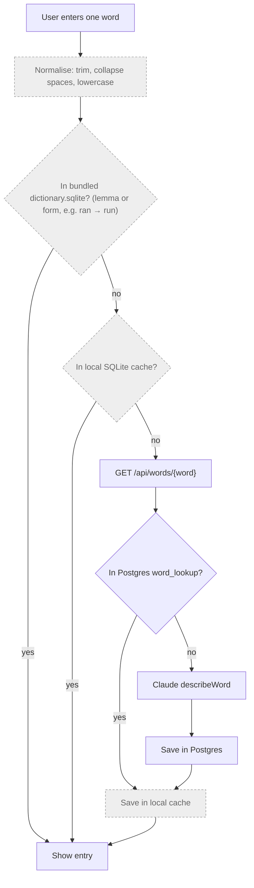
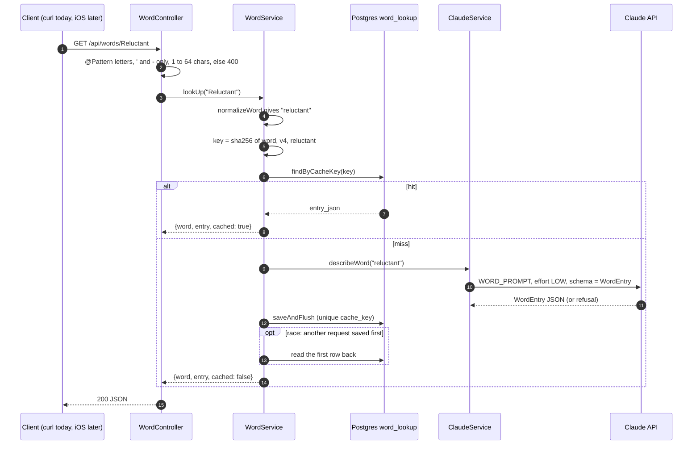

> Status: **backend done, iOS not started** (TASK-4, TASK-5, TASK-6). Last traced from code: 2026-10-10.
> Spec: R1, R2 in [Vision and spec](../doc-1%20-%20Vision-and-spec.md).

## What it does

A single word gets a **learner dictionary entry**: 1–4 senses, each with part of speech, CEFR level,
a simple English definition, a Vietnamese meaning, 2 examples, collocations, and synonyms.
Most words come from the dictionary bundled in the app (built by the [dictionary pipeline](doc-6%20-%20Dictionary-pipeline.md)).
Only words the bundle doesn't have go to the backend, which asks Claude once and caches the answer for everyone.

## Planned full flow (spec R2)

Grey boxes don't exist yet.



## Backend: step by step (works today)



| Step | File | What happens |
|---|---|---|
| Endpoint | [WordController.java:20-23](../../../backend/src/main/java/com/englishtranslation/backend/word/WordController.java#L20-L23) | `GET /api/words/{word}`. Only letters, `'` and `-`, 1–64 chars ("don't", "well-known"). A space → 400. |
| Normalise | [CacheKeys.java:24-26](../../../backend/src/main/java/com/englishtranslation/backend/cache/CacheKeys.java#L24-L26) | Sentence rules + `toLowerCase(Locale.ROOT)`. "Run" and "run" share one row. |
| Cache key | [WordService.java:28-29](../../../backend/src/main/java/com/englishtranslation/backend/word/WordService.java#L28-L29) | `sha256("word" \| promptVersion \| normalizedWord)`. No language: entries are always English + Vietnamese. |
| Hit | [WordService.java:31-34](../../../backend/src/main/java/com/englishtranslation/backend/word/WordService.java#L31-L34) | Parse `entry_json` into `WordEntry`, `cached: true`. |
| Miss | [WordService.java:36-40](../../../backend/src/main/java/com/englishtranslation/backend/word/WordService.java#L36-L40) | Claude → save the whole entry as JSON text → `cached: false`. |
| Race | [WordService.java:41-45](../../../backend/src/main/java/com/englishtranslation/backend/word/WordService.java#L41-L45) | Same pattern as sentences: the unique key wins, the second request reads the first row. |
| Prompt | [ClaudeService.java:45-57](../../../backend/src/main/java/com/englishtranslation/backend/claude/ClaudeService.java#L45-L57) | `WORD_PROMPT`: 1–4 senses, ≤20-word definition, never the word itself, 2 examples, 0–3 collocations and synonyms. Not an English word → empty `senses`. |
| Request | [ClaudeService.java:82-95](../../../backend/src/main/java/com/englishtranslation/backend/claude/ClaudeService.java#L82-L95) | `maxTokens 8000`, `effort LOW`, structured output with `WordEntry.class`. The word goes inside `<word>` tags, escaped by `wordMessage` ([103-105](../../../backend/src/main/java/com/englishtranslation/backend/claude/ClaudeService.java#L103-L105)). |
| Shape | [WordEntry.java:6-17](../../../backend/src/main/java/com/englishtranslation/backend/word/WordEntry.java#L6-L17) | Same as the pipeline's `models.py`, in camelCase, **without** `source_index`, `image_type`, `image_query`. |
| Response | [WordResponse.java:3](../../../backend/src/main/java/com/englishtranslation/backend/word/WordResponse.java#L3) | `{ word, entry: { senses: [...] }, cached }`. |

**Table `word_lookup`** ([V1](../../../backend/src/main/resources/db/migration/V1__create_cache_tables.sql#L11-L19), entity [WordLookup.java](../../../backend/src/main/java/com/englishtranslation/backend/word/WordLookup.java)):
`cache_key VARCHAR(64) UNIQUE`, `word VARCHAR(64)`, `entry_json TEXT`, `model`, `prompt_version`, `created_at`.
Unlike `sentence_translation`, the entry is stored as **one JSON column**, not split into columns.

Try it:

```bash
curl -s localhost:8081/api/words/serendipity
```

## Errors

Same handler as sentences ([ApiExceptionHandler.java](../../../backend/src/main/java/com/englishtranslation/backend/common/ApiExceptionHandler.java)):
bad word → 400, Claude refused → 422, Claude down → 502. A made-up word like `asdfg` returns **200 with empty `senses`**, and that empty answer is cached too.

## Tests

| Test | Covers |
|---|---|
| [WordServiceTest.java](../../../backend/src/test/java/com/englishtranslation/backend/word/WordServiceTest.java) | A saved entry reads back the same |
| [TranslationControllerTest.java:69](../../../backend/src/test/java/com/englishtranslation/backend/translation/TranslationControllerTest.java#L69) | A word with spaces → 400 |
| [CacheKeysTest.java](../../../backend/src/test/java/com/englishtranslation/backend/cache/CacheKeysTest.java) | Words are lowercased |

## Known gaps

- **No iOS code yet.** No bundled dictionary reader, no local cache, no word screen. The iOS app must copy `CacheKeys` normalising **exactly**, or the phone and server will use different keys.
- **No "second request is cached" test for words.** Sentences have one (`secondRequestComesFromCacheWithoutCallingClaude`). Words only test the read-back.
- **Backend entries skip the pipeline's quality checks.** The pipeline rejects definitions with words outside NGSL ([validate.py](../../../pipeline/src/pipeline/validate.py)). The backend trusts Claude's answer, so backend definitions can be harder than bundled ones.
- **Empty answers are cached forever** (for that prompt version), including a typo the user fixes a second later.
- **Shared prompt version:** see the note in [sentence-translation.md](doc-4%20-%20Sentence-translation.md#known-gaps).
