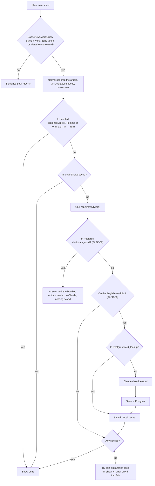
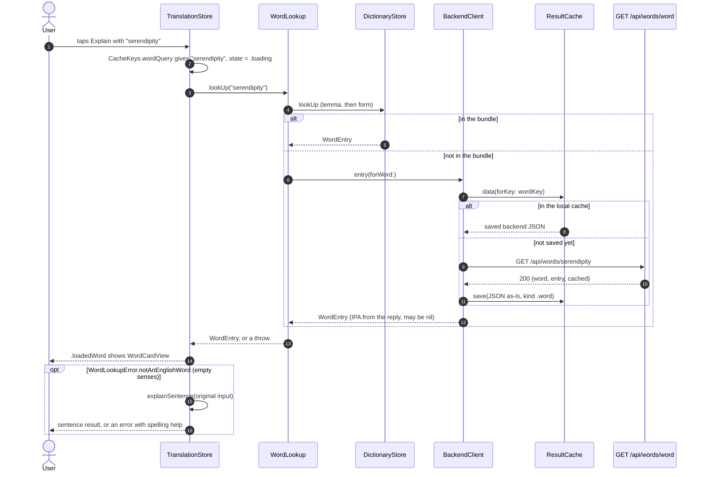
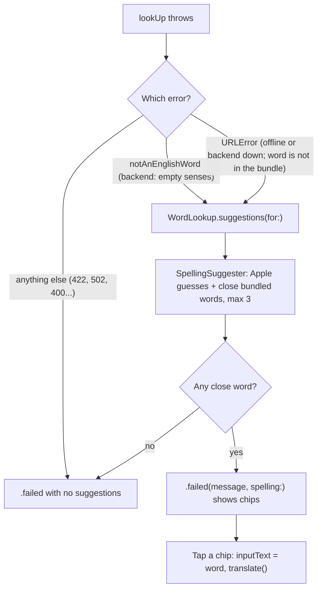
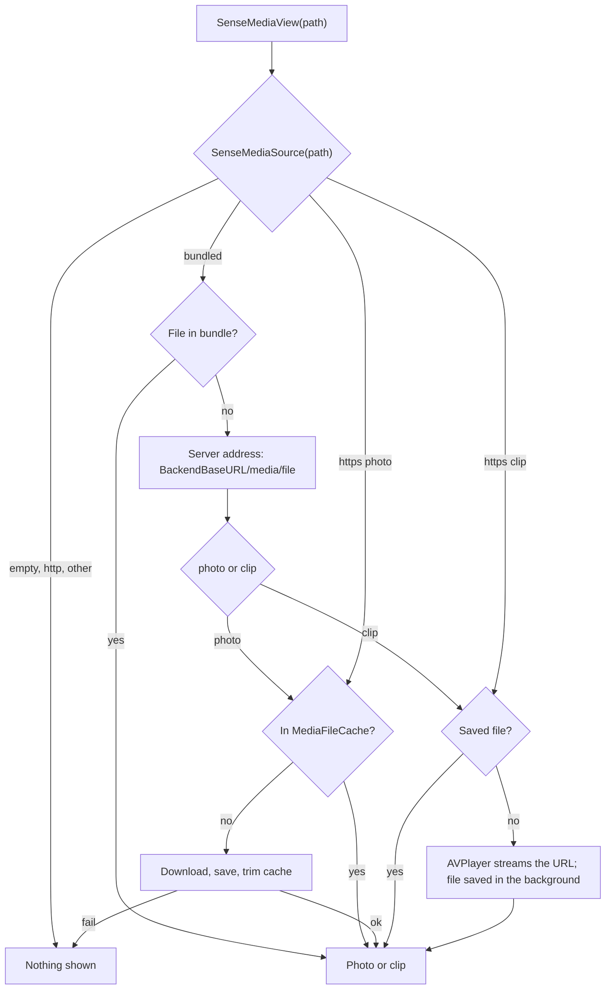
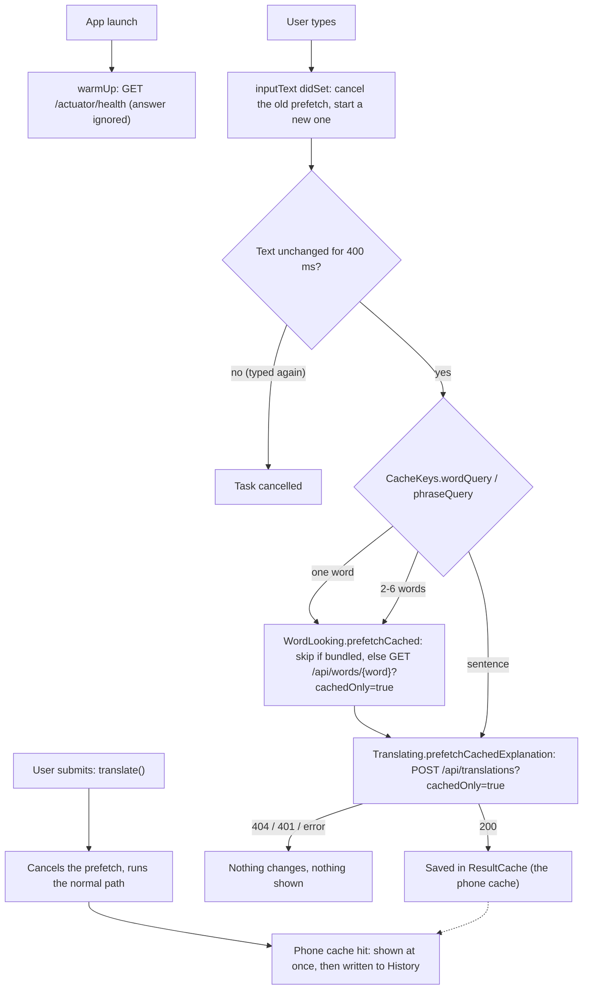
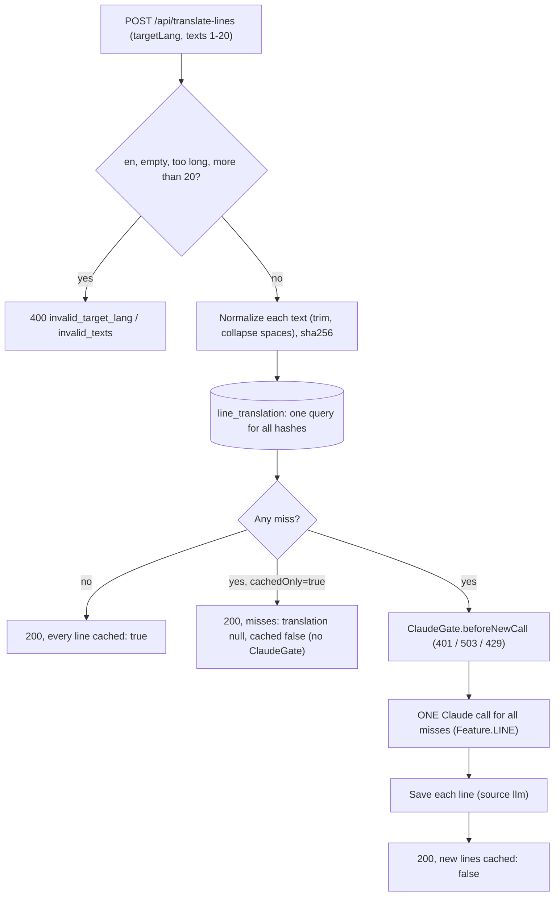

> Status: **working end to end** (bundle, local cache, backend, word card). iOS lookup: TASK-4, TASK-5, TASK-6; single-word routing and card: TASK-19; "an apple" is the word apple: TASK-44. Last traced from code: 2026-10-24 (word language row from `POST /api/translate-lines`: TASK-106.3; language lines endpoint: TASK-106.2; before that 2026-10-22: unknown-word fallback: TASK-94; before that 2026-10-20: warm connection and cached-only prefetch while typing: TASK-83.5; before that 2026-10-18: phrases from the cache as word cards and the IPA on the headword line: TASK-83.10; `imageWidth`/`imageHeight` per sense, so the picture frame keeps its shape; cachedOnly lookups, Cache-Control and `GET /api/suggest`: TASK-83.4; sign-in for words that need a new Claude call: TASK-70; examples row layout: TASK-48; stop speech and duck music: TASK-46; media of bundled words loads from the server: TASK-51; a bundled word is answered from Postgres first, the bundled entry wins: TASK-58; pictures for backend words: TASK-49.4; Listen: TASK-7; article before a word: TASK-44; Show translation setting: TASK-29; simple-word check on backend entries: TASK-16; target-language row: TASK-40; IPA from a word list: TASK-39; not-a-word check before Claude: TASK-38; better did-you-mean (Apple's checker, long words): TASK-72; did you mean: TASK-37; levelled examples and form types: TASK-35).
> Spec: R1, R2 in [Vision and spec](../doc-1%20-%20Vision-and-spec.md).

## What it does

A single word gets a **learner dictionary entry**: 1–4 senses, each with part of speech, CEFR level,
a simple English definition, a Vietnamese meaning, 3 **examples** ordered easy, medium, harder (`{ level, text }`), and up to 3 **usage** items
(`{ kind, pattern, example }`, see the glossary in doc-1). It has no collocations or synonyms any more (decision-2, TASK-24).
Most words come from the dictionary bundled in the app (built by the [dictionary pipeline](doc-6%20-%20Dictionary-pipeline.md)).
Only words the bundle doesn't have go to the backend, which asks Claude once and caches the answer for everyone.

## Full flow (spec R2)



## Backend: step by step (works today)

```mermaid
sequenceDiagram
    autonumber
    participant App as Client (curl today, iOS later)
    participant WC as WordController
    participant WS as WordService
    participant DB as Postgres word_lookup
    participant CS as ClaudeService
    participant CL as Claude API
    participant MS as BackendWordMediaService

    App->>WC: GET /api/words/Reluctant
    WC->>WC: @Pattern letters, ' and - only, 1 to 64 chars, else 400
    WC->>WS: lookUp("Reluctant")
    WS->>WS: normalizeWord gives "reluctant"
    WS->>DB: bundled? dictionary_word with lemma "reluctant" (TASK-58); if yes: its entry + media, cached: true, stop
    WS->>WS: word list check (SCOWL + NGSL); not on it: empty senses, no Claude, no save
    WS->>WS: key = sha256 of word, v7, reluctant
    WS->>DB: findByCacheKey(key)
    alt hit
        DB-->>WS: entry_json
        WS->>DB: media of the saved word (word_lookup_media + media)
        WS-->>WC: {word, entry (+ imageUrl per sense), cached: true}
    else miss
        WS->>CS: describeWord("reluctant")
        CS->>CL: WORD_PROMPT, effort LOW, schema = WordEntry
        CL-->>CS: WordEntry JSON (or refusal)
        WS->>DB: saveAndFlush (unique cache_key)
        opt race: another request saved first
            WS->>DB: read the first row back
        end
        WS-)MS: fetchInBackground (own thread, not waited for)
        WS-->>WC: {word, entry, cached: false}
    end
    WC-->>App: 200 JSON
```

| Step | File | What happens |
|---|---|---|
| Endpoint | [WordController.java:34-49](../../../backend/src/main/java/com/englishtranslation/backend/word/WordController.java#L34-L49) | `GET /api/words/{word}`. Letters, `'` and `-`, 1–64 chars ("don't", "well-known"), or a phrase of up to 6 such words with spaces ("give up", TASK-83.10). Any other mark → 400. Optional `?cachedOnly=true` (TASK-83.4, see the rows below). |
| Normalise | [CacheKeys.java:24-26](../../../backend/src/main/java/com/englishtranslation/backend/cache/CacheKeys.java#L24-L26) | Sentence rules + `toLowerCase(Locale.ROOT)`. "Run" and "run" share one row. |
| Bundled first | [WordService.java:73-78](../../../backend/src/main/java/com/englishtranslation/backend/word/WordService.java#L73-L78), [bundledResponse:144](../../../backend/src/main/java/com/englishtranslation/backend/word/WordService.java#L144), [BundledEntryReader](../../../backend/src/main/java/com/englishtranslation/backend/dictionary/BundledEntryReader.java), [findWithSensesByLemma](../../../backend/src/main/java/com/englishtranslation/backend/dictionary/DictionaryWordRepository.java) | **The bundled entry wins (TASK-58).** Before anything else, the normalised word is looked up in `dictionary_word` by **lemma** (the 2,750 bundled words, imported into Postgres by TASK-49.3). If it is there, the answer is that entry (senses with examples and usage, `imageUrl` from `dictionary_sense.media_id`, the bundled IPA or the word-list IPA), `cached: true`. Claude is **not** called and **no `word_lookup` row is made**, so a word can never be in both lists in the admin. The response has the same shape as before. A form such as `working` (a form of `work`) is not a lemma, so it still goes on to the steps below. The iOS app looks bundled words up on the device first, so this mostly protects the admin and other clients. The old duplicates were removed by Flyway [V9](../../../backend/src/main/resources/db/migration/V9__remove_backend_words_that_are_bundled.sql), which deletes `word_lookup` rows (and their `word_lookup_media` links) whose word is a bundled lemma; the media files stay on disk. |
| Phrase (TASK-83.10) | [WordService.java:81-86](../../../backend/src/main/java/com/englishtranslation/backend/word/WordService.java#L81-L86), [cachedPhrase:137](../../../backend/src/main/java/com/englishtranslation/backend/word/WordService.java#L137) | A normalised text with a space ("give up", "a piece of cake") is answered **only from `word_lookup`**, with the same cache key as a word. A hit is `cached: true` with `Cache-Control: max-age=3600`; a miss is **404 `not_cached`**, with or without `cachedOnly`. It never reaches the word list, `ClaudeGate` or Claude, so it is never "not a word" and costs nothing. The rows come from the local collection (TASK-83.9, `collection push`, doc-18). |
| Word list | [WordService.java:88-94](../../../backend/src/main/java/com/englishtranslation/backend/word/WordService.java#L88-L94), [EnglishWords.java](../../../backend/src/main/java/com/englishtranslation/backend/word/EnglishWords.java) | After normalising, the word must be on the list loaded at startup into a `HashSet`: `words/scowl-70.txt` (SCOWL size 70, US/GB/CA/AU, license in `words/SCOWL-LICENSE.txt`) plus `words/ngsl.txt` (lemmas and forms of the bundled dictionary). Not on it (`runk`): **200 with empty `senses`**, Claude is not called, nothing is saved in Postgres (so a list update can fix a missing word), debug log only. Why: Haiku "corrected" `runk` into a `drunk` entry (TASK-38). |
| Cache key | [WordService.java:96](../../../backend/src/main/java/com/englishtranslation/backend/word/WordService.java#L96) | `sha256("word" \| wordPromptVersion \| normalizedWord)`. No language: entries are always English + Vietnamese. |
| Hit | [WordService.java:98-102](../../../backend/src/main/java/com/englishtranslation/backend/word/WordService.java#L98-L102) | Parse `entry_json` into `WordEntry`, `cached: true`. |
| Cached only (TASK-83.4) | [WordService.java:103-105](../../../backend/src/main/java/com/englishtranslation/backend/word/WordService.java#L103-L105), [NotCachedException](../../../backend/src/main/java/com/englishtranslation/backend/cache/NotCachedException.java) | With `?cachedOnly=true` a word that is neither bundled nor cached stops here with **404 `not_cached`** (and `Cache-Control: no-store`), before `ClaudeGate`. So a guest never gets 401 from it, nothing is saved, and it costs nothing. Bundled, cached and not-a-word answers are the same as without the flag. The app (TASK-83.5) asks this while the user types. |
| Cache-Control (TASK-83.4) | [WordController.java:38-45](../../../backend/src/main/java/com/englishtranslation/backend/word/WordController.java#L38-L45), [WordAnswer](../../../backend/src/main/java/com/englishtranslation/backend/word/WordAnswer.java) | `WordService.lookUp(word, cachedOnly)` returns the answer and its origin. A **bundled** answer gets `Cache-Control: max-age=86400, public` (1 day: a bundled entry changes only by a rare admin edit or a deploy). A **cached backend word** gets `max-age=3600, public` (1 hour: its Pixabay picture and admin review edits arrive after the first save). A **new** Claude answer (its picture is not there yet) and a **not-a-word** answer (the list changes on deploy) keep Spring Security's default `no-cache, no-store`. Same values with and without `cachedOnly`. `URLCache` on the phone follows `max-age`, so a repeat lookup needs no network. |
| Miss | [WordService.java:107-127](../../../backend/src/main/java/com/englishtranslation/backend/word/WordService.java#L107-L127) | Claude → simple-word check (next row) → save the whole entry as JSON text → `cached: false`. |
| Race | [WordService.java:129-134](../../../backend/src/main/java/com/englishtranslation/backend/word/WordService.java#L129-L134) | Same pattern as sentences: the unique key wins, the second request reads the first row. |
| Prompt | [ClaudeService.java:63-134](../../../backend/src/main/java/com/englishtranslation/backend/claude/ClaudeService.java#L63-L134) | `WORD_PROMPT`: 1–4 senses, ≤20-word definition, never the word itself, exactly 3 examples with a level (easy = short present simple, medium = another situation and structure, harder = a complex structure or B2 collocation; same rules as the pipeline's `EXAMPLE_RULES`, with one good set), 0–3 `usage` items with the rules and the agreed few-shot examples (get, make, take, depend). Never correct spelling, never describe a different word; not an English word exactly as written → empty `senses` (TASK-38). |
| Request | [ClaudeService.java:389-404](../../../backend/src/main/java/com/englishtranslation/backend/claude/ClaudeService.java#L389-L404) | `maxTokens 8000`, `effort LOW`, structured output with `WordEntry.class`. The word goes inside `<word>` tags, escaped by `wordMessage` ([174-176](../../../backend/src/main/java/com/englishtranslation/backend/claude/ClaudeService.java#L180-L182)). |
| Gateway mode | [askForJson:201](../../../backend/src/main/java/com/englishtranslation/backend/claude/ClaudeService.java#L201) | With `CLAUDE_BASE_URL` set, the `WordEntry` schema goes in the prompt and the answer is parsed from the text; a broken answer is asked once more (doc-4, "Gateway mode"). |
| Shape | [WordEntry.java:7-41](../../../backend/src/main/java/com/englishtranslation/backend/word/WordEntry.java#L7-L41) | Same as the pipeline's `models.py`, in camelCase, **without** `source_index`, `image_type`, `image_query`. `examples` is a list of `{ level, text }` (`level` is a lowercase String, like `kind`). `usage` is a list of `{ kind, pattern, example }`; `kind` is a plain lowercase String (an enum would be written in capitals in the schema). |
| Simple words | [SimpleWords.java](../../../backend/src/main/java/com/englishtranslation/backend/word/SimpleWords.java), [WordService.java:110-120](../../../backend/src/main/java/com/englishtranslation/backend/word/WordService.java#L110-L120), [retry 158-169](../../../backend/src/main/java/com/englishtranslation/backend/word/WordService.java#L158-L169) | Java copy of the pipeline's `validate.py` rules (TASK-16). The word list is `words/ngsl.txt` plus `words/simple-extra.txt` (the pipeline's `EXTRA_ALLOWED`, `BASIC_WORDS`, `NUMBERS_AND_DATES`, `GRAMMAR_TERMS`, copied; keep them in step). Checked: each `simpleDefinition` (no word outside the list; the possessive `'s` is dropped) and each example (easy 0 outside words, medium 1, harder 2; contractions count as their base word; `me`, `my`, `oh` are allowed; the headword and words starting with it are allowed, because a backend headword may be rare). Usage items and the 20-word limit are **not** checked. If anything fails: **one** retry through `ClaudeService.describeWordAgain(word, feedback)`, where the feedback names the hard words. If the retry also fails, the entry is still saved with `needs_review = true` and a `warn` log line. If the retry call itself throws, the first entry is kept and flagged. Never more than one retry. The flag is not sent to the app. |
| Cache version | [application.properties:18](../../../backend/src/main/resources/application.properties#L18) | `app.claude.word-prompt-version=v7` (TASK-38; v6 was TASK-35). v7 makes the wrong `runk` rows of v6 unreachable on the server and the phone. Rows saved with v3 to v5 have no example levels (or no usage); the new key never reads them. The app has the same value in `PromptVersions.word` ([CacheKeys.swift:15](../../../EnglishTranslation/EnglishTranslation/Cache/CacheKeys.swift#L15)); a test checks they match. |
| Response | [WordResponse.java:9](../../../backend/src/main/java/com/englishtranslation/backend/word/WordResponse.java#L9), [WordEntryView.java](../../../backend/src/main/java/com/englishtranslation/backend/word/WordEntryView.java) | `{ word, entry: { senses: [...] }, cached, ipa }`. `ipa` is nullable. Each sense may have `imageUrl` (TASK-49.4): an absolute address such as `https://api.saynata.com/media/run_1_3fa9c2d1.webp`, plus `imageWidth` and `imageHeight` (pixels, from `media.width`/`height`) when the size is known. Each field is **left out** when the sense has no media, and every other field is unchanged, so old app versions see nothing new. `WordEntry` itself (what Claude writes and `entry_json` stores) has no image field; the response uses `WordEntryView`. |
| Media | [WordService.mediaOf:178](../../../backend/src/main/java/com/englishtranslation/backend/word/WordService.java#L178), [SenseMediaReader](../../../backend/src/main/java/com/englishtranslation/backend/media/SenseMediaReader.java) | A cached word reads its media rows (`word_lookup_media` joined to `media`) and adds `imageUrl` = `MEDIA_BASE_URL` + `/` + file name. A problem reading media is logged and ignored: the word still answers. |
| IPA | [IpaDictionary.java](../../../backend/src/main/java/com/englishtranslation/backend/word/IpaDictionary.java), [WordService.java:171-174](../../../backend/src/main/java/com/englishtranslation/backend/word/WordService.java#L171-L174) | `words/ipa-dict-en_US.txt` (open-dict-data/ipa-dict, MIT, license in `words/IPA-DICT-LICENSE.txt`) is loaded at startup into a map: lowercase word to its **first** IPA, with slashes (for example `/ˈɡɹeɪvˌjɑɹd/`). `WordService.response()` adds it on every answer, at request time, so rows cached before TASK-39 get it too. It is not saved in `entry_json`, so the word prompt and its version did not change. A phrase gets its words' IPA in one pair of slashes ("give up" → `/ˈɡɪv ˈəp/`), or `null` when any word is missing (TASK-83.10). A word missing from the list (or a not-a-word answer) gets `ipa: null`. The list uses `ɹ` and `ɫ` (American, dictionary style). |

### Pictures for backend words (TASK-49.4)

Words that are not in the bundled dictionary get a Pixabay photo or clip **after** the answer was sent. **Not** a word saved by the prefill job (doc-18): inside a prefill run `startMediaJob` returns at once, so there is no Pixabay call, no claim row and no ffmpeg (developer, 10-16). The first lookup has no `imageUrl`; the next one has it.

```mermaid
sequenceDiagram
    autonumber
    participant WS as WordService
    participant MS as BackendWordMediaService (thread media-1)
    participant DB as Postgres
    participant PX as Pixabay
    participant FF as ffmpeg
    participant FS as MEDIA_DIR

    WS->>DB: save the new word_lookup row
    WS-)MS: fetchInBackground (returns at once)
    WS-->>WS: answer the request without imageUrl
    loop first 3 senses that are noun, adjective or verb
        MS->>DB: claim: insert word_lookup_media (word_lookup_id, sense_position)
        alt already claimed
            MS-->>MS: skip, Pixabay is not asked again
        else new
            MS->>PX: verb: search clip (photo if none); noun/adjective: search photo
            PX-->>MS: hit + download
            MS->>FF: 320 px WebP, or 3 s muted H.264 MP4
            FF->>FS: write .tmp file, then move to word_sense_hash8.ext
            MS->>DB: insert media row (Pixabay id, photographer, page, license) and set media_id
        end
    end
```

| Step | File | What happens |
|---|---|---|
| Start | [WordService.startMediaJob:191](../../../backend/src/main/java/com/englishtranslation/backend/word/WordService.java#L191) | Called after `saveAndFlush`. If starting it fails, it is logged and the answer is still sent. |
| Thread | [MediaConfig.mediaExecutor](../../../backend/src/main/java/com/englishtranslation/backend/media/MediaConfig.java#L21) | One worker thread, queue of 50. When the queue is full the job is dropped (the word works, it just has no picture). |
| Job | [BackendWordMediaService.fetch:55](../../../backend/src/main/java/com/englishtranslation/backend/media/BackendWordMediaService.java#L55) | Does nothing when `PIXABAY_API_KEY` is empty. Nouns and adjectives get a photo, verbs get a clip (a photo if Pixabay has no clip), other parts of speech get nothing. The first 3 senses at most. Search words = the headword. |
| Claim | [claim:88](../../../backend/src/main/java/com/englishtranslation/backend/media/BackendWordMediaService.java#L88) | A row in `word_lookup_media` is inserted **before** Pixabay is asked (unique on word and sense position). So a sense is asked once, even if Pixabay found nothing or the download failed. To try again, delete the word in the admin ("Regenerate"). |
| Pixabay | [HttpPixabayClient](../../../backend/src/main/java/com/englishtranslation/backend/media/HttpPixabayClient.java) | Same searches as `pipeline/src/pipeline/media.py` (`safesearch`, `order=popular`, tiny/small video first). At least 1.5 s between requests (40 per minute; Pixabay allows 100 per 60 s). Downloads only from `*.pixabay.com` over https. |
| Convert | [FfmpegMediaConverter](../../../backend/src/main/java/com/englishtranslation/backend/media/FfmpegMediaConverter.java) | One ffmpeg call: photo to WebP (quality 80, max 320 px wide), clip to H.264 MP4 (3 s, no audio, 320 px, `+faststart`). ffmpeg is installed in the Docker image. |
| Save | [fetchOneSense:100](../../../backend/src/main/java/com/englishtranslation/backend/media/BackendWordMediaService.java#L100), [MediaStore.save:48](../../../backend/src/main/java/com/englishtranslation/backend/media/MediaStore.java#L48) | File name `word_<sense number>_<8 hex of sha256>.webp\|mp4` (the hash makes the name unique per content, so Caddy can cache it for a year). Written to a `.tmp-` file and moved. If the media row cannot be saved, the file is deleted. Download, convert and save live in `MediaStore`, which the admin also uses when it picks another picture (TASK-52, doc-13). A failed sense is logged and the next sense still runs. |

Flyway [V7](../../../backend/src/main/resources/db/migration/V7__create_word_lookup_media.sql) adds `word_lookup_media (word_lookup_id, sense_position, media_id)`; deleting a word deletes its rows. Bundled words need no table: `dictionary_sense.media_id` already points to the `media` row. Env: `MEDIA_DIR`, `MEDIA_BASE_URL`, `PIXABAY_API_KEY` (doc-11, section 9).

**Table `word_lookup`** ([V1](../../../backend/src/main/resources/db/migration/V1__create_cache_tables.sql#L11-L19), entity [WordLookup.java](../../../backend/src/main/java/com/englishtranslation/backend/word/WordLookup.java)):
`cache_key VARCHAR(64) UNIQUE`, `word VARCHAR(64)`, `entry_json TEXT`, `model`, `prompt_version`, `created_at`, and `needs_review BOOLEAN NOT NULL DEFAULT FALSE` ([V4](../../../backend/src/main/resources/db/migration/V4__add_needs_review_to_word_lookup.sql), TASK-16). To list entries to check: `SELECT word, entry_json FROM word_lookup WHERE needs_review;`. In the admin the flag is cleared with the check button (`POST /api/admin/words/w-ID/reviewed`, doc-13); the admin shows the reasons (TASK-55).
Unlike `sentence_translation`, the entry is stored as **one JSON column**, not split into columns.

`BundledWordWinsTest` covers TASK-58: a bundled word is answered from Postgres without Claude and without a row (also when an old backend row exists), its media becomes `imageUrl`, a word that is not bundled still calls Claude, and the V9 SQL deletes only the backend rows of bundled words with their media links.

Try it:

```bash
curl -s localhost:8081/api/words/depend
```

Expected shape (the words differ from run to run, the keys do not; first call `"cached": false`, second `true`):

```json
{ "word": "depend", "cached": false, "entry": { "senses": [ {
  "pos": "verb", "cefr": "A2", "simpleDefinition": "...", "vietnamese": "...", "examples": [ { "level": "easy", "text": "..." }, { "level": "medium", "text": "..." }, { "level": "harder", "text": "..." } ],
  "usage": [ { "kind": "pattern", "pattern": "depend on + something", "example": "It depends on the weather." } ]
} ] } }
```

## iOS: bundled dictionary lookup (TASK-4)

| Step | File | What happens |
|---|---|---|
| Bundle | `EnglishTranslation/EnglishTranslation/Resources/dictionary.sqlite` | Copy of the pipeline output. Refresh: after a pipeline run, copy `pipeline/data/out/dictionary.sqlite` over it and commit. |
| Normalise | [CacheKeys.swift:51-53](../../../EnglishTranslation/EnglishTranslation/Cache/CacheKeys.swift#L51-L53) | `CacheKeys.normalizeWord`: trim, collapse spaces, lowercase, exactly like the backend. `DictionaryStore.lookUp` calls it. |
| Look up | [DictionaryStore.swift:54-59](../../../EnglishTranslation/EnglishTranslation/Dictionary/DictionaryStore.swift#L54-L59) | `lookUp(_:)` returns a `WordEntry` or nil. Tries `words.lemma`, then `forms.form` ("ran" finds "run", and then `matchedForm` is `MatchedForm(text: "ran", type: "past tense")` from `forms.type`; a base-word hit has none). Like `usage`, the type column is checked once at open (`hasFormTypeColumn`); in an old file without it the type is "form". Uses system SQLite3, read-only. |
| Model | [WordEntry.swift](../../../EnglishTranslation/EnglishTranslation/Dictionary/WordEntry.swift) | `WordEntry { word, ipa, senses, matchedForm }` ([10-25](../../../EnglishTranslation/EnglishTranslation/Dictionary/WordEntry.swift#L10-L25)), `MatchedForm { text, type }` ([28-34](../../../EnglishTranslation/EnglishTranslation/Dictionary/WordEntry.swift#L28-L34), the form the user typed, for example "ran" and "past tense"; nil for a base word; `DictionaryStore` fills it from `forms.type`), `Sense { pos, cefr, simpleDefinition, vietnamese, examples, usage }`, `Usage { kind, pattern, example }`, `Example { level, text }` ([115-145](../../../EnglishTranslation/EnglishTranslation/Dictionary/WordEntry.swift#L115-L145); `level` is easy, medium or harder; a plain string in old data decodes with no level; the pipeline exports old strings as easy, medium). `usage` is read from the `senses.usage` JSON column ([DictionaryStore.swift:80-97](../../../EnglishTranslation/EnglishTranslation/Dictionary/DictionaryStore.swift#L80-L97), [decodeUsage:154-156](../../../EnglishTranslation/EnglishTranslation/Dictionary/DictionaryStore.swift#L154-L156)), `examples` by [decodeExamples:147-150](../../../EnglishTranslation/EnglishTranslation/Dictionary/DictionaryStore.swift#L147-L150). The old bundled file has no `usage` column: [columnExists](../../../EnglishTranslation/EnglishTranslation/Dictionary/DictionaryStore.swift#L99-L103) checks `PRAGMA table_info(senses)` once at open, and then usage is empty. A missing or unknown `kind` becomes `.pattern`. Collocations and synonyms are not loaded (decision-2). |

Tests: [DictionaryStoreTests.swift](../../../EnglishTranslation/EnglishTranslationTests/DictionaryStoreTests.swift) (hit, miss, form, usage kind default, usage JSON decode, a tiny file with a `usage` column, a tiny file with levelled examples and `forms.type`, an old file without them (type "form"), old string examples without a level; normalising is tested in [CacheTests.swift](../../../EnglishTranslation/EnglishTranslationTests/CacheTests.swift)).

## iOS: the full lookup (TASK-6, TASK-19)



| Step | File | What happens |
|---|---|---|
| Word or sentence | [CacheKeys.swift:77-95](../../../EnglishTranslation/EnglishTranslation/Cache/CacheKeys.swift#L77-L95) | `wordQuery` (TASK-44) is the one rule. One token gives the word without edge punctuation. `a`, `an` or `the` (any case) plus exactly one word gives that word: "an apple", "The  Apple!" and `“an apple”` all give the word apple, so the word card and the cache key are the same as for "apple". "the red apple" gives nil (a sentence). An article alone ("the") is one token and is looked up as a word. Only marks ("?!") give "" so the word path shows its error. The share extension's `TextRoute` (on `feature/f6-share-extension`) should call this function after the merge. |
| One token | [CacheKeys.swift:56-62](../../../EnglishTranslation/EnglishTranslation/Cache/CacheKeys.swift#L56-L62) | `isSingleToken`: normalise like the backend, then no space left and not empty. "don't" and "well-known" are one token, "go home" is two. The no-break space does not split (same as Java). `wordQuery` and the sentence word cards use it. |
| Phrase or sentence (TASK-83.10) | [CacheKeys.swift:97-114](../../../EnglishTranslation/EnglishTranslation/Cache/CacheKeys.swift#L97-L114) | `phraseQuery`, only when `wordQuery` gave nil: 2 to 6 words of letters, `'` and `-`, edge punctuation removed, the curly apostrophe made straight ("Give up!" → "Give up"). A comma, a digit or a 7th word gives nil (a sentence). |
| Route | [TranslationStore.swift:81-97](../../../EnglishTranslation/EnglishTranslation/Stores/TranslationStore.swift#L81-L97) | `CacheKeys.wordQuery` sends a word to `lookUpWord`. Otherwise a 2–6 word phrase tries the phone cache and `GET /api/words/{phrase}?cachedOnly=true` before the sentence path. A cached phrase shows a word card; a phrase miss takes the sentence path. Quick Explain makes the same choice ([QuickExplainer.swift:66-75](../../../EnglishTranslation/EnglishTranslation/Translation/QuickExplainer.swift#L66-L75)). |
| Word path | [TranslationStore.swift:125-139](../../../EnglishTranslation/EnglishTranslation/Stores/TranslationStore.swift#L125-L139) | `makeWordLookup().lookUp(...)` shows a word card on a hit. An empty-senses result raises `notAnEnglishWord` and now tries the text explanation with the original input. A sign-in requirement still opens the sign-in sheet; other word errors still show an error and spelling help. |
| Punctuation | [CacheKeys.swift:64-75](../../../EnglishTranslation/EnglishTranslation/Cache/CacheKeys.swift#L64-L75) | `trimmingWordPunctuation`: word path only. Removes punctuation and symbols at the start and end ("Run!", "(run)", "“run”" give "Run"); inner `'` and `-` stay. `WordLookup` calls it first, so the bundle, the cache key and the backend all get the clean word. Nothing left ("?!") gives `notOneWord`. Sentences are not touched. |
| Order | [WordLookup.swift:54-75](../../../EnglishTranslation/EnglishTranslation/Dictionary/WordLookup.swift#L54-L75) | 1. bundle (`DictionaryStore.lookUp`, a broken file counts as a miss), 2. and 3. `backend.entry(forWord:)`. Protocols `WordLooking` and `WordFetching` ([WordLookup.swift:9-27](../../../EnglishTranslation/EnglishTranslation/Dictionary/WordLookup.swift#L9-L27)) let tests use fakes. |
| Cache and fetch | [BackendClient.swift:86-101](../../../EnglishTranslation/EnglishTranslation/Network/BackendClient.swift#L86-L101) | `entry(forWord:)`: key = `CacheKeys.wordKey` (same as the backend), local hit returns with no network. A miss calls `GET {baseURL}/api/words/{normalised word}` (the word is percent-encoded as one path part), then saves the **raw JSON** under the key. Errors are never saved. |
| Decode | [BackendClient.swift:19-34](../../../EnglishTranslation/EnglishTranslation/Network/BackendClient.swift#L19-L34) | `WordResponse` reads `word`, `entry.senses` and the optional `ipa` into `WordEntry.ipa`. A reply without `ipa` (JSON saved on the phone before TASK-39) or with `null` decodes with no IPA, and the card shows no IPA line. Old `collocations` and `synonyms` in an older backend reply are ignored. |
| Status check | [BackendClient.swift:104-112](../../../EnglishTranslation/EnglishTranslation/Network/BackendClient.swift#L104-L112) | Shared with sentences: not 200 gives `BackendError.badStatus(code, detail)`. |
| No word entry | [WordLookup.swift:102-122](../../../EnglishTranslation/EnglishTranslation/Dictionary/WordLookup.swift#L102-L122) | Empty `senses` raises `WordLookupError.notAnEnglishWord`. The empty word reply may be saved in the phone cache. It is not the final user result: the app tries the existing sentence explanation next. |
| Text fallback (TASK-94) | [TranslationStore.swift:239-268](../../../EnglishTranslation/EnglishTranslation/Stores/TranslationStore.swift#L239-L268), [QuickExplainer.swift:77-101](../../../EnglishTranslation/EnglishTranslation/Translation/QuickExplainer.swift#L77-L101) | A term such as `well-looked` can be understood even when the word list has no entry. The main app and Quick Explain send it through the normal sentence service, which checks its phone and server caches before a new AI call. If the service also rejects it, the user sees an error; the main app keeps spelling suggestions when available. |
| Result | [TranslateResultView.swift:22-23](../../../EnglishTranslation/EnglishTranslation/Views/Translate/Subviews/TranslateResultView.swift#L22-L23) | `.loadedWord(entry)` shows `WordCardView(entry:)`. |

What the user sees when it goes wrong:

| Cause | HTTP | Message |
|---|---|---|
| Only punctuation ("?!"), or digits, symbols inside, or more than 64 letters | none / 400 | "Type one English word, with letters only." |
| Unknown single word (`well-looked`, `asdkj`) | 200 with empty senses, then sentence endpoint | Tries the text explanation. If that service cannot explain the input, shows its error; spelling suggestions remain available in the main app. |
| Claude refused | 422 | "Claude declined to answer this text. (status 422)" (same text as sentences) |
| Claude down | 502 | "The translation service is not available. Try again later. (status 502)" |
| Offline, or backend not running (and not in the bundle or cache) | none | The system text, for example "The Internet connection appears to be offline." |
| `BackendBaseURL` missing | none | "Missing BackendBaseURL. Check Secrets.xcconfig and the Info tab." (it stops even bundled words, because the lookup is built whole) |

Tests: [WordLookupTests.swift](../../../EnglishTranslation/EnglishTranslationTests/WordLookupTests.swift) (bundle first, backend on a miss, empty senses, 400 message, other errors pass through), the word tests in [BackendClientTests.swift](../../../EnglishTranslation/EnglishTranslationTests/BackendClientTests.swift) (GET path and decode, save then serve with no network, errors not saved), the token rule in [CacheTests.swift](../../../EnglishTranslation/EnglishTranslationTests/CacheTests.swift), and the word or sentence choice plus unknown-word fallback in [TranslationStoreTests.swift](../../../EnglishTranslation/EnglishTranslationTests/TranslationStoreTests.swift) and [QuickExplainerTests.swift](../../../EnglishTranslation/EnglishTranslationTests/QuickExplainerTests.swift).

## iOS: did you mean (TASK-37)

When the word path and its text fallback fail, the result can show up to 3 suggestions under the error. Tapping one fills the input and looks it up. Works offline (Apple's spell checker and the bundle both run on the device). Last traced: 2026-10-15 (TASK-72: Apple's checker and a looser rule for long words).



A real word that is not in the bundle (for example "serendipity") still goes to the backend first: suggestions are asked for only after the lookup failed.

| Step | File | What happens |
|---|---|---|
| Candidates | [DictionaryStore.swift:61-74](../../../EnglishTranslation/EnglishTranslation/Dictionary/DictionaryStore.swift#L61-L74) | `spellingCandidates()`: every lemma, plus every form joined to its lemma, with `words.rank`. |
| Suggest | [SpellingSuggester.swift:55-75](../../../EnglishTranslation/EnglishTranslation/Dictionary/SpellingSuggester.swift#L55-L75) | Loads the candidate list on first use and keeps it. A word that is already bundled gives nothing. Otherwise it merges, in this order: (1) Apple's guesses that are bundled words, (2) close bundled words, (3) Apple's other guesses (real words that are not bundled; a tap still looks them up). No duplicates, max 3. Close bundled words use Damerau-Levenshtein distance (a swap of two neighbour letters counts as 1), must start with the same letter, and may differ in length by at most the max distance. Max distance ([`maxDistance(forLength:)`](../../../EnglishTranslation/EnglishTranslation/Dictionary/SpellingSuggester.swift#L112)): 1 for 4 letters or fewer, 2 for 5 to 8, a third of the length rounded down for 9 or more (15 letters: 5, so "controlvesation" finds "conversation"). One result per lemma (best distance), sorted by distance, then rank (lower = more common), then alphabet. |
| Apple's checker | [SpellingSuggester.swift:18-31](../../../EnglishTranslation/EnglishTranslation/Dictionary/SpellingSuggester.swift#L18-L31) | `SpellChecking` protocol (tests use a fake) and `AppleSpellChecker`, which calls `UITextChecker.guesses(forWordRange:in:language: "en_US")`. Only single lowercase words made of letters are kept, and never the typed word. A guess that is a bundled form ("received") shows its base word ("receive"). Good for normal typos (recieve, beatiful, develoment), but it gives nothing for "controlvesation", which is why the bundled match for long words exists. |
| Ask | [WordLookup.swift:50-52](../../../EnglishTranslation/EnglishTranslation/Dictionary/WordLookup.swift#L50-L52) | `suggestions(for:)` removes punctuation, then asks the suggester. The protocol has a default that returns nothing, so fakes need no change. |
| Wire | [TranslatorFactory.swift:24-28](../../../EnglishTranslation/EnglishTranslation/Network/TranslatorFactory.swift#L28-L31) | One shared suggester for the app, built on the bundled dictionary and `AppleSpellChecker`. |
| State | [TranslationStore.swift:66-96](../../../EnglishTranslation/EnglishTranslation/Stores/TranslationStore.swift#L66-L96) | Only `notAnEnglishWord` and `URLError` ask for suggestions. `.failed(message, spelling: SpellingHelp?)` keeps the old message. `lookUp(suggestion:)` handles a tap. |
| View | [SpellingSuggestionsView.swift](../../../EnglishTranslation/EnglishTranslation/Views/Translate/Subviews/SpellingSuggestionsView.swift) | "No word "runj". Did you mean:" and chips in the `LevelChip` style, 44 pt tall, VoiceOver label "Look up run". Shown by [TranslateResultView.swift:26-33](../../../EnglishTranslation/EnglishTranslation/Views/Translate/Subviews/TranslateResultView.swift#L26-L33). |

Note: a form is suggested by its base word ("rung" is a form of "ring", so "runj" can show "run" and "ring").

Tests: [SpellingSuggesterTests.swift](../../../EnglishTranslation/EnglishTranslationTests/SpellingSuggesterTests.swift) (runj gives run first, aple gives apple, zzzzqq gives none, a correct word is not corrected, swaps, length limits, one result per lemma, max 3, loaded once, and the real bundle; `SpellingSuggesterCheckerTests` with a fake checker: controlvesation gives conversation, recieve gives receive, merge order, no duplicates, max 3, never the typed word, only single lowercase words, distance for 4/8/15 letters, same first letter), [TranslationStoreTests.swift](../../../EnglishTranslation/EnglishTranslationTests/TranslationStoreTests.swift) (suggestions after not-English and offline, none for other errors, a tap looks the word up), [WordLookupTests.swift](../../../EnglishTranslation/EnglishTranslationTests/WordLookupTests.swift).

## iOS word card (v2, TASK-36)

Built in TASK-27, shown for real lookups since TASK-19, redesigned in TASK-36 (developer mockup v3, doc-7).
Uses the model from the TASK-4 section above. An empty `cefr` or `vietnamese` (what the store gives for a missing value)
hides the level or the Vietnamese row. Last traced: 2026-10-18 (level chip under the explanation; Listen: TASK-7).

| Part | File |
|---|---|
| Sample words for previews (`ran`, `apple`, `get`, `run`, `depend`, `oldData`, `sparse`) | [WordEntry+Samples.swift](../../../EnglishTranslation/EnglishTranslation/Models/WordEntry+Samples.swift) |
| Full card: header, one card per sense, folded rows | [WordCardView.swift](../../../EnglishTranslation/EnglishTranslation/Views/Word/WordCardView.swift) |
| Compact card (word list in a sentence): first sense only | [WordCardCompactView.swift](../../../EnglishTranslation/EnglishTranslation/Views/Word/WordCardCompactView.swift) |
| Sense title: number circle, simple explanation with the level chip below it (left-aligned), small speaker at the right | [SenseTitleRow.swift](../../../EnglishTranslation/EnglishTranslation/Views/Word/SenseTitleRow.swift) |
| Form pill ("past tense of run /rʌn/") | [FormPill.swift](../../../EnglishTranslation/EnglishTranslation/Views/Word/FormPill.swift) |
| "Examples" content: per example, line 1 is the easy / medium / harder label and a plain speaker at the right edge, line 2 is the sentence at full width | [WordExamplesSection.swift](../../../EnglishTranslation/EnglishTranslation/Views/Word/WordExamplesSection.swift) |
| "Grammar" content (usage grouped by kind) | [WordUsageSection.swift](../../../EnglishTranslation/EnglishTranslation/Views/Word/WordUsageSection.swift) |
| Text helpers: `chipText`, `usageGroups`, `formPillText` | [WordEntry+Display.swift](../../../EnglishTranslation/EnglishTranslation/Views/Word/WordEntry+Display.swift) |

Top to bottom:

1. **Header** ([WordCardView.swift:51-60](../../../EnglishTranslation/EnglishTranslation/Views/Word/WordCardView.swift#L51-L60) calls [WordHeaderView.swift](../../../EnglishTranslation/EnglishTranslation/Views/Word/WordHeaderView.swift), which the share sheet reuses with its own buttons, see doc-10): the headword as typed (`matchedForm.text`, else `word`), and the word speaker (see Listen below); the word gets the speech highlight through `isSpeaking`. The IPA sits **after the headword on the same line** (developer's choice, TASK-83.10, mockup A), and goes under it when the line is too long (`ViewThatFits`, for example "beat around the bush"). A form (`matchedForm` set) shows the form pill under the headword instead of the IPA.
2. **One card per sense** ([senseCard:62-104](../../../EnglishTranslation/EnglishTranslation/Views/Word/WordCardView.swift#L62-L104)): surface, hairline border, card radius. Title = `SenseTitleRow` (with its small speaker).
3. **Three folded rows**, in this order: Examples, Grammar, and the picked language (title from `TargetLanguage.title`, "Vietnamese" by default). No counters. Examples and Grammar are closed and only one of them is open at a time per card. The language row starts closed unless "Show translation" in Settings says otherwise (TASK-29); it is tracked apart from the other two (`openTargetRows`), so "Always open" can open it on every sense. Examples is hidden with no examples, Grammar with no usage. The language row is hidden for English and for a sense with no simple explanation and no dictionary text; every other language gets a row (`Sense.hasTargetLanguageRow(for:)`, TASK-106.3).
4. **Examples (open)**: one line each, with a level label (`ExampleLevelLabel`: easy teal, medium amber, harder coral). No level (old data) means no label.
5. **Grammar (open)**: `Sense.usageGroups` ([WordEntry+Display.swift:22-33](../../../EnglishTranslation/EnglishTranslation/Views/Word/WordEntry+Display.swift#L22-L33)) groups by kind in a fixed order: Patterns, Collocations, Phrases and idioms (phrase and idiom together). Empty groups are hidden. Each item is a bullet: pattern in medium weight, example below in secondary serif.

Compact card: word, IPA, the word speaker (the only speaker on it), then the same `SenseTitleRow` for sense 1, then the language row (closed by default, follows "Show translation" too).

### Listen (F3, TASK-7)

Last traced: 2026-10-15. Spec R4, scope in doc-7 (2026-10-14). The app reads three things aloud, on the device, in an en-US voice, so it works offline: the headword as typed ("ran", not "run"), each sense's simple explanation, and each example sentence. It does **not** read the Vietnamese line, Grammar examples, other languages. No slow speed and no accent choice in v1.

| Part | Where | Notes |
|---|---|---|
| Word speaker | [WordCardView.swift:51-60](../../../EnglishTranslation/EnglishTranslation/Views/Word/WordCardView.swift#L51-L60) (header, drawn by `WordHeaderView`; the share sheet's Listen button reads the word or sentence too), [WordCardCompactView.swift:19-46](../../../EnglishTranslation/EnglishTranslation/Views/Word/WordCardCompactView.swift#L19-L46) | Regular 44 pt. Reads the displayed word (`matchedForm.text`, else `word`), so "ran" stays "ran". The compact card keeps only this speaker. |
| Explanation speaker | [SenseTitleRow.swift:18-55](../../../EnglishTranslation/EnglishTranslation/Views/Word/SenseTitleRow.swift#L18-L55) | Compact `IconButton`, at the right of the explanation, level with its first line. Reads `sense.simpleDefinition`. The compact card passes no speech id, so it shows none. |
| Example speaker | [WordExamplesSection.swift:11-53](../../../EnglishTranslation/EnglishTranslation/Views/Word/WordExamplesSection.swift#L11-L53) | Plain `IconButton` (`style: .plain`, TASK-48) at the right edge of line 1, on the same line as the level label; the sentence is on line 2 at full width. Old data with no level has no label but still shows the speaker. Reads only `example.text`; ids use `example-{sense}-{example}`. |
| Button and highlight | [IconButton.swift](../../../EnglishTranslation/EnglishTranslation/DesignSystem/Components/IconButton.swift), [SpeechPlayer.swift:67-76](../../../EnglishTranslation/EnglishTranslation/Speech/SpeechPlayer.swift#L67-L76) | The button has a compact 32 pt circle inside its 44 pt tap target, and a `plain` style (icon only, no circle, border or shadow, same 44 pt tap target; `isActive` draws it in the accent colour, used for `stop.fill` on examples). Every view changes its icon to `stop.fill` and VoiceOver label to "Stop" while its id plays. `speechHighlight(isPlaying:)` puts a soft accent background (12% opacity) behind that text. |
| Player | [SpeechPlayer.swift:14-58](../../../EnglishTranslation/EnglishTranslation/Speech/SpeechPlayer.swift#L14-L58) | `@MainActor @Observable`; API `speak(_:id:)`, `stop()`, `currentID`. A new id stops the old utterance. Tokens ignore a late cancellation callback, and empty text does nothing. One instance is shared with `.environment(speechPlayer)` in [EnglishTranslationApp.swift:9-25](../../../EnglishTranslation/EnglishTranslation/EnglishTranslationApp.swift#L9-L25). |
| Voice | [SpeechSynthesizing.swift:22-88](../../../EnglishTranslation/EnglishTranslation/Speech/SpeechSynthesizing.swift#L22-L88) | `AppleSpeechSynthesizer` wraps `AVSpeechSynthesizer`, voice `en-US`. Audio session `.playback` + `.spokenAudio` with `.duckOthers` plays with the silent switch on and makes music quieter instead of pausing it (TASK-46). Finish/cancel deactivates it with `.notifyOthersOnDeactivation`, so music returns to full volume. A protocol hides audio from unit tests. |

**Stopping (TASK-46).** Speech stops when the shown result changes (`TranslateView` watches `TranslationState.resultKey` with `onChange`: a new search goes through loading, so it always changes; the streamed `.meaning` state has the same key as `.loaded`, so meaning turning into the full result does not stop speech), when `SentenceWordSheet` closes (`onDisappear`), when the app goes to the background (`EnglishTranslationApp` watches `scenePhase`), and when the share sheet closes (`SelectedTextResultView`, already there). All of them call `SpeechPlayer.stop()`.

Tests: [SpeechPlayerTests.swift:40-129](../../../EnglishTranslation/EnglishTranslationTests/SpeechPlayerTests.swift#L40-L129) (speak sets `currentID`, a new id replaces and stops the old one, stop clears, finish clears, late callbacks are ignored, and empty text does nothing).

### Target-language row (TASK-40, doc-7)

The picked language reaches the card as `TranslationStore.targetLanguage`, through `TranslateView`, `TranslateResultView` and a `targetLanguage` parameter on `WordCardView` and `WordCardCompactView`. The row content is [TargetLanguageRowContent.swift](../../../EnglishTranslation/EnglishTranslation/Views/Word/TargetLanguageRowContent.swift). It exists only while the row is open (or at load with "Show translation" = Always open), so nothing is asked before the user wants it. The layout is the same folded row; a small `ProgressView` shows while the line loads (TASK-106.3).

The line comes from the backend (`POST /api/translate-lines`, see the section below), in this order ([prepare()](../../../EnglishTranslation/EnglishTranslation/Views/Word/TargetLanguageRowContent.swift#L66)):

1. **Phone cache.** [TranslationCache](../../../EnglishTranslation/EnglishTranslation/Translation/TranslationCache.swift) keeps one line per (English text, language), in memory. A hit shows at once.
2. **Backend.** [LanguageLines.load](../../../EnglishTranslation/EnglishTranslation/Translation/LanguageLines.swift#L38) sends **one request with the simple explanation of every sense** of the card (`WordEntry.senseDefinitions`), so opening the other senses sends nothing new. Rows that open together (Always open) share the one request in flight. The compact card in a sentence result asks for its one sense only. [BackendClient.lines](../../../EnglishTranslation/EnglishTranslation/Network/LineTranslating.swift#L37) (protocol `LineTranslating`, a fake in the tests): **signed in** is a normal call (a miss is written by the LLM and saved for everyone); a **guest** adds `?cachedOnly=true`, so a miss comes back as `null` and Claude is never called. More than 20 texts go in groups of 20.
3. **Fallback** when the line is missing or the call fails (no error is shown): **Vietnamese** shows `sense.vietnamese` from the dictionary; **other languages** translate `sense.simpleDefinition` on the device with Apple's Translation framework (`.translationTask`, iOS 18): ask `LanguageAvailability` for the pair; if `.unsupported`, show "<Language> is not available for on-device translation."; else set the configuration, so iOS shows its one-time language download sheet if needed. On success: the text and a muted note "Translated on this iPhone" (not saved in the cache, so a later backend line can replace it). On error: "Could not translate. The <Language> language pack may be missing."

- **English**: no row (the explanation is already English).
- Chinese uses Apple's code `zh-Hans` (`TargetLanguage.appleIdentifier`).
- The cache lives in memory only. It is gone when the app quits.
- **Show translation (TASK-29)**: `TranslationRowPreference.startsOpen` sets the first state of the row on `WordCardView`, `WordCardCompactView` and the sentence `MeaningCard`. Opening or closing a row calls `rowChanged(isOpen:)`, which "Remember last choice" reuses. Details in doc-4.
- Known gap: the iOS Simulator reports the pair as unsupported, so the real translation and the download sheet can only be tested on a device.


Tests: [TranslationRowPreferenceTests.swift](../../../EnglishTranslation/EnglishTranslationTests/TranslationRowPreferenceTests.swift) (Show translation logic), [TargetLanguageRowTests.swift](../../../EnglishTranslation/EnglishTranslationTests/TargetLanguageRowTests.swift) (row title, dictionary text, English has no row, Chinese code, cache), [LanguageLinesTests.swift](../../../EnglishTranslation/EnglishTranslationTests/LanguageLinesTests.swift) (TASK-106.3: one request for all senses, shared in-flight request, signed-in call, guest `cachedOnly=true` miss, error fallback, 20-text groups, Quick explain line), [WordEntryTests.swift](../../../EnglishTranslation/EnglishTranslationTests/WordEntryTests.swift) (usage grouping and order, empty groups, form pill text, example decoding of old strings and new objects, entry without `matchedForm`).

## Tests (iOS, TASK-44)

`CacheTests.swift` (`wordQuery…` tests): articles, case, extra spaces, punctuation `! . , ? ; :` and straight/curly quotes, sentences give nil, same cache key for every form. `TranslationStoreTests.swift`: "an apple" calls `lookUp("apple")`, "the red apple" uses the sentence translator, "the" alone is looked up, spelling help uses the bare word.

## Suggestions while typing: GET /api/suggest (TASK-83.4)

`GET /api/suggest?q=<prefix>&lang=<code, optional>` gives up to **8** texts that start with the prefix and **already have an answer**, so tapping one is a cache hit, never a Claude call. Open to guests (no token needed), rate limited with the other public reads ([PublicReadRateLimitFilter](../../../backend/src/main/java/com/englishtranslation/backend/limits/PublicReadRateLimitFilter.java), 120 per minute per IP). The iOS list is TASK-83.6 (mockup first).

```json
{"query": "app", "suggestions": [{"text": "app", "kind": "word"}, {"text": "apply", "kind": "word"}, {"text": "Apple pie is my favourite", "kind": "phrase"}]}
```

| Step | File | What happens |
|---|---|---|
| Endpoint | [SuggestController.java](../../../backend/src/main/java/com/englishtranslation/backend/suggest/SuggestController.java) | `q` defaults to empty; `lang` must be two small letters (else 400). `Cache-Control: max-age=300, public`: new cached phrases show within 5 minutes, and the same prefix is typed again often. |
| Prefix | [SuggestService.normalize](../../../backend/src/main/java/com/englishtranslation/backend/suggest/SuggestService.java) | Trimmed, spaces squeezed, lower case, cut to 100 characters. `%`, `_` and `\` are escaped, so they match as plain text. Blank → empty list, no query. |
| Bundled words | `bundledWords` | `dictionary_word.lemma LIKE 'app%'`, by NGSL rank (most common first), 8 rows. |
| Cached words | `cachedWords` | `word_lookup.word LIKE 'app%'` of the **current** word prompt version (older rows are not cache hits), 24 rows, shorter first. |
| Cached phrases | `cachedPhrases` | `lower(sentence_translation.source_text) LIKE 'app%'` of the current sentence prompt version, only `lang` when given, 24 rows, shorter first. The same text in two languages is one suggestion; a phrase equal to a word is dropped. |
| Order and limit | `suggest` | Words first: the exact match, then bundled, then cached words. Then phrases. When there are phrases, words keep at most 5 places so up to 3 phrases show. |
| Speed | [V19__add_prefix_indexes.java](../../../backend/src/main/java/db/migration/V19__add_prefix_indexes.java) | Postgres indexes with `text_pattern_ops` (a plain index is not used for `LIKE 'x%'` unless the collation is "C"): `lemma`, `word`, `lower(source_text)`. H2 in tests gets plain indexes. The cached words and phrases are **not** sorted in SQL: `ORDER BY length` would read every match (89 ms for 200,000 phrases on "p"), a plain `LIMIT` stops after a few rows (under 1 ms, checked with `EXPLAIN ANALYZE` on Postgres 15). Java sorts the few rows. |

Known gaps: the 24 cached phrases are the first 24 the index gives (alphabetical), then sorted by length, so with thousands of phrases on one short prefix the very shortest may be missed. Suggestions are not personal and have no Vietnamese line; the app looks the picked text up as usual.

## Errors

A word that is neither bundled nor cached needs a new Claude call, so it needs a signed-in user: a guest gets **401** `sign_in_required`. Bundled words, cached words and not-a-word answers work for everyone. When today's Claude budget is used up the answer is 503 `daily_limit_reached` (no Claude call), and a user over the limit gets 429 `rate_limited`. See [Accounts and limits](doc-17%20-%20Accounts-and-limits.md); the gate is [WordService.java:107](../../../backend/src/main/java/com/englishtranslation/backend/word/WordService.java#L107). With `?cachedOnly=true` that word is **404 `not_cached`** instead, for guests and users alike (TASK-83.4). The retry for hard words only re-checks the budget.

**In the app (TASK-70):** `BackendClient.entry(forWord:)` sends the Bearer token when signed in (a 401 with a token refreshes it once and tries again, [BackendClient.swift:261-290](../../../EnglishTranslation/EnglishTranslation/Network/BackendClient.swift#L261-L290)). A guest's 401 becomes `BackendError.signInRequired`, which passes through `WordLookup` unchanged. `TranslationStore.lookUpWord` then shows "Sign in to get a new explanation.", opens the sign-in sheet over the result, and runs the lookup again after a right code ([TranslationStore.swift:76-120](../../../EnglishTranslation/EnglishTranslation/Stores/TranslationStore.swift#L76-L120)). No "did you mean" words are shown for this error. A word that is bundled or already cached never asks for a token. Tapping a word inside a sentence result uses the same lookup, but its sheet only shows the message (no sign-in sheet): see doc-17 known gaps. Flow and tests: [Accounts and limits](doc-17%20-%20Accounts-and-limits.md#ios-app-task-70).

Same handler as sentences ([ApiExceptionHandler.java](../../../backend/src/main/java/com/englishtranslation/backend/common/ApiExceptionHandler.java)):
bad word → 400, Claude refused → 422, Claude down → 502. A word that is not on the English word list (`asdfg`, `runk`) returns **200 with empty `senses`** straight away: Claude is not called and nothing is saved on the server (the phone's ResultCache still keeps the answer). A word on the list that Claude still rejects also returns empty `senses`, and that answer is cached.

## Tests

| Test | Covers |
|---|---|
| [WordServiceTest.java](../../../backend/src/test/java/com/englishtranslation/backend/word/WordServiceTest.java) | a simple entry has no retry; a hard definition gets exactly one retry (with the hard word in the feedback) and the better entry is saved; a second failure is saved with `needs_review` and no third call; a throwing retry keeps the first entry flagged; possessives and contractions are not hard; example limits per level; The second lookup is `cached: true` and calls Claude once; a saved entry reads back the same; `runk` is rejected with no Claude call and no saved row; `serendipity`, `run`, `running` and uppercase input reach Claude; the list has SCOWL and NGSL words; `graveyard` has IPA, `aardwolf` (on the word list, not the IPA list) has `null`, a row saved without IPA gets it when read from cache, `hello` uses its first IPA |
| [TranslationControllerTest.java:123](../../../backend/src/test/java/com/englishtranslation/backend/translation/TranslationControllerTest.java#L123) | A word with a comma → 400 |
| [PhraseLookupTest.java](../../../backend/src/test/java/com/englishtranslation/backend/word/PhraseLookupTest.java) | A cached phrase is a word card with the joined IPA, with and without `cachedOnly`; a miss is 404 `not_cached`; 7 words or a mark → 400; Claude and `ClaudeGate` never touched (TASK-83.10) |
| [CacheKeysTest.java](../../../backend/src/test/java/com/englishtranslation/backend/cache/CacheKeysTest.java) | Words are lowercased |
| [CachedOnlyTest.java](../../../backend/src/test/java/com/englishtranslation/backend/limits/CachedOnlyTest.java) (TASK-83.4) | With sign-in required and a mocked `ClaudeGate` and Claude that must never be touched: a bundled word (1-day header), a cached word (1-hour header, also without the flag), a miss is 404 `not_cached` with `no-store` and nothing saved, a not-a-word answer stays `no-store`; the sentence cases are in doc-4 |
| [SuggestTest.java](../../../backend/src/test/java/com/englishtranslation/backend/suggest/SuggestTest.java) (TASK-83.4) | Order (exact match, bundled by rank, cached words, phrases), old prompt versions left out, at most 8 with 3 places kept for phrases, one phrase per text across languages, `lang` filter, `%` and `_` are plain text, blank prefix, guest gets 200 with `max-age=300` and no Claude call, bad `lang` → 400, 429 after the public-read limit |

## Known gaps

- Phrases match only the whole text: "what time is it" does not find the cached "what time". A phrase not in `word_lookup` costs one quick 404 before the sentence path. The phrases are served only after `collection push --kind phrasal_verb idiom collocation --yes` (doc-18).

- Backend-word pictures (TASK-49.4): the job runs only when a word is created. If the server restarts while the job is queued, that word gets no picture until an admin regenerates it. `GET /api/words/{word}` serves bundled words' media only through the exported `dictionary.sqlite` (the app reads bundled words from its own file, never from this endpoint).

- **Keep the keys equal.** `CacheKeys.swift` must copy the backend normalising **exactly**, or the phone and server use different keys. The word prompt version lives in `PromptVersions.word` and must equal `app.claude.word-prompt-version`.
- **Phone-cached backend words keep their old JSON**, saved before TASK-39, so they show no IPA until the phone cache entry is cleared or replaced. The usage list of a backend word can be empty if the saved answer is from an older prompt version. A word that is not on the IPA list shows no IPA line.
- **The backend simple-word check is lighter than the pipeline's** (TASK-16). It checks definitions and examples, with one retry, then flags `needs_review`. It does not check usage items, the 20-word limit, the headword rule or the Vietnamese field. Flagged rows are only in the database and the log; there is no screen to review them. `simple-extra.txt` is a copy of the pipeline's lists, so a change in `validate.py` must be copied by hand.
- **Empty answers from Claude are cached forever** (for that prompt version). Not-a-word answers from the word list are not saved on the server, but the phone's ResultCache keeps them, so a later list update does not reach a phone that already asked.
- **The word list can miss a real word** (new slang, rare names). Such a word shows "not an English word" until the list is updated (regenerate `scowl-70.txt` at app.aspell.net/create, see `SCOWL-LICENSE.txt`).
- **No check that the senses match the headword.** If the word is on the list but Claude describes another word, it is still saved. Only the prompt rule guards this.
- **Own prompt version:** `app.claude.word-prompt-version`, separate from the sentence one (TASK-15). Changing `WORD_PROMPT`? Bump it, or old entries keep being served.

## Media row (photo or clip under the sense title)

Last traced: 2026-10-15 (TASK-23, TASK-47, TASK-51; a bundled word's media loads from the server). A sense with `imageUrl` shows one small photo (WebP) or a muted looping clip (MP4) between the title row and the folded rows ([WordCardView.swift:68-71](../../../EnglishTranslation/EnglishTranslation/Views/Word/WordCardView.swift#L68-L71)). The frame is always 240 x 135, so the card never jumps. It is hidden from VoiceOver.

`Sense.imageUrl` holds one of two things. `SenseMediaSource` ([SenseMediaSource.swift:15-56](../../../EnglishTranslation/EnglishTranslation/Views/Word/SenseMediaSource.swift#L15-L56)) tells them apart:

| Value | Example | Where the file comes from |
|---|---|---|
| Bundled path (dictionary.sqlite) | `media/run_1.mp4`, `dog_1.webp` | The app bundle (`Resources/media`) if the file is there (only 3 files are). Otherwise the server, `https://api.saynata.com/media/<file>`, then the disk cache, like an https address. The server address is `AppConfig.backendBaseURL()`. |
| https address (backend, TASK-49.4) | `https://api.saynata.com/media/run_1_3fa9c2d1.mp4` | The server, then the disk cache. A photo shows offline after its first view. Plain http and other schemes are ignored (nothing is shown). |

The JSON key is `imageUrl` from the backend and `image_url` in older data; both decode ([WordEntry.swift:48-107](../../../EnglishTranslation/EnglishTranslation/Dictionary/WordEntry.swift#L48-L107)). `DictionaryStore` reads `senses.image_url` only when the column exists, else `imageUrl` is nil ([DictionaryStore.swift:107-128](../../../EnglishTranslation/EnglishTranslation/Dictionary/DictionaryStore.swift#L107-L128)). The backend leaves `imageUrl` out when a sense has no media, so both cases work.



| Step | File | What happens |
|---|---|---|
| Load | [SenseMediaView.swift:102-134](../../../EnglishTranslation/EnglishTranslation/Views/Word/SenseMediaView.swift#L102-L134) | `loadState`: loading (frame kept, opacity 0), photo, clip, or failed. Failed removes the view: no media, no error text. |
| Disk cache | [MediaFileCache.swift:13-122](../../../EnglishTranslation/EnglishTranslation/Views/Word/MediaFileCache.swift#L13-L122) | Folder `Caches/SenseMedia`, name = sha256 of the address + extension (AVPlayer needs `.mp4`). Limit 50 MB: the file used longest ago is removed first. A file bigger than a quarter of the limit is not saved. One download per address at a time. A photo is shown offline after its first view. A clip is saved after its first play, so the second play uses the saved file. |
| Clip player | [SenseMediaView.swift:136-199](../../../EnglishTranslation/EnglishTranslation/Views/Word/SenseMediaView.swift#L136-L199) | `LoopingPlayerUIView` uses an empty `AVQueuePlayer()` plus `AVPlayerLooper(templateItem:)` (Apple's pattern, no stutter at the first loop). Muted. If the looper status is `.failed`, the media is hidden. |
| Play only when seen | [SenseMediaView.swift:64-67](../../../EnglishTranslation/EnglishTranslation/Views/Word/SenseMediaView.swift#L64-L67) | `onScrollVisibilityChange(threshold: 0.33)` (iOS 18) sets `isOnScreen`. The clip plays only when `isOnScreen` and `scenePhase == .active`; it pauses when scrolled away or when the app goes to the background. |

Tests: [SenseMediaTests.swift](../../../EnglishTranslation/EnglishTranslationTests/SenseMediaTests.swift) (Sense decoding, `image_url` column, bundled path vs https, cache hit, offline, failure, size limit). Not covered by tests: the visibility and background rule (needs a real scroll view), checked by hand in the PR card.

## Warm connection and prefetch while typing (TASK-83.5)

> Last traced from code: 2026-10-20. iOS only, no UI change. The server side is TASK-83.4 (`?cachedOnly=true`, 404 `not_cached`).

Two small things make the first answer quicker. Neither can cost money: they only ask the server for answers it already has.



| Step | File | What happens |
|---|---|---|
| Warm-up | [BackendClient.swift:306-308](../../../EnglishTranslation/EnglishTranslation/Network/BackendClient.swift#L306-L308), [TranslatorFactory.swift:21-24](../../../EnglishTranslation/EnglishTranslation/Network/TranslatorFactory.swift#L21-L24), [EnglishTranslationApp.swift:26](../../../EnglishTranslation/EnglishTranslation/EnglishTranslationApp.swift#L26), [AppDelegate.swift:59](../../../EnglishTranslation/SaynataMac/AppDelegate.swift#L59) | At launch (the iPhone app's `.task`, the Mac app's `applicationDidFinishLaunching`) one `GET actuator/health` on the shared `URLSession`, so the TLS connection is open when the first lookup runs. Errors are ignored. The extensions do not warm up. |
| Start | [TranslationStore.swift:15](../../../EnglishTranslation/EnglishTranslation/Stores/TranslationStore.swift#L15), [TranslationStore.swift:98-123](../../../EnglishTranslation/EnglishTranslation/Stores/TranslationStore.swift#L98-L123) | `inputText` has a `didSet`. Each real change cancels the earlier prefetch `Task` and, for a non-empty text within 500 characters, starts a new one that sleeps `prefetchDelay` (400 ms; tests pass a short one). After the pause it follows the same word / phrase / sentence rule as `translate()`. A phrase tries the word card first, then the sentence. |
| Cancel | [TranslationStore.swift:86](../../../EnglishTranslation/EnglishTranslation/Stores/TranslationStore.swift#L86) | `translate()` cancels the pending prefetch first, so submit never races it. |
| Words | [WordLookup.swift:95-100](../../../EnglishTranslation/EnglishTranslation/Dictionary/WordLookup.swift#L95-L100) | `prefetchCached` skips empty text and bundled words, then calls `backend.cachedEntry(forPhrase:)` (the TASK-83.10 call, which also works for one word). A hit is saved in the phone cache under the word key. |
| Sentences | [BackendClient.swift:313-327](../../../EnglishTranslation/EnglishTranslation/Network/BackendClient.swift#L313-L327) | `prefetchCachedExplanation` returns at once if the phone cache has the sentence key. Otherwise `POST api/translations?cachedOnly=true`. A 200 that decodes is saved under the same key as a normal answer. `sendChecked` throws on 404, 401 and others; all are swallowed. |
| Submit | [TranslationStore.swift:84-96](../../../EnglishTranslation/EnglishTranslation/Stores/TranslationStore.swift#L84-L96) | Unchanged. `explainStreaming` and `entry(forWord:)` check the phone cache first, so a prefetched answer shows without waiting. History is written only here, after the result is shown. |

Rules this keeps: only `cachedOnly` requests (no Claude call, `ClaudeGate` is never reached), no error text and no sign-in sheet (a prefetch never sets `state` or `textNeedingSignIn`), and nothing in History until the user submits.

Tests: [TranslationStorePrefetchTests.swift](../../../EnglishTranslation/EnglishTranslationTests/TranslationStorePrefetchTests.swift) (pause, cancel, route, history), [BackendClientTests.swift](../../../EnglishTranslation/EnglishTranslationTests/BackendClientTests.swift) (`prefetch*`, `warmUp`), [WordLookupTests.swift](../../../EnglishTranslation/EnglishTranslationTests/WordLookupTests.swift) (`prefetch*`).

## Language lines: POST /api/translate-lines (TASK-106.2)

> Last traced from code: 2026-10-24. Backend only. The apps (TASK-106.3, 106.4) and the sentence prompt (TASK-106.6) build on it.

A **language line** is one short, natural line in the user's language (Vietnamese, Japanese, Korean, Chinese, French, Spanish, German) for a short English text, for example the simple explanation of a word sense. It is saved once per (text, language, prompt version) and shared by all users.



| Step | Code | What happens |
|---|---|---|
| Endpoint | [LinesController.translate:22](../../../backend/src/main/java/com/englishtranslation/backend/lines/LinesController.java#L22) | `POST /api/translate-lines`, body `{"targetLang":"ko","texts":["..."]}`, optional `?cachedOnly=true`. An unknown language code fails JSON parsing (400). |
| Check | [LineTranslationService.translate:45](../../../backend/src/main/java/com/englishtranslation/backend/lines/LineTranslationService.java#L45) | `targetLang` must not be `en` (400 `invalid_target_lang`). 1-20 texts, each 1-500 characters after normalizing (400 `invalid_texts`). Normalizing = trim + collapse inner whitespace to one space; the sha256 hex of that text is the key. The same text twice in one request is asked once. |
| Cache | [LineTranslationService.translate:70](../../../backend/src/main/java/com/englishtranslation/backend/lines/LineTranslationService.java#L70) | One query for all hashes with the current `app.claude.line-prompt-version`. Hits answer `cached: true`. |
| Miss | [LineTranslationService.askClaude:98](../../../backend/src/main/java/com/englishtranslation/backend/lines/LineTranslationService.java#L98) | Calls `ClaudeGate.beforeNewCall()` once, then `ClaudeService.translateLines` once for all misses ([ClaudeService:411](../../../backend/src/main/java/com/englishtranslation/backend/claude/ClaudeService.java#L411), prompt `LINE_PROMPT`, one JSON object with a `lines` list; in gateway mode the schema is in the prompt like the other calls). The answer must have one line per text, else the request fails. Each non-empty line is saved with source `llm` ([save:119](../../../backend/src/main/java/com/englishtranslation/backend/lines/LineTranslationService.java#L119); a unique-key race is ignored). Usage is saved as `Feature.LINE`. |
| cachedOnly | same | No gate, no Claude call, so a guest may use it. A miss comes back as `{"text":"...","translation":null,"cached":false}`. |

Answer: `{"targetLang":"ko","lines":[{"text","translation","cached"}]}`, same order and same `text` as sent. Table `line_translation` (Flyway V27): `text_hash`, `text`, `target_lang`, `prompt_version`, `translation`, `source` (`llm`, `codex` or `seed`), `created_at`; unique on `(text_hash, target_lang, prompt_version)`. Changing `LINE_PROMPT` means bumping `app.claude.line-prompt-version`.

Errors: 400 `invalid_target_lang`, `invalid_texts`; 401 `sign_in_required` (guest, miss, not cachedOnly); 429 `rate_limited`; 503 `daily_limit_reached`. Tests: [TranslateLinesApiTest.java](../../../backend/src/test/java/com/englishtranslation/backend/lines/TranslateLinesApiTest.java) (hit, miss, one call for many misses, order, cachedOnly, guest, `en`, bad sizes), and `ClaudeServiceJsonInPromptTest.languageLinesAreOneCallWithTheSchemaInThePrompt`.

