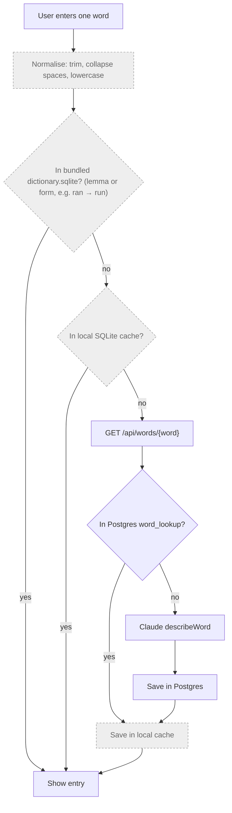
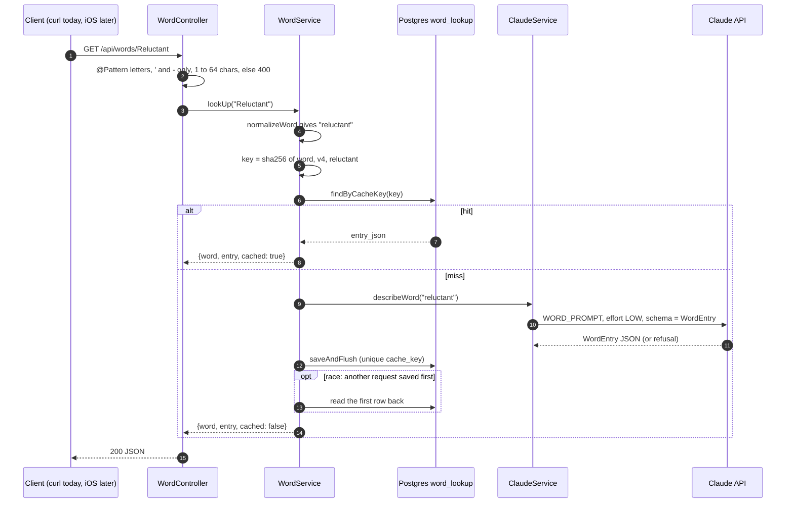

> Status: **backend done; iOS bundled-dictionary lookup (TASK-4) and local cache (TASK-5) done; backend fallback (TASK-6) and UI (TASK-19) not started**. Last traced from code: 2026-10-11.
> Spec: R1, R2 in [Vision and spec](../doc-1%20-%20Vision-and-spec.md).

## What it does

A single word gets a **learner dictionary entry**: 1–4 senses, each with part of speech, CEFR level,
a simple English definition, a Vietnamese meaning, 2 examples, and up to 3 **usage** items
(`{ kind, pattern, example }`, see the glossary in doc-1). It has no collocations or synonyms any more (decision-2, TASK-24).
Most words come from the dictionary bundled in the app (built by the [dictionary pipeline](doc-6%20-%20Dictionary-pipeline.md)).
Only words the bundle doesn't have go to the backend, which asks Claude once and caches the answer for everyone.

## Planned full flow (spec R2)

Grey boxes don't exist yet.



## Backend: step by step (works today)



| Step | File | What happens |
|---|---|---|
| Endpoint | [WordController.java:20-23](../../../backend/src/main/java/com/englishtranslation/backend/word/WordController.java#L20-L23) | `GET /api/words/{word}`. Only letters, `'` and `-`, 1–64 chars ("don't", "well-known"). A space → 400. |
| Normalise | [CacheKeys.java:24-26](../../../backend/src/main/java/com/englishtranslation/backend/cache/CacheKeys.java#L24-L26) | Sentence rules + `toLowerCase(Locale.ROOT)`. "Run" and "run" share one row. |
| Cache key | [WordService.java:28-29](../../../backend/src/main/java/com/englishtranslation/backend/word/WordService.java#L28-L29) | `sha256("word" \| wordPromptVersion \| normalizedWord)`. No language: entries are always English + Vietnamese. |
| Hit | [WordService.java:31-34](../../../backend/src/main/java/com/englishtranslation/backend/word/WordService.java#L31-L34) | Parse `entry_json` into `WordEntry`, `cached: true`. |
| Miss | [WordService.java:36-40](../../../backend/src/main/java/com/englishtranslation/backend/word/WordService.java#L36-L40) | Claude → save the whole entry as JSON text → `cached: false`. |
| Race | [WordService.java:41-45](../../../backend/src/main/java/com/englishtranslation/backend/word/WordService.java#L41-L45) | Same pattern as sentences: the unique key wins, the second request reads the first row. |
| Prompt | [ClaudeService.java:45-84](../../../backend/src/main/java/com/englishtranslation/backend/claude/ClaudeService.java#L45-L84) | `WORD_PROMPT`: 1–4 senses, ≤20-word definition, never the word itself, 2 examples, 0–3 `usage` items with the rules and the agreed few-shot examples (get, make, take, depend). Not an English word → empty `senses`. |
| Request | [ClaudeService.java:109-122](../../../backend/src/main/java/com/englishtranslation/backend/claude/ClaudeService.java#L109-L122) | `maxTokens 8000`, `effort LOW`, structured output with `WordEntry.class`. The word goes inside `<word>` tags, escaped by `wordMessage` ([130-132](../../../backend/src/main/java/com/englishtranslation/backend/claude/ClaudeService.java#L130-L132)). |
| Shape | [WordEntry.java:7-29](../../../backend/src/main/java/com/englishtranslation/backend/word/WordEntry.java#L7-L29) | Same as the pipeline's `models.py`, in camelCase, **without** `source_index`, `image_type`, `image_query`. `usage` is a list of `{ kind, pattern, example }`; `kind` is a plain lowercase String (an enum would be written in capitals in the schema). |
| Cache version | [application.properties:18](../../../backend/src/main/resources/application.properties#L18) | `app.claude.word-prompt-version=v4` (TASK-24). Rows saved with v3 have collocations and synonyms and no usage; the new key never reads them. |
| Response | [WordResponse.java:3](../../../backend/src/main/java/com/englishtranslation/backend/word/WordResponse.java#L3) | `{ word, entry: { senses: [...] }, cached }`. |

**Table `word_lookup`** ([V1](../../../backend/src/main/resources/db/migration/V1__create_cache_tables.sql#L11-L19), entity [WordLookup.java](../../../backend/src/main/java/com/englishtranslation/backend/word/WordLookup.java)):
`cache_key VARCHAR(64) UNIQUE`, `word VARCHAR(64)`, `entry_json TEXT`, `model`, `prompt_version`, `created_at`.
Unlike `sentence_translation`, the entry is stored as **one JSON column**, not split into columns.

Try it:

```bash
curl -s localhost:8081/api/words/depend
```

Expected shape (the words differ from run to run, the keys do not; first call `"cached": false`, second `true`):

```json
{ "word": "depend", "cached": false, "entry": { "senses": [ {
  "pos": "verb", "cefr": "A2", "simpleDefinition": "...", "vietnamese": "...", "examples": ["...", "..."],
  "usage": [ { "kind": "pattern", "pattern": "depend on + something", "example": "It depends on the weather." } ]
} ] } }
```

## iOS: bundled dictionary lookup (TASK-4)

| Step | File | What happens |
|---|---|---|
| Bundle | `EnglishTranslation/EnglishTranslation/Resources/dictionary.sqlite` | Copy of the pipeline output. Refresh: after a pipeline run, copy `pipeline/data/out/dictionary.sqlite` over it and commit. |
| Normalise | [CacheKeys.swift:51-53](../../../EnglishTranslation/EnglishTranslation/Cache/CacheKeys.swift#L51-L53) | `CacheKeys.normalizeWord`: trim, collapse spaces, lowercase, exactly like the backend. `DictionaryStore.lookUp` calls it. |
| Look up | [DictionaryStore.swift:51-56](../../../EnglishTranslation/EnglishTranslation/Dictionary/DictionaryStore.swift#L51-L56) | `lookUp(_:)` returns a `WordEntry` or nil. Tries `words.lemma`, then `forms.form` ("ran" finds "run"). Uses system SQLite3, read-only. |
| Model | [WordEntry.swift](../../../EnglishTranslation/EnglishTranslation/Dictionary/WordEntry.swift) | `WordEntry { word, ipa, senses }`, `Sense { pos, cefr, simpleDefinition, vietnamese, examples, usage }`, `Usage { kind, pattern, example }`. `usage` is read from the `senses.usage` JSON column ([DictionaryStore.swift:77-94](../../../EnglishTranslation/EnglishTranslation/Dictionary/DictionaryStore.swift#L77-L94), [decodeUsage:147-150](../../../EnglishTranslation/EnglishTranslation/Dictionary/DictionaryStore.swift#L147-L150)). The old bundled file has no such column: [columnExists:96-100](../../../EnglishTranslation/EnglishTranslation/Dictionary/DictionaryStore.swift#L96-L100) checks `PRAGMA table_info(senses)` once at open, and then usage is empty. A missing or unknown `kind` becomes `.pattern`. Collocations and synonyms are not loaded (decision-2). |

Tests: [DictionaryStoreTests.swift](../../../EnglishTranslation/EnglishTranslationTests/DictionaryStoreTests.swift) (hit, miss, form, usage kind default, usage JSON decode, a tiny file with a `usage` column; normalising is tested in [CacheTests.swift](../../../EnglishTranslation/EnglishTranslationTests/CacheTests.swift)).

## Errors

Same handler as sentences ([ApiExceptionHandler.java](../../../backend/src/main/java/com/englishtranslation/backend/common/ApiExceptionHandler.java)):
bad word → 400, Claude refused → 422, Claude down → 502. A made-up word like `asdfg` returns **200 with empty `senses`**, and that empty answer is cached too.

## Tests

| Test | Covers |
|---|---|
| [WordServiceTest.java](../../../backend/src/test/java/com/englishtranslation/backend/word/WordServiceTest.java) | The second lookup is `cached: true` and calls Claude once; a saved entry reads back the same |
| [TranslationControllerTest.java:69](../../../backend/src/test/java/com/englishtranslation/backend/translation/TranslationControllerTest.java#L69) | A word with spaces → 400 |
| [CacheKeysTest.java](../../../backend/src/test/java/com/englishtranslation/backend/cache/CacheKeysTest.java) | Words are lowercased |

## Known gaps

- **iOS has the bundled lookup and the local cache only.** The cache ([ResultCache.swift](../../../EnglishTranslation/EnglishTranslation/Cache/ResultCache.swift), `CacheKeys.wordKey` in [CacheKeys.swift](../../../EnglishTranslation/EnglishTranslation/Cache/CacheKeys.swift)) is not called for words yet; there is no backend fallback and no word screen. `CacheKeys.swift` must copy the backend normalising **exactly**, or the phone and server use different keys. The bundled lookup uses the same `CacheKeys.normalizeWord`. The word prompt version lives in `PromptVersions.word` and must equal `app.claude.word-prompt-version`.
- **Backend entries skip the pipeline's quality checks.** The pipeline rejects definitions with words outside NGSL ([validate.py](../../../pipeline/src/pipeline/validate.py)). The backend trusts Claude's answer, so backend definitions can be harder than bundled ones.
- **Empty answers are cached forever** (for that prompt version), including a typo the user fixes a second later.
- **Own prompt version:** `app.claude.word-prompt-version`, separate from the sentence one (TASK-15). Changing `WORD_PROMPT`? Bump it, or old entries keep being served.
