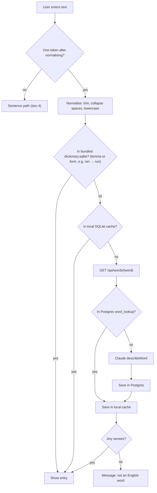
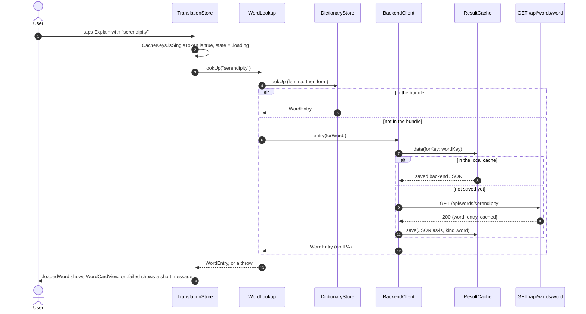

> Status: **working end to end** (bundle, local cache, backend, word card). iOS lookup: TASK-4, TASK-5, TASK-6; single-word routing and card: TASK-19. Last traced from code: 2026-10-11.
> Spec: R1, R2 in [Vision and spec](../doc-1%20-%20Vision-and-spec.md).

## What it does

A single word gets a **learner dictionary entry**: 1–4 senses, each with part of speech, CEFR level,
a simple English definition, a Vietnamese meaning, 2 examples, and up to 3 **usage** items
(`{ kind, pattern, example }`, see the glossary in doc-1). It has no collocations or synonyms any more (decision-2, TASK-24).
Most words come from the dictionary bundled in the app (built by the [dictionary pipeline](doc-6%20-%20Dictionary-pipeline.md)).
Only words the bundle doesn't have go to the backend, which asks Claude once and caches the answer for everyone.

## Full flow (spec R2)



## Backend: step by step (works today)


| Step | File | What happens |
|---|---|---|
| Endpoint | [WordController.java:20-23](../../../backend/src/main/java/com/englishtranslation/backend/word/WordController.java#L20-L23) | `GET /api/words/{word}`. Only letters, `'` and `-`, 1–64 chars ("don't", "well-known"). A space → 400. |
| Normalise | [CacheKeys.java:24-26](../../../backend/src/main/java/com/englishtranslation/backend/cache/CacheKeys.java#L24-L26) | Sentence rules + `toLowerCase(Locale.ROOT)`. "Run" and "run" share one row. |
| Cache key | [WordService.java:28-29](../../../backend/src/main/java/com/englishtranslation/backend/word/WordService.java#L28-L29) | `sha256("word" \| wordPromptVersion \| normalizedWord)`. No language: entries are always English + Vietnamese. |
| Hit | [WordService.java:31-34](../../../backend/src/main/java/com/englishtranslation/backend/word/WordService.java#L31-L34) | Parse `entry_json` into `WordEntry`, `cached: true`. |
| Miss | [WordService.java:36-40](../../../backend/src/main/java/com/englishtranslation/backend/word/WordService.java#L36-L40) | Claude → save the whole entry as JSON text → `cached: false`. |
| Race | [WordService.java:41-45](../../../backend/src/main/java/com/englishtranslation/backend/word/WordService.java#L41-L45) | Same pattern as sentences: the unique key wins, the second request reads the first row. |
| Prompt | [ClaudeService.java:45-84](../../../backend/src/main/java/com/englishtranslation/backend/claude/ClaudeService.java#L45-L84) | `WORD_PROMPT`: 1–4 senses, ≤20-word definition, never the word itself, 2 examples, 0–3 `usage` items with the rules and the agreed few-shot examples (get, make, take, depend). Not an English word → empty `senses`. |
| Request | [ClaudeService.java:109-122](../../../backend/src/main/java/com/englishtranslation/backend/claude/ClaudeService.java#L109-L122) | `maxTokens 8000`, `effort LOW`, structured output with `WordEntry.class`. The word goes inside `<word>` tags, escaped by `wordMessage` ([130-132](../../../backend/src/main/java/com/englishtranslation/backend/claude/ClaudeService.java#L130-L132)). |
| Shape | [WordEntry.java:7-29](../../../backend/src/main/java/com/englishtranslation/backend/word/WordEntry.java#L7-L29) | Same as the pipeline's `models.py`, in camelCase, **without** `source_index`, `image_type`, `image_query`. `usage` is a list of `{ kind, pattern, example }`; `kind` is a plain lowercase String (an enum would be written in capitals in the schema). |
| Cache version | [application.properties:18](../../../backend/src/main/resources/application.properties#L18) | `app.claude.word-prompt-version=v5` (TASK-24). Rows saved with v3 or v4 have collocations and synonyms and no usage; the new key never reads them. |
| Response | [WordResponse.java:3](../../../backend/src/main/java/com/englishtranslation/backend/word/WordResponse.java#L3) | `{ word, entry: { senses: [...] }, cached }`. |

**Table `word_lookup`** ([V1](../../../backend/src/main/resources/db/migration/V1__create_cache_tables.sql#L11-L19), entity [WordLookup.java](../../../backend/src/main/java/com/englishtranslation/backend/word/WordLookup.java)):
`cache_key VARCHAR(64) UNIQUE`, `word VARCHAR(64)`, `entry_json TEXT`, `model`, `prompt_version`, `created_at`.
Unlike `sentence_translation`, the entry is stored as **one JSON column**, not split into columns.

Try it:

```bash
curl -s localhost:8081/api/words/depend
```

Expected shape (the words differ from run to run, the keys do not; first call `"cached": false`, second `true`):

```json
{ "word": "depend", "cached": false, "entry": { "senses": [ {
  "pos": "verb", "cefr": "A2", "simpleDefinition": "...", "vietnamese": "...", "examples": ["...", "..."],
  "usage": [ { "kind": "pattern", "pattern": "depend on + something", "example": "It depends on the weather." } ]
} ] } }
```

## iOS: bundled dictionary lookup (TASK-4)

| Step | File | What happens |
|---|---|---|
| Bundle | `EnglishTranslation/EnglishTranslation/Resources/dictionary.sqlite` | Copy of the pipeline output. Refresh: after a pipeline run, copy `pipeline/data/out/dictionary.sqlite` over it and commit. |
| Normalise | [CacheKeys.swift:51-53](../../../EnglishTranslation/EnglishTranslation/Cache/CacheKeys.swift#L51-L53) | `CacheKeys.normalizeWord`: trim, collapse spaces, lowercase, exactly like the backend. `DictionaryStore.lookUp` calls it. |
| Look up | [DictionaryStore.swift:51-56](../../../EnglishTranslation/EnglishTranslation/Dictionary/DictionaryStore.swift#L51-L56) | `lookUp(_:)` returns a `WordEntry` or nil. Tries `words.lemma`, then `forms.form` ("ran" finds "run"). Uses system SQLite3, read-only. |
| Model | [WordEntry.swift](../../../EnglishTranslation/EnglishTranslation/Dictionary/WordEntry.swift) | `WordEntry { word, ipa, senses, matchedForm }` ([9-24](../../../EnglishTranslation/EnglishTranslation/Dictionary/WordEntry.swift#L9-L24)), `MatchedForm { text, type }` ([27-33](../../../EnglishTranslation/EnglishTranslation/Dictionary/WordEntry.swift#L27-L33), the form the user typed, for example "ran" and "past tense"; nil for a base word; TASK-35 fills it from the bundle), `Sense { pos, cefr, simpleDefinition, vietnamese, examples, usage }`, `Usage { kind, pattern, example }`, `Example { level, text }` ([98-128](../../../EnglishTranslation/EnglishTranslation/Dictionary/WordEntry.swift#L98-L128); `level` is easy, medium or harder; a plain string in old data decodes with no level). `usage` is read from the `senses.usage` JSON column ([DictionaryStore.swift:77-94](../../../EnglishTranslation/EnglishTranslation/Dictionary/DictionaryStore.swift#L77-L94), [decodeUsage:148-150](../../../EnglishTranslation/EnglishTranslation/Dictionary/DictionaryStore.swift#L148-L150)), `examples` by [decodeExamples:141-144](../../../EnglishTranslation/EnglishTranslation/Dictionary/DictionaryStore.swift#L141-L144). The old bundled file has no `usage` column: [columnExists](../../../EnglishTranslation/EnglishTranslation/Dictionary/DictionaryStore.swift#L96-L100) checks `PRAGMA table_info(senses)` once at open, and then usage is empty. A missing or unknown `kind` becomes `.pattern`. Collocations and synonyms are not loaded (decision-2). |

Tests: [DictionaryStoreTests.swift](../../../EnglishTranslation/EnglishTranslationTests/DictionaryStoreTests.swift) (hit, miss, form, usage kind default, usage JSON decode, a tiny file with a `usage` column; normalising is tested in [CacheTests.swift](../../../EnglishTranslation/EnglishTranslationTests/CacheTests.swift)).

## iOS: the full lookup (TASK-6, TASK-19)



| Step | File | What happens |
|---|---|---|
| Word or sentence | [CacheKeys.swift:56-62](../../../EnglishTranslation/EnglishTranslation/Cache/CacheKeys.swift#L56-L62) | `isSingleToken`: normalise like the backend, then no space left and not empty. "don't" and "well-known" are one token, "go home" is two. The no-break space does not split (same as Java). |
| Route | [TranslationStore.swift:44-54](../../../EnglishTranslation/EnglishTranslation/Stores/TranslationStore.swift#L44-L54) | One token goes to `lookUpWord`, more go to `explainSentence` (doc-4). The input is trimmed first. The target-language picker does not matter for a word: entries are English plus Vietnamese. |
| Word path | [TranslationStore.swift:56-63](../../../EnglishTranslation/EnglishTranslation/Stores/TranslationStore.swift#L56-L63) | `makeWordLookup().lookUp(...)`, then `.loadedWord(entry)` or `.failed(error.localizedDescription)`. The lookup is built per request (like the translator), by [TranslatorFactory.swift:25-33](../../../EnglishTranslation/EnglishTranslation/Network/TranslatorFactory.swift#L25-L33). |
| Punctuation | [CacheKeys.swift:64-75](../../../EnglishTranslation/EnglishTranslation/Cache/CacheKeys.swift#L64-L75) | `trimmingWordPunctuation`: word path only. Removes punctuation and symbols at the start and end ("Run!", "(run)", "“run”" give "Run"); inner `'` and `-` stay. `WordLookup` calls it first, so the bundle, the cache key and the backend all get the clean word. Nothing left ("?!") gives `notOneWord`. Sentences are not touched. |
| Order | [WordLookup.swift:34-62](../../../EnglishTranslation/EnglishTranslation/Dictionary/WordLookup.swift#L34-L62) | 1. bundle (`DictionaryStore.lookUp`, a broken file counts as a miss), 2. and 3. `backend.entry(forWord:)`. Protocols `WordLooking` and `WordFetching` ([WordLookup.swift:9-18](../../../EnglishTranslation/EnglishTranslation/Dictionary/WordLookup.swift#L9-L18)) let tests use fakes. |
| Cache and fetch | [BackendClient.swift:86-101](../../../EnglishTranslation/EnglishTranslation/Network/BackendClient.swift#L86-L101) | `entry(forWord:)`: key = `CacheKeys.wordKey` (same as the backend), local hit returns with no network. A miss calls `GET {baseURL}/api/words/{normalised word}` (the word is percent-encoded as one path part), then saves the **raw JSON** under the key. Errors are never saved. |
| Decode | [BackendClient.swift:19-32](../../../EnglishTranslation/EnglishTranslation/Network/BackendClient.swift#L19-L32) | `WordResponse` reads `word` and `entry.senses`. The backend sends no `ipa`, so the card has none. Old `collocations` and `synonyms` in an older backend reply are ignored. |
| Status check | [BackendClient.swift:104-112](../../../EnglishTranslation/EnglishTranslation/Network/BackendClient.swift#L104-L112) | Shared with sentences: not 200 gives `BackendError.badStatus(code, detail)`. |
| Not a word | [WordLookup.swift:57-59](../../../EnglishTranslation/EnglishTranslation/Dictionary/WordLookup.swift#L57-L59) | Empty `senses` gives `WordLookupError.notAnEnglishWord`. The empty answer is saved in the local cache too (the server keeps it as well). |
| Result | [TranslateResultView.swift:22-23](../../../EnglishTranslation/EnglishTranslation/Views/Translate/Subviews/TranslateResultView.swift#L22-L23) | `.loadedWord(entry)` shows `WordCardView(entry:)`. |

What the user sees when it goes wrong:

| Cause | HTTP | Message |
|---|---|---|
| Only punctuation ("?!"), or digits, symbols inside, or more than 64 letters | none / 400 | "Type one English word, with letters only." |
| Made-up word (`asdkj`) | 200, empty senses | "\"asdkj\" is not an English word. Check the spelling." |
| Claude refused | 422 | "Claude declined to answer this text. (status 422)" (same text as sentences) |
| Claude down | 502 | "The translation service is not available. Try again later. (status 502)" |
| Offline, or backend not running (and not in the bundle or cache) | none | The system text, for example "The Internet connection appears to be offline." |
| `BackendBaseURL` missing | none | "Missing BackendBaseURL. Check Secrets.xcconfig and the Info tab." (it stops even bundled words, because the lookup is built whole) |

Tests: [WordLookupTests.swift](../../../EnglishTranslation/EnglishTranslationTests/WordLookupTests.swift) (bundle first, backend on a miss, empty senses, 400 message, other errors pass through), the word tests in [BackendClientTests.swift](../../../EnglishTranslation/EnglishTranslationTests/BackendClientTests.swift) (GET path and decode, save then serve with no network, errors not saved), the token rule in [CacheTests.swift](../../../EnglishTranslation/EnglishTranslationTests/CacheTests.swift), and the word or sentence choice in [TranslationStoreTests.swift](../../../EnglishTranslation/EnglishTranslationTests/TranslationStoreTests.swift).

## iOS word card (v2, TASK-36)

Built in TASK-27, shown for real lookups since TASK-19, redesigned in TASK-36 (developer mockup v3, doc-7).
Uses the model from the TASK-4 section above. An empty `cefr` or `vietnamese` (what the store gives for a missing value)
hides the level or the Vietnamese row. Last traced: 2026-10-11.

| Part | File |
|---|---|
| Sample words for previews (`ran`, `apple`, `get`, `run`, `depend`, `oldData`, `sparse`) | [WordEntry+Samples.swift](../../../EnglishTranslation/EnglishTranslation/Models/WordEntry+Samples.swift) |
| Full card: header, one card per sense, folded rows | [WordCardView.swift](../../../EnglishTranslation/EnglishTranslation/Views/Word/WordCardView.swift) |
| Compact card (word list in a sentence): first sense only | [WordCardCompactView.swift](../../../EnglishTranslation/EnglishTranslation/Views/Word/WordCardCompactView.swift) |
| Sense title: number circle, simple explanation, level chip | [SenseTitleRow.swift](../../../EnglishTranslation/EnglishTranslation/Views/Word/SenseTitleRow.swift) |
| Form pill ("past tense of run /rʌn/") | [FormPill.swift](../../../EnglishTranslation/EnglishTranslation/Views/Word/FormPill.swift) |
| "Examples" content with easy / medium / harder labels | [WordExamplesSection.swift](../../../EnglishTranslation/EnglishTranslation/Views/Word/WordExamplesSection.swift) |
| "Grammar" content (usage grouped by kind) | [WordUsageSection.swift](../../../EnglishTranslation/EnglishTranslation/Views/Word/WordUsageSection.swift) |
| Text helpers: `chipText`, `usageGroups`, `formPillText` | [WordEntry+Display.swift](../../../EnglishTranslation/EnglishTranslation/Views/Word/WordEntry+Display.swift) |

Top to bottom:

1. **Header** ([WordCardView.swift:32-50](../../../EnglishTranslation/EnglishTranslation/Views/Word/WordCardView.swift#L32-L50)): the headword as typed (`matchedForm.text`, else `word`), and the Listen icon button. Under it, either the form pill (when `matchedForm` is set; it has the lemma IPA) or the IPA (when the user typed the base word).
2. **One card per sense** ([senseCard:52-82](../../../EnglishTranslation/EnglishTranslation/Views/Word/WordCardView.swift#L52-L82)): surface, hairline border, card radius. Title = `SenseTitleRow`.
3. **Three folded rows, all closed**, in this order: Examples, Grammar, Vietnamese. No counters. One row open at a time per card. Examples is hidden with no examples, Grammar with no usage, Vietnamese with no text.
4. **Examples (open)**: one line each, with a level label (`ExampleLevelLabel`: easy teal, medium amber, harder coral). No level (old data) means no label.
5. **Grammar (open)**: `Sense.usageGroups` ([WordEntry+Display.swift:22-33](../../../EnglishTranslation/EnglishTranslation/Views/Word/WordEntry+Display.swift#L22-L33)) groups by kind in a fixed order: Patterns, Collocations, Phrases and idioms (phrase and idiom together). Empty groups are hidden. Each item is a bullet: pattern in medium weight, example below in secondary serif.

Compact card: word, IPA, Listen, then the same `SenseTitleRow` for sense 1, then Vietnamese (closed).

Tests: [WordEntryTests.swift](../../../EnglishTranslation/EnglishTranslationTests/WordEntryTests.swift) (usage grouping and order, empty groups, form pill text, example decoding of old strings and new objects, entry without `matchedForm`).

## Errors

Same handler as sentences ([ApiExceptionHandler.java](../../../backend/src/main/java/com/englishtranslation/backend/common/ApiExceptionHandler.java)):
bad word → 400, Claude refused → 422, Claude down → 502. A made-up word like `asdfg` returns **200 with empty `senses`**, and that empty answer is cached too.

## Tests

| Test | Covers |
|---|---|
| [WordServiceTest.java](../../../backend/src/test/java/com/englishtranslation/backend/word/WordServiceTest.java) | The second lookup is `cached: true` and calls Claude once; a saved entry reads back the same |
| [TranslationControllerTest.java:69](../../../backend/src/test/java/com/englishtranslation/backend/translation/TranslationControllerTest.java#L69) | A word with spaces → 400 |
| [CacheKeysTest.java](../../../backend/src/test/java/com/englishtranslation/backend/cache/CacheKeysTest.java) | Words are lowercased |

## Known gaps

- **Keep the keys equal.** `CacheKeys.swift` must copy the backend normalising **exactly**, or the phone and server use different keys. The word prompt version lives in `PromptVersions.word` and must equal `app.claude.word-prompt-version`.
- **A word from the backend has no IPA** (the backend does not send it), and its usage list can be empty if the saved answer is from an older prompt version.
- **Direct providers (DeepSeek, ChatGPT, Claude) still use the word path for one word**, because the word lookup does not depend on the provider. They go away in TASK-18.
- **Backend entries skip the pipeline's quality checks.** The pipeline rejects definitions with words outside NGSL ([validate.py](../../../pipeline/src/pipeline/validate.py)). The backend trusts Claude's answer, so backend definitions can be harder than bundled ones.
- **Empty answers are cached forever** (for that prompt version), including a typo the user fixes a second later.
- **Own prompt version:** `app.claude.word-prompt-version`, separate from the sentence one (TASK-15). Changing `WORD_PROMPT`? Bump it, or old entries keep being served.
