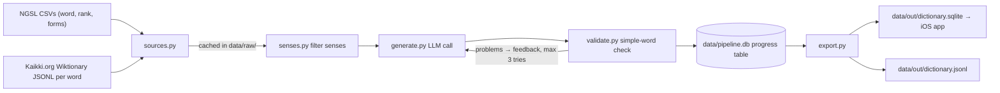
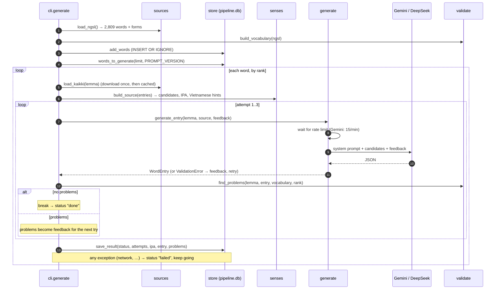
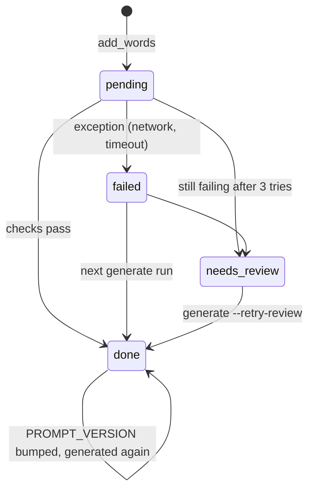

> Status: **works, 245 of 2,809 words done** (TASK-3). Last traced from code: 2026-10-10.
> Spec: R1 in [Vision and spec](../doc-1%20-%20Vision-and-spec.md). How to run: [pipeline/README.md](../../../pipeline/README.md).

## What it does

An offline Python job that builds `dictionary.sqlite`, the word data bundled in the iOS app.
For each of the ~2,800 most common English words (NGSL), it takes the Wiktionary senses, asks an LLM
to write a **simple definition** + **Vietnamese meaning** + examples, checks that the definition only
uses simple words, and retries with feedback when it doesn't.

## Big picture

## `generate` command: step by step

## Step by step

### 1. Sources: [sources.py](../../../pipeline/src/pipeline/sources.py)

| Step | Line | What happens |
|---|---|---|
| Download once | [25-32](../../../pipeline/src/pipeline/sources.py#L25-L32) | `_download` skips the request if the file is already in `data/raw/`. |
| NGSL list | [40-63](../../../pipeline/src/pipeline/sources.py#L40-L63) | Reads two CSVs: stats (rank) and lemmatised forms ("run" → "runs, ran, running"). |
| Excel fix | [35-37](../../../pipeline/src/pipeline/sources.py#L35-L37) | Lowercases everything except "I", because Excel turned "true" into "TRUE". |
| Wiktionary | [66-70](../../../pipeline/src/pipeline/sources.py#L66-L70) | `kaikki.org/.../{w[0]}/{w[:2]}/{word}.jsonl`: one JSON line per part of speech. |

### 2. Sense filter: [senses.py](../../../pipeline/src/pipeline/senses.py)

| Rule | Line | Why |
|---|---|---|
| Skip parts of speech | [9](../../../pipeline/src/pipeline/senses.py#L9) | name, symbol, prefix, suffix, phrase, proverb… a learner doesn't need them. |
| Skip tags | [10-13](../../../pipeline/src/pipeline/senses.py#L10-L13) | archaic, obsolete, rare, dialectal, form-of ("ran" = past of run), abbreviation… |
| Max 5 per entry | [17](../../../pipeline/src/pipeline/senses.py#L17), [43-58](../../../pipeline/src/pipeline/senses.py#L43-L58) | Per entry, not per word, so "bank" (money) and "bank" (river) both survive. |
| IPA | [74-80](../../../pipeline/src/pipeline/senses.py#L74-L80) | Prefers US / General American. |
| Vietnamese hints | [83-90](../../../pipeline/src/pipeline/senses.py#L83-L90) | Wiktionary's `vi` translations, passed to the LLM as hints. |

### 3. LLM call: [generate.py](../../../pipeline/src/pipeline/generate.py)

| Step | Line | What happens |
|---|---|---|
| Provider | [20-35](../../../pipeline/src/pipeline/generate.py#L20-L35), [55-56](../../../pipeline/src/pipeline/generate.py#L55-L56) | `LLM_PROVIDER` = `gemini` (free, 15/min) or `deepseek`. Both speak the OpenAI API, so one client works. |
| Client | [59-65](../../../pipeline/src/pipeline/generate.py#L59-L65) | Created once (`@cache`). `max_retries=5` for 429 and 5xx errors. |
| Rate limit | [76-88](../../../pipeline/src/pipeline/generate.py#L76-L88) | Sleeps so calls are ≥ 60/limit seconds apart. SDK retries alone aren't enough for Gemini. |
| System prompt | [37-52](../../../pipeline/src/pipeline/generate.py#L37-L52) | Cambridge Learner's style, plus the full `WordEntry` JSON schema. |
| User prompt | [91-103](../../../pipeline/src/pipeline/generate.py#L91-L103) | Headword + candidate senses + Vietnamese hints + **feedback from the last failed try**. |
| Call | [106-118](../../../pipeline/src/pipeline/generate.py#L106-L118) | `response_format: json_object`, `temperature 0.3`, then `WordEntry.model_validate_json`. |
| Version | [18](../../../pipeline/src/pipeline/generate.py#L18) | `PROMPT_VERSION = 1`. Bump it and `generate` redoes `done` rows with an older version. |

Output shape: [models.py](../../../pipeline/src/pipeline/models.py): `senses[]` with `source_index, pos, cefr, simple_definition, examples, vietnamese, collocations, synonyms, image_type, image_query`.

### 4. Quality check: [validate.py](../../../pipeline/src/pipeline/validate.py)

The **defining vocabulary** method from learner dictionaries: a definition may only use words from a fixed list.

| Check | Line | Rule |
|---|---|---|
| Vocabulary | [41-46](../../../pipeline/src/pipeline/validate.py#L41-L46) | NGSL lemmas + all forms + numbers/days/months + grammar terms + "someone/something…". |
| Hard words | [56-59](../../../pipeline/src/pipeline/validate.py#L56-L59) | Any word outside the vocabulary → problem. |
| Headword | [60-62](../../../pipeline/src/pipeline/validate.py#L60-L62) | Can't use the word itself, **except** the top 100 grammar words ("a", "the"). |
| Length | [63-64](../../../pipeline/src/pipeline/validate.py#L63-L64) | Max 20 words. |
| Vietnamese / examples | [65-68](../../../pipeline/src/pipeline/validate.py#L65-L68) | Vietnamese not empty, at least 2 examples. |

### 5. Progress table: [store.py](../../../pipeline/src/pipeline/store.py)

| Part | Line | Note |
|---|---|---|
| Schema | [15-28](../../../pipeline/src/pipeline/store.py#L15-L28) | `words(lemma PK, rank, forms, status, prompt_version, attempts, ipa, entry, problems, updated_at)`. |
| What runs next | [47-57](../../../pipeline/src/pipeline/store.py#L47-L57) | `pending` + `failed` (+ `needs_review` with `--retry-review`) + old-version `done`, ordered by rank. |
| Save | [60-69](../../../pipeline/src/pipeline/store.py#L60-L69) | `attempts` is **added to**, so `report` shows the total LLM calls. |

### 6. Export: [export.py](../../../pipeline/src/pipeline/export.py)

| Part | Line | Note |
|---|---|---|
| App schema | [10-32](../../../pipeline/src/pipeline/export.py#L10-L32) | `meta`, `words`, `forms` ("ran" → run), `senses`. Case-insensitive indexes on lemma and form. |
| Only `done` | [42](../../../pipeline/src/pipeline/export.py#L42) | `needs_review` and `failed` words are **not** exported. |
| Rebuild | [37-40](../../../pipeline/src/pipeline/export.py#L37-L40) | Deletes and recreates the file each time. |
| Version | [69-72](../../../pipeline/src/pipeline/export.py#L69-L72) | `meta.dictionary_version` = UTC timestamp, so the app can tell versions apart. |

## Commands ([cli.py](../../../pipeline/src/pipeline/cli.py))

| Command | LLM? | Use |
|---|---|---|
| `uv run pipeline preview bank` | No | See the exact prompt for a word |
| `uv run pipeline try bank` | 1–3 calls | Try one word, save nothing, print the checks |
| `uv run pipeline generate --limit 200` | Yes | Next 200 words by rank |
| `uv run pipeline generate --retry-review` | Yes | Also redo `needs_review` |
| `uv run pipeline report` | No | Counts per status + the problem list |
| `uv run pipeline export` | No | Build `data/out/dictionary.sqlite` + `.jsonl` |

## Tests

| Test | Covers |
|---|---|
| [test_senses.py](../../../pipeline/tests/test_senses.py) | Drops archaic and form-of senses, keeps both homograph entries, skips names, reads Vietnamese hints |
| [test_validate.py](../../../pipeline/tests/test_validate.py) | Simple definition passes, hard word and headword reported, missing Vietnamese/examples, numbers and grammar terms allowed, grammar words may use themselves |

Run: `uv run pytest` in `pipeline/` (no API key needed).

## Known gaps

- **Network errors become `failed` with `attempts=1`**, even when some LLM calls already ran ([cli.py:73-75](../../../pipeline/src/pipeline/cli.py#L73-L75)). `report` undercounts calls for these words.
- **3 schema errors in a row → `needs_review` with no entry** ([cli.py:59-68](../../../pipeline/src/pipeline/cli.py#L59-L68)). Harmless for export, but `report` shows the schema error as the problem.
- **`temperature 0.3`**, not the lowest. This is fine here: the output is generated once and stored, so R3's "same input, same output" holds through the file, not the sampling.
- **Image fields are generated but not used yet** (`image_url` is always empty). Images are out of scope for v1.
- **The iOS app doesn't read the file yet** (TASK-4).
