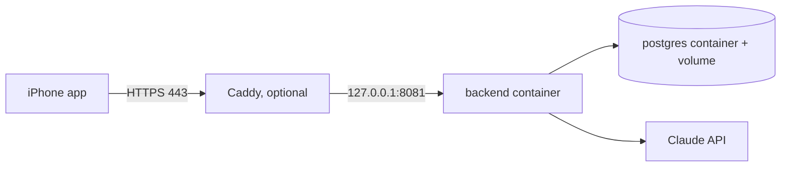

# Deploy to a VPS

How to run the Saynata backend on a small server (about 10 USD per month) so the iPhone app works anywhere.
You do each step yourself. No secrets are in git.

What you need:
- A VPS with Ubuntu 22.04 or newer, 2 GB RAM (1 GB works, but the first build is slow), and a public IP.
- Docker with the Compose plugin on the server (`curl -fsSL https://get.docker.com | sh`).
- A Claude API key.
- For HTTPS: a domain name that points to the server's IP (an `A` record).

## What runs



Files: [backend/Dockerfile](../../../backend/Dockerfile), [backend/docker-compose.prod.yml](../../../backend/docker-compose.prod.yml),
[backend/.env.example](../../../backend/.env.example).
Postgres has no public port. Its data lives in the named volume `pgdata`, so it survives restarts and rebuilds.
The backend has a health check on `/actuator/health` (it shows only `UP` or `DOWN`).

## 1. Copy the files to the server

The simplest way is to clone the repo on the server:

```bash
git clone https://github.com/<you>/english-translation.git
cd english-translation/backend
```

Or copy only the `backend/` folder: `rsync -av --exclude target backend/ user@SERVER:~/saynata/`.

## 2. Set the .env file

```bash
cp .env.example .env
nano .env
```

| Name | Meaning |
|---|---|
| `CLAUDE_API_KEY` | Your key. Required. |
| `DB_PASSWORD` | A long random password for Postgres. Required. Make one with `openssl rand -base64 24`. |
| `BACKEND_PORT` | Port on the server (default 8081). |
| `BACKEND_BIND` | `0.0.0.0` (open) or `127.0.0.1` (only Caddy on the same server can reach it). |
| `CLAUDE_MODEL` | Optional. Default is the model in `application.properties`. |

`.env` is git-ignored. Never commit it. Set `DB_PASSWORD` before the first start: Postgres keeps the first one
in the volume.

## 3. Start it

```bash
docker compose -f docker-compose.prod.yml up -d --build
```

The first build downloads Maven dependencies and takes a few minutes. Then check:

```bash
docker compose -f docker-compose.prod.yml ps        # backend should become "healthy"
curl http://localhost:8081/actuator/health          # {"status":"UP"}
curl http://localhost:8081/api/words/run            # a bundled word, no Claude call
docker compose -f docker-compose.prod.yml logs -f backend
```

Useful commands:

| Job | Command |
|---|---|
| Update after `git pull` | `docker compose -f docker-compose.prod.yml up -d --build` |
| Restart | `docker compose -f docker-compose.prod.yml restart backend` |
| Stop (keeps data) | `docker compose -f docker-compose.prod.yml down` |
| Back up the database | `docker compose -f docker-compose.prod.yml exec postgres pg_dump -U app english_translation > backup.sql` |

Never use `down -v` unless you want to delete the database: `-v` removes the volume.

## 4. Firewall

Allow SSH first, or you lock yourself out.

```bash
sudo ufw allow OpenSSH
sudo ufw allow 80/tcp     # only if you use Caddy
sudo ufw allow 443/tcp    # only if you use Caddy
sudo ufw enable
```

Warning: Docker opens ports by editing iptables itself, and that skips ufw. A port in `ports:` is open to the
internet even if ufw says no. This is why, with Caddy, you set `BACKEND_BIND=127.0.0.1`. Also check your VPS
provider's own firewall panel.

## 5. HTTPS (needed for the iPhone app)

iOS App Transport Security (ATS) blocks plain `http://` to any host except local-network addresses. Our Info.plist
only has `NSAllowsLocalNetworking`. So a real server needs an `https://` URL with a valid certificate. Do not turn
ATS off.

Option A, recommended: Caddy in front of the backend. Caddy gets and renews a free Let's Encrypt certificate by itself.

1. In `.env` set `BACKEND_BIND=127.0.0.1`, then run `docker compose -f docker-compose.prod.yml up -d`.
2. Install Caddy (https://caddyserver.com/docs/install#debian-ubuntu-raspbian) and put this in `/etc/caddy/Caddyfile`:

```caddyfile
api.example.com {
    reverse_proxy 127.0.0.1:8081
}
```

3. Run `sudo systemctl reload caddy`, then `curl https://api.example.com/actuator/health`.

Option B: a tunnel such as Cloudflare Tunnel or Tailscale Funnel. You open no ports and need no certificate setup,
but it adds an account and a service you depend on.

## 6. Point the app at the server

In `EnglishTranslation/EnglishTranslation/Info.plist`, change the value of `BackendBaseURL`:

```xml
<key>BackendBaseURL</key>
<string>https://api.example.com</string>
```

Build and run on your iPhone. A word that is not in the bundled `dictionary.sqlite`, and every sentence, goes to the
server. Watch `docker compose -f docker-compose.prod.yml logs -f backend` while you test.

The Claude key stays on the server. The app never sends one.

## Troubleshooting

| Problem | Fix |
|---|---|
| Compose says `Set CLAUDE_API_KEY in .env` | `.env` is missing or the value is empty. Run compose from the `backend/` folder. |
| Backend stays "unhealthy" | Read `logs backend`. Often a wrong `DB_PASSWORD` (the volume keeps the old one) or too little RAM. |
| App cannot connect | Test the URL with `curl` from your laptop. Check DNS, the firewall, and that the URL starts with `https://`. |
| Build is killed on a 1 GB VPS | Add swap: `sudo fallocate -l 2G /swapfile && sudo chmod 600 /swapfile && sudo mkswap /swapfile && sudo swapon /swapfile`. |
