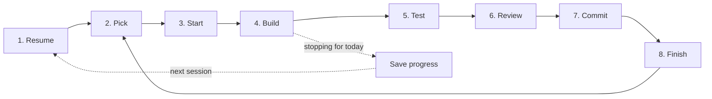

# Daily workflow

You don't need to remember this. Open it when you come back after a break.

| Step | Say to Claude | Or run yourself | What happens |
|---|---|---|---|
| 1. Resume | "Where was I?" | `backlog board` | Claude reads the In Progress task and its notes, and tells you the next step. |
| 2. Pick | "What's next in the backlog?" | `backlog browser` | The top To Do task that isn't blocked by a dependency. |
| 3. Start | "Start TASK-n" | `backlog task edit n -s "In Progress"` | Status → In Progress. Claude writes a plan into the task. |
| 4. Build | (normal work) | | Claude adds notes to the task as it goes. |
| 5. Test | "Run the tests" | see below | All green before you go on. |
| 6. Review | "/code-review" | | Finds bugs in the diff before they land. |
| 7. Commit | "Commit this" | `git add -A && git commit` | One commit per task, with the `backlog/` changes in it. |
| 8. Finish | "Finish TASK-n" | `backlog task edit n -s Done` | Claude ticks the ACs and the Definition of Done (including the feature doc), and writes a summary. |
| Stop for today | **"Save my progress"** | | Claude writes what changed, what's half done, and **Next step: …** into the task. |

**The one habit that matters:** say "save my progress" before you stop. A task with a "Next step" line
takes seconds to resume. A task without one takes half an hour.

## Test commands

| Part | Command |
|---|---|
| Backend | `cd backend && ./mvnw test` |
| Pipeline | `cd pipeline && uv run pytest` |
| iOS | Xcode → ⌘U |

## Where things live

| What | Where |
|---|---|
| Goal, requirements, decisions | [backlog/docs/doc-1 - Vision-and-spec.md](../backlog/docs/doc-1%20-%20Vision-and-spec.md) |
| How each feature works | [docs/features/](features/README.md) |
| Tasks and progress | `backlog/tasks/`, or `backlog browser` |
| Decisions made later | `backlog/decisions/` ("record a decision: …") |
| Reports on finished work | [docs/reports/](reports/) |
