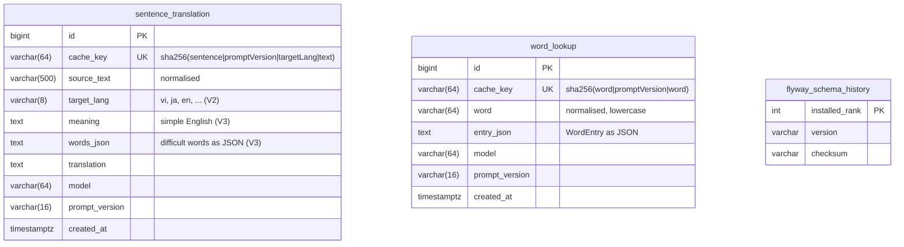

# Database design

Status: v1 · 2026-10-09 · Spec: `.scratch/translator/spec.md`

The app has **three databases**, and each one has a different owner and lifetime.

| Database | Where | Written by | Lifetime |
|---|---|---|---|
| `dictionary.sqlite` | Bundled in the iOS app | `pipeline/` at build time | Read-only. Replaced as a whole file by an app update. |
| Local cache (`cache.sqlite`) | On the phone | The iOS app | Kept until the user deletes the app. |
| Shared cache (Postgres) | Backend | `backend/` | Permanent. Shared by every user. |

```
iPhone                                         Backend
┌────────────────────┐  miss   ┌─────────────┐  miss   ┌──────────────┐  miss   ┌────────┐
│ dictionary.sqlite  │ ──────► │ cache.sqlite│ ──────► │  Postgres    │ ──────► │ Claude │
│ (words only, r/o)  │         │ (r/w)       │         │  (shared)    │         │        │
└────────────────────┘         └─────────────┘         └──────────────┘         └────────┘
```

---

## 1. Shared cache — Postgres (built)

Migrations: `backend/src/main/resources/db/migration/` (`V1__create_cache_tables.sql`, `V2__add_target_lang_to_sentence_translation.sql`)



The two cache tables have no relation to each other. Flyway owns `flyway_schema_history`.

### Main queries

| Query | Index used |
|---|---|
| `SELECT … WHERE cache_key = ?` (every request) | The `UNIQUE` index on `cache_key` |
| `INSERT …` on a miss | The same index rejects a duplicate key |

That's the whole workload: one lookup by key, one insert. Every decision below comes from it.

---

## 2. Local cache — SQLite on the phone (planned)

The same two tables, without the audit columns. The phone doesn't need to know which model wrote a row.

```sql
CREATE TABLE sentence_translation (
    cache_key   TEXT PRIMARY KEY,   -- same sha256 as the backend
    source_text TEXT NOT NULL,
    target_lang TEXT NOT NULL,
    translation TEXT NOT NULL,
    fetched_at  INTEGER NOT NULL    -- unix seconds
);

CREATE TABLE word_lookup (
    cache_key  TEXT PRIMARY KEY,
    word       TEXT NOT NULL,
    entry_json TEXT NOT NULL,
    fetched_at INTEGER NOT NULL
);
```

**`cache.sqlite` is a separate file from `dictionary.sqlite`.** The dictionary is replaced as a whole file when the pipeline produces a new version. If the user's cache lived inside it, every dictionary update would wipe the cache, or need a data migration.

---

## 3. Why this design

### 3.1 Postgres, not Redis

The usual "cache" tool is Redis. It's the wrong tool here.

- Redis is built to *forget*: keys expire, and memory pressure evicts them. Our rule (spec R3) is the opposite: **once an answer is saved, never generate it again.** Losing a row costs money and can change the answer.
- Postgres keeps data on disk, has `UNIQUE` constraints to stop duplicates, and is already the stack you know (Spring Data JPA, Flyway).
- One service fewer to run.

So this is less a "cache" in the Redis sense and more a **permanent table of answers**.

### 3.2 Two tables, not one generic `cache_entry` table

The alternative was one table with a `kind` column (`word` or `sentence`).

- The two shapes are different: a sentence has one translation string, a word has a structured entry. A shared table would need nullable columns, or JSON for everything.
- The limits are different (500 characters and 64 characters), and each table enforces its own.
- Two tables can grow apart later (for example, an `audio_url` on words only) without touching the other.

This follows the profile rule: *favour the obvious over the clever*. Two plain tables are easier to read than one clever table.

### 3.3 A hashed `cache_key`, not `UNIQUE(source_text)`

- **Size:** a Postgres B-tree index entry is limited to roughly 2.7 KB. A unique index on raw text can fail on long input. A sha256 hex key is always 64 characters.
- **Several inputs, one key:** a sentence key is built from `kind`, `promptVersion`, `targetLang` and the text, so one column covers all four. A composite unique index on four columns would also work, but the phone needs a single key anyway.
- **Same key on both sides:** the phone computes the same sha256, so phone and server agree on what "the same input" means.

The text is normalised before hashing (trim, collapse spaces, lowercase for words). Without that, `"I love you"` and `"I love  you"` would be two rows and two Claude calls.

### 3.4 `prompt_version` inside the key, and as a column

- **Inside the key:** when the prompt improves (`v1` → `v2`), every key changes, so old answers stop being served. No need to delete anything first.
- **As a column:** later you can clean up with `DELETE FROM sentence_translation WHERE prompt_version = 'v1'`, or compare v1 and v2 answers.

`model` is stored for the same reason. If a model gives bad answers, you can find exactly which rows it wrote.

### 3.5 Surrogate `id` plus a unique `cache_key`

`cache_key` could be the primary key on its own. A `BIGINT` identity `id` is kept because:

- it's the normal JPA pattern (`@GeneratedValue(strategy = IDENTITY)`), so the entities stay plain;
- a future table (for example, a user's history) can reference a small `bigint`, not a 64-character string.

The phone uses `cache_key` as its primary key, because nothing references its rows.

### 3.6 `entry_json TEXT`, not `senses` tables and not `jsonb`

**Why not normalised tables** (`word` → `sense` → `example`):
- The app always reads and writes the *whole* entry, and never asks for "all senses with CEFR B2".
- Normalised tables would turn one read into a join or several queries (N+1 risk, see `practices/java.md`) for no benefit.
- The bundled `dictionary.sqlite` *is* normalised, because the pipeline builds it once and the phone searches it by form (`ran` → `run`). The backend table has a different job.

**Why `TEXT` and not `jsonb`:**
- `jsonb` is useful when you query inside the JSON. We don't.
- `TEXT` works the same in Postgres and in the H2 test database, so the same migration file runs in both.
- Switching later is one migration: `ALTER TABLE word_lookup ALTER COLUMN entry_json TYPE jsonb USING entry_json::jsonb;`. Source: [PostgreSQL JSON types](https://www.postgresql.org/docs/current/datatype-json.html).

### 3.7 Rows never change

There's no `updated_at` and no `UPDATE` anywhere. A row is written once and then only read. This keeps the race simple: if two requests insert the same key, the `UNIQUE` index keeps the first one, and the second request reads it (see `TranslationService`).

### 3.8 `timestamptz`

`created_at` is a `TIMESTAMP WITH TIME ZONE`, mapped to Java `Instant`. It always stores a point in time in UTC, so a server in another time zone can't shift the values.

---

## 4. Deliberately left out (and when to add it)

| Not in v1 | Add it when |
|---|---|
| `users` table, per-user history | You add accounts. History becomes `user_lookup(user_id, sentence_translation_id, created_at)`, which is where the surrogate `id` pays off. |
| Expiry or eviction | Storage actually becomes a problem. One row is about 1 KB, so 1 million rows is about 1 GB, which is small for Postgres. |
| `hit_count` column | You want to know which texts are popular, for example to pre-generate audio. |
| `source_lang` column | You need to filter or report by the input language. (`target_lang` was added in V2 and is already part of the key.) |
| A Docker volume for Postgres | You want the local data to survive `docker compose down`. |

## 5. Known risk

**Sentences are shared between users.** If one user translates a private sentence, another user who types exactly the same sentence gets the cached row. They see nothing they didn't type themselves, but the private text is stored on the server. That's accepted for v1 (one user). Revisit before a public release: either store only a hash of the source text, or share only short sentences.
