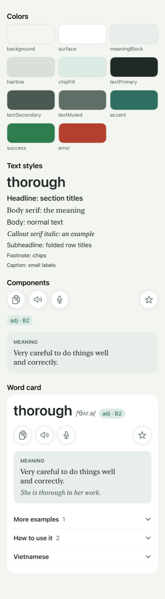
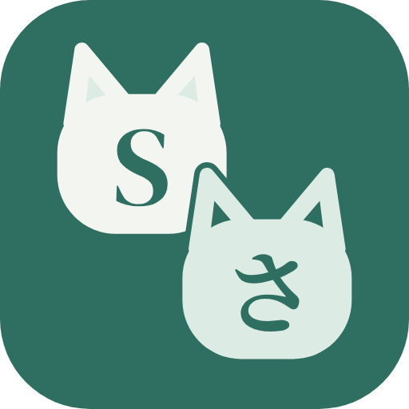
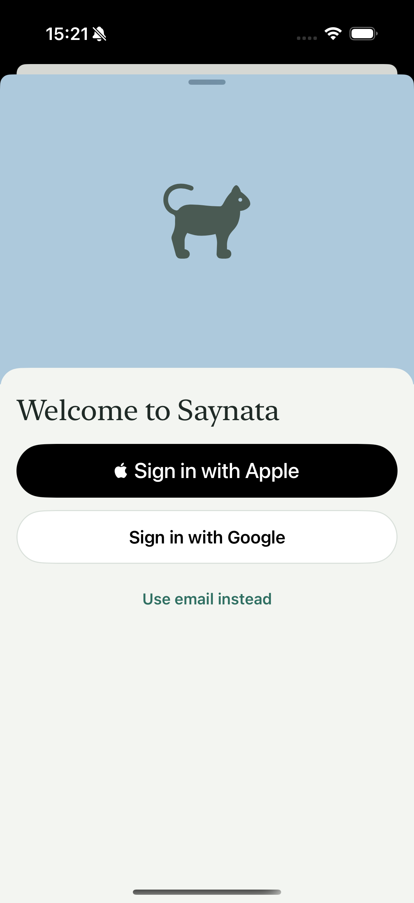
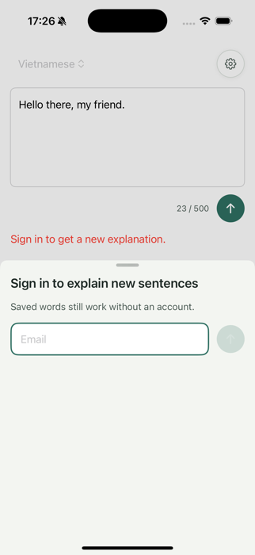
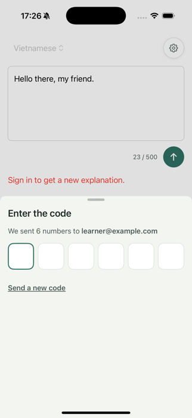

# Saynata design system

The design system lives in code. This page holds the rules. Read it before any UI work.

- Tokens: [Theme.swift](../../EnglishTranslation/EnglishTranslation/DesignSystem/Theme.swift)
- Color values: `EnglishTranslation/EnglishTranslation/Assets.xcassets/Theme/` (one Color Set per role)
- Components: [DesignSystem/Components/](../../EnglishTranslation/EnglishTranslation/DesignSystem/Components/)
- See everything at once: open [DesignSystemGallery.swift](../../EnglishTranslation/EnglishTranslation/DesignSystem/DesignSystemGallery.swift) and its Xcode preview

## Where the truth is

Code is the source of truth. To change a color, change the Color Set first, then this page.
There are no mockups in Figma or Claude Design. Build screens straight in SwiftUI with `#Preview`.

## Rules

1. **Follow Apple first.** When a question is not answered here, do what the
   [Human Interface Guidelines](https://developer.apple.com/design/human-interface-guidelines/) say.
   Do not invent a new style.
2. **Colors only from `Theme.Colors`.** No hex values or system colors (`.blue`, `.gray`) in views.
   Palette "Sage and Teal" (Option A in [color-schemes-2026-10-11.md](color-schemes-2026-10-11.md)).
3. **Accent in one small place per screen**: the send button, the level chip text, focus.
   Never for large areas.
4. **Light mode only.** `UIUserInterfaceStyle = Light` in `Info.plist`. To add dark mode later, add a
   "Dark" value to each Color Set and remove that key. The dark values are already in the color report.
5. **Text uses Apple text styles only**, never a fixed point size, so Dynamic Type works
   ([HIG: Typography](https://developer.apple.com/design/human-interface-guidelines/typography)).

   | Use | Style |
   |---|---|
   | Headword | `.largeTitle` semibold |
   | Section title | `.headline` |
   | Meaning (the hero), the simple summary | `.body` serif (New York, 17 pt) |
   | Sentence the user typed (sentence card) | `.title3` serif |
   | Example sentence | `.callout` serif italic |
   | Folded row title | `.subheadline` semibold |
   | Chip | `.footnote` medium |
   | Small label ("MEANING", group headings) | `.caption` semibold, uppercase |
   | Example level label ("easy") | `.caption` semibold |
   | Sense number | `.footnote` semibold |
   | Grammar pattern | `.body` medium |

6. **Buttons are icon-only and 44 pt** (`IconButton`). 44×44 pt is Apple's minimum tap target
   ([HIG: Accessibility](https://developer.apple.com/design/human-interface-guidelines/accessibility)).
   Every icon button has an accessibility label. Icons are SF Symbols
   ([HIG: SF Symbols](https://developer.apple.com/design/human-interface-guidelines/sf-symbols)).
7. **Spacing and radius only from `Theme.Spacing` and `Theme.Radius`.** Spacing is on a 4 pt grid.
8. **Meaning first, translation last** (CLAUDE.md "Product rule"). The `MeaningBlock` is the hero.
   Vietnamese is a `FoldedRow` at the bottom, closed by default (Settings > Show translation can change this). One folded row open at a time.
9. **Fold the details** (progressive disclosure: show what most people need, hide the rest behind one tap).
   On the word card each sense is a card with its number and explanation; Examples, Grammar and Vietnamese
   are folded rows, all closed, with no counters.
10. **Never use color alone to mean something.** A wrong word in the speaking score is red *and*
    underlined or marked with an icon ([HIG: Color](https://developer.apple.com/design/human-interface-guidelines/color)).

## Logo (TASK-95)

Two cat heads on a teal tile: a light cat with a serif Latin "S" and a sage cat with the Japanese "さ" (sa).
Why: doc-7, Design, 10-23. Colours are `Theme.Colors` only: Accent tile, Background and ChipFill cats.

- Master drawings: [docs/design/logo/](logo/) (`saynata-logo.svg` with the round tile, `saynata-icon-ios.svg` square,
  `saynata-icon-mac.svg` with margin and shadow, `saynata-menubar.svg` one-colour template, `saynata-cats.svg` no tile).
- Do not edit the PNGs or SVGs by hand. Change [build_logo.py](../../scripts/logo/build_logo.py) and run it: it draws
  every file (iOS and Mac app icon, menu-bar image, extension icons and selection button, Google consent logo).
- The letters are outlines from two SIL Open Font License fonts, DM Serif Display ("S") and Noto Serif JP Bold ("さ").
  The fonts are not in the repo; the script's docstring says where to get them.
- Smallest size: 16 px (extension toolbar). There the letters disappear and the two cat heads carry the logo. The menu
  bar (18 pt) uses the cats without letters.
- The cats are inspired by a paid pixel-art pack (CatMegaBundle). No file from that pack is in the repo.

## Example level colors (TASK-36)

Small labels before an example sentence. The text uses the token color; the label background is the same
color at 14% opacity. Never color alone: the label also has the word ("easy", "medium", "harder").

| Token | Hex | Label |
|---|---|---|
| `Theme.Colors.levelEasy` | `#1F6B5F` (teal) | easy |
| `Theme.Colors.levelMedium` | `#8A5A00` (amber) | medium |
| `Theme.Colors.levelHarder` | `#B4432F` (coral) | harder |

## Components

| Component | Job |
|---|---|
| `IconButton` | Round 44 pt button: white with a hairline border, or accent fill (`isProminent`) for the one main action. `size: .compact` draws a 32 pt circle inside the same 44 pt tap target, for rows of text (the speaker on a sense title, TASK-7). `style: .plain` draws only the icon, with no circle, border or shadow, inside the same 44 pt tap target; `isActive` makes it accent-coloured (the example speaker at the right edge of line 1, `stop.fill` while playing, TASK-48) |
| `LevelChip` | Pill with word type and CEFR level, for example "adj · B2" |
| `SenseTitleRow` | Title of a word-card sense: number in a circle, simple explanation (serif) with the level chip below it, small speaker on the right |
| `FormPill` | Tinted pill with a "return" arrow under the headword when a form was typed: "past tense of run /rʌn/" |
| `ExampleLevelLabel` | Small tinted label (easy, medium, harder) before an example sentence |
| `MeaningBlock` | Tinted box with the "Meaning" label, serif meaning, and one optional example |
| `FoldedRow` | Row that opens and closes (the word card uses no counts); the parent decides which row is open |
| `cardSurface()` | View modifier: padding, surface color, hairline border, card radius. The sentence cards use it |
| `SentenceCard` | The sentence result (TASK-41, redone in TASK-89.2, mockup Option B): **one** `cardSurface()` with the sentence the user typed (serif `.title3`) and its Listen `IconButton`, a `HairlineDivider`, the simple summary (serif `.body`) with its own Listen and the caption "In simple words" (`.caption`, `textMuted`), then the target language as a closed `FoldedRow`, last. One icon-only Copy button sits under the card on the right and copies the original. While the answer streams, the original shows at once, a spinner stands where the summary will be, and the folded row appears at the end, so nothing jumps. `Views/Sentence/SentenceCard.swift`; in the gallery |
| `SentenceTextView` / `SelectableSentenceText` | One sentence of serif text (TASK-89.2) where **every word has a light dotted underline** (`textMuted`). A tap highlights the word (`chipFill` background, accent text) and opens the word sheet. On iOS it wraps a `UITextView` (SwiftUI's `Text` cannot report a selection); on the Mac it is a `Text` with links. The system edit menu is off; Copy lives in the popup |
| `SentencePartPopup` | The popup for a selected part (TASK-89.2): a SwiftUI popover under the selection (arrow, `surface` background) with a sparkle crumb and the part in quotes, its simple summary (serif `.body`, words tappable), the caption "In simple words" with compact Listen and Copy `IconButton`s, and the target language as a closed `FoldedRow`. Opens when the selection stops changing for 0.4 s (two characters or more; one whole word opens the word sheet instead); a tap outside closes it. iOS only for now. In the gallery |
| `SettingsView` | The Settings sheet (TASK-29): native `List`. An "Account" section on top (TASK-70): signed out one **Sign in** row; signed in the email, **Sign out** and **Delete account** (error colour, confirmation dialog). These are list rows with text, not buttons (rule 6 is about buttons). Then the "Show translation" section with a checkmark list. Opened by the icon-only hamburger button (`line.3.horizontal`) at the top left of the home screen (TASK-97). Not a component to reuse; it lives in `Views/Settings/` |
| `CodeBoxes` | Six boxes for a one-time code (TASK-70). It is **one** `TextField` (number pad, `.textContentType(.oneTimeCode)` so Mail fills it) drawn as boxes: the field sits on top of the boxes with clear text and caret. The next box gets the accent border (focus). Used only by the sign-in sheet |
| `SignInSheet` | The sign-in bottom sheet (TASK-70, redone in TASK-96, mockup A of 2026-10-23): grabber, large detent. Top 300 pt: `SignInCatRoom`, the pixel-art room on `Theme.Colors.roomSky` with the cat asleep in its bed, "z z" and a rolling ball. Below, on `background` with a 20 pt top radius that overlaps the picture: the serif title "Welcome to Saynata", then on iOS two **equal full-width pills** (Sign in with Apple, black; Sign in with Google, white with a hairline border; both keep their words because the providers' brand rules ask for them) and a "Use email instead" accent text link. The link shows the email step (field, round icon-only send button `IconButton` "Send code", a plain back chevron, "Email me a link instead" link), then the code step (`CodeBoxes`, "Send a new code" **text link**). The Mac has no Apple or Google button and starts at the email step. Errors are a red `exclamationmark.circle` line. Lives in `Views/Account/`. Without the paid cat pack the picture is a still `cat.fill` on the sky colour:  Older steps:   |
| `CatSpriteView` | An animated pixel-art sprite from the paid cat pack (TASK-96): `.sleep` (4 frames), `.idle` (10 frames, for the Settings profile card), `.ball` (5 frames). `size` should be a whole multiple of the pixel size (64 pt for 32 px) so pixels stay square; `fps`; optional `roll: CatSpriteRoll(distance:duration:)` moves it back and forth. **Cheap on purpose**: the sheet is decoded once and shared (`CatSpriteImageCache`), each sprite is one `CALayer` whose frames switch with a discrete `CAKeyframeAnimation` on `contentsRect` (nearest filter), so SwiftUI never redraws per frame. The animation is removed when the view leaves the window, and with Reduce Motion the first frame stands still. Hidden from VoiceOver and never takes a tap. One engine (`CatSpritePlayer`) for iOS (`UIViewRepresentable`) and macOS (`NSViewRepresentable`). The PNGs are **not in git** (paid pack, public repo): `scripts/install-cat-assets.sh` copies them and a build phase puts them in the app. Without them it shows `sheet.fallbackSymbol` (`cat.fill` in `textSecondary`; nothing for the ball). In the gallery. `DesignSystem/Components/` |
| `CharacterCounter` | "41 / 500" in the composer. It shows only from 450 characters. Over the limit it is red and says "Make it shorter." (words too, not only color) |
| Composer card | The home input (TASK-97, `TranslateInputView`): **one** white `surface` card, `Theme.Radius.card`, hairline border (accent border while it has the keyboard, rule 3). Inside: a `TextField` (`.body`, 2 to 6 lines, placeholder "Type a word or a sentence"), then a bottom row: the target-language **chip** (`chipFill` capsule, `.footnote` medium, a menu) at the left; the `CharacterCounter` (only near the limit) and the round accent send `IconButton` (`arrow.up`, "Explain") at the right. The screen behind is `Theme.Colors.background`. Above it: a hamburger `IconButton` (Settings) at the left and the History `IconButton` at the right, no logo or title |
| `HairlineDivider` | One-pixel line in the hairline color. Use it, not `Divider().overlay(...)`, which flickers while scrolling |

Add a new component only when two screens need the same thing. Add it to the gallery in the same change.
