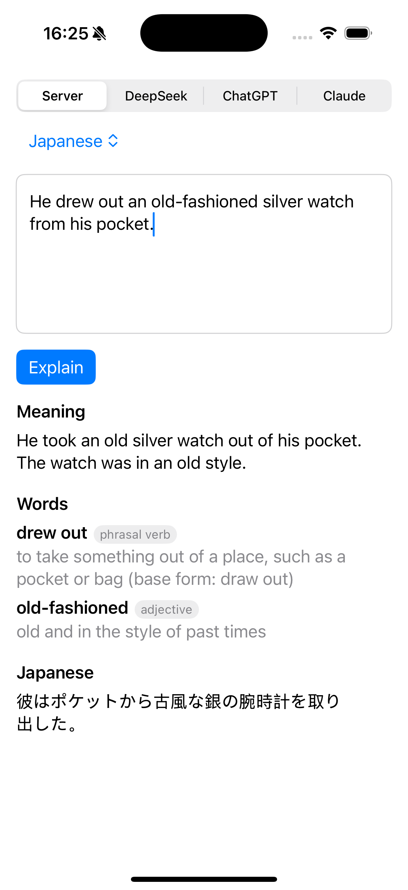

# Report: remove level, connect the iOS app to the Java backend

Date: 2026-10-09 · Result: **done, all tests pass, verified end to end in the simulator**

## Summary

| | Result |
|---|---|
| Level picker removed | Yes. `EnglishLevel` is gone from the app, the prompt and the tests. |
| App talks to the Java API | Yes. A new **Server** provider (now the default) calls `POST /api/translations`. |
| Translation language | A new picker with 9 languages (`vi en ja ko zh th fr es de`), sent as `targetLang`. |
| Backend tests | **13 / 13 pass** (`./mvnw clean test`) |
| iOS unit tests | **17 / 17 pass** (iPhone 16 Pro simulator, iOS 18) |
| End-to-end checks | **4 / 4 pass** (real app → real backend → Claude Haiku 5.5 → Postgres) |



---

## 1. Why the backend had to change first

The app shows an **Explanation** for each sentence: *Meaning*, *Words*, then the translation at the
bottom. The backend only returned a translation string. So the backend now returns the same shape
the app already decodes:

```json
POST /api/translations
{ "text": "He drew out an old-fashioned silver watch from his pocket.", "targetLang": "ja" }

200 OK
{ "text": "...", "targetLang": "ja", "cached": false,
  "explanation": {
    "meaning": "He took an old silver watch out of his pocket. The watch was in an old style.",
    "words": [ { "word": "drew out", "partOfSpeech": "phrasal verb", "meaning": "... (base form: draw out)" },
               { "word": "old-fashioned", "partOfSpeech": "adjective", "meaning": "old and in the style of past times" } ],
    "translation": "彼はポケットから古風な銀の腕時計を取り出した。" } }
```

Only `translation` depends on `targetLang`. `meaning` and `words` are always simple English.

## 2. Changes

### Backend (`backend/`)

| File | Change |
|---|---|
| `translation/Explanation.java` | New record, same JSON shape as the app's `Explanation`. |
| `claude/ClaudeService.java` | `translateSentence` → `explainSentence`. Prompt asks for meaning, words and translation. No level: "difficult words" means difficult for a B1 learner. |
| `translation/TranslationService.java` | Saves and reads back the whole explanation. |
| `translation/TranslationResponse.java` | Returns `explanation` instead of `translation`. |
| `db/migration/V3__add_explanation_to_sentence_translation.sql` | Adds `meaning` and `words_json` columns. |
| `application.properties` | `prompt-version` `v2` → `v3`. The answer shape changed, so old rows are not reused. |

### iOS app (`EnglishTranslation/`)

| File | Change |
|---|---|
| `Translation/EnglishLevel.swift` | **Deleted.** |
| `Translation/TargetLanguage.swift` | New enum. Codes match `TargetLanguage.java`. |
| `Network/BackendClient.swift` | New. Calls the backend; shows Spring's `detail` message on errors. |
| `Network/Provider.swift` | New `server` case, first in the list. |
| `Network/Translating.swift` | `explain(_:translatingTo:)` takes a `TargetLanguage`; level removed from the prompt. |
| `Network/TranslatorFactory.swift` | Builds `BackendClient` for `.server`. |
| `Config/AppConfig.swift` | `backendBaseURL()` reads `BackendBaseURL` from Info.plist. |
| `Info.plist` | `BackendBaseURL = http://localhost:8081`; `NSAllowsLocalNetworking` so plain HTTP to localhost is allowed. |
| `Stores/TranslationStore.swift` | `level` removed; `targetLanguage` is now a `TargetLanguage`; default provider `.server`. |
| `Views/.../TranslateOptionsView.swift` | Level picker replaced by a "Translate into" menu. |
| `Views/Translate/TranslateView.swift` | Passes the new bindings. |
| `EnglishTranslationTests/EnglishTranslationTests.swift` | **Deleted** (it was Xcode's empty example test). |

## 3. Test cases

### Backend — 13 tests

| Test | What it proves | Result |
|---|---|---|
| `CacheKeysTest` × 3 | Normalising and key building | Pass |
| `TranslationServiceTest.secondRequestComesFromCacheWithoutCallingClaude` | Same sentence with messy spacing → 1 Claude call | Pass |
| `TranslationServiceTest.cachedExplanationIsReadBackTheSame` | Meaning + words + translation survive a DB round trip | Pass |
| `TranslationServiceTest.eachLanguageIsCachedSeparately` | `vi` and `ja` → 2 rows, 2 answers | Pass |
| `TranslationControllerTest.languageCodeIsReadAndReturned` | JSON in/out uses `"ja"`, `explanation.*` fields present | Pass |
| `TranslationControllerTest` × 4 more | Blank text, unknown language, missing language, word with a space → 400 | Pass |
| `WordServiceTest`, `BackendApplicationTests` | Word cache; app context starts | Pass |

### iOS — 17 tests

| Test | What it proves | Result |
|---|---|---|
| `BackendClientTests.postsTextAndLanguageCodeToTranslations` | `POST /api/translations`, JSON body `{"text", "targetLang": "ja"}` | Pass |
| `BackendClientTests.decodesTheExplanation` | A real backend reply decodes into `Explanation` | Pass |
| `BackendClientTests.serverErrorShowsItsDetail` | 502 → the server's own message is shown | Pass |
| `BackendClientTests.errorWithoutBodyShowsStatus` | 500, empty body → "status 500" | Pass |
| `BackendClientTests.unexpectedJSONThrowsDecodingError` | Old/wrong response shape fails loudly | Pass |
| `TargetLanguageTests.codesMatchTheBackend` | The 9 codes match the Java enum | Pass |
| `TranslationStoreTests.passesSelectedLanguage` | Picker choice reaches the translator | Pass |
| `TranslationStoreTests.defaultsToServerAndVietnamese` | New defaults | Pass |
| `TranslationStoreTests.sendsTrimmedText` | Input is trimmed before sending | Pass |
| `TranslationStoreTests` × 5 more | Empty input, success, translator error, missing key, provider choice | Pass |
| `ExplanationDecodingTests` × 3 | Direct-provider JSON parsing (unchanged) | Pass |

`BackendClient` is tested with a fake `URLProtocol`, so the real networking code runs with no server.

### End to end — 4 checks (simulator + real backend + Claude)

| Check | Expected | Result |
|---|---|---|
| Server + Japanese, tap Explain | Meaning, 2 words, Japanese translation shown; 1 row in Postgres with `target_lang = ja`, `prompt_version = v3` | Pass (screenshot above) |
| Tap Explain again | Same answer from cache, no new row | Pass (still 1 row; 6 ms reply) |
| Backend stopped, tap Explain | Clear error, no crash | Pass: "Could not connect to the server." |
| Level picker | Not on screen | Pass |


## 4. Problems found on the way

1. **Old backend still running on port 8081** (started 14:12, before today's changes). It returns 500
   for the new request shape. I left it running and tested on port 8082. **Restart it** to get the new code.
2. **The app installed in the simulator points to port 8082** (a temporary test build). The source
   `Info.plist` is back to 8081. **Run the app from Xcode once** to install the normal build.
3. **SwiftUI menu opens late in the simulator.** A tap right after opening the menu picked
   "Japanese" by accident. Not a bug in the app, only in fast automated tapping.
4. **`URLProtocol` gets the request body as a stream**, not `httpBody`. The test stub reads the
   stream; worth remembering for future network tests.

## 5. Follow-ups (not done)

| Item | Why it matters |
|---|---|
| Remove the DeepSeek / ChatGPT / Claude providers, or keep them only in Debug builds | Their API keys are inside the app bundle, and anyone can extract keys from an `.ipa`. The Server provider needs no key. |
| Local cache on the phone (`cache.sqlite`, spec R2) | The app still asks the backend every time; offline use needs this. |
| Physical iPhone | `localhost` only works in the simulator. A real phone needs the Mac's LAN IP (e.g. `http://192.168.1.10:8081`) in `BackendBaseURL`. |
| Two languages under one sentence | Currently one language per request; the app would send two requests. |
| Commit | Nothing is committed. The iOS repo already had staged changes, so review with `git status` first. |

## 6. How to run the tests yourself

```bash
cd backend && ./mvnw clean test
```

```bash
cd EnglishTranslation && xcodebuild test -project EnglishTranslation.xcodeproj -scheme EnglishTranslation -destination 'platform=iOS Simulator,name=iPhone 16 Pro' -only-testing:EnglishTranslationTests
```

Or in Xcode: **⌘U**.
