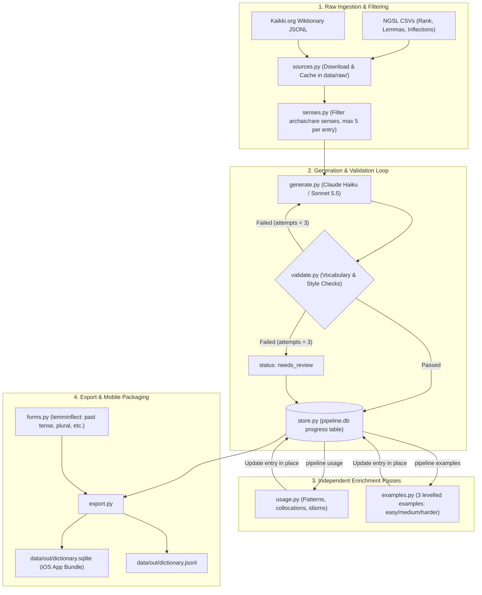
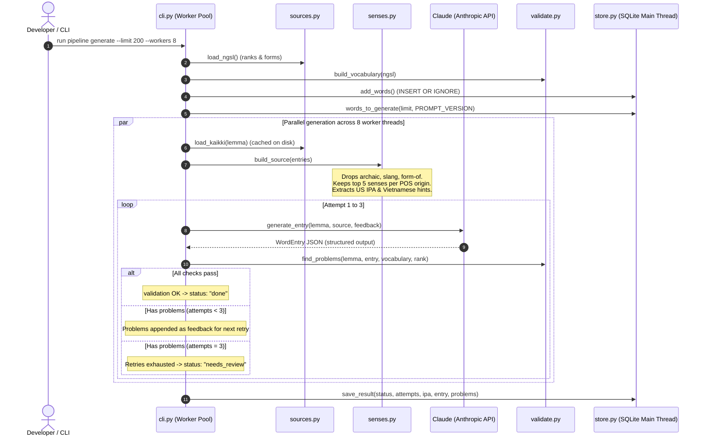
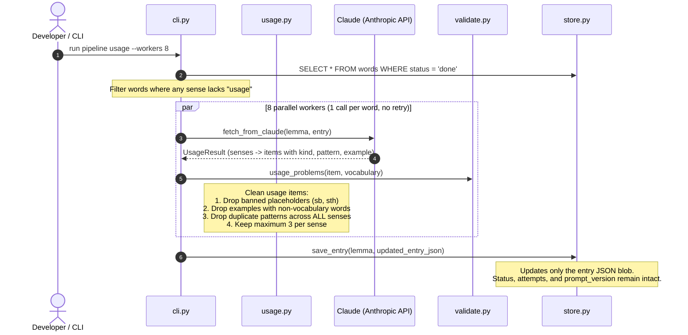
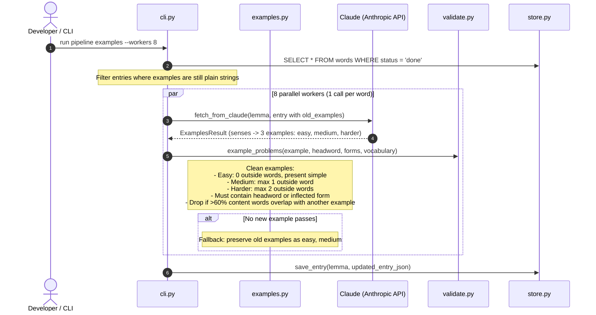
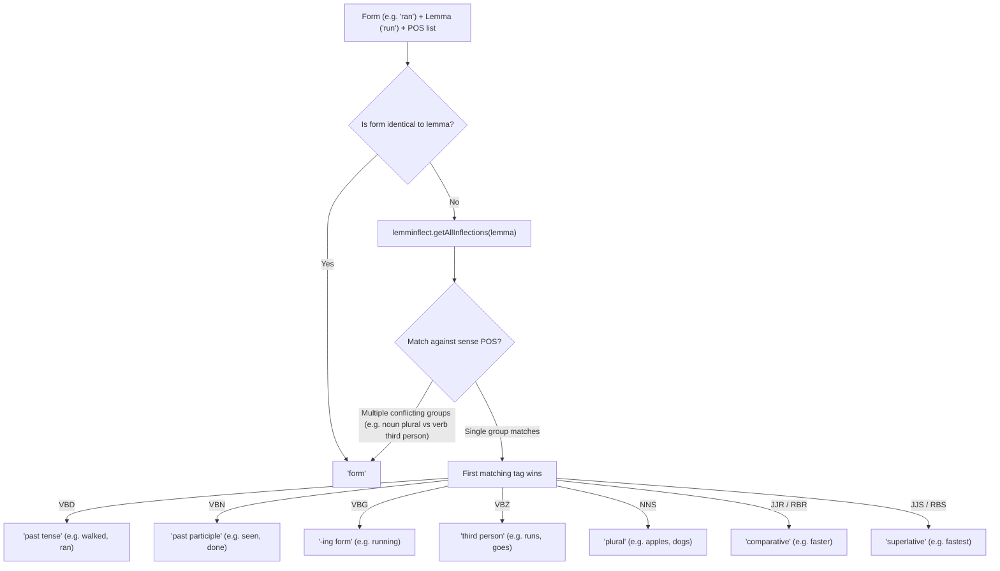
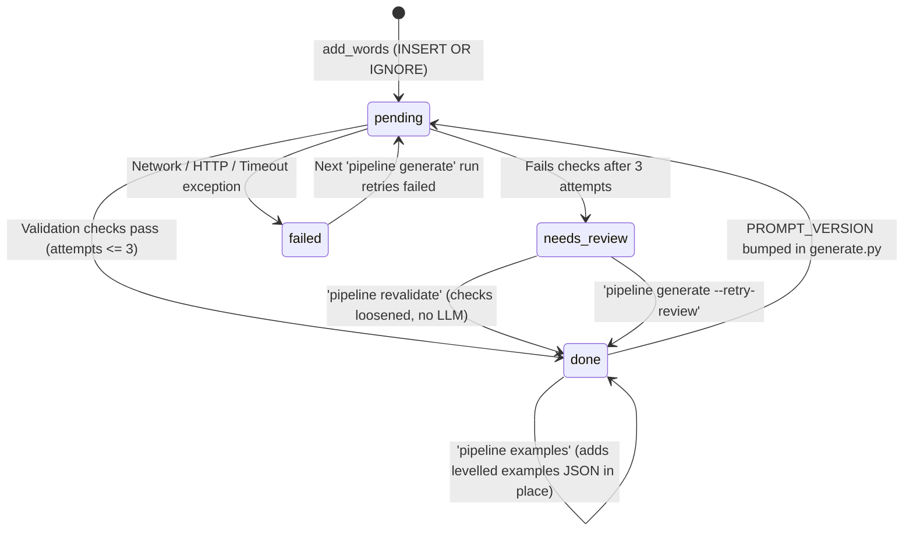
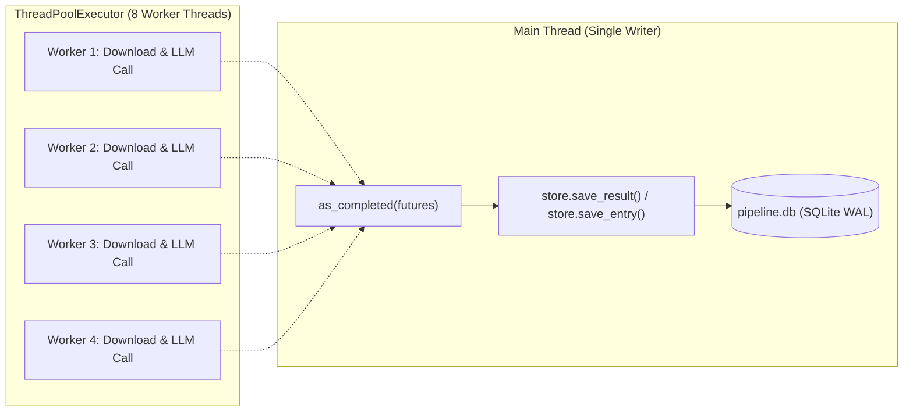
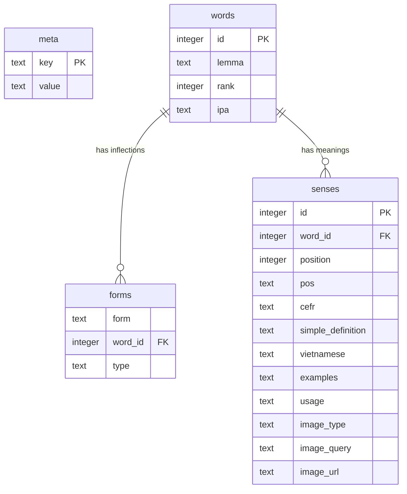

# Dictionary Pipeline: Architecture and Workflows

> **Scope**: Detailed design, workflows, and data pipelines for `pipeline/`, building the offline dictionary database (`dictionary.sqlite`) bundled in the iOS application.

---

## 1. System Overview & Data Flow

The dictionary pipeline is an offline, multi-stage processing system. Its goal is to take frequency-ranked English word lists and Wiktionary entries, synthesize simple English definitions with Vietnamese translations, enrich them with levelled examples and usage patterns, and export them into an indexed SQLite database for offline mobile lookup.

### End-to-End Pipeline Architecture

---

## 2. Core Workflows Step-by-Step

### Workflow A: Primary Word Generation (`pipeline generate`)

This workflow extracts source words, queries Claude using structured JSON outputs, and validates definitions against a strict **Defining Vocabulary**. If checks fail, it feeds errors back to Claude for correction up to 3 attempts.

#### Key Rules & Algorithms in Primary Generation

1. **Sense Filtering ([senses.py](src/pipeline/senses.py))**:
   - Skips non-target parts of speech: `name`, `character`, `symbol`, `prefix`, `suffix`, `phrase`, `proverb`.
   - Skips noise tags: `archaic`, `obsolete`, `dated`, `rare`, `dialectal`, `form-of`, `abbreviation`.
   - Capped at **5 senses per entry** (per etymological origin/POS), ensuring homographs like *bank* (river bank) and *bank* (financial institution) are both retained.
   - Selects US / General American IPA first.

2. **Defining Vocabulary Validation ([validate.py](src/pipeline/validate.py))**:
   - Definitions are restricted to ~2,800 NGSL lemmas + their inflected forms.
   - Allows numbers, days of the week, months, grammatical terms, and 58 curated everyday words (`container`, `rude`, `queen`, `tv`, etc.).
   - Possessive `'s` is stripped before vocabulary lookup (`person's` -> `person`).
   - Max length: **20 words per definition**.
   - No self-referential headword in definition (exempt only for the top 100 grammar words such as *a*, *the*).

---

### Workflow B: Usage Enrichment Pass (`pipeline usage`)

The usage pass adds collocations, sentence patterns, phrasal verbs, and idioms to entries that are already in `done` status, **without modifying existing definitions, examples, or Vietnamese meanings**.

#### Usage Pattern Tokenization & Deduplication

In [`usage.py:pattern_words`](src/pipeline/usage.py), patterns are converted into tokens to detect cross-sense duplicates:
* `depend on + something` $\rightarrow$ `("depend", "on", "SOMETHING")`
* `depend on + someone` $\rightarrow$ `("depend", "on", "SOMEONE")`
* Trailing `s` is stripped to match inflections (`depends` $\rightarrow$ `depend`).
* Sub-pattern matching prevents overlapping or redundant entries (e.g., `make a decision` suppresses redundant broader patterns).

---

### Workflow C: Levelled Examples Pass (`pipeline examples`)

The examples pass upgrades every sense to have exactly 3 levelled example sentences ordered from easy to hard.

---

### Workflow D: Inflected Forms Labeling (`forms.py`)

When exporting to the mobile SQLite database, each inflected form of a lemma is mapped to a grammatical label using `lemminflect`:

---

## 3. Database State Machine & Concurrency

### Pipeline Progress Lifecycle (`data/pipeline.db`)

Progress is tracked per lemma in `pipeline.db` so any command can be interrupted and safely resumed at any time.

### Threading & Concurrency Architecture

SQLite does not support concurrent write operations from multiple Python threads without locking errors. The pipeline separates network I/O from database writes:

---

## 4. Export Schema: `dictionary.sqlite` for iOS

When `pipeline export` runs, it packages all `done` records into a normalised SQLite database bundled directly inside `EnglishTranslation/Resources/dictionary.sqlite`.

* **Indexes**: Case-insensitive collation indexes (`idx_words_lemma ON words(lemma COLLATE NOCASE)`, `idx_forms_form ON forms(form COLLATE NOCASE)`).
* **Speed on Mobile**: An iOS search for *"ran"* hits `forms` in $<1\text{ ms}$, retrieves `word_id`, and loads the `run` lemma entry without network round-trips.

---

## 5. CLI Command Reference & Safety Levels

| Command | LLM Calls | Cost Profile | Description |
|---|---|---|---|
| `uv run pipeline preview <word>` | 0 | Free | Inspect Wiktionary senses, IPA, and prompt payload without calling Claude. |
| `uv run pipeline try <word>` | 1–3 | ~$0.008 | Test generation and validation on a single word; outputs to stdout, saves nothing. |
| `uv run pipeline generate --limit N` | ~1.5 per word | ~$0.012 / word | Generate batch of words by frequency rank using 8 parallel worker threads. |
| `uv run pipeline revalidate` | 0 | Free | Re-evaluate `needs_review` words against updated rules without calling Claude. |
| `uv run pipeline usage --dry-run --words ...` | 1 per word | ~$0.003 / word | Test usage pattern extraction; outputs results without writing to DB. |
| `uv run pipeline usage` | 1 per word | ~$8.00 total | Run usage pass for all `done` words lacking usage; resume-safe. |
| `uv run pipeline examples --dry-run --words ...` | 1 per word | ~$0.003 / word | Test levelled examples extraction; outputs results without writing to DB. |
| `uv run pipeline examples` | 1 per word | ~$8.00 total | Run examples pass for all `done` words lacking levels; resume-safe. |
| `uv run pipeline report` | 0 | Free | Display status counts and current validation errors. |
| `uv run pipeline export` | 0 | Free | Build `data/out/dictionary.sqlite` and `data/out/dictionary.jsonl`. |
